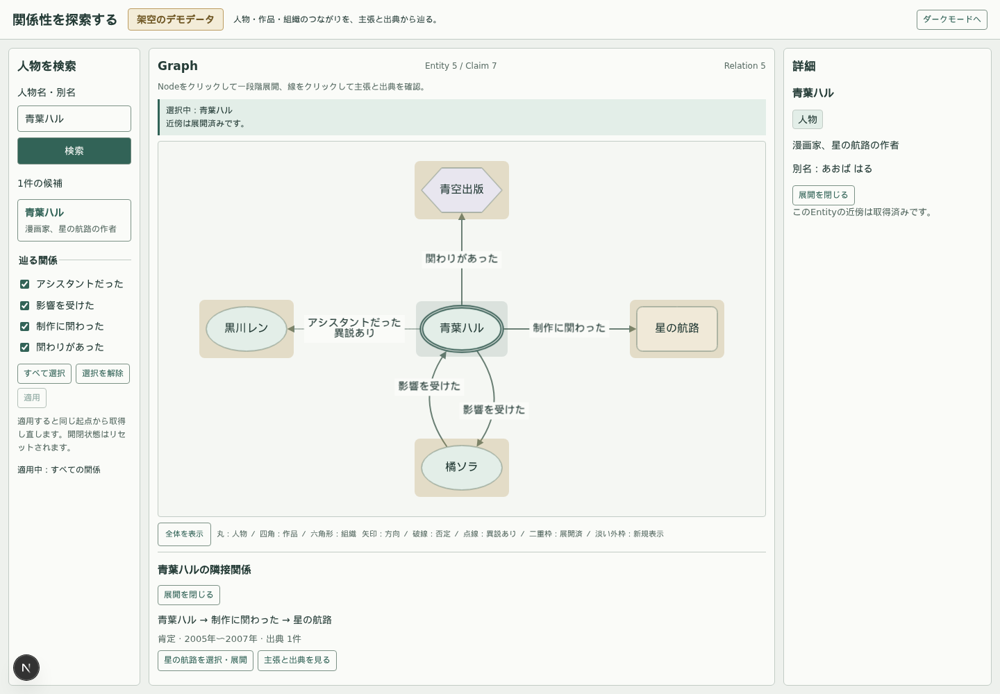
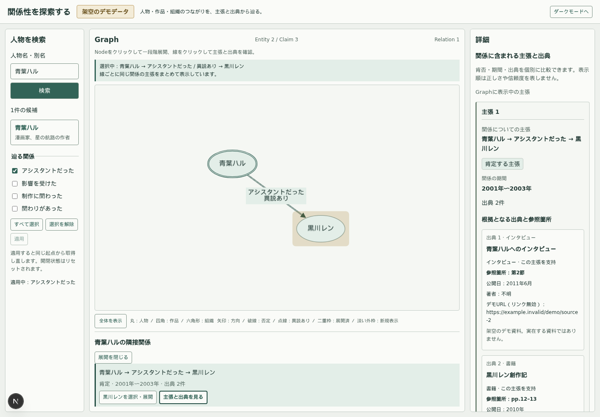
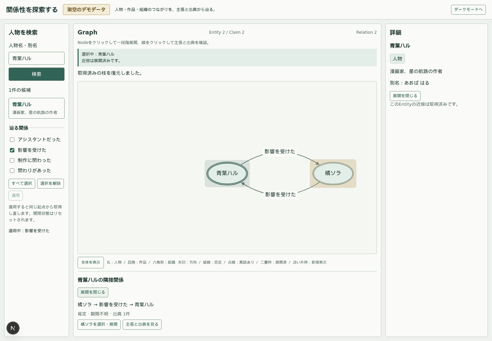

# 最小の条件付き探索の実施記録

2026-10-03。現行仕様は [ARCHITECTURE.md](../../ARCHITECTURE.md)。採用UX・API契約は [CONDITIONAL_EXPLORATION_PHASE.md](../../design/CONDITIONAL_EXPLORATION_PHASE.md)。

## 実装の範囲

検索パネルに関係選択を追加。チェック編集と適用を分け、無条件・部分集合・空集合を区別する。既存predicateの意味、Neo4jモデル、Claim / Citation / Source、fixture、返却型は変更していない。

条件変更は同一起点で新しい探索世代として再取得する。開閉意図と受理範囲・cursor・通信を捨て、選択を起点へ戻す。条件が同じなら再取得しない。検索で起点を変えても適用条件を維持する。多条件のキャッシュや旧枝の復元は実装しない。

新しい探索文字列はlib/i18n/exploration.tsのlocale解決へ集約。今回はjaのみ、地域localeの基本言語・未対応localeからjaへフォールバックする。UI翻訳と条件・識別子を分離し、既存UI全体や知識名称の多言語化は追加していない。

## 作成・変更ファイル

| 範囲 | 主なファイルと責務 |
| --- | --- |
| 条件型・文字列 | lib/domain/exploration.ts：集合の正規化・条件キー・predicate一致。lib/i18n/exploration.ts：今回の表示・エラー文言 |
| API | lib/server/http.ts・neighbor-cursor.ts・queries.ts・graph.ts、app/api/entities/[id]/neighbors/route.ts：入力検証、条件スコープcursor、LIMIT前評価 |
| 通信・state | lib/client/api.ts・graph-state.ts・use-graph-explorer.ts：条件付き要求、単一条件スコープ、受理検証、旧通信破棄 |
| UI | components/RelationFilter.tsx・Explorer.tsx・Explorer.module.css、GraphCanvas.tsx・RelationsList.tsx・ClaimDetails.tsx |
| テスト | tests/domain.test.ts・http.test.ts・ui-state.test.tsx・api.integration.test.ts・e2e/explorer.spec.ts |
| 文書 | README、PROJECT_CONTEXT、ARCHITECTURE、docs一覧、探索レビューと棚卸しの状態、今回の契約と実施記録 |

## APIと主要Cypher

API追加はneighborsのpredicatesのみ。CSVを正規化し全4種は無条件、空文字は空集合。未知ID・重複query・未対応queryは400。条件付きcursorの不正・起点や条件の不一致も400。無条件UUID cursorを維持する。

主要クエリの対象選択:

```cypher
MATCH (:Entity {id: $id})<-[:SUBJECT|OBJECT]-(c:Claim)
WHERE c.visibility = 'published'
  AND ($predicates IS NULL OR c.predicate IN $predicates)
  AND ($after IS NULL OR c.id > $after)
WITH DISTINCT c ORDER BY c.id LIMIT $take
```

$afterは検証済みcursorから復元したClaim UUID、$takeはlimit+1。ユーザー入力をクエリ文字列に補間しない。両方向・肯否・一段階・中心と全端点・Claim単位ページングを維持する。空集合の一致なしは孤立と区別する。

## 判断と理由

- Entity＋条件を単一スコープと世代で識別する。条件別の永続辞書や汎用クエリ型を先に作る必要はない。
- 旧条件へ戻した時は新規取得。条件別の受理ページ・開閉意図を残す方式は復元・予算・失効の契約が増えるため今回採用しない。
- 同一起点の条件変更は既存Nodeの位置を保存して再利用し、pan/zoomも維持する。検索からの起点選択は従来のリセット。通信の世代変更と、全体配置のリセットを同一視しない。
- 個別Claimの比較は全公開Claimのまま。Graph未取得と条件外の表示を分け、詳細取得からGraphへ自動追加しない。predicate条件だけでは同一Relation内の全Claimは同じ条件判定になる。
- API統合テストにAPI_TEST_BASE_URLを追加し、起動済みdevを使用可能にした。Next devの同一ディレクトリの二重起動を避ける。DB停止・再開テストは他のブラウザ確認と分ける。

## 検証とブラウザ確認

最終結果：通常テスト83件、実DB統合20件（API19＋seed1）、Playwright全20件成功。typecheck / lint / build / git diff --check成功。スクリーンショットを実際に確認し、既存三列・テーマ・関係の意味表現と、選択・詳細の可読性を維持した。

Playwright全実行後、影響関係の子Nodeの追加ページ受理を待ち、切断循環の閉鎖・受理範囲の復元を明示検証するよう追加ケースを補強。その1ケースも再実行で成功した。

実行コマンド（Node 24を使用）:

```bash
npm test
npm run typecheck
npm run lint
npm run build
API_TEST_BASE_URL=http://127.0.0.1:3210 npm run test:integration
GRAPH_TEST_REUSE=1 npm run test:e2e
GRAPH_TEST_REUSE=1 npm run test:e2e -- --grep '条件付きページング・編集待機'
git diff --check
```





追加ブラウザケースは、アシスタント3 Claimの1 Relation集約・全Claim比較と複数出典、OBJECT側展開・休止子孫復元、座標とpan/zoom、空条件と孤立の区別、条件付きページング・未取得Claimの比較、編集と適用の分離、双方向の影響と循環、遅い旧応答、条件内503と再試行を扱う。

初回API統合実行ではDB再起動直後、buildとの同時負荷下で追加条件クエリが503になった。APIのタイムアウトを緩めず、DB停止ケースを末尾へ配置して、機能ケースと停止・復旧ケースを分けて再検証した。初回ブラウザ全実行では新ケースの操作先に白石ミオのfixture IDを指定してしまい失敗した。橘ソラのIDへ修正し、アプリ機能の不具合とは分けて記録する。

## 残る課題

条件変更で旧枝を復元するUX、多条件キャッシュ、kind・期間条件、taxonomy・プリセット、複数起点、保存、全面翻訳は未実装。実データ規模の関連Claim詳細の予算、更新中のページング整合、由来・履歴・多言語名称の投入設計は別フェーズで必要。
