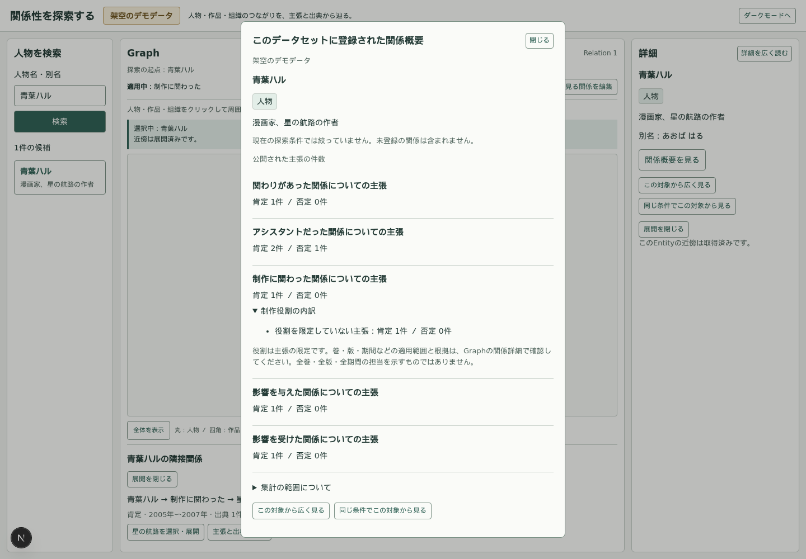
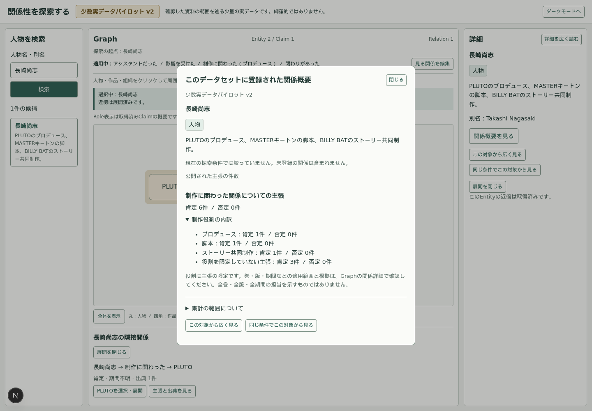
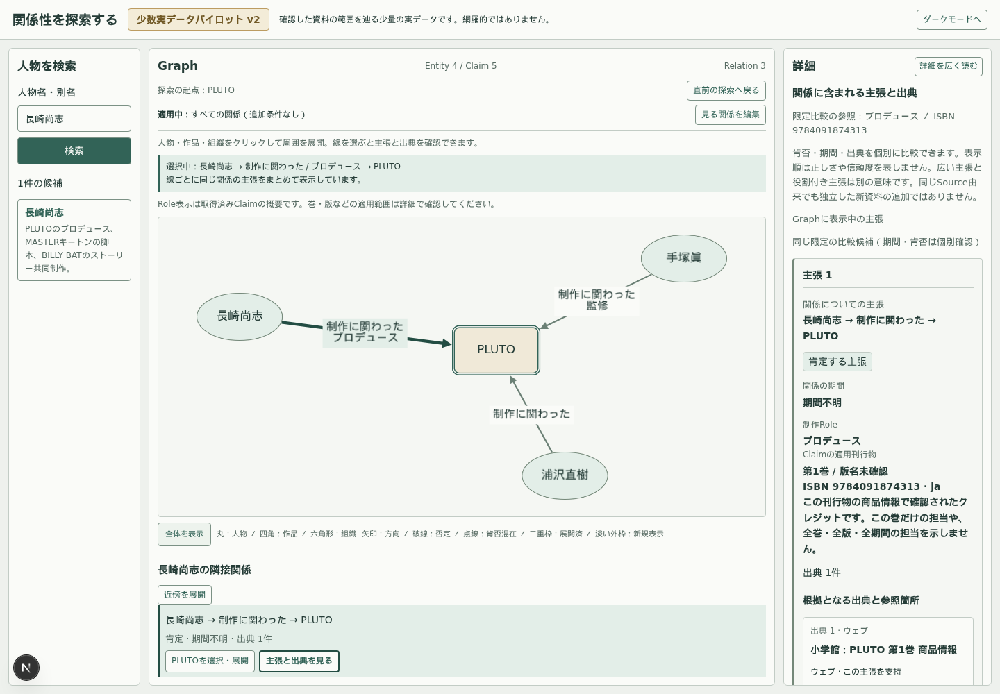

# Phase 08：最小の関係俯瞰・起点切替・直前探索復帰

2026-10-04。推奨案を採用し実装。現行契約は [ARCHITECTURE](../../ARCHITECTURE.md#phase-08関係概要起点切替直前探索への復帰)。DBモデル・Claim/Citation/Source・fixture・凍結pilot v1/v2・語彙・既存API契約は変更しない。専用APIを追加した。

## 実装

| 境界 | 変更 |
| --- | --- |
| domain / API | `entityOverviewSchema`、`GET /api/entities/{id}/overview`、公開・追加条件なし・Claim単位というscope |
| Query / service | Entity存在確認とSUBJECT/OBJECT別集計を一つの読取transactionで実行。各視点でDISTINCT Claim ID。Citation JOIN、LIMIT、探索条件を使用しない |
| 概要UI | `EntityOverview`のnative dialog。Entity基本情報、predicateの視点別主張・肯否件数。Role内訳と集計説明は任意の開閉内へ |
| 起点切替 | `RootActions`からhookの`switchRoot`へ。直接操作と概要経由は同じ遷移。概要成功は必須ではない |
| 復帰 | `captureExploration`で一件だけ保存。Canvasの`GraphView`境界で座標・pan/zoomを取得・復元 |
| 言語 | 新しい表示は`lib/i18n/entity-overview.ts`の安定キー／locale解決へ。ID・条件・件数から独立 |

概要対象は現在選択・起点とは別のstate。概要通信は専用controllerで取消し、Graph通信・条件編集のdraftを変更しない。明示ボタンではGraph不変。ダブルクリックは既存300ms判定へ接続し、未選択Nodeの初回選択・必要時展開を残し、二度目の開閉のみ抑止する。開始済みGraph取得は概要表示中も完了し得る。

native dialogはEscape・明示閉じる・再試行を提供し、開いた操作へfocusを戻す。Graph経由で開いた時はCanvasへ戻す。背面入力と待機ジェスチャーを止める。条件編集と同時に開く操作はnative modalのinertで防ぐ。

「広く見る」はpredicate/Roleをnull、「同じ条件」は確定値（空集合も含む）を保持。無条件時は重複する操作を省く。同一起点・同実効条件はno-op。検索候補選択は従来どおり条件維持。起点＋条件を一度に新世代へ渡し、新起点だけを取得する。旧通信・応答・cursor・受理ページ・open意図は新探索へ混ぜない。

復帰記録は概要を開いた時ではなく実際の切替直前に保存。起点・条件・受理済みcache/page/cursor・open意図・選択・表示/休止Node座標・pan/zoomを保持する。controller、通信、旧loading、検索語/結果、draft、概要、詳細の取得結果は保存しない。戻る時も新世代にし、未完了取得は中断表示＋明示再試行にする。別の切替で上書き、復帰で消費、検索候補選択・再mount・再読込で失効する。

予算は現在と直前各400 Entity/800 Claim、合計最大800/1600。一件の完全な受理範囲を保つため、今回は二つの探索を跨ぐ汎用LRUを作らず、既存上限を各探索へ適用した。保存上限超過時は保存せず復帰不可を通知する。表示上限100/200は変更しない。現在は同じ凍結datasetの画面内に限定し、時間による失効は導入しない。可変データ・認可導入時は版と認可の失効契約が必要。

受理直後でまだCanvasへ描画されていないNodeには保存座標がない。その場合、既知座標は固定し、既存追加配置ルールで不足だけを補う。座標が一つも残らない場合は初期配置とfitを使い、同じviewportの復元を保証しない。

## 集計と失敗

[実応答例](API_OVERVIEW_EXAMPLE.json)。青葉ハルのASSISTANT_OFは肯定2／否定1。C01の二つのCitationで件数は増えない。INFLUENCED_BYはsubject/objectの二行。孤立Entityは成功して空配列。公開対象外は含めない。行の合計を「人物数」「Edge数」「Source数」「重要性」へ変換せず、自己関係に備えて全体総数も表示しない。

v2長崎尚志は制作関与6主張（Role付き3／役割限定なし3）。Role条件でGraphが1 Claimでも概要は全6主張。PLUTOは制作関与5主張。これは役割の担当人数や全巻・全版・全期間の認定ではない。

400は不正UUID・query parameter、404は対象不存在、405はGET以外、500は不正保存データ等、503はDB接続不能・予算超過。失敗を0件に置き換えない。404では概要からの切替を無効化。それ以外の集計失敗では既知の対象から切替可能。DB停止時でも保存済みGraphへ戻る処理はDB通信を必要としないが、詳細・続きを読む取得は失敗し得る。

## 実ブラウザ

- 青葉ハルを制作関与だけで探索→概要でアシスタント、影響の両方向、組織の関係も確認→Escape→503を模擬→再試行→孤立Entityを確認。
- 黒川レンを実マウスでダブルクリック→選択/初回展開を残して概要→直接起点切替→戻る。手動Node位置、pan/zoom、選択の一致を検証。
- アシスタント条件を維持して別起点→直前復帰→広く見るで追加条件を解除。
- 概要404で起点切替不可。近傍応答保留中に切替→戻る→旧応答を排除→明示再試行で追加。
- 星の航路→白石ミオを展開し、子孫を明示閉鎖→祖先を閉鎖→青空出版の概要/直接起点→復帰→祖先を再開。閉じた子孫を自動で開かず、既存の共有範囲を維持。
- v2：長崎尚志をプロデュースで絞る→概要で脚本・ストーリー共同制作・役割無限定も確認→PLUTOの概要→広く見る→Role/刊行物/Citation/Source詳細→元のRole条件・選択へ復帰。
- v1の実在経路・影響条件・出典確認も回帰。全展開・合流・循環・上限・ページング・条件draft取消・テーマ・詳細幅等は既存demo/v2ケースで回帰。

画像を実際に読み、文字・内訳・刊行物限定の注意・Graphとの文脈を確認。Roleと説明を初期から全展開せず、戻る操作は起点行へ小さく配置した。

## 検証

| 検証 | 結果 |
| --- | --- |
| unit | 143件成功 |
| 実DB統合 | demo 21件、pilot v1 1件、v2 1件成功。テスト終了時のDB snapshot一致を確認 |
| Playwright | demo全25件、v1全2件、v2全6件成功。描画前の座標補完後に概要・復帰ケースを追加再確認 |
| typecheck / lint | 成功。語彙の既存warning一件は維持（意味レビューの比較注意、error 0） |
| build | 成功。新overview routeを含めNext production buildを確認 |

実行：`npm test`、`API_TEST_BASE_URL=http://127.0.0.1:3210 npm run test:integration`、`npm run pilot:integration`、`npm run pilot:v2:integration`、`GRAPH_TEST_REUSE=1 npm run test:e2e`、`npm run pilot:e2e`、`npm run pilot:v2:e2e`、`npm run typecheck`、`npm run lint`、`npm run build`。Node24とPlaywright用共有library pathを使用。ブラウザconfigとDB停止テストを直列に実行し、v1テストが生成する過去画像は原本へ戻した。

初回検証では並行実行の負荷で既存DB再起動のhealth待ちが失敗し、DB復旧前に開始したブラウザも失敗。復旧後に直列再実行して通過。新しいダブルクリックテストの押下時間が300msを超えていたため実イベント時刻で確認し、閾値内のマウス入力へ修正。既存ダブルクリックテストには今回追加した概要を閉じる手順が必要であり、期待を更新。Nextの空のroute announcerとerror alertが衝突するlocatorも対象を限定した。クリック契約・DBの読取予算・health待ち時間は変更していない。

## 残る点と次フェーズ

一般Entity検索へ進める状態。検索対象kind・同名判別・locale・検索条件と探索条件の分離・既存人物検索APIの互換契約を次に決める。今回のEntity Summary／概要／neighbors／起点切替・復帰は人物専用ではない。

現在は名前を知る人物か既存Graphからの入口であり、作品・組織を直接検索できない。概要から特定関係だけの探索へ一操作で進む導線はなく、必要なら既存条件編集で調整する。真の別分野データ・高次数集計の性能・更新/認可変更での復帰失効は未検証。多段履歴・保存・共有・分類・プリセットは今回の範囲外。
