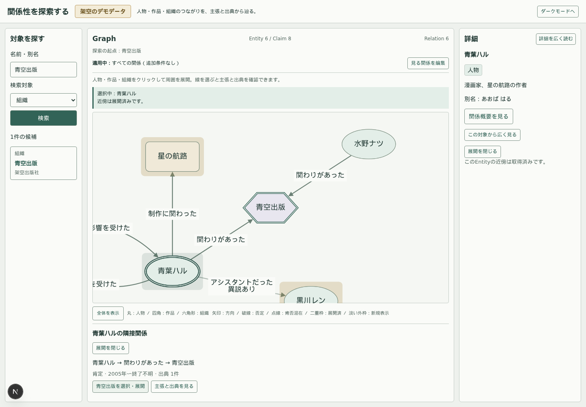
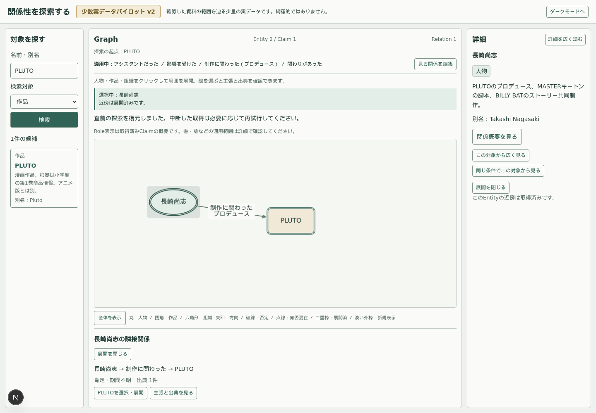

# Phase 09：既存Entity kindへの検索入口

2026-10-04。人物専用検索を、既存の人物・作品・組織へ一般化。知っている対象を探し、まず関係を辿り、必要なら条件を調整するPhase 07の流れを維持する。

## 採用契約と範囲

`GET /api/entities?q=...&kind=work&limit=10`。kind省略でperson / work / organizationすべて、指定すると検索候補だけを一種へ絞る。eventは現在のfixture・pilotに実例がなく、既存4 predicateにも適用端点がないため今回対象外。schemaから削除したわけではない。

qはtrim・NFKC・小文字化後1〜100 Unicode code point。空・欠落は400。limitは既定10、1〜20。未知／空kind、重複query、未対応queryを400にする。0件は成功の空配列。完全一致name／aliasを優先し、name・ID順で安定化。limit+1からhasMoreを判定する既存方式を維持し、全文検索や検索cursorは追加しない。

検索返却は既存EntityDetail（EntitySummary＋aliases）を再利用。searchNames・DB property・外部IDは露出しない。同じAPI経路を直接更新し、利用者が現在Webクライアントだけなのでversioning・互換shimを追加しない。GET以外405、DB停止503等の既存エラー処理は共通。

## UIと状態の境界

左は一つの「対象を探す」フォーム。「名前・別名」と「検索対象（既定すべて）」を提示し、検索種別の選択を必須にしない。候補は種別の文字、名前、説明、別名を表示。同名・同kind・同descriptionの場合だけIDも補助表示する。読み上げ名にも種別・別名を含め、判別が必要な場合は識別IDも含める。

kindはSearchPanelのローカルstate。検索対象変更では進行中検索をabortし候補をクリア、自動検索しない。候補取得／kind変更だけではGraph・選択・起点・predicate／Role・直前探索を変えない。旧検索応答はAbortSignalで排除する。検索語は探索起点や選択と同期させない。

候補の明示選択だけ既存chooseRootへ渡す。確定predicate／Role条件を維持し、新世代で対象を起点に一段階取得。旧通信・枝・一件履歴を破棄する既存契約を再利用。検索kindは探索state・conditionKey・cursorへ入れず、作品／組織から人物、人物から作品／組織を通常どおり辿れる。

Phase 08の関係概要・直接／概要経由切替・広く見る／同条件・復帰を変更しない。Graph配置・Relation集約・Role／publication scope・Claim／Source詳細も変更しない。新しい表示文言はlocale解決可能なlib/i18n/entity-search.tsへ置き、入口／dataset例文も調整。APIの名称言語モデルや全面翻訳は追加しない。

## 主な変更箇所

- domain/search：公開可能な検索kind定数。domain/api：検索候補へ既存aliases型を追加。
- server/http・queries・graph、entities route：kind入力検証、LIMIT前のパラメータ化kind条件、EntityDetail変換。
- client/api・SearchPanel・検索／入口／dataset locale resource・CSS Modules：一つの検索入口と候補識別。
- http／ui-state／実DB統合／Playwright：汎用検索と旧経路の回帰。人物専用のテスト期待と検索labelを更新。
- ARCHITECTURE・PROJECT_CONTEXT・README・docs入口：現行検索契約と実施履歴。

主要Cypherは既存検索の `e.kind = 'person'` を `e.kind IN $kinds` に変更。`any(name IN e.searchNames WHERE name CONTAINS $q)`、完全一致rank、ORDER BY rank/name/id、LIMIT $takeは維持する。kindとqは文字列連結せずパラメータとして渡す。

## 確認経路

- demo：青葉ハル検索→初期5 Entity / 7 Claim→関係概要。星の航路検索だけではGraph不変→作品起点4 / 3→青葉を追加展開7 / 9→青葉を広く見る5 / 7→直前作品探索へ7 / 9で復帰。
- demo：青空出版から3 / 2→組織側の概要→青葉を展開6 / 8。組織で検索しても人物・作品へ辿れる。
- demo：あおば はるのalias検索と別名表示、佐藤アキ二名の説明区別、work指定による0件。
- 実データv2：Master Keaton別名から作品候補を識別→PLUTO起点4 / 5→作品概要→プロデュース条件2 / 1→長崎尚志を選択・同条件起点2 / 1→作品探索へ復帰。さらに検索対象を人物へ変更し、浦沢直樹を選択。プロデュース条件を維持しても手塚治虫への影響関係が残り、Roleが非CONTRIBUTED_TOへ作用しないことを確認。
- Phase 07〜08の条件draft取消、開閉／休止子孫復元、ページング、上限、座標／pan／zoom、ダブルクリック、切替中の旧応答排除、概要0件／失敗、Claim／Sourceの経路を既存一式で回帰する。

## 検証結果

| 検証 | 結果 |
| --- | --- |
| unit | 149件成功（検索の種別変更・旧応答排除・候補の明示選択を追加） |
| 実DB統合 | demo 22件、pilot v1 1件、v2 1件成功。テスト終了時のDB snapshot一致 |
| Playwright | demo 27件、pilot v1 2件、v2 7件成功、計36件 |
| typecheck / lint | 成功。既存語彙warning一件は維持、error 0 |
| build | 成功。既存route一式のproduction buildを確認 |

実行：`npm test`、`API_TEST_BASE_URL=http://127.0.0.1:3210 npm run test:integration`、`npm run pilot:integration`、`npm run pilot:v2:integration`、`GRAPH_TEST_REUSE=1 npm run test:e2e`、`GRAPH_TEST_REUSE=1 npm run pilot:e2e`、`GRAPH_TEST_REUSE=1 npm run pilot:v2:e2e`、`npm run typecheck`、`npm run lint`、`npm run build`。Node24とブラウザ共有library pathを使用。DB停止を含むdemo統合はブラウザと直列、各ブラウザconfigも直列実行。v1のテストが生成する過去画像はバックアップから復元した。

[実応答例](API_SEARCH_EXAMPLES.json)は稼働APIから取得。今回の検索・Graph画面を実際に読み、種別・別名・説明と、作品起点／人物選択／適用条件を別々に確認できることを確認した。狭い左ペインでは説明は折り返す。追加展開したGraphが画面外へ広がる既存挙動は維持し、pan／zoom／全体表示で確認する。

## 残る入口の課題と次へ進む条件

名前を知らない利用者の入口はまだない。開始例・テーマ・presetは必要性が実データで確認できた時に設計する。名称・別名の単純部分一致は表記揺れ／形態素を吸収せず、候補が多い時の全文検索／ランキングも未検証。原語別名は検索・表示できるが、名称の言語情報を検索DTOへ返すモデルは未導入。pilotに組織がなく組織経路は架空demoで検証した。

既存kindのどこからでも同じ探索を始められるため、別分野の小さなパイロットへ進める。新しい分野データの受入・predicate意味契約・非制作関係の検証は別フェーズ。今回DB・fixture・凍結pilot・新語彙・taxonomy・presetを変更していない。
