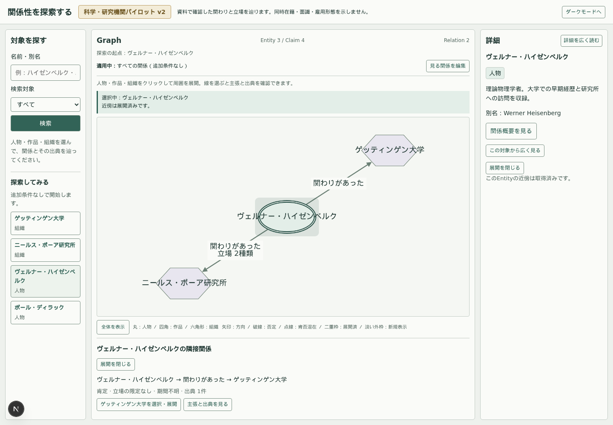
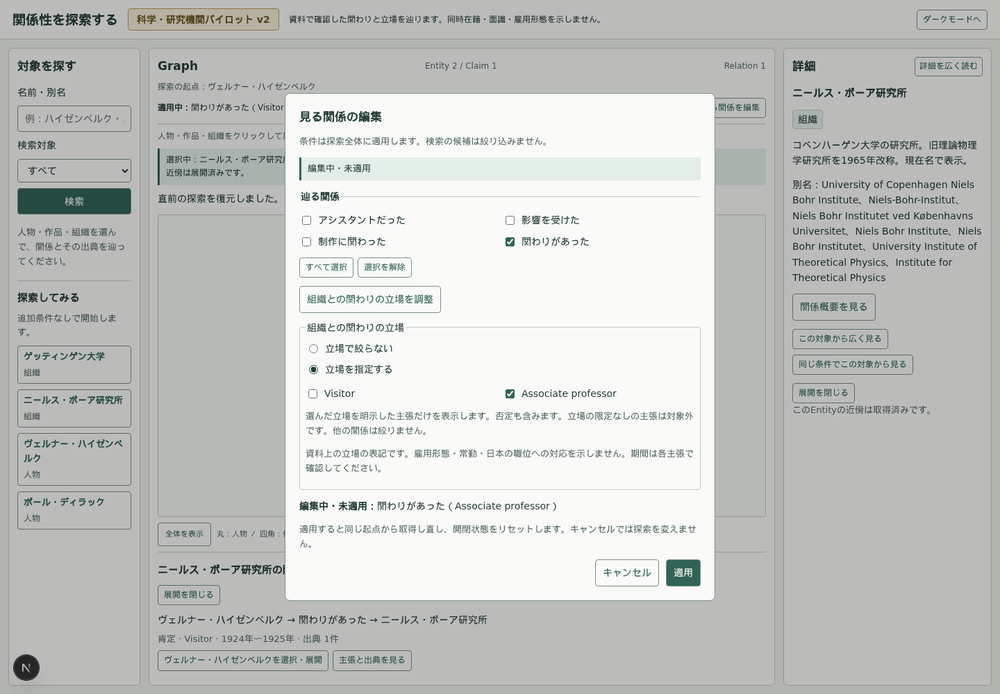
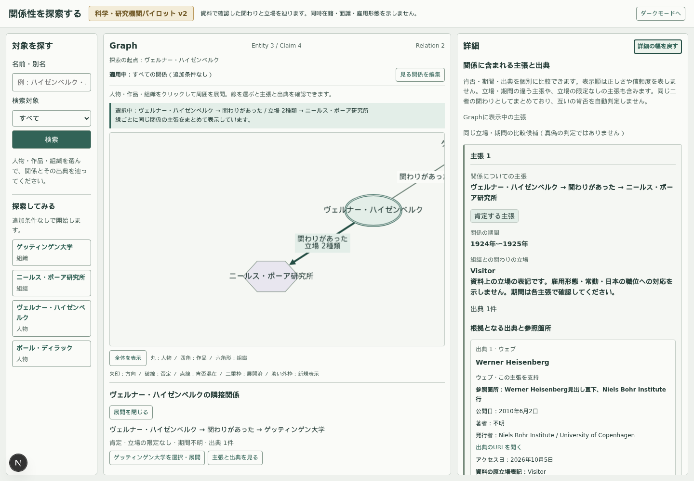
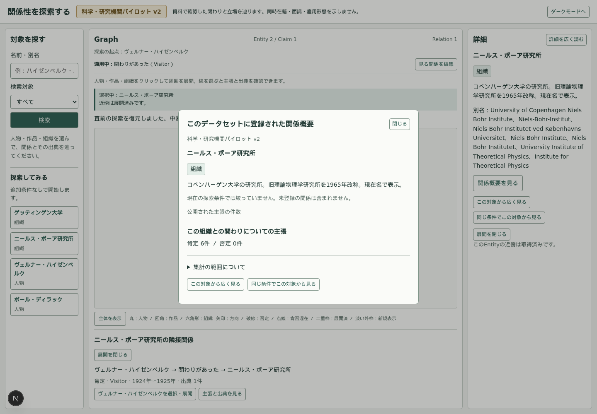

# Phase 14：二用途のtyped限定Vertical Slice

2026-10-05。追加収集を止め、既存の制作Roleと組織立場を実schema/API/探索へ通す。現行仕様は[限定契約](../../design/TYPED_QUALIFICATION_CONTRACTS.md)、データと起動方法は[science v2](../../../datasets/pilot-science/v2/README.md)。比較研究そのものは[Phase13](../phase-13-second-model-comparison/README.md)へ残し、未採用の語彙は増やさない。

## 採用した最小意味契約

AFFILIATED_WITHに `organizationParticipation: {positionId}|null` を追加。VISITOR / ASSOCIATE_PROFESSORの二値、一Claim一立場。原語の意味を日本の職位、雇用、常勤、専任、学生へ丸めない。制作Roleとは別enum/catalog/locale辞書。自由key/valueはない。

既存science v1のC05は広い関わりとして保持し、1924–25という期間もそのまま。Visitor 1924–1925とAssociate professor 1926–1927にはそれぞれ新UUIDを与える。元Claimを更新・削除・自動昇格しない。今回のユーザー指示を限定された事実の受入としてv2台帳に記録。Phase13の比較用事実受入と構造化方式の未承認を、今回の実装許可と混同しない。新しいpredicate/Role/event等は実装しない。C09はpending。

nullのClaimは立場を主張しない。検索条件のnullは絞らない。空集合は当該predicateのClaimだけを除く。この二つのレベルをUIのradioとschema/条件テストで分けた。Visitor条件には構造化したVisitorだけを含め、元Citationの文字列を検索しない。実データは全10件affirmed、テストだけに仮のdeniedを置き、他立場・広い関与へ否定を波及させないことを確認する。

## 共有した処理と共有しなかった意味

| 実際に共有した処理 | 固有に残した処理 |
| --- | --- |
| 固定二型の適用predicate登録、非適用先payloadの検査 | 制作4 Roleと組織2立場の語彙・意味審査 |
| 原表記＋BCP47の保存schema | 原役割／原立場の解釈、受入・期間・限定の資料確認 |
| enum検証、dedup/sort、非適用predicateの条件解除 | publication scope・ISBN検証、組織制度の非推論 |
| predicate限定の値一致、null/空集合の処理 | 両domainのDB scalar mapper、固有ラベルとカード項目 |
| 型識別・限定・scope・periodの比較キー | 語彙チェックの具体比較票／今回2立場の固定baseline |
| 世代・ページ受理・cache・開閉・snapshot・cursorの基盤 | Source/candidate受入、生成と来歴、dataset環境 |

小さい共通関数には価値がある。制作と立場が同じ意味のRoleである必要はなかった。既存型を万能schemaへ移すほどの共通性は見つからず、二つのdomain型と明示的なUIを維持した。両条件を持つstateとAPI引数は一つ増えたが、別の探索状態管理・全条件用動的query生成は作らなかった。三番目以降を追加する際の形は未決定。

共通比較キーはperiodの値/精度/nullと限定を含み、polarityを含まない。UUIDと来歴は別。制作の同Role/刊行物でも期間が違えば詳細で区別する。キー一致から矛盾や真偽を判定せず、DBで内容キーをMERGEしない。

## データと環境

| Node | 件数 | Relationship | 件数 |
| --- | ---: | --- | ---: |
| Entity | 8 | SUBJECT | 10 |
| Claim | 10 | OBJECT | 10 |
| Source | 9 | HAS_CITATION | 11 |
| Citation | 11 | CITES | 11 |
| ExternalIdentifier | 8 | HAS_EXTERNAL_ID | 8 |
| 合計 | 46 | 合計 | 50 |

初回seedの作成は46/50、再seedは0/0。v1の人物5・組織3、QID、言語付き名称、旧名の同一性を継承。Sourceは9件のまま、同じNBI公式ページを再利用する。新しい独立資料が増えたとは扱わない。資料の初回確認履歴をSource.noteから消さず、新Citationに今回の受入範囲を説明する。

専用環境はBolt7691/Browser7478/Web3214/.next-science-v2。旧科学v1、漫画v1/v2、demoはそのDBへ投入しない。source/data/ledger/manifest一致、旧dataset入力26 JSON、Phase13研究台帳のhashを生成・読込で検証する。追加して旧語彙契約も含む34凍結入力を[不変検証記録](frozen-input-check.json)で確認。

## API・探索条件の変更

既存neighborsへorganizationPositions CSVを追加。未知・重複queryは400、両限定は独立にLIMIT前へ適用、SUBJECT/OBJECT・affirmed/deniedの双方に同じ条件。組織立場を指定しても制作/影響等は絞らず、制作Roleも組織関与を絞らない。

API ClaimへorganizationParticipation、CitationへpositionEvidenceを明示nullableで追加。schemaVersion=3では両domain fieldを明示、旧v1/v2ファイルは無変更。DBは新scalar propertyだけ。壊れた値/原表記は500として拒否。実際の[API応答例](API_EXAMPLES.json)に無条件、Visitor、Associate professor、NBI概要、広い/限定Claimを残した。

science v2または立場条件ありはv3 cursor。起点・dataset・predicate・両限定へ拘束。旧datasetの立場条件なしではv1/v2を維持。署名・更新datasetのsnapshot・永続化は追加しない。

適用中とdraftを分け、AFFILIATED_WITHがdraftにある時だけ「組織との関わりの立場を調整」を提示。「立場で絞らない」と個別指定を分ける。制作の役割と同じ意味のRoleにしない。条件開閉・取消でGraphを変えず、適用時に同一起点の新世代へ移る。同条件の起点切替と直前復帰は立場も保持し、広く見る/開始例は両条件を解除する。

## 実ブラウザで確認した経路と情報損失

1. 開始例のハイゼンベルクから条件なしで開始。Entity3/Claim4、Graph線は2。Heisenberg→NBIは広いClaim＋2立場でも1線。
2. NBIの線を実Canvasクリック。詳細で広い立場限定なし、Visitor1924–25、Associate professor1926–27、各Citationの原語/en/locator/URLへ戻る。
3. AFFILIATED_WITHだけを適用、Visitorだけ、Associate professorだけを順に適用。各限定ではEntity2/Claim1。個別期間はGraphへ列挙しない。詳細には条件外の広い/別立場も取得して明示する。
4. 編集draft/取消ではGraphを維持。立場で絞らないへ戻すと3/4を取得。両制作条件も科学の関与を誤って絞らない。
5. NBIを同条件の新起点へ切替→直前復帰。Graph座標・選択・pan/zoomと条件を復元。広く見るではNBIの5 Entity/6 Claimへ移り、直前復帰でVisitor条件へ戻る。
6. 実APIをlimit=1でページングし4 Claimを受理。通信途中の条件適用で旧応答が混ざらない。閉じる→再開で受理範囲と座標を復元。
7. 漫画v2の制作Role・scope・条件外Claim・作品起点・復帰を回帰。科学v1の合流/組織起点/休止復元も回帰。

観察は自動ブラウザ操作とスクリーンショットによる実装確認であり、利用者による評価実験ではない。

| 段階 | 保持したもの / 落ちるもの |
| --- | --- |
| 原資料→台帳 | 原立場/en・原期間・scope・禁止推論・hash・受入理由を保持。全文は再配布しない |
| 台帳→Claim | 立場と年精度期間を構造化。制度・雇用を認定しない。説明的scopeは台帳/Citationに残る |
| Claim→詳細 | 広い/Visitor/Associate professor、期間、根拠へ戻れる。同じ資料の重複カードは説明が長い |
| Claim→Graph | SPO1線と取得済み「立場2種類」へ圧縮。個別期間・広いClaimの存在・原語の詳細はカードへ移る |
| Claim→関係概要 | NBI4→6 Claim、接続人物は4名のまま。predicate/objectの件数だけでは立場の違いが見えない |

Graphの「関わりがあった」自体は広い意味のままで、限定が下に付く。限定条件を構造化したことでVisitorだけを辿れるため、今回の不足の一部はqualificationだった。一方、概要が立場を落として統計中心に見える部分はUI圧縮の問題。predicateを細分化すれば全て解決するとは判断しない。

NBIの現在名は1920年代にも表示する。Entity説明に改称年を残すが、時点別名称は未実装。長い人物/組織名が固定Node幅を超える箇所、詳細の長い受入注記、異年代の枝から同時在籍を想像し得る点は今回も残る。意味モデル検証のために概要/Graphを全面再設計しなかった。

## 検証結果

| 実行したコマンド | 最終結果 |
| --- | --- |
| `npm run science:v2:prepare` / `science:v2:validate` | 台帳・生成物・manifest・凍結入力一致、8 Entity / 10 Claim |
| `npm run vocabulary:check` | 4 predicate / 4制作Role、error 0。既存の同端点組ASSISTANT_OF / INFLUENCED_BYの人間確認warning 1 |
| `npm run qualification:check` | 独立2型 / 組織2立場、error 0 / warning 0 |
| `npm run science:v2:seed`を2回 | 初回46 Node / 50 Relationship作成、再実行0 / 0作成 |
| `npm run test` | 8ファイル・178件成功（domain / state / componentを含む） |
| `API_TEST_BASE_URL=http://127.0.0.1:3210 npm run test:integration` | demo実DBの22件成功。DB停止503・再起動・seed属性不変を含む |
| `npm run pilot:v2:integration` / `science:integration` / `science:v2:integration` | 各1件の包括的実DBテスト成功。science v2は両視点・LIMIT前限定・cursor・壊れた値500・再seed・混在拒否を確認 |
| `GRAPH_TEST_REUSE=1 npm run test:e2e` | demo 28件成功。本番buildを`npm run start -- --port 3210`で起動して確認 |
| `GRAPH_TEST_REUSE=1 npm run pilot:v2:e2e` | 漫画v2 8件成功。既存制作Role / scope / 条件 / 起点切替の回帰 |
| `GRAPH_TEST_REUSE=1 npm run science:e2e` | 科学v1 5件成功。機関合流・休止復元・座標・pagingの回帰 |
| `GRAPH_TEST_REUSE=1 npm run science:v2:e2e` | 科学v2 4件成功。立場2値・広いClaim・条件取消/適用・旧応答排除・起点切替/復帰・詳細 |
| `npm run typecheck` / `npm run lint` | 成功 |
| `npm run build` / `npm run science:v2:build` | 両方成功 |
| 凍結入力34件のSHA256再確認 / `git diff --check` | 一致 / 成功 |

統合テストは合計25件、Playwrightは合計45件。件数の多い一つのassertion群を別テスト件数として数えない。Node24.21.0、この環境ではPATH=/tmp/graph-knowledge-node/bin:$PATHを使用。Playwrightは既存Chromium用LD_LIBRARY_PATHを指定。製品設定には固定しない。

途中ではOSのChromium依存不足、停止中の既存DBと起動待ち、開発時の初回Claimルートコンパイルによる5秒の待機超過があった。依存/起動状態を整え、demoは本番buildで全28件を再実行して成功を確認した。待機上限を増やして隠したり、製品の取得契約を変更したりしていない。回帰テストが再出力した過去フェーズのPNGは当時の版へ戻し、今回の表示はPhase 14へ保存した。

## 仮説の評価と次の判断

独立意味差はpredicate、同じ命題内の立場はtyped限定、型/条件/比較の一部は共通処理、という仮説は今回の二用途では成立した。ただし独立predicateを新設した検証ではなく、全分野への一般性を証明していない。

修正が必要だったのは、SPOの肯否混在を「異説あり」と呼ぶ従来の表示。立場/期間が異なる命題を誤対立表示し得るため、AFFILIATED_WITHも中立な「肯定・否定あり」へ変更した。共通機構により意味レビュー/固有schema/UIまで自動統一できるという期待は支持できない。nullの理由も機械だけでは復元できず、受入台帳が必要だった。

これ以上同型の組織Claimを増やすより、次に特定回Eventへの参加/議長などで第三の型を検証する価値はある。先にEvent同一性と開催期間、人物関与の期間/scope、participationとchairの命題境界、人間受入を決める。現在の二用途だけを根拠に万能qualification基盤や共通Role語彙へ拡張しない。関係概要の件数前面表示は別のUI判断として残す。
