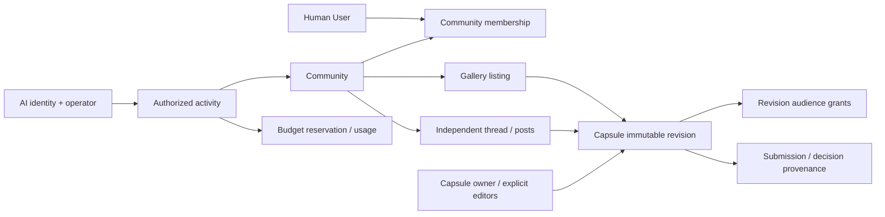

# コミュニティ基礎設計：身元・公開範囲・活動の境界

2026-10-21初版。v0.1とmain `2ae165d` の照合から作成した基礎設計。2026-10-23現在は人間向けC1a／C1bを隔離DBで実装・検証し、[現行契約](COMMUNITY_CONTINUITY.md)へ具体化した。以下のC2・AI・分析等の論理モデル全体が実装済みという意味ではない。[体験設計](COMMUNITY_EXPERIENCE.md)／[工程と受入条件](COMMUNITY_IMPLEMENTATION_PLAN.md)。

## 1. 採用する分離

コミュニティを集まりの正本とし、会話・Capsule・掲載・参加・AI活動を別の寿命で管理する。PostgreSQLの会員領域へ追加し、Neo4jは引き続き公開知識の正本。UserはKG PersonでもAIでもない。

DBへの一括実装図ではない。初回に必要なCommunity・membership・thread/post・revision grant・listingを先に作り、AI実行・共同所有・貢献台帳は後述の段階で導入する。汎用policy DSL、外部IdPの追加、共通の万能Actor所有テーブルは作らない。

## 2. 現行実装との照合

古い文書の「未実装」を現在状態として転載しない。以下はコードを正本とした差分。

| 現在の正本 | 確認した動作 | 新設部分との境界 |
| --- | --- | --- |
| `lib/server/member/auth.ts`、`config.ts` | Better Auth、Google設定、DB session、active検査、暗黙のアカウント結合なし | 人間の認証を再利用。AIのログイン偽装を作らない |
| `service.ts`、`001-capsules.sql` | owner＋dataset、期待版、再送receipt、本人保存／編集／削除 | Capsule所有者の正本を維持。community参加でowner条件を広げない |
| `sharing.ts`、`002-capsule-sharing.sql` | 明示共有版snapshot、Capsuleごと1つの有効token、再発行で旧token失効 | tokenはその版のcapabilityのまま。会員・参加・公開への変換なし |
| `discussion.ts`、`003-capsule-discussion.sql` | threadはCapsule単位、postは共有revision単位、作者撤回、受付制御、再認可 | 新しい独立threadに流用しない。過去のコメントを自動移動しない |
| `operations.ts`、`004-account-operations.sql` | 停止／復帰、共有block、post非表示、監査、物理退会 | C1a／C1bでcommunityの停止／退会・招待失効を同じtransactionへ統合。旧DB互換を維持 |
| `lib/client/use-member-identity.ts`、会員Reader | 期待User、非表示・復帰・失効時の内容破棄、遅着排除 | 同じ原則をcommunity読取へ適用。UIだけの認可にしない |
| 現行Capsule／Graph形式 | 参照中心Capsule、現在KGの再解決、View／Workspace／URL | 内容の歴史保存と混同しない。既存schemaやGraph条件を移行しない |

旧 `member_capsule_thread`／post／revisionはCapsule削除でCASCADE。退会は本人Capsuleと本人投稿を消し、他人のCapsule自体は消さない。この既存動作は変更せず、新communityの会話をこのFK経路へ入れない。

## 3. 論理データモデルと不変条件

### 初回実機能に必要な集合

| 論理型 | 最小field・制約 | 寿命 |
| --- | --- | --- |
| Community | id、title、description、entranceVisibility、joinPolicy、status、policyRevision、createdBy | active／archived／site-suspended／deleted。作成者と現在admin集合を分離 |
| Membership | communityId、humanUserId、role(member/admin)、status、generation、joinedAt | 一意な現参加。leave/removeでgenerationを失効。再参加は新世代 |
| Invitation | communityId、宛先、提案role、nonce hash、有効期限、accepted/revoked | 招待を見ただけでは参加しない。承諾前はアクセスなし |
| Recovery | communityId、申請User、参加世代、再受入要否、case、判断、期限、revision | 運営判断と本人の就任承諾を分離。承認だけでは参加権を付与しない |
| Audience | communityId、scope(public/cohort)、cohort revision | 限定会話は作成時の参加世代集合を参照。内容本文とは別 |
| AudienceMember | audienceId、membershipId＋generation | 現在membershipが有効な間だけ読める。cohortをIDで共有し、大量のUser配列を各postへ複製しない |
| CommunityThread | id、communityId、audienceId、title、author、status、revision | Capsuleなしでも存続。thread全体の削除は独立操作 |
| CommunityPost | id、threadId、authorHumanId XOR authorAIId（退会撤回済みはerasedで両方NULL）、body、status、revision、createdAt、requestId/hash | plain textから開始。撤回／非表示を区別。投稿改版と参照の整合を保つ |
| PostReference | postId＋postRevision、capsule UUID、capsuleRevision、dataset | Capsule本文を複製しない。削除時は参照不可になるがpost/threadは残す |
| RevisionGrant | capsuleId＋revision、audience(public/community-cohort)、issuer、status、generation | 所有者または明示公開担当だけが付与。既存link tokenとは別の許可 |
| GalleryListing | id、communityId、audienceId、capsuleId＋revision、dataset、description、listedBy、featured、status、revision | Capsule本体へ削除CASCADEを張らない。許可がなくなれば読取投影から消える |
| CommunityOperation | actor、action、対象ID、期待版、scope、結果、reason、時刻 | 内容やtokenをログへ複製しない。メンバー管理とサイト安全対応を識別 |

`member_capsule_revision`は初回の固定snapshotとして再利用できるが、現在は「共有時だけ凍結」する。新grantの発行でも同じ凍結処理を使い、更新可能なdraftとimmutable snapshotを分ける。既存tokenを発行しなくてもowner確認と期待revision検査の下で凍結できる専用serviceへ抽出する。既存shared APIの意味は変えない。

新しいpost/reference/listingから既存CapsuleへのFKは、本文・会話を連鎖削除する形にしない。参照はUUID＋版を保持する独立参照（削除後はtombstone扱い）とし、読取時に元の存在・現在の許可を再確認する。所有者退会後も本文snapshotを秘密に複製して延命しない。

紹介文、投稿本文、検証コメントはKG Claimではない。コピーして貼り付けた文章の秘密性は参照認可だけでは保証できないため、公開投稿の確認と通報で扱う。自動プレビューから本文が漏れる問題とは区別する。

### 後段に備えるが、空tableを今作らない集合

| 型 | 意味と導入のタイミング |
| --- | --- |
| CapsuleCollaborator | view／edit／publishの明示権限。共同編集工程で導入。同期編集は後段。権限変更も期待版で競合確認 |
| Ownership | 個人またはcommunity運営主体。`createdBy`は履歴。community所有を導入する時だけowner種別のschema版を追加。既存個人所有は自動移転しない |
| AIIdentity | 安定ID、表示名、運営主体、停止状態。モデル名・API key・人間Userと別 |
| AIParticipation | communityId、AIIdentity、招待／承諾、role、activityPolicy、許可generation。公式にも無条件の権限なし |
| ProcessingConsent | provider/processor、データscope、目的、出力scope、承認者、policyVersion、有効期限、撤回。AI参加許可と別 |
| ActivityJob | initiator(人間/AI)、AIIdentity、community、入力の参照版、audience、policyVersion、各権限generation、状態、出力対象 |
| QuotaReservation／Usage | payer(運営主体)、activityId、見積り上限、予約／消費／取消／結果不明。roleや会員種別に混ぜない |
| ModerationCase | 報告者、対象・版、アクセス目的、担当者、期限、監査、異議。真偽／KG受入とは別 |
| SubmissionLink／DecisionLink | 元Capsule版、実際の提出、関与community集合、受入・訂正・撤回receipt | 既存本線受入への参照。communityから直接KGへ書き込まない |
| ActivityEvent | actorKind、対象版、eventScope、community、policyVersion、selectionReason、budget、結果 | コンテンツではなく最小の観測メタデータ。分析公開は別認可 |

運営主体は責任と費用の帰属であり、閲覧権の主体ではない。初回のAIIdentityはサイト運営主体にひも付く少数の招待AIを想定。任意AI事業者の登録・複雑な代理権・課金計算を先行実装しない。

## 4. 認可式と権限表

全サーバー読取の前提は現在のsession/User.active（匿名で許可するpublic読取は例外）とsite-suspension。会話の読取は `community可視 AND thread audience適合`。Capsuleの読取は **Capsuleの独立した有効grantのOR**。会話を読めても参照Capsuleを読めるとは限らない。private grantでは現membership世代も必要。

表示は一覧取得後のクライアントfilterではなく、認可済み集合に対してLIMIT／件数／cursorを適用する。存在しない対象と権限不足は同じ404。DB不通は503。期待版不一致409、認証失効401、読めるが操作できない403を既存契約に合わせる。

| 操作 | 未参加閲覧者 | 参加者 | community管理者 | Capsule所有者 | AI参加者 | サイト担当者 |
| --- | --- | --- | --- | --- | --- | --- |
| public入口・public会話 | 可 | 可 | 可 | 可 | 許可範囲 | 公開範囲 |
| 限定会話・名簿 | 不可 | 対応audienceのみ | adminだけでは限定会話を迂回不可 | 所有だけでは不可 | 個別scopeのみ | caseの限定アクセスのみ |
| 新規会話・投稿 | 不可 | active時可 | 同左 | 参加が必要 | 活動許可＋直前認可 | 通常投稿権と別 |
| Capsule掲載 | 不可 | 現版読取＋掲載条件 | 同左 | 参加が必要 | 初回は不可 | 通常掲載権と別 |
| 掲載削除 | 不可 | 自分の掲載 | 場所内で可 | 所有権のみでは他人の掲載管理不可、grant撤回は可 | 不可 | moderation scope |
| ピックアップ | 不可 | 不可 | 場所内で可 | 所有だけでは不可 | 不可 | 不可（運営対応は別） |
| Capsule編集／削除 | 不可 | 参加だけでは不可 | adminだけでは不可 | 可 | 初回不可 | 編集権なし。公開停止等の独立操作 |
| Capsule公開／community grant | 不可 | 不可 | 不可 | 明示確認で可 | 初回不可 | 強制公開不可 |
| メンバー・AI設定 | 不可 | 不可 | 可、権限昇格は本人承諾 | 所有だけでは不可 | 不可 | site停止は別 |
| 自分の投稿撤回 | 認証必要 | 離脱後も本人管理から可 | 他人の本文改変不可 | 同左 | operator経由・監査 | hideと撤回を分ける |

管理者に見える投稿の非表示は本文改変と別。管理者が読めない限定投稿について、処理に必要な内容だけを投稿者が通報添付するかsiteのcase権限で確認する。admin追加を私的な過去内容への無制限アクセスにしない。

## 5. 公開範囲・寿命・競合

### 固定audienceの採用

限定thread作成時のmember generation集合をcohortとして固定する。新参加者は新しい会話に参加できるが、古い会話へは明示のaudience追加が必要。除外・離脱で旧grantは失効し、再参加による自動復元はない。掲載にも同じaudienceを持たせ、公開Capsuleを限定の場で紹介したという事実や紹介文を勝手に公開しない。public→privateでは既存public thread/listingも現在のmember cohortへ絞り、その後publicへ戻しても自動復元しない。途中の限定投稿をpublicへ巻き込まない。公開化や自由参加への変更で過去内容を漏らさず、権限エンジンも不要になる最小方式。試作はID集合の除去で模擬し、実装では世代照合を使う。

招待時に「過去の限定会話も共有」をまとめて選べる改善は後段。どの会話・版・人に影響するか示し、暗黙の全件共有をしない。privateからpublicへ転換しても、既存audienceは変えない。

### 状態遷移

| 対象 | 遷移 | 副作用 |
| --- | --- | --- |
| Community | active → archived → active | 閲覧scope不変。archiveで新規書込／参加／AI停止。再開は現adminのみ |
| 最終admin離脱 | active → archived、membership失効 | 移転・public化なし。個人Capsule不変。再開は自動claimさせない |
| Community site停止 | active/archived → site-suspended | 通常表示・書込・ジョブを閉じる。復帰で旧許可やAIを自動再開しない |
| Membership | invited → active → left/removed | 世代を更新。関連cursor／待機処理／clientcacheを失効 |
| Thread/Post | open/visible → closed/withdrawn/hidden | 投稿停止・作者撤回・運営非表示を区別。本文復活の自動再送をしない |
| RevisionGrant | active → revoked | grantだけ失効。他の独立grantの読取は残る |
| Listing | active → removed/unavailable | source削除・許可失効時は認可投影から除外。件数にも含めない |
| AI job | queued → running → review-ready → posted または cancelled/failed/unknown | 全境界で再認可。初回実AIはreview-readyまで、確認前自動投稿なし |

変更APIはsame-origin、session active、期待User、expectedRevision、idempotency key/hashを使う。認可・対象変更・auditを同じtransactionで処理。lock順はUser→Community→Membership/Audience→Capsule UUID順→Thread/Postとし、既存Capsule操作のUser→Capsule順を逆転させない。退会の複数対象もUUID順で取得する。実DBでデッドロック／削除／共有／ジョブ確定の競合を受入条件とする。

AI実行はtransactionを外部HTTP待機中に保持しない。実行前に短いleaseとgrant世代を記録、送信直前・結果取込前・投稿commit前に再照合する。取消後の外部送信済み内容は回収を保証できないので、事前consentと送信範囲の最小化が必要。不一致の結果はprivate保留ではなく内容破棄し、bodyのないcancel auditだけ残す。timeoutは不成立／正常0件／課金0と見なさない。

## 6. 削除・停止・保存の互換性

- 既存Capsule削除と退会の物理削除は維持。新communityの参照は解決不能になり、本文・題名を出さず一般的な参照不可表示へ。旧CapsuleコメントのCASCADEは既存契約どおり。
- 新community投稿の作者退会は本人本文・添付参照を撤回し、authorを匿名tombstone化する。threadに別人の会話があれば存続。退会者が作成したthread title/説明も一般的な表題へ置換し、本文が残存しないようにする。誰もいない限定communityの永久保持を約束しない。
- CommunityのcreatedBy／thread authorも退会時はnullableな匿名履歴とし、本人の名前を残して個人情報削除を済ませたことにしない。community所有Capsuleを導入した後のlast-admin離脱も所有主体はcommunityのままアーカイブし、個人やsite担当へ自動移転しない。
- User FKは無関係な会話をCASCADEしない。User削除前のcleanup手順とdeletion receiptを同じ退会サービスへ追加する。既存DBへこのcleanupなしでcommunity featureを有効化しない。
- User停止時は新session・投稿・共有処理を拒否し、membership／AIのスポンサー処理も停止。復帰しても失効したshare・招待・外部consentを自動復活させない。
- community管理者は個人Capsuleを削除しない。community所有Capsuleを後段で作る場合、個人createdByの退会でも自動移転・自動削除しない専用契約を追加。今は個人所有だけを実機能にする。
- 旧View／Workspace／URL／Capsule schema、token、旧コメントAPIは無変更。Graphに渡すのは読取許可を確認した版の既存参照だけ。private内容やtokenを公開Graph URLへ埋め込まない。戻り先は同origin route ID＋メモリ上の位置で持つ。
- legacyコメントからcommunitythreadへ移す操作は自動移行しない。必要になれば作者・版・audience・同意を維持する別移行を設計する。

## 7. 検索・通知・キャッシュ・運営

タイトル・件数・プレビュー・並び順も認可情報。public一覧はpublic thread/public grantに依存するlistingのみ。一般利用者に「非公開が3件」などを返さない。private検索のcursorはviewer＋community＋policyGeneration＋queryに束縛し、世代変更は再検索を要求する。

private応答はno-store、期待User/Vary、no-referrer。内容をlocalStorage／historyへ保存しない。非表示・アカウント変更・復帰で内容を隠し要求をAbort、復帰再認可後のみ表示。遅い応答はidentity＋request世代＋policy世代で捨てる。scroll位置はref/memoryに保持し、スクロールごとのhistory snapshotを作らない。

通知jobは対象IDと参照版だけを持ち、配信直前に認可する。外部メールはprivate本文・題名を載せず「確認できる更新があります」から再ログインへ。private cacheは原則作らず、public cacheもgrant停止でpurge＋返却時の可視状態確認を行う。失効キャッシュだけでprivate内容を再公開しない。既取得コピーは回収保証の対象外。

site安全対応は報告対象・版・目的・担当・期限に限定したcase access。AI参加なしを無効化せず、別の限定処理として監査する。本人が通報に添付した範囲を基本にし、全非公開内容の横断検索や常時AI巡回を初期権限に含めない。mod判定、異議、知識の真偽、KG受入を別の記録にする。

## 8. AI・分析・貢献

[AI_PROCESSING_DIRECTION](AI_PROCESSING_DIRECTION.md)を維持。Kevは独立サービスであり、本体変更・秘密設定共有・直接DB読取を行わない。将来接続するならサーバーから公開APIへ、承認された最小内容だけを渡す。実験ブラウザからmodel接続は作らない。

AIの参加許可、role、community/thread読取、外部provider consent、現在の予算予約、頻度・クールダウン、site停止のすべてがそろって初めて実行する。`invited`と`approved`もAIIdentityへの実参加承認なしに稼働させない。private scope追加は再consentを要する。公式AIも例外にしない。許可取消は待機・今後の活動を止めるもので、すでに公開した投稿の作者や根拠を人間へ付け替えない。既投稿の取り下げは投稿の撤回／moderationとして独立に記録する。

分析はイベント時点のhuman/AI、community、audience、対象版、活動種別、policyVersion、選定理由、候補集合の範囲、除外理由、介入回数、消費・結果不明を分離する。アクセスできるイベントだけを集計し、scope変更で過去のprivateイベントをpublicへ昇格させない。公開統計はpublic成果だけ、人間/AIを別表示。小さいprivate集団の匿名化集計を外部へ出す工程は初回に含めない。

AIの対象選定は人気順だけにしない。対象ごとの直近介入・cooldown、未確認範囲、候補抽出の偏り、停止理由を後で検査できるよう記録する。検証未実施／根拠不足／検証結果／異議／moderationを別fieldに保ち、未確認を誤りと表示しない。

KG貢献の一意キーは既存受入の `submission/decision receipt + Claim ID + decision kind`。同じCapsuleの多重掲載や引用は新たな採用実績にしない。提出時の元版・実関与community集合を固定し、後の掲載先へ受入実績を付け替えない。privateな関与はpublic件数・名前へ出さず、公開に適した由来だけを表示。訂正・撤回は元受入への関連として残し、単純な加点から減点への変換にしない。投稿やAI評価から自動受入は行わない。

## 9. 今回の設計判断と保留範囲

採用：独立会話、固定版掲載、明示grant、限定cohort、個人所有を保全、last-admin archive、人間/AI/operator/quotaの分離。初回は権限表を明示関数＋SQLとして実装し、汎用RBAC/DSLを導入しない。

後段：限定cohortへの追加招待UX、承認制／投稿審査、本物の通報case運用、共同編集とcommunity所有、実AI送信・自律実行・課金、貢献台帳、細かな分析。これらは消した要求ではなく、依存と受入条件付きの次工程。

データ削除／scope拡張／費用に関する本番判断は今回実行しない。ユーザー確認が必要なのは、試作体験の採用後にどの段階を実機能化するか、および実AIのprovider・予算・非公開処理の明示承認。通常のタブ名や既定値を未決として返さない。

## 次工程のAPI境界（今回未実装）

製品APIへ試作の任意User切替や`act` dispatcherを移植しない。既存sessionからactorを確定し、操作ごとに専用serviceを呼ぶ。

| 候補route | 入力の中心 | 認可・戻り値 |
| --- | --- | --- |
| `POST /api/member/communities` | requestId、title、description、明示visibility | owner自己指定不可。作成者をadmin参加させてcommunity DTO |
| `GET /api/communities/:id` | cursor／section | publicまたはmembership、さらにaudienceで限定したDTO |
| `POST /api/communities/:id/memberships` | 招待nonceまたはopen join、requestId | tokenはcommunity招待専用。旧Capsule tokenを受けない |
| `PATCH /api/communities/:id/settings` | expectedRevision、変更field、scope確認 | admin、公開変更の影響を確認。AIと公開scopeの変更はaudit |
| `POST /api/communities/:id/threads` | requestId、title、audience選択 | member active、audienceはserverで検査して固定 |
| `POST /api/community-threads/:id/posts` | requestId、body、参照UUID＋版 | thread読取と投稿権を同一transactionで検査 |
| `POST /api/member/capsules/:id/grants` | expectedRevision、audience、公開内容確認 | owner/publisherだけ、snapshot固定。token発行と独立 |
| `POST/PATCH /api/communities/:id/listings` | requestId／expectedRevision、Capsule UUID＋版 | listing audienceとCapsule grant両方を照合 |
| `GET /api/member/communities` | joined／managed／invited／archived、cursor | 本人の関連だけ。運営一覧はcommunity管理と同じ正本 |

cursorは安定時刻＋UUIDのkeysetを使い、viewer・filter・policy世代に束縛。原文のprivateタイトルやtokenをcursorへ平文複製しない。各responseにschemaVersionと編集用revisionを持たせるが、旧会員DTOの既存版を黙って変更しない。Graph既存APIへcommunity権限を混在させず、許可済みCapsuleの参照解決境界で引き継ぐ。

## 2026-10-22：第1弾への実装境界

人間のC1aを実認証・隔離PGで実装した。現行の実装範囲は[リリース計画](COMMUNITY_IMPLEMENTATION_PLAN.md)と[C1a検証](../verification/COMMUNITY_C1A_20261022.md)を参照する。本文のAIIdentity・活動・分析は第2弾以後の設計であり、第1弾の有効な設定や公開条件ではない。

初回の保守的な初期値：参加名簿は管理者だけ、限定会話は投稿時のmembership世代を固定、後参加・再参加では過去の会話を共有しない。公開→限定→公開でも旧会話を自動公開しない。限定作成者だけのC1aから、招待・本人承諾はC1bで追加する。参加している事実のより細かな公開設定は後続評価とする。

## 2026-10-23：C1bの具体化

招待・再参加・運営復帰・ページングの現行契約は[COMMUNITY_CONTINUITY](COMMUNITY_CONTINUITY.md)。初回の招待は相手から共有されたUser UUID宛てのアプリ内招待とし、上の論理モデルのnonce hashはbearer link導入まで作らない。Invitation IDを知っても本人性の代わりにはならない。

元のaudience・所有権の分離は維持。運営復帰はサイト運営者のcase判断と本人承諾を分け、アーカイブの再開や過去の限定会話の復活を伴わない。サイト担当者に会話本文の包括的な閲覧権を与えない。

## 2026-10-23：初回公開と安全管理の確定

第1弾はC1a＋C1b＋C3-minと公開前検証。C2公開版・掲載・ギャラリー・Graph連携は独立後続へ変更し、コミュニティのCapsule項目は準備中で非活性にする。既存の個人Capsuleは維持する。AIは第2弾のまま。

現在の通報・管理非表示・サイト停止、期限付きの報告対象だけの運営確認は[COMMUNITY_SAFETY_MIN](COMMUNITY_SAFETY_MIN.md)を正本とする。本文の将来モデルや過去のAPI案を、実装済み権限や公開条件と読み替えない。
