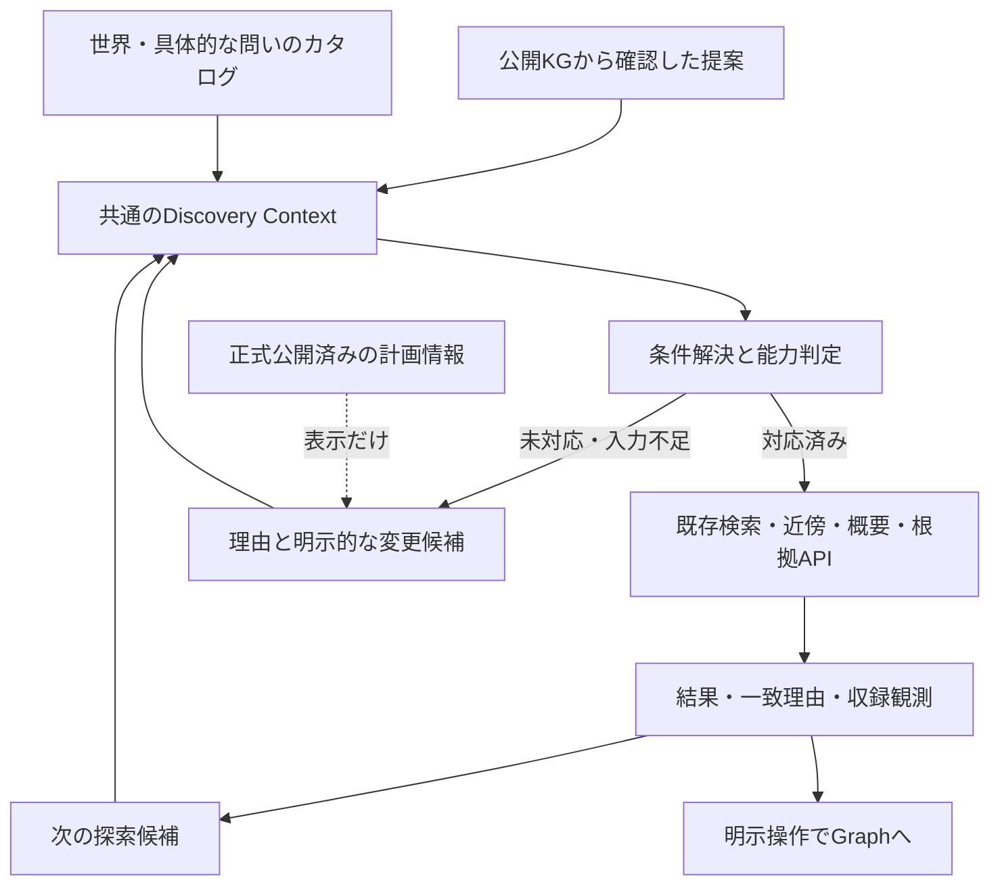

# Discovery Modelと検索体験の再設計

2026-10-16着手、2026-10-17整理／M3設計レビュー。**今回の設計で採用する方針と、次の試作で比較する案**。本書のインターフェイスは未実装であり、現在のAPI契約・UI・データを変更しない。利用者による操作評価は未実施。

[知識世界と収録状況](KNOWLEDGE_WORLDS_AND_COVERAGE_PLAN.md)、[M3の体験目標](M3_DISCOVERY_EXPERIENCE_CONTEXT.md)、[現行検索](DISCOVERY_SEARCH.md)、[プリセット](EXPLORATION_PRESETS_REVIEW.md)、[プロダクト原則](PRODUCT_VISION_AND_PRINCIPLES.md)、[収集管理](COLLECTION_THEMES.md)を踏まえる。意味の基準は[関係モデル](RELATION_MODEL_PRINCIPLES.md)と[制作クレジット](CONTRIBUTION_CREDITS.md)。調査証跡・再確認範囲は[シナリオ照合記録](../research/discovery-model/20261016/REVIEW.md)。

## 1. 今回選ぶ方向

**一つの探索文脈を、「今ある接点から探す」と「興味のある世界から探す」の二つの入口で編集する。** 前者は公開記録を根拠に候補を提案し、後者は11世界と具体的な問いを収録量にかかわらず提示する。入口の切替そのものでは条件・起点・Graphを変えない。

採用する設計判断：

1. 世界は非排他的な編集カタログ、意図は問い、条件は実行する要求として分離する。世界の名称をNeo4j分類・収集テーマID・検索キーワードへ自動変換しない。
2. 条件解決は**要求全体を実行できるか**を先に判定する。未対応条件を除去して正常な検索結果として返さない。実行可能な別案は変更点を示した操作として出す。
3. 検索一覧・一段探索・根拠閲覧の能力を別々に宣言する。共通モデルとは、全画面が同じ条件を無条件に実行できることではない。
4. 収録状況はKG revisionと観測範囲に依存する。0件・未対応・未確認・正式な収集予定を一つの状態enumや色へ押し込めない。
5. 独立Claimの方向・肯否・役割・scope・期間・Citationを保持する。経路はClaimの列であり、新しい直接関係や共同研究の主張ではない。
6. 既存の条件型・API・Graph状態管理を段階拡張する。別検索エンジン、DSL、汎用クエリビルダー、DB taxonomyの一括導入は採らない。
7. 次のUI試作は**共通の選択要約を持つ探索面＋入口部分だけの段階切替**を第一候補とする。二つの独立した検索状態を作らない。

これは今後の実装に用いるレビュー案としての採用であり、全機能の実装承認・UIの最終合格ではない。検索UIを先に作り直してモデルを追認する順序にはしない。

## 2. 現行実装の能力と不足

基準コードは調査開始時のmain `c98e74d`。ロック取得時のmainは `fb58d8a` で、並行した収集側の承認・実行記録だけが追加され、検索コードと公開releaseは不変だった。過去の設計文書にある「4 Role」「検索語必須だけ」「保存・日英未実装」は当時の記述であり、現状はコードを優先した。

| 経路 | 現在できること | まだできないこと／誤解しやすい点 |
| --- | --- | --- |
| 名前検索 `/api/entities` | 名前・別名のNFKC／小文字部分一致、任意kind、完全一致→名前→UUID。既定10・最大20件 | q必須。説明・Source・分野・受賞理由は検索しない。Discoveryと異なり、公開Claimへの接続を検索条件にしていない |
| `/api/discovery/entities` | q任意、kind、around、theme、predicate OR、20件ページ、条件とrevisionに束縛したcursor | Role・方向・期間・分類・肯否の指定、多起点・経路検索、根拠付きの一致理由は未対応 |
| 現在の3テーマ | 固定起点から公開Claimを最大2段辿った集合。名前・kind・around・predicateをANDで適用 | 漫画／科学／歴史の全収録ではない。3テーマ外の対象は新しく収録されても自動で入らない。起点を確認できないテーマは隠れる |
| around | 中心自身＋直接の隣接Entity。themeとの併用は集合の交差 | 「選んだpredicateで中心と結ばれる相手」ではない。集合生成と、候補がそのpredicateを持つ判定は別。端点の証人Claimを確認する新能力が必要 |
| 関係の切り口 | 範囲内Entityに接続する公開Claimの述語を集計。現在の名前・kind・切り口では候補を消さない | 件数はDISTINCT Claim、Entity数でも独立根拠数でもない。肯否混在を含む。意図別の次の候補や比較・橋渡しの提案ではない |
| Graph neighbors | published、5 predicate、制作7 Role・組織2立場・参加CHAIRをLIMIT前評価。一段ずつ両方向 | 方向制限・期間条件・kind制限・肯否指定・経路自動探索はない。Roleは適用predicateにだけ作用 |
| 概要・詳細 | 方向／肯否別集計、独立Claim・scope・期間・根拠の比較 | 概要のClaim数は接続人数ではない。Citation文から担当・分類・受賞条件を検索時に補えない |
| 検索→Graph | 明示したpredicateを引継ぎ。未指定なら既存Graph条件を維持 | 明示引継ぎ時はRole等をnullにする。theme／kind／aroundはGraph条件ではない。検索文脈を含む永続URLではない |
| UI／非同期 | 空欄一回入口、仮選択・解除、250ms debounce、IME抑制、Abort、24条件／30秒cache、戻る／進む、局所演出 | 入口の不足を見た目だけでは解決できない。cacheには現在dataset/revisionの明示キーがなく、初頁応答にもrevision欄がない |

参照実装：
[domain/discovery](../../lib/domain/discovery.ts)、
[server/discovery-search](../../lib/server/discovery-search.ts)、
[条件型](../../lib/domain/exploration.ts)、
[queries](../../lib/server/queries.ts)、
[入力境界](../../lib/server/http.ts)、
[検索UI](../../components/DiscoverySearch.tsx)、
[検索hook](../../lib/client/use-discovery-search.ts)、
[Graph引継ぎ](../../components/Explorer.tsx)、
[URL引継ぎ](../../lib/client/discovery-navigation.ts)。

現行の良い性質は再利用する：パラメータ化、条件のLIMIT前評価、revision変更409、旧応答排除、条件外Claimも比較できる詳細、安定した名前順、Graphの開閉・復帰・表示上限。初回から検索基盤を置換する理由はない。

## 3. 概念と責務

| 概念 | 所有する情報・責務 | 所有しないもの |
| --- | --- | --- |
| Knowledge World | 安定ID、日英の名称、紹介、関連世界・Topicへの編集的リンク | Entityの分類事実、固定predicate集合、収集の実行状態 |
| Discovery Topic | 「量子力学の歴史」「漫画家の影響の系譜」等の具体的な入口。複数Worldへ属し、選べる意図・確認済み起点・必要能力を案内 | 必ず検索できる集合、DB階層。入れ子は閲覧リンクで、巨大な継承taxonomyにしない |
| Discovery Intent | 「つくり手を知る」「別作品へ」「共通する場」「影響を辿る」等。必要な入力と条件テンプレートの版 | 自然言語を任意クエリにする機構、Claimの意味定義 |
| Exploration Criteria | 対象候補の条件と、関係・探索操作の条件。正規化と組合せの意味 | UIの配置、World名による暗黙分類、Neo4jのproperty名 |
| Search Capability | 操作ごとに対応する条件・上限・意味の版。全必須条件を評価できるか判定 | データがあるという保証、今後の提供時期 |
| Coverage Observation | dataset/revision・条件・観測時点・方法・完全性・件数・代表証跡 | 世界全体の網羅率、収集候補数から推定した公開件数 |
| Discovery Result | 対象と一致理由、証人Claim、根拠への参照、部分取得、次にできる操作 | 真偽の総合判定、複数段から作る新Claim |
| Discovery Context | World／Topic／Intentの出自、要求条件、実効条件、解決結果。入口間で共有する文脈 | Graphの取得cache・cursor・座標・会員保存の形式そのもの |

TopicはWorldを細分化するDB型ではなくカタログ内の薄い編集単位。Intentと条件テンプレートも別々の管理サービスにせず、最初は一つの版管理ファイル内のレコードでよい。



Neo4jの実装差はquery層が吸収する。カタログの実行方式は既知のhandler IDだけを参照し、Cypher／任意式／コードを保存しない。収集テーマからは必要なデータと問いを人が参照するだけで、CLI定義・承認ファイルをruntimeから読まない。

## 4. 小さいインターフェイス案

以下は設計境界であり、新HTTP APIの実装ではない。最初のprototypeでは純粋関数と固定応答で比較できる。

| 境界 | 入力 | 出力・責任 |
| --- | --- | --- |
| listDiscoveryEntries | locale、現在Context、catalog版 | 11 World・Topic・Intent、関連付けの理由。未収録でも消さない |
| resolveDiscovery | 要求条件、Intent版、公開Capability一覧 | ready / needs-input / unsupported / invalid、実効条件、未対応項目、明示変更案 |
| executeDiscovery | readyな計画、dataset/revision、ページ | 既存APIを呼ぶ固定handler。サーバーで再検証し、要求条件と実効条件を返す |
| proposeNext | Context、結果の証跡、Coverage、catalog | add / replace / remove / pivot操作候補と、その理由・差分。自動実行しない |
| prepareGraphHandoff | 選んだEntity、実効条件、現在Graph条件 | 起点＋引継ぐ条件＋検索だけの条件＋未対応項目。明示適用後だけ新しいGraph世代へ |

### 条件は「候補を探す」と「関係を辿る」を分ける

```text
DiscoveryContext v1（概念案）
  catalogRefs: worldIds[], topic(id, revision)?, intent(id, revision)?
  requested:
    targets:
      q: 名前・別名（空欄可）
      kind: 一種または未指定（初回は既存互換）
      scope: all | editorialCollection(id, revision) | around(entityId)
      classification: 軸別の値集合（将来。現在は未対応）
    relations:
      predicates: null | Predicate[]              # 既存型
      contributionRoles: null | ContributionRoleId[]
      organizationPositions: null | OrganizationPositionId[]
      eventRoles: null | EventRoleId[]
      directionByPredicate: 未指定 | subject/object # 将来の明示方向
      polarity: both | affirmed | denied         # 現行実行はbothだけ
      time: 未指定 | basis/range/unknownPolicy    # 将来
    operation: findEntities | inspectNeighbors | inspectOverview | readClaim
  resolution: status, effectiveCriteria?, issues[], alternatives[]
```

これは無制限なASTではない。scopeの複合が必要な時は、既存のtheme AND aroundを含む決めた組合せだけをhandlerで処理する。将来の分類・方向・時間の欄を旧APIへ送ったり、未対応なのに値を捨てたりしない。二起点の共通相手や多段の経路は、必要になった時に別の固定operationを追加する。

条件の合成規則：

- 世界・Topicは文脈。選択だけでKGを絞らない。選んだ世界を検索対象にするには、**明示された検索対象集合のresolver**が必要。「映画全体」は分類索引なしでは未対応と示す。
- 最初に再利用するのは「PLUTO周辺2段」のような範囲名付きeditorialCollection。世界そのものとは表示を分ける。複数世界は案内候補の和集合で、選択した集合の和／交差は別の明示条件とする。初回の実行は単一集合＋aroundまで。
- q・kind・scope・関係一致はAND。同一のpredicate集合はOR。複数分類を導入するなら同じ軸の値はOR、軸間はANDを既定案とし、例えば職能と媒体を一配列へ平坦化しない。分類索引の出典と所属根拠は別設計。
- 関係のpredicate・方向・Role・scope・期間・肯否は**同じ証人Claim**に対して満たす。別Claimの「制作」と「作画」を合わせて「作画した」としない。kindも返す候補のkindと反対側端点のkindを区別する。
- 未指定null、空集合[]、具体値集合を区別する。全Role列挙はRole未指定Claimを含まない。全predicateをnullへ正規化する既存規則は現行語彙版と一緒に扱い、将来語彙追加で保存済みの明示集合を勝手に広げない。
- 新UIでは「切り口を何も選んでいない」を無条件／継承の操作として扱う。空集合は明示的な「関係なし」の内部状態であり、チップを全解除した際に誤って生成しない。
- 制作から影響へ意図を切り替える際は「制作Roleを外し、影響を調べる」という差分を候補ボタンに添える。矛盾した旧条件を黙って残すことも、黙って除去することもしない。利用者が確認できる一回の置換操作にする。

### 能力は操作と条件の組合せで判断する

| 能力ID案 | 現状 | 初回の接続 |
| --- | --- | --- |
| name-lookup | 既存APIで可 | 名前を知る人の直接入口、孤立Entityも区別 |
| entity-discovery | 既存のq/kind/周辺集合/predicate ORで可 | 意図テンプレートから現行条件へ解決 |
| qualified-neighbors | Graphで可、Discovery一覧では未対応 | 選んだ起点のRole付き探索へ。一覧のRole絞込みは次段 |
| evidence-reading / overview | 可 | 証人Claimと比較の読取りを再利用 |
| relation-witness-search | 未実装 | aroundから指定方向／Roleの相手を証人付きで検索。LIMIT前評価 |
| classification-search | 未実装 | 媒体・専門・職能などのレビュー済み索引が必要 |
| directed-step / time-filter | 未実装 | 方向基準、期間の意味と不明値を明示して拡張 |
| shared-context / bounded-path | 自動検索は未実装 | 手動の一段展開は可能。自動化は別の固定能力として追加 |
| award / research-output-discovery | 未実装 | 受賞・理論・成果等の意味と索引／関係が必要 |

availableは、例えば「Role検索可能」だけでは不十分。operation、対応predicate、端点、条件次元、上限、能力版を持たせる。分類・期間が必須なら、名前検索が可能でも要求全体はunsupportedとなる。

### 結果・証跡と継続操作

Resultには、requestId、要求と実効条件のfingerprint、dataset/revision、結果状態、items、nextCursor、Coverage参照、nextActionsを持たせる案。初頁でもrevisionを返す拡張が必要で、現在のDiscoverySearchResponseに存在すると扱わない。

- Entity結果は現在のEntityDetailを再利用。関係一致を説明する場合は証人Claim IDとsubject/objectの視点を添える。名称一致だけなら関係理由を捏造しない。
- 経路候補は順番付きEntity IDと各段のClaim ID／正規方向／表示視点を持つ。肯否・Role・scope・期間はClaimSummaryを再利用し、詳細はCitationへ戻る。
- 証人は「この条件に一致した記録」であって全関連Claimではない。部分取得・未取得・条件外を保ち、relatedClaimIdsを使う既存比較へ繋ぐ。
- UIはbothを既定に「影響に関する記録」のような中立見出しを使う。deniedだけの経路を「影響を受けた系譜」と紹介しない。肯定経路の提案でも「肯定する記録から辿る」と出自を示し、否定や別限定があるなら詳細へ案内する。
- 同じSourceの複数Claimは独立根拠の増加ではない。pathの長さ・接続数・引用数を真偽スコアにしない。
- nextActionsは条件差分、add/replace/remove/pivot、理由、実行可否を持つ。提案を描画しただけでGraphの起点・枝・条件を変えない。

### 同じ要求を二つの入口で扱う具体例

1. Aの「PLUTOの担当」またはBの「漫画・アニメ→つくり手→PLUTO」を選ぶ。worldと入口の出自は異なっても、`inspectNeighbors(PLUTO, predicates=[CONTRIBUTED_TO], contributionRoles=null)`という実効要求は同じになる。PLUTOはworkで、このpredicateのobject側と分かるので、既存の両方向取得でも人物側の記録を読める。これを任意predicateの方向制限に一般化しない。
2. 「AUTHORSHIPの記録に限る」を選ぶと、同じPLUTOのneighborsは既存Role条件でready。公開KG全体からAUTHORSHIPを持つ人物の一覧を探す`findEntities`は現在unsupported。単に「Role対応済み」と一つのフラグにしない。代替は「この作品の著者記録を見る」で、全体一覧検索の成功として表示しない。
3. Bで「ノーベル受賞者→1994年→機関」を選んだ場合、受賞年というbasisの条件を現行APIへ解決できないためunsupported。`q=1994`やClaim期間への置換はしない。「Princetonの関係記録を見る」を選ぶと、変更内容を示した別のready要求になる。元の意図は出自として残り、結果を「1994年受賞者一覧」とは呼ばない。
4. ready要求のままA/B表示だけを切り替えても、実効条件のfingerprintと結果ページは変わらない。worldラベルの翻訳やTopic紹介文の修正も同様。条件を変更した場合だけ再解決し、旧cursorを破棄する。

## 5. Coverageと0件を正しく表す

状態は三つの独立軸にする。

| 軸 | 値の例 | 表示と判断 |
| --- | --- | --- |
| 実行 | not-run / succeeded / failed / unsupported / needs-input | failed・unsupportedに結果0件を返さない。入力不足は必要な起点を選べる |
| 観測 | matched / zero-in-scope / unassessed / stale | succeededかつ範囲内全件のcount=0の時だけzero-in-scope。古いrevisionはstale |
| 計画情報 | none-verified / announced / paused / completed | 正式に公開された運営判断の参照・対象範囲・確認日を持つ。noneは「将来予定がない」と断定しない |

「該当データなし」は**実行した条件と検索対象範囲の一致なし**。一ページに出ない、テーマ起点の2段にない、上限打切り、検索方式未対応を領域全体の未収録へ拡大しない。

CoverageObservationの最小案：dataset、revision、criteriaFingerprint、capability/catalog版、observedAt、method（API／release全件照合／編集サンプル）、scopeDescription、completeness（complete-for-query／bounded／sample）、unit（entity／claim／path）、countまたは下限、証跡参照。世界全体の%には分母がないので表示しない。

表示例：

- 「この公開版・選んだ条件では一致する対象がありません。『役割の指定を外す』」：実行成功後の限定0件。
- 「映画監督・出演者という役割から探す方法は、まだ対応していません。『名前で探す』」：別案を選ぶまで全KGの結果を映画結果として出さない。
- 「音楽家の影響関係：収録範囲は未確認。人物名から影響の記録を探せます」：名前検索の結果を音楽家分類の保証にしない。
- 「収集予定：○○、確認日○月○日、対象は○○」：運営が別途公表した記録がある場合だけ。今回の11世界には新しい予定表示を作らない。

テーマの企画合意、CLI承認、ジョブ成功、候補件数、公開release適用は別々である。正式な収集予定を検索側が捏造しない。将来の公表情報は手動レビューした小さい表示用カタログから参照し、収集CLIをruntime依存にしない。

## 6. 11世界と横断テーマ

全世界を閲覧カタログに置き、収録・能力の不足があっても隠さない。初期画面へ11枚を並べる義務はなく、一覧へ一回で進める。下表の足場は固定releaseの観察と既存企画の範囲で、世界全体の監査ではない。

| 世界 | タップから試したい具体的な問い | 現在の足場／不足 | 次の候補 |
| --- | --- | --- | --- |
| 漫画・アニメ | つくり手の別作品／影響の系譜 | 漫画10作品の接続群。アニメ化関係は未対応 | PLUTO周辺、制作Role、人物間の影響 |
| 映画・ドラマ | 監督と出演者／同じ脚本家 | 独立した映画群は未確認。監督・出演Roleは現行語彙にない | 名前から探す、必要能力の説明 |
| ゲーム | 開発者と代表作品／開発会社を渡る | 開発者分類・制作チーム・移植のモデルが不足 | 名前入口、作品と役割の設計候補 |
| 音楽 | 影響を受けた人／別の演奏へ | 人物間影響の機構はあるが音楽家の集合と経路は未確認 | 名前＋影響記録、音楽分類は未対応と明示 |
| 科学・発見 | ノーベル受賞者と機関／理論の担い手 | 人物・機関が厚い。受賞・専門・理論索引がない | NBI周辺、Princetonを介する記録 |
| 発明・技術 | 企業研究所から技術の発展へ | IBM等の組織関与は足場。発明・成果・派生が不足 | 機関名、科学・企業のTopicへ横断 |
| 歴史 | 量子力学の歴史／出来事の参加者 | 1927年Solvay開催回あり。広い年代検索は未対応 | 開催回から参加記録、科学史へ |
| 美術・文学 | 作品とつくり手／影響 | 漫画と重なる入口は作れるが、文学・美術全般は未確認 | 作品名、漫画との横断Topic |
| 企業・産業 | 人の移動／企業研究の接点 | 一部企業研究組織の関与。合併・製品・継承は不足 | 機関を介した人、技術へ |
| スポーツ | 選手とクラブ／大会の参加者 | クラブ分類・競技Role・成績等は未対応、収録未確認 | 名前検索、必要条件の提示 |
| 地理・文化 | 場所から作品・出来事へ | 現行kindにplaceなし。地名全文があっても場所関係ではない | 名称入口、場所モデル・地理検索は別設計 |

Topicは多対多に紐づく。「量子力学の歴史」は科学＋歴史、「量子力学の最前線」は科学＋技術、「漫画家の影響の系譜」は漫画＋美術・文学へ置ける。ただし「歴史／最前線」という語だけで期間を捏造せず、最前線を最近の登録日順へ置換しない。世界の多重所属は編集上の案内で、個々の人物の学問分野を確定しない。

## 7. AとBの共存・提案の作り方

**A：今ある接点から探す。** 最初は既存の開始例と編集済み経路を、現在の公開revisionで再確認して提示する。「PLUTOの制作担当」「同じ大学に記録がある二人」等、どこから提案したかを短く示す。未確認の経路、撤回された証人、private Capsuleは推薦しない。

提案する価値は、単なる接続数でなく「別作品へ進める」「担当が違う」「別世界の入口になる」を編集的に説明する。これは評価仮説で、意外さの客観スコアではない。自動生成は後段で、上限付き2段・証人付き候補に限定する。高次数ハブの全組合せを列挙しない。同じハブ・同じ関係に偏る場合は代表候補を分散し、「ほかを見る」へ繋ぐ。

**B：広い世界から探す。** World→Topic／Intent→利用できる検索対象・条件へ進む。世界の選択直後は、その世界の案内と現状を表示し、未対応の世界検索を実行したように見せない。現在の足場としてeditorialCollectionを選ぶか、名前で探すか、まだ扱えない問いの説明を読むかを選べる。

**両者の往復。** Aの提案からBへ移ると、その提案の対象・関係・出自をチップに残し、関連Worldを示す。BからAへ移ると、現在条件に合う確認済みの提案だけを優先する。なければ「この条件の提案はまだありません」とし、条件を外す候補を出す。切替を全解除と同義にしない。

次の候補には三種を用意する：

- **深める**：この作品の制作Roleを見る、同じ人の別作品へ。追加条件の意味を表示。
- **横へ進む**：機関や作品を新しい起点候補にする。pivotは明示し、旧起点を暗黙に置換しない。
- **広げ直す**：Roleだけ外す、世界の範囲だけ外す、別の意図へ置換。現在の選択を残しながら差分を試せる。

候補の並びは初回は編集順＋安定ID。実データの一致数を使うなら対象範囲と単位を付ける。人気・信頼・根拠の強さとして表示しない。選択中の条件は0件でも残す。結果にない能力を候補として紹介する時も、押せない無説明ボタンではなく「何が未対応か／今できる別案」を開ける。

## 8. 具体的な探索シナリオによる照合

表の「今できる」は現行API／手動Graph操作と固定releaseに基づく。新しいIntent resolverや自動経路検索を実装済みとはしない。未収録分の漫画adapter候補は証跡に使わない。

| シナリオと操作 | 現在成立する範囲 | 新モデルでの解決・不足・表示 |
| --- | --- | --- |
| M1 PLUTO→作者・共同制作者 | CONTRIBUTED_TOで浦沢・長崎・手塚眞。AUTHORSHIP／PRODUCING／SUPERVISIONの独立限定あり | 「作者だけ」はAUTHORSHIP等の意味を区別し必要Roleを明示。「つくり手」は広い関与。検索一覧のRole条件は未対応、Graph限定は可 |
| M2 作者→別作品 | 浦沢から8作品、長崎から4作品への制作記録。PLUTO→長崎→BILLY BATが成立 | 一段ずつ辿れる。作品から人へはobject視点、人から作品へはsubject視点。連続操作を同一向きの新Claimにしない |
| M3 制作Roleを比較 | 長崎のPLUTOのPRODUCINGとBILLY BATのSTORY_CO_CREATIONを比較可能 | 刊行物scopeとCitationを併記。広いClaimも残す。「原作」をAUTHORSHIPへ推定しない |
| M4 漫画家の影響の系譜 | 浦沢→手塚のINFLUENCED_BYは1件。続きの公開記録はこのreleaseにない | 手動両方向探索は可。方向固定の自動連鎖は未対応。「次の影響記録なし」と「連鎖検索未対応」を併記できる |
| S1 ノーベル受賞者と機関 | 人名から受賞時所属の広いAFFILIATED_WITHと根拠へ進める | 「ノーベル賞受賞者」一覧や年／部門は検索未対応。レビュー済み紹介集合は可能だが完全な受賞者検索と呼ばない。受賞年を所属期間にしない |
| S2 機関を介し別分野の人へ | パウリ→Princeton←Nashの2 Claimあり。根拠に1945 Physics／1994 Economic Sciences | 経路は手動で可。異分野の構造化検索と共通相手の自動発見は未対応。編集説明は証跡参照を付け、同時在籍・交流・共同研究を断定しない |
| S3 成果・理論・実験→人物 | このreleaseのworkは漫画10件。対象kindをworkにしただけでは研究成果を探せない | 成果種別・関係の意味と索引が必要。未対応と表示し「関連する研究機関から」を明示的な別案にする |
| S4 量子力学の歴史と現代 | NBI、人物の立場／期間、1927年Solvay参加記録が足場 | 歴史は編集Topicで紹介可。期間検索・学術分野条件・最前線判定は未対応。開催期間≠個別参加期間、記録の追加日≠研究の新しさ |
| T1 映画監督と出演者 | 名前検索の機構は可。監督・出演は現7 Roleにない | Worldは表示。role-unsupported＋coverage-unassessed。一般制作を監督／出演に代用しない |
| T2 ゲーム開発者と代表作品 | 名前・work候補の機構はある。ゲーム分類・開発担当は未確認／未対応 | World→問い→不足の説明。「作品名で探す」は独立の代替検索で、代表性を保証しない |
| T3 音楽家の影響 | person→person INFLUENCED_BYの意味と一段探索は利用可 | 音楽家分類が未対応、経路の収録未確認。既知人物を選んだ影響記録探索へ明示的に切替可能 |

全シナリオでResultは独立Claimへ戻れる。たとえばdenied DRAWINGを見ても、著者や制作全体の否定へ拡大しない。「共通点」は共有するEntityへの各記録であり、新しい人間関係ではない。

## 9. UI構成の比較と次の試作

| 案 | 操作感の利点 | 問題 | 判断 |
| --- | --- | --- | --- |
| 全部を一画面に常設 | 選択と結果を一望 | 11世界・問い・精密条件がフォーム化、スマホで結果が遠い | 比較用。全軸の常設は採らない |
| A/Bを独立した2タブ | 入口の違いが明快 | 条件の二重管理・切替で喪失・検索エンジンが別に見える | 不採用。共有Contextなら表示切替として比較可能 |
| 共通面＋入口／詳細を段階表示 | 同じ選択要約を見ながら興味と精密条件を往復 | 切替が深いと場所を見失う | **第一試作案**。最大2段、戻ると解除を分ける |
| 別ページで詳細検索 | 幅と直リンクを得やすい | Graphとの往復・URL設計・スマホで分断 | 条件が増えた段階の代替案 |

第一試作のワイヤー（仮）：

```text
[探索する                                      閉じる]
[今ある接点から] [世界から]        ← 表示入口だけ切替
[漫画・アニメ ×] [つくり手 ×] [PLUTO周辺 ×]    選択要約
----------------------------------------------------
入口領域：
 A  PLUTOの担当を見比べる / 同じ機関を介して…
 B  世界の一覧 → 具体的な問い・今使える足場
----------------------------------------------------
次の一手： [別作品へ] [役割を比べる] [範囲を広げる]
必要なときだけ [詳しい条件]
名前・別名 [任意入力                         ]
結果・収録状況 ─ コンパクトな行／小さな経路プレビュー
```

PCは現行wide dialogを候補とし、スマホは同じ一領域を全画面に近い表示で使う。11世界一覧・問い・Role詳細は入口領域を置換し、戻れば元の位置へ。多重モーダルを重ねない。結果は常に同じ検索処理から得る。名称欄は結果の直前に置く現在の実験を継続する。

**触りたくなる単位**は「作品」「具体的な問い」「次の一手」。巨大なダミー画像や能力の一覧を主役にしない。明朝の見出し、薄い罫線、空間を取る小見出しと密な結果行を維持し、選択後に次の問いが局所的に変わる。例：PLUTOを選ぶ→「担当を比べる」「長崎の別作品」へ変わる。条件を狭める操作だけに偏らせない。

### 状態遷移と応答

- タップした選択は即時に輪郭・文字で応答。Contextのdraft更新→能力判定→対応済みだけ検索。Graphへは結果を明示選択するまで影響させない。
- 名前入力の250ms debounceとIME抑制を継承。離散タップは選択表示を即時にし、通信を即時にするか短い集約にするかを試作で比較する。演出終了待ちはしない。
- 結果が更新中でも条件は操作可能。前の結果は「更新中」と区別してinertにし、旧条件の結果をクリックさせない。新応答はrequest generationで照合し、遅着で巻き戻さない。
- 検索の失敗と未対応を別表示。未対応は通信待ちのskeletonを出し続けない。retryは失敗した要求だけ、0件を失敗として再試行しない。
- 選択・候補は170〜200ms程度、結果は約200msの局所フェードを試す。高さを大きく伸縮させず、reduced-motionは移動・進捗アニメを止める。数値は試作初期値で合格実測値ではない。
- 固定ヘッダと一つの本文スクロールを基本にする。選択チップの折返しは上限2行＋展開とし、長い条件を常時押し下げない。更新前の可視先頭item IDとoffsetを保持し、存在すれば復元。消えた場合は結果見出しを基準にし、勝手にページ先頭へ飛ばさない。
- A/Bそれぞれの入口領域のscroll位置をUI状態として保存。共有条件と結果cursorは入口切替だけでは初期化しない。条件が変わった時だけcursorを先頭へ。
- 選択肢の入替中も押したボタンとフォーカスを保つ。消す場合は次の見出しへ移し、更新件数をaria-liveで控えめに通知。色・動きだけで選択を表さない。横レール以外の縦スクロールを奪わない。
- touch領域は概ね44pxを試作目標とし、キーボード、Escape、Back、フォーカストラップを維持。Enterによる名前検索も残す。

### Graph・履歴・URLへの引継ぎ

入口切替とチップ編集は検索内の操作であり、Graphの再取得ではない。現行の検索modal用History一件を再利用し、各タップでブラウザ履歴を増やさない。検索内の「一つ戻す」はContext差分の小さい履歴で、ブラウザBackと混同しない。初回は同一modal内の直前一件undoでよい。

Graphへ進む時は「制作の記録で開く」など**適用する関係条件を操作名で示す**。名前だけの検索なら現在条件を引継ぐ。新しい意図から開く場合はtemplateが置換する次元と維持する次元を示し、全条件を暗黙初期化しない。未対応の方向・期間を含む要求はそのまま移さず、「両方向・期間指定なしで開く」の別操作を提示する。

world、Topic、q、候補kindは「ここへ来た文脈」として保持できるが、Graph展開へ自動適用しない。Graph対象kindと検索候補kindの違いも要約する。方向固定など将来の探索条件がある場合は、Graph条件・URL codec・保存形式を一緒に版更新してから引き継ぐ。旧codecに新フィールドを混入させない。

試作ではメモリ内Context＋既存History stateだけで十分。reload後の検索条件共有や永続保存は未対応と示す。将来のURLはschema版＋具体条件＋任意の出自版を保存し、cursor・取得結果を保存しない。既存の探索URLとCapsuleを再定義しない。

## 10. 拡張順とデータ収集側との接点

| 段階 | 検索側の成果 | データ側への要求／変更境界 |
| --- | --- | --- |
| D0 今回 | 能力表、Contextとresolver設計、シナリオ証跡、UI比較 | コード・収集CLI・ジョブ・公開KG・本番を変更しない |
| D1 独立した操作試作 | 11世界・二入口・明示変更・4状態・Graph引継ぎの操作を固定応答で比較 | 合成データと実証跡を区別。現行UI置換なし |
| D2 現行APIへ縦接続 | 版付き小カタログ、能力判定、初頁revision、一致理由、Context共有 | 既存の公開Claimを読む。新DB・新分類なし |
| D3 意図に必要な検索能力 | relation witnessの方向／RoleをLIMIT前に取得、cursor／Graph引継ぎの同時拡張 | 既存Roleを使う。役割意味の追加は別レビュー |
| D4 世界の広がり | 軸別の分類索引、受賞や研究分野の入口、上限付き共通相手／経路 | 分類と事実の根拠・公開適用・索引再生成を別に検証 |

D2は全シナリオ実現を意味しない。未対応の問いが正しく見え、今使える足場へ移れることも進捗。D3/D4の全部を一括実装する計画にはしない。

収集側へ渡すのは、「問い」「必要なEntity粒度」「predicate／Role／scope」「別名・分類の必要性」「期待する2〜3段の経路」「不足の種類」の短い要求票でよい。収集件数ノルマ、CLIのschema、ジョブ設定を検索側が変更しない。公開後に該当revisionで観測し、初めてCoverageと提案候補を更新する。

検索用の分類索引を導入する場合も、Entityの新たな分類事実と、運営が選んだ紹介集合を区別する。新releaseで索引が古くなったらunassessed/staleにし、昔の件数を現行版の件数として残さない。索引は再生成可能な投影で、Neo4j知識の第二の正本にしない。

### 実行予算・互換性

- 現行20件ページ、neighbors最大50 Claim、Graph100 Entity／200 Claimを初期基準にする。自動多段は今回導入しない。
- 現行の読取timeoutと配備時設定を継承し、組合せ・件数・候補生成も同じ総予算へ入れる。広い分類の集計やハブ全探索を各タップで走らせない。
- cache keyは正規化条件＋operation＋dataset/revision＋resolver/capability版。localeだけの変更は意味キーを変えない。名前検索語自体が変わる場合は別要求。
- ページングcursorは現在条件と版に束縛。結果・facet・Coverageのrevisionを揃えられない場合は古い表示を明示して再取得し、合わせて一つの成功結果にしない。
- 公開KGだけを対象にし、private／限定共有Capsuleを候補へ混ぜない。将来公開Capsule検索は独自の可視性・結果種別を持つ別能力とし、M3の目標からは外さない。
- 関心・入力語・条件を新しく分析サービスへ送らない。個人履歴による推薦やAIによる意図解釈を初期要件にしない。

## 11. 次の試作で判定すること

実物を操作するまでは「楽しい／気持ちよい」を合格にしない。まず同じ状態・結果を使い、段階表示案と共有Contextの二タブ表示案を比較する。ダミーの0件と実際の公開0件は表示を分ける。

| 課題 | 操作と合格基準 |
| --- | --- |
| 入力なしで始める | Homeから一回で入口。World→問い→足場の選択をキーボードなしで進められる |
| A/B往復 | PLUTO周辺＋制作を選択後B→A。条件・結果ページ・Graphが変化せず、どこへ移ったか分かる |
| 狭めるだけにしない | Role指定後、別作品／別の世界／Role解除へ進める。全リセットだけが脱出口にならない |
| 0件・未対応・未確認 | 3例を見た利用者が違いと次の操作を説明できる。架空の収集予定を示さない |
| 根拠へ戻る | 担当比較・Princeton経路の各Claimと出典へ到達。共同研究や全巻担当と誤読させない |
| 状態と操作の安定 | 連続5タップと遅延応答逆転で最新条件だけ表示。旧結果は操作できず、選択編集は可能 |
| スクロール・タッチ | 390px幅とPC幅、条件チップ折返し、20件→0件→20件で意図しない先頭ジャンプや二重scrollを起こさない |
| 速度・動き | 選択反応100ms以内を試作目標に計測。データ待ちと演出時間を分け記録。reduced-motionでも意味が通る |
| Back／取消 | modalを閉じて元Graphへ。戻る／進む・再表示・locale変更で条件とフォーカスを確認 |
| 名称を知る人 | インライン候補と任意の名前欄から従来同等の少ない操作で到達 |

性能の数値は合格実績ではなく試作目標。利用者評価では、所要時間だけでなく「次を押したくなった箇所」「迷った表示」「意図せず失った条件」を記録する。初回は採点システムや分析基盤を追加せず、操作観察と短い聞き取りでよい。

## 12. 採用・代替・未決の整理

| 区分 | 判断 |
| --- | --- |
| 今回の設計で採用 | 共通Context、編集Worldと実行scopeの分離、操作別能力判定、未対応の黙殺禁止、revision付きCoverage、証人Claimと根拠、11世界を隠さない |
| 次のUI試作の第一候補 | 共通の選択要約＋入口だけ段階切替、具体的な問いと次の一手、任意入力は結果直前 |
| 代替案 | 共有Contextの二タブ表示、条件増大時の専用ページ。比較は同じモデルと固定応答で行う |
| 採らない案 | 11 DB分類／11固定タブ、収集テーマID直結、世界名の全文検索代用、predicateだけで著者認定、未対応条件を削った0件表示、巨大DSL |
| 実物で判断 | A/Bの名称・初期入口、表示する問いの数、段階切替と2タブの理解しやすさ、離散タップ通信間隔、scrollアンカー |
| 次の意味設計 | 分類の軸と根拠、受賞・成果・作品種別、期間のbasisと不明値、方向のGraph一貫性、新Role。今回の設計で承認しない |
| 運営判断が必要 | 正式な収集予定の公表主体・確認期限、紹介集合のレビュー担当。未決でも現行の検索と試作は進められる |

現在の検索UIを変更する前にD1の操作比較を行い、モデルの穴を修正する。その後D2の小さい縦経路へ進む。収集の候補生成や公開適用を前提条件にせず、既存の漫画・機関・Eventと未対応の世界で検証する。
