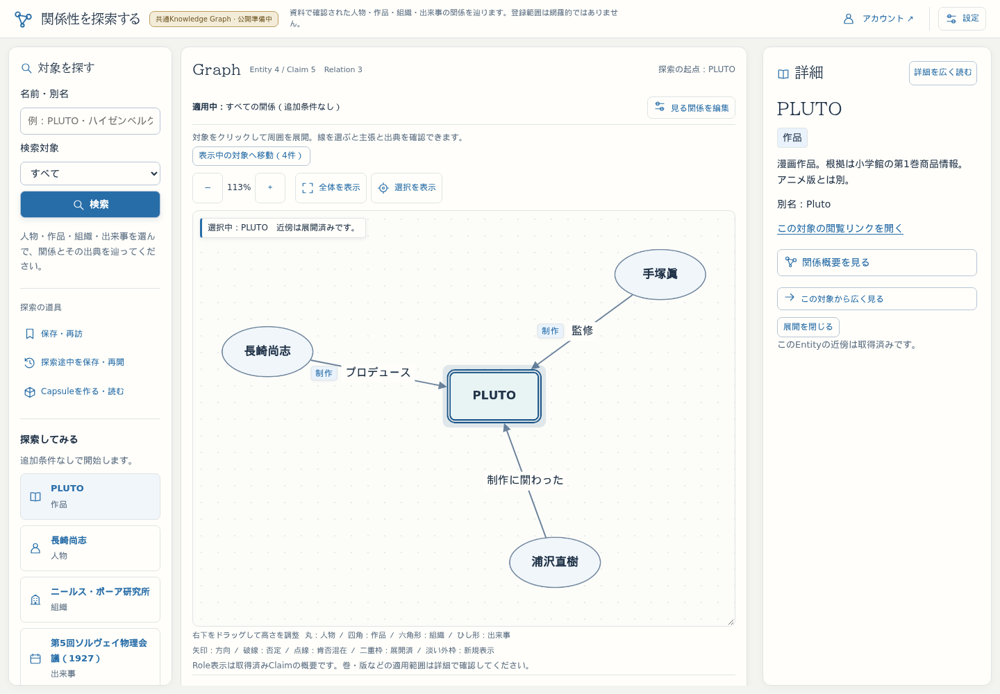
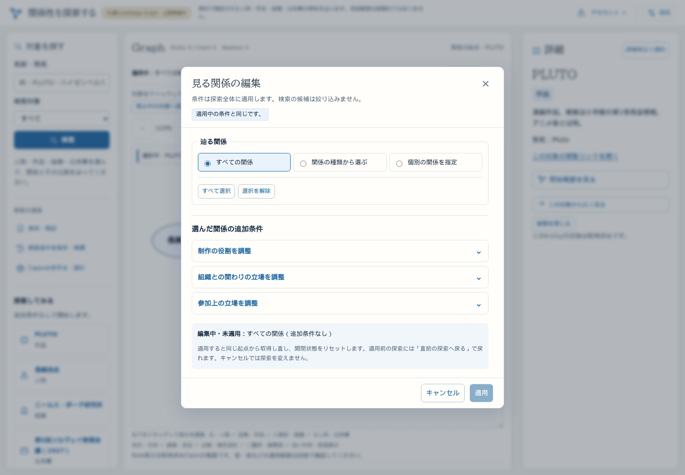

# 探索画面のデザイン刷新

2026-10-14。ユーザーのデザイン刷新依頼と追加の判断軸を採用。公開βの工程17以降より先に、実物を見て評価できる探索画面を作る。監査前の工程8〜10の完了記録を、この要求の充足証拠には使わない。

## 中心に置く体験

明朝体を活かした文化的な知性と、アイコン・関係図による科学的な探索感を調和させる。余白のバランスを大切にし、静かに全体を俯瞰しながら、好奇心のまま知識を辿れるようにする。コーヒーを飲みながら長時間眺められる落ち着きと、小さい発見の楽しさを両立する。

参考①「ライト・エディトリアル」を基調に、③「PLUTO」のコンパクトなヘッダ、操作の記号、青いアクセントを取り入れる。参考画像の名称・架空機能・作者等の属性は実装要件ではない。サービス名も変えない。

## 現行との差と今回の範囲

| 元の目的 | 現行の問題／今回の対応 | 評価方法・残り |
| --- | --- | --- |
| 知的・静かで無個性でない | 淡い緑の配色と同じ枠の反復から、温かい紙の白・濃紺の文字・青い選択と主要操作へ。サービス名・詳細の対象名・大きい見出しは明朝、操作と数字はsans | PCのPLUTO／科学／Event、ライトと既存二ダークで実画面確認。最終的な好みはユーザーが判断 |
| 部品・情報階層まで設計 | 検索は塗りのprimary、保存は軽いアイコン付き操作、対象候補は小さいカード、詳細は見出し・限定・根拠のまとまりで読む。設定と狭幅の既存領域切替にも同じ記号とアクセントを使う | 原文・aria名・機能を維持。未実装のcollection／insight等は増やさない |
| Graphを探索ツールの中心に | 淡い点地、余白、明瞭な線と読みやすいラベル、選択・hoverの外枠を整える。ノードは種別の形を維持 | 方向・否定破線・肯否混在・限定・既存座標／pan／zoomの回帰を確認。人物画像・minimap・新rendererは今回追加しない |
| 軽快で自然な反応 | modal／設定の短い出現、accordion内容・狭幅領域のfade、buttonの状態変化、新規Nodeの220ms表示効果 | 実ブラウザの進行中animationとreduced-motionを確認。通信や次の入力を演出完了まで止めない |
| 全画面の一貫性 | 探索の代表画面を確認してから、会員／共有・Capsuleへ同じ色・書体・境界・見出しを展開 | 実Googleは未接続のまま。会員と共有の実保存は専用PG／検証OIDCで確認 |

## 守る境界

- DB・API・Entity／Claim／Source・predicate／qualification・dataset・保存形式は変更しない。
- 三ペインとスクロール契約、Graph高さの手動調整、開閉・休止復元・起点切替・条件draftの寿命を維持する。
- 人物ellipse／作品round rectangle／組織hexagon／Event diamondを維持する。色だけに依存させない。否定・肯否混在の線、展開済み二重枠・選択枠・新規表示の淡い外枠を維持する。
- 原文にない作者・職位・期間等をデザインで補わない。アイコンは装飾として読み上げを重複させず、意味のある操作名は残す。
- 閉鎖では対象を即時に表示から外す。消えかけのクリック可能なNode、閉鎖待ち、保存stateへのanimation情報を導入しない。これは閉鎖アニメーションを完成させたという意味ではない。
- OSのreduced-motionでは新しい演出も停止。色・形・文字の状態は静的に残す。

## 今回の書体と動き

見出しは同梱のBIZ UDPMincho Regularをnext/font/localで配信する（[出典とライセンス](../../app/fonts/README.md)）。11741のcmapを維持し、文字を現在のdatasetだけへ間引いていない。約3.0MiBの初回取得は残るためdisplay:swapとし、本文・操作の描画を待たせない。フォントの配信分割は残る最適化候補。CSS Modulesと小さい共通SVGアイコンを使い、UIライブラリやアプリ依存は追加しない。

新規Nodeはopacity 0.45→1を220ms、modal／設定は180ms・最大5px、領域切替は160msのfade。対応ブラウザのnative detailsは180msの高さ補間、非対応では既存の開閉＋fadeへfallbackする。制作Role等の条件panelは開く時のfadeで、閉じる時は即時。Cytoscapeの位置や倍率を演出で動かさない。

## 段階と公開β計画への接続

1. PC探索の代表経路を操作できる初回案。配色・書体・部品・Graph・反応をまとめて確認する。
2. 同じ基礎を会員／共有へ展開し、スマホの外観・日英・既存経路を回帰確認する。
3. 日常確認先3200／Tunnelへ反映。参考との共通点・差・不足を報告し、ユーザーが画面を評価できるところで区切る。好みの最終承認は実装やテスト成功と分ける。

今回の作業を理由に24工程の分母を黙って増減しない。監査前の15/24は過去の記録であり、現在の要求充足率の保証ではない。工程8〜9は刷新・再評価、10はスマホ詳細配置の検討未履行を残す。データ拡充17を現在の最優先とする扱いは中断する。

スマホのGraph下段詳細／詳細優先／隣接一覧accordionは**別の未解決要求**。今回は既存タブ方式の外観に同じ方針を適用するだけであり、その配置要求を解決済みにはしない。広告仮配置・計測・実Google・数千実測も今回の外観変更へ混ぜない。

## 完了判定

配色差分やテスト数だけでデザイン要求を満たしたとはしない。上表の元目的→対応→実画面の評価→不足を記録する。実装案をユーザーが触れる状態へ反映し、どの点を判断でき、何が未確認かを報告する。

本書は実装の採用境界と初回案の評価記録であり、デザインの最終承認を示さない。

## 初回案の実画面評価（2026-10-14）

PCのPLUTO、NBI、特定Solvay開催回、Relation／Claim詳細、条件modalを確認。会員／共有は専用PG＋検証OIDCの390／1440pxで確認した。通常の確認先へ検証用認証は公開しない。

| 判断軸 | 今回確認できた改善 | 参考との差・残る不足 |
| --- | --- | --- |
| ①の知性・資料性 | 温かい白と濃紺、明朝のサービス名／詳細名／見出し、sansの操作・数値。字体と資料の階層を分けた | 本文は長時間の可読性を優先してsans。Graph内の名前もsans。参考の書体・装飾をそのまま写してはいない |
| ③の探索ツールらしさ | 共通の細線SVG、青い主要操作と選択、淡い点地、短い状態変化。左の保存操作を軽い道具として区切った | 参考の上部アプリタブ、minimap、人物画像等は新機能になるため追加しない。既存のkind形状を維持する |
| 余白とGraphの優先度 | 重複した上部保存操作を左へ集約し、Roleの詳しい注意書きは凡例側へ移動。PCのPLUTOではCanvas開始位置を初回案の約363pxから約303pxへ調整 | スマホはまだ操作・説明が上部を使う。外観刷新を、詳細下段・詳細優先・一覧accordionの解決とは扱わない |
| 自然な反応 | modalの最大5px移行とfade、設定・領域のfade、資料detailsの高さ補間、新規Nodeの220ms表示。設定と領域切替はanimationstartの実発火も検証 | 条件の立場panelとGraph閉鎖は即時。大きい消失演出や座標移動は入れていない。静止画像だけで動きの魅力を確定しない |
| 可読性・役割 | 三テーマで主要本文・補助文字・primary文字4.5以上、線／kind輪郭3以上をブラウザで検証。ライトの本文12.57、補助文字5.13、primary文字5.47 | 全画面・全状態のアクセシビリティ適合認証ではない。長い科学者名・Event名のGraph内改行には詰まり感が残る |
| 会員／共有の統一 | 同じ資料面・見出し・設定、保存のprimaryと破壊操作の警告色。日英の未保存入力・共有URL・コメントを保持 | 狭い共有画面の英語操作がアイコンで分断されたため、狭幅toolbarでは文字を優先して修正。実Google接続は依然未了 |

参考画像より登録情報が少ない箇所を、架空の作者・発表年・所属等で埋めていない。現在のデータだけで見える関係を維持する。Graphの輪郭・kind形状・方向・破線・展開済み二重枠は残す。hoverは一時的な表示classのみで、探索stateや保存形式には入れない。

PCの代表画面：

### 検証記録

- 通常テスト30 file・577/577成功（582.28秒）。ロジック変更時に全件を実行し、その後の外観調整は実ブラウザの対象回帰で確認した。
- `npm run typecheck`／`npm run lint`／`npm run public:build` は最終の演出修正後も成功。既存の語彙warning1件は増加なし。
- 公開用本番buildのPlaywrightは20/20成功（6.7分）。三domain・三限定・検索・開閉・復帰・閲覧・保存・Source・日英・320／390pxの既存経路を含む。
- その後のCSS Modules演出修正後は、三テーマ／字体／設定とタブの実発火／資料accordion、320／390pxのtouch・Source往復、日英・座標保持の対象4/4（1.3分）を再確認。
- demo実DBの通常／reduced-motionは2/2（60.0秒）。追加・閉鎖・再開・起点復帰・選択・座標／pan／zoom・通信回数を確認。
- 専用PG＋検証OIDCの会員／共有390／1440pxは2/2（6.5分）。toolbarの狭幅修正後も390pxを再実行し1/1（4.2分）。編集・共有・Source／探索・コメント・退会確認を維持。最後の演出だけの修正は上記対象回帰で確認。
- 原フォントとWOFF2の11741 cmap一致、アプリの依存追加なし、API・server／domain・dataset・fixture不変を確認。DB migration・seed・新しい実データ投入はしていない。

初回は新しいコントラストテストがCSS最適化後の3桁hexを扱えず失敗し、検証側の形式処理を修正した。また途中の再buildがブラウザ検証と重なった回は採用せず、build完了→server再起動→固定版の20件という順で再確認した。実画面の動きを追う過程で、CSS Modulesが局所化したanimation名に定義がない箇所を発見し、同じscopeへkeyframesを定義した。「animationNameがnoneでない」だけの確認を、登録済み定義・実際のanimationstart・reduced-motionまで確認する形へ補強した。

モーダルは開始時の半透明／約4pxの位置と、完了時opacity 1／変形なしを実ブラウザで確認。資料detailsは開いた本文が実際に高さを持ち、肯否内訳を読めることも確認した。デザインの最終的な好み・長時間使用の快適さは未判定であり、ユーザーの実物評価へ渡す。

フォント初回配信量、長いGraph名の改行、条件panel／閉鎖の演出、スマホ詳細配置は残る課題。これらを無制限の完成条件へ増やさず、まず日常確認先で今回案を評価する。VPSは既存の工程16を維持し、今回案の評価前に一般公開の承認や会員有効化を行わない。

### 確認先と区切り

ローカル3200と https://graph-beta.isinxnisi.com/ はbuild `6EDDklJLu6NG_VR-zrYxt`。Tunnelの最終代表2/2（1.1分）が成功し、同梱明朝・三テーマ・設定／タブの実発火・条件／概要・座標と、漫画／科学／Eventから根拠・起点復帰まで確認。datasetはpublic-kg、revisionは既存の `legacy:20261011-001` を維持する。3210〜3215のdataset APIも全て200。

VPSの https://graph.isinxnisi.net は工程16 build `2sDd_pNucKRYWsHCCq6AK`・revision `5b6ccb7b-7a5d-4005-ab34-01c490e93b1c` のまま200を確認。preview認証・会員無効化を維持し、今回のデザインはまだ配置していない。DockerfileにはフォントライセンスをWeb imageにも同梱するCOPYを追加したが、今回VPS用imageを作成・配置したとはしない。通常VPS更新は既存契約の工程19。

初回案を実物評価へ渡せるところまでを今回の区切りとする。好みの最終承認、長時間使用の快適さ、残るスマホ詳細配置は未了。次はユーザーの画面評価を基に調整範囲を決め、スマホ配置の独立した比較と工程17再開の順序を整理する。

## 2026-10-14 隣接一覧の局所調整

利用者の画面確認で、隣接一覧が横幅いっぱいの区切り線と左寄せの情報だけになり、右側の余白が大きく味気ないことを確認。独立Claimをそのまま保ち、読みやすい列幅のカードへ変更した。幅がある場合は複数列、スマホは一列。関係名、両端と矢印、肯否・限定・期間・出典、操作の順に階層を付け、一覧全体にネイティブの折り畳みを追加した。初期は開き、折り畳みで通信やGraphを変更しない。中央ペインだけのスクロールを維持する。

既存のモーダル開閉・背景クリック・Escape契約を維持。折り畳みは共通の180msの表示効果と、対応ブラウザの高さ補間を使用。動きを減らす設定では抑止する。カードのhover・選択を枠と背景で示す。主張を統合・並べ替えて評価する変更は行っていない。スマホのGraph下段詳細／詳細優先という未解決事項を、この一覧改善で完了とは扱わない。

### URL共有とリロードについての確認（提案・未実装）

現在の直接閲覧URLは `read=entity|claim&dataset=…&id=…` で対象または主張を開くもので、展開Graphの共有ではない。Capsuleの限定リンク共有も、明示した参照・説明を共有する別の機能である。

- 起点＋確定条件の探索入口は、小さい版付きquery契約へ載せられる。検索語や未適用draft、通信cursorを混ぜない。URLの長さが許容範囲内になる入力上限を設ける。
- 枝・配置まで共有するなら、既存の探索途中保存の形式を基礎に、サーバー側に検証済みの保存を置き、URLは短い識別子とする方が自然。途中保存の現行上限はJSONで100,000 bytesであり、そのままqueryへ詰める前提にはしない。これは提案で、共有ストレージやAPIは追加していない。
- リロード復元は共有とは分け、同じタブの一時保存から続きを復元することを次の小さい実装候補とする。sessionStorage等を使う場合も、dataset分離、手動操作との競合、更新された知識での再構成、再試行・中止、保存不可時の表示が必要。現在の途中保存は選択を保存せず、受理ページ本文・古いcursor・通信も保存しない。完全な過去再現を約束しない。

今回、リロードによるGraph消失は修正していない。起点だけの復元で枝が失われる方式を、その要求の解決とは判定しない。共有URLもまだ展開Graphを再現できない。

検証: 隣接一覧・探索状態のunit 97/97、typecheck、lint（既存の語彙レビュー警告1件を維持）、production build成功。実ブラウザはPC1440px／スマホ390pxで二列→一列、キーボード開閉・animationstart発火、5 Claim保持、根拠画面への移動、折り畳み前後の座標・pan/zoom一致を確認。三テーマ・条件／概要の往復を含む代表Playwright2/2（44.2秒）、日常確認URLの同一覧1/1（12.6秒）成功。初回はローカルとTunnelのテスト成果物ディレクトリが競合して終了時に失敗したため、その結果を最終成功に含めず、別出力先で再実行した。

3200／日常確認URLへbuild `6DegX8bGU-kyUihEL-Xey` を反映。VPSは今回更新しない。好みの最終評価は利用者の画面確認待ち。URL共有・自動リロード復元は上記の提案段階のままであり、今回の実装完了範囲には含まない。

## 2026-10-14 追加修正：一覧の文脈と開閉の動き

画面確認で「主張と出典を見る」を押すとカード数が変わる問題が判明。従来はClaim／Relation選択時にそのsubjectを隣接一覧の対象へ採用していたため、作品から人物の一覧へ暗黙に切り替わっていた。一覧の文脈を詳細選択と分離し、主張／線の詳細を読むだけでは維持する。Entityを明示選択した時、新探索へ切り替えた時、対象がGraphから消えた時にだけ更新する。Graphの意味・取得条件は変更しない。

前回の短いフェードとCSS対応ブラウザだけの高さ補間では、要求された開閉の体験を十分保証できていなかった。隣接一覧と関係概要内の統計折り畳みはnative detailsを維持し、Web Animationsで高さを240ms補間する。途中で反転可能、閉鎖途中の本文は操作対象外とし、キーボード開閉も維持する。条件／関係概要モーダルは開く時260msの移動・縮尺・フェード、取消／Escape／背景クリックで閉じる時160msの退出と背景フェードを付けた。条件適用や起点切替などの実処理を演出のために遅らせない。保存など他のモーダルの退出処理は今回変更しない。

利用者から端末設定による無効化の可能性が提示された。`prefers-reduced-motion: reduce`では従来からフェード等を止めているため、今回もCSSとWeb Animations双方で抑止する。これを勝手に解除しない。利用者の実端末で有効かは未確認であり、見えなかった理由を未実装だけにも端末設定だけにも断定しない。通常／動きを減らす両条件を実ブラウザで検証する。

最終検証: 関連unit104/104、typecheck、lint（既存語彙警告1件、追加ファイルの最終lintも成功）、production build成功。通常のブラウザ設定で240msの高さアニメーションの実行と異なる開始／終了高さ、キーボード開閉、Claim詳細を開いた後もPLUTOの5カードと同じID・見出しが残ることを確認。条件モーダルの260ms表示／160ms退出、Escape、概要モーダルの背景クリック、reduce指定でアニメーションなし・即時開閉を検証。ローカル代表3/3（1.3分）、日常確認URL2/2（47.5秒）成功。3200／Tunnelへbuild `AhF3GECgY4cWkdb66zNpe` を反映した。利用者の端末のreduce実値は未確認。

## 2026-10-14 関係概要の取得後の高さ変化

非同期取得後に「この対象から伸びる関係／この対象へ向かう関係」が加わり、中央配置のモーダルの高さと位置が急変していた。利用者の意図は高さの固定ではなく滑らかな変化であるため、内容に合う自然な高さと画面内の上限を維持し、取得成功・失敗・再試行による本文差し替え時に描画前のlayout effectで高さを240ms補間する。中央位置も高さに従って連続的に変化する。取得を待ってモーダルを開く方式や固定の空白枠は採用しない。統計の折り畳みは既存の高さ補間を維持する。reduce設定では高さの補間も抑止する。

検証: 概要unit6/6、typecheck、変更ファイルのlint、production build成功。実ブラウザで通常PC／reduceスマホの遅延取得2/2（36.2秒）と既存モーダル操作1/1を確認。PCでは取得前約401px、取得後約561pxの間で、80ms時点約533px・160ms時点約557pxという実描画の高さと中央位置を確認した。壁時計によるrAF採取は自動テスト環境のフレーム間引きで途中を拾えず一度失敗したため、検証時だけアニメーション時刻を制御して中間のbounding boxを実測する方式にした。reduceでは高さのアニメーションが作られないことを確認。日常確認URLでも2/2（39.5秒）成功し、3200／Tunnelへbuild `OssbVLzK-oyavNkwJ4Vef` を反映した。

### 伸縮中の一時的なスクロールバー（2026-10-14）

高さを補間している途中は本文が一時的に収まりきらず、`overflow: auto`の本文にバーが点滅していた。高さ補間の実行中だけ一時属性を付け、本文のスクロールバー表示を隠す。完了・中断・unmountで解除する。overflowやホイール操作は変更せず、内容が長い場合の通常スクロールは残す。reduce等で高さを補間しない場合には非表示を適用しない。

検証: 概要unit6/6、変更ファイルlint、型検査込みproduction build成功。unitは並列build中に既存1件が5秒の制限を超えたため、build後に単独で再実行して6件成功を確認した。PCで補間の各時刻にバーが非表示であること、完了後に一時属性と非表示指定が解除されること、500px高の画面で本文をスクロールできることを確認。reduceスマホも維持。ローカル2/2（35.7秒）、Tunnel2/2（34.5秒）成功。3200／Tunnelをbuild `3awuKfeso0k1VBm0ivnTR` に更新した。

## 2026-10-14 対象ナビゲータの横幅と情報密度

表示中対象への移動パネルは、短い名前・説明を画面全幅の帯へ引き延ばし、各行の右に大きな未使用領域を残していた。候補を可読幅の複数列へ並べ、種別アイコン・名前・種別・説明を一つのまとまりにした。繰り返す移動案内は矢印と支援技術向けの操作名へ整理。説明・同名識別IDは省略しない。絞り込み欄は最大440pxとし件数を横へ配置、狭い画面では折り返す。スマホで開いたパネルは中央ペインの幅を使う。選択・絞り込み・枝を開閉しない移動・Escape／focus復帰は維持する。

今後も、短い情報に全幅の帯や入力欄を当てて余白を成り行きにしない。情報のまとまり、可読幅、候補数に合う列密度と操作位置から配置を決める。複数列化だけを一律の解決策にはせず、今回の小さい候補一覧に適用する。

検証: 移動パネルunit2/2、変更ファイルlint、型検査込みproduction build成功。PC1440pxでは三列で候補を表示し、カード幅・入力幅を確認。スマホ390pxは中央ペイン幅の一列になり、横はみ出しなし。実画像も確認した。絞り込み・選択後のfocus復帰・Escape・GraphのEntity／Claim件数維持をPlaywrightで確認。初回テストでは「PLUTO」で名前だけが一致する1件を期待したが、既存契約では説明にも一致して4件となるため、同じ仕様のまま検証入力を修正。ローカル1/1（20.5秒）、Tunnel1/1（30.6秒）成功。3200／Tunnelへbuild `Ej9VGg9Qk82Rf1n9UdXqm` を反映した。最終的な見た目の評価は利用者の確認を待つ。

## 2026-10-14 閉じた通常状態のGraph操作

開いた候補一覧だけでなく、通常状態でも案内・移動ボタン・表示操作がGraphの上に数段並び、空白帯を作っていた。対象一覧を左上のアイコンとキャンバス内の浮動パネルへ移し、右下へ選択表示・拡大・倍率・縮小・全体表示をまとめた。ボタンは44px角のアイコンにし、日英の読み上げ名とtitle説明を保持する。適用条件と編集はGraph外に残す。通常の操作案内とスマホの隣接一覧ショートカットはGraphの下へ整理した。

対象一覧はGraphの高さを押し広げず、枠内でパネル全体をスクロールする。リストとの二重スクロールを作らない。非操作部分の透明な領域はポインターをGraphへ通し、操作ボタンやパネルのイベントはCanvas操作へ伝えない。選択状態は左上アイコンの隣へ配置し、右下のresizeつまみも空ける。探索条件・受理Graph・Node座標・開閉の意味は変更しない。

検証: 対象移動unit2/2、変更ファイルlint、型検査込みproduction build成功。ローカル代表3/3（38.9秒）、Tunnelの移動／操作2/2（20.9秒）成功。ズーム・選択表示・全体表示でNode座標とGraph件数を維持、対象一覧の開閉・ホイールでpan/zoomを維持、閉じた透明領域ではドラッグでpanできることを確認した。PC1440px／スマホ390pxでツールがキャンバス内へ収まり、44pxの操作領域と説明があることを確認。撮影時は全体表示へ戻し、両サイズの実画像も確認した（追加代表1/1、15.7秒）。3200／Tunnelはbuild `BI02b5kFo9fV6Z2Y7_uVt` に更新済み。味付けの最終評価は利用者の確認を待つ。

## 2026-10-14 探索URLの実装

上記の共有ストレージ案は過去の提案。今回の明示依頼を受け、[探索URL復元契約](EXPLORATION_URL_RESTORE.md)に沿い、起点UUID＋可逆圧縮queryで枝と座標を保持する方式を採用した。過去の未実装記録は書き換えず、現行契約はリンク先を優先する。

## デザイン未成立の定義と次の作業（2026-10-14訂正）

**現在はデザインが成立していないため、画面・操作の意図が伝わらない。デザインが成立していないため、保存までの流れがどうあるべきかも判断できない。デザインが成立していないため、次へ進めない状態である。**

「デザインができていないこと」と「保存までの流れが伝わりにくいこと」は別課題。後者の局所修正へ前者を縮小しない。保存ボタンの見落としは観察された具体例であり、デザイン要求の全体ではない。先の「会員Capsule導線の改善」という整理はユーザーの訂正を受け撤回する。

実Googleログイン・アカウント保存・再ログイン後の再閲覧は本人が確認済み。この機能確認は維持するが、デザインが成立している根拠にはしない。現行の未整理な画面を前提に、保存手順だけを説明・短縮して先へ進めない。

次は採用済みの明朝／ライト・エディトリアルの方針に基づき、画面の役割、情報階層、レイアウト、操作の意味、視覚的な強弱、反応を一体として設計する。会員・Capsule画面はその具体的な検討対象とするが、問題の定義を会員保存だけへ限定しない。実際に操作できる画面で意図が伝わる状態を作り、その中で作成・保存・再閲覧・共有の流れを検討する。

リンク／ボタンは実装要素の違いだけで見せ方を決めず、利用者に何が起こると伝えるべきか、どの操作を主役とするかから設計する。一覧・閲覧・編集・保存先・共有操作の関係を整理し、画面を見て現在位置と次の操作を理解できる構成にする。保存導線の問題は独立して検証し、デザインが成立しただけで自動的に解消したと判断しない。

判定はPCと狭幅の実ブラウザで、画面の意図・情報のまとまり・操作の意味が伝わるかを確認し、ユーザーが実物を評価できる状態へ進める。テスト成功・保存成功をデザインの完成や最終の好みの承認へ読み替えない。スマホGraph下段詳細の別要求、本人による編集／限定共有・停止等の未確認も維持する。

知識モデル・保存形式・認可・一般公開は変更しない。この節は問題定義と次の作業の訂正であり、新デザインの実装・充足済みの記録ではない。

## 現在の操作体験を絶対軸にした導線整理（2026-10-14）

ユーザー指示：導線は現状の体験を基に、ユーザーがどんな操作を体験するかを絶対軸として整理する。画面／機能一覧や内部の保存方式を出発点にしない。前節のデザイン未成立という定義は維持するが、「見た目を先に作り、その後で導線を考える」という順序にはしない。操作体験を整理せずデザインも曖昧になっている可能性を検証する。原因を確認せず一方から他方へ断定しない。

### 現在、利用者がすること

| 利用者の場面・目的 | 現在見えるもの／実際の操作 | 起こること | 利用者が判断しなければならないこと・問題 |
| --- | --- | --- | --- |
| 知っている対象から調べ始める | 検索する、または開始例を押す→対象を選ぶ | 対象が起点になりGraphを取得 | 検索候補取得だけではGraphは変わらない。選択が開始操作 |
| 興味を持ったつながりを辿る | Nodeを押す、線を選ぶ | 周囲の展開、関係／主張／出典の詳細確認 | 選択・開閉・起点切替は異なる。線から何を確認できるかを画面で伝える必要 |
| 後でまた見たい | 「保存・再訪」「探索途中を保存・再開」「Capsuleを作る・読む」、Graph URLコピーが存在 | 起点／条件、枝／配置、説明付きの選んだ対象／主張、URLによる探索復元を別々に扱う | 利用者が最初から内部の保存用途を分類しないと選べない。実際の達成目的から入口を検討する必要 |
| 説明を付けて関係を残したい | 「Capsuleを作る・読む」を押す | 最初はブラウザ内Capsuleの一覧を開く。別タブのアカウント入口も並ぶ | 作りたいのにまず一覧に入る。ブラウザ／アカウントの違いもこの時点で理解を求められる |
| 新しく作る | 「表示中のGraphから作る」→題名／説明／対象／主張を選択→「Capsuleを保存」 | ブラウザ内へ保存し、同じモーダルでそのCapsuleの内容表示へ直接進む | Graphの全状態を保存する操作ではない。「保存」でどこまで完了したかを理解する必要 |
| 別端末でも読み返せるよう残す | 内容表示の「この内容をアカウントへ保存（別タブ）」を押す | 会員画面を別タブで開き、保存するブラウザ内Capsuleが選択される | このリンクは保存完了ではなく保存先画面への移動。現在の見せ方では主操作として見落とされ得る |
| 本人のアカウントへ保存する | 未ログインならGoogleログイン→「この内容をアカウントへ保存」を押す | 明示保存し、そのアカウントCapsuleを内容表示。元のブラウザ保存は残る | ログインだけでは保存されない。二つのコピーが以後同期しないことを理解する必要 |
| 後日読み返す | 会員画面でログイン→本人一覧→「内容と根拠を読む」 | アカウントへ保存した内容を再閲覧 | ブラウザ内一覧とは別。実Googleのlogout→login後も本人が再閲覧を確認済み |
| 保存内容を直す | 内容表示→編集→「アカウントの変更を保存」 | アカウント側の内容版を更新 | ブラウザ側と既存共有版は自動更新されない。どの内容を編集しているかが必要 |
| 人に見せる | 「この版の共有リンクを作る」→版を確認→閲覧可能にする→リンクをコピー | 指定版の限定共有を作る。停止は別の確認操作 | 会員ページURLのコピーとは違う。更新した内容と共有中の版の違い、停止の結果を判断する必要 |
| 元の探索へ戻る | モーダルを閉じる、会員画面は別タブを閉じる、または探索リンクを開く | 元Graphへ戻る／別の探索を開く | 同じ探索への復帰と新しい探索を開くことの違いを予測できる必要 |

根拠：`components/Explorer.tsx`、`CapsuleDialog.tsx`、`MemberCapsules.tsx`、`CapsuleShareControls.tsx`と対応i18n、`tests/e2e/member.spec.ts`の操作定義。今回は既存E2Eの全経路を再実行したとはしない。ローカル3200の1440px・使い捨てChromiumでCapsule入口を開き、一覧／作成／アカウントへの別タブリンクの現行表示を確認。さらにPLUTO開始→新規作成→題名と対象を選択→ブラウザ内保存を操作し、保存直後に内容表示とアカウント保存リンクが現れることを確認した。使い捨てcontextのブラウザ保存だけで、DBへの保存は行っていない。本人アカウントの内容やcredentialは扱っていない。

新規保存後は`CapsuleDialog`が自動で内容表示へ進む。「保存→一覧の『読む』」は必須ではなく、既存保存を開き直す場合の手順。先の案内と記録ではこの二つを混同していたため、この操作表を正しい現状とする。

### 今回の整理の範囲（2026-10-14・追加指示）

ユーザー体験は設計の上位概念として別途設計中。上記の表はその設計へ渡す現状の操作・結果・観察であり、独立した理想フローや改修計画を決めない。導線の整理と修正を一緒に行う場合は、1回で完結できる局所範囲に限る。複数ステップを要する場合は現状整理だけで区切る。

今回は現状整理のみ。保存用途を選ぶ負担や別タブ遷移は観察事項として残し、それらの変更方式・新UI・実装順序は採用しない。画面の統合、保存の自動化、別タブ廃止を先取りしない。実Googleで未確認の編集／共有停止等は未確認を維持する。

2026-10-14後続：関係詳細の「情報・ボタンを置くだけ」という指摘に対し、[関係詳細の読み順](RELATION_PRESENTATION_CONTRACTS.md#関係詳細の読み順と二対象のまとまり2026-10-14)を見直す。関係→二対象のペア→資料→確認範囲を優先し、枠線や色の追加だけで解決したと判断しない。初期実物をユーザーが評価できる状態にする局所改善であり、全体のデザイン要求の充足や好みの最終承認とは区別する。

関係詳細では、ユーザー指定の「情報をコンパクトに表現する」を密度の判断基準に加える。対象ペアは小さな一組の導線、記録は軽い区切り、資料は控えめな面でまとめ、単一記録の目次や繰り返す関係文を省く。長い確認メモは全文へ展開できる短いプレビューとする。余白を増やすこと自体を洗練と見なさない。
