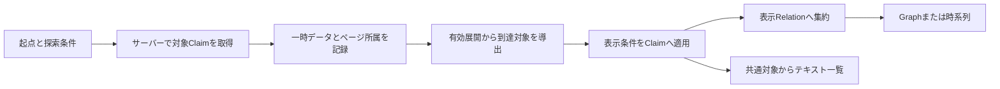

# 探索モデルの設計レビュー

2026-10-03。状態: **移行順序1〜4の開閉モデルは採用・実装済み。条件付き探索・時系列・API拡張は提案段階**。初期Vertical Sliceは維持する。以下の現状分析はレビュー時点の記録で、開閉後の実装は末尾の参照先を基準とする。

## 1. 現状の構造

実際に確認した実装:

| 実装 | 現在の責務・制約 |
| --- | --- |
| lib/client/graph-state.ts | nodes / claimsのID辞書、単一centerId、Entity IDごとのexpansions、lastExpandedId。ページ全体をマージし100 Entity / 200 Claimを超えるページを拒否 |
| lib/client/use-graph-explorer.ts | React state。選択と展開が結合。Entityクリックで未展開なら取得。同一Entityの通信抑止、abort、世代番号による旧応答排除。中心変更で全リセット |
| lib/client/graph-presentation.ts | 取得済みClaimをsubject / predicate / objectの表示Relationへ集約。肯否の混在から「異説あり」。同名ラベルと曲率も導出 |
| components/GraphCanvas.tsx | GraphStateから直接Cytoscape要素を追加。中心変更時以外の消失要素の差分削除はない。座標・pan/zoomはCore内、追加配置はgraph-layoutを使用 |
| components/RelationsList.tsx | 同じgraph.claimsから隣接一覧を作る。Graphの表示条件を持たない |
| components/ClaimDetails.tsx | Claim APIから同一関係の全公開Claimを取得。詳細の関連ClaimをGraphへ追加しない |
| lib/server/queries.ts / graph.ts | published Claimの両方向の一段階近傍、Claim ID順のページング。predicate / kind / 時間の条件なし |
| lib/domain/predicates.ts / fixture.ts / server/mappers.ts | 管理されたpredicateと端点kindの検証。INFLUENCED_BYはperson→personのみ。CONTRIBUTED_TOは役割を特定しない |
| lib/domain/dates.ts / api.ts | Claim.periodの年/月/日精度と不明端点。Entityに作品発表日・生年月日・活動期間はなく、APIにもない |

ページをマージすると「どの展開・どのページがそのClaimを取得したか」が失われる。expansionsにあるのは通信とcursorの状態で、取得結果の所属ではない。lastExpandedIdは直近の配置元であり、所有関係や探索履歴ではない。

Neo4jのEntity / Claim / Citation / Sourceを独立させたモデルは引き続き適切。保存した主張と表示Relationの分離も良い土台。問題はクリック方式自体より、**取得済みデータ＝表示Graph**となっている状態の境界である。

## 2. 将来詰まりそうな点

### 閉じる

- 「その時初めて追加されたNode」を消すと、別経路で利用中のEntityやClaimを壊す。
- 単一parentIdの探索木では、循環・合流・複数起点を表現できない。
- 参照数だけでは、起点から切れたB↔Cの循環が互いを参照して残る場合がある。
- Claimを消すと同じRelationの所属Claimと肯否表示も変わる。Nodeだけ消すと端点を欠く辺が残る。
- 通信中に閉じた展開の応答が、あとから表示を復活させ得る。現在の世代番号は中心変更単位で、局所的な閉じるには足りない。
- データ取得済み、展開が開いている、今の起点から到達している、画面に表示されている、は別の状態。
- GraphCanvasは現在追加中心なので、stateから消しても同じ世代のCoreに古い要素が残る。閉じる実装には差分削除が必須。

### 見たい軸

- 同じEntityでも検索条件が違えば結果・cursorは別。Entity IDだけのexpansions / pendingでは条件が混ざる。
- predicateを表示側で隠すだけでは、関係のないページを読み続けなければ狙ったClaimに到達できない。空の表示ページを「関係なし」と誤認し得る。
- フィルタ後のRelationだけを見ると、除外されたdeniedが存在しないように見える。詳細の全Claimとの範囲差も説明が必要。
- Entity種別を隠すことと、探索経路でその種別を通らないことは違う。作品経由で人物へ行きたい時に作品を除外すると、方針によっては辿れなくなる。
- 時系列は「何の日付か」が未定義。Claimの成立期間、作品の発表日、人物の生年月日、Source公開日、登録日時は交換できない。
- 一つのEntityに複数時点の関係があるため、Entity一個にx座標一個を与えるだけでは関係の時系列を表現できない。
- 現状の検索はperson限定。「作品を起点にする検索」は未対応だが、既知の作品IDの詳細・近傍取得は利用できる。

## 3. 設計案

### 分けるべき概念

次は実装型や新規クラスの指定ではなく、保持すべき責務の提案。React標準state・通常の関数で始められる。

| 概念 | 内容 |
| --- | --- |
| 探索条件 | 起点集合、辿るpredicate・端点kindの組・方向・期間条件、未知の日付の扱い、取得予算 |
| 取得済みデータ | Entity / Claim / 必要な詳細のID辞書。DBの第二の正本ではない、画面内の一時キャッシュ |
| 展開記録 | 起点Entity、取得条件の識別、取得ページと所属Claim IDs、cursor / hasMore、開閉意図、要求番号、通信状態 |
| 表示条件 | 表示kind / predicate、非表示Entity・Relation、期間表示条件。取得条件とは区別する |
| 表示対象 | 有効な展開と起点から導出したEntity / Claim、そのRelation集約。正本として二重に編集しない |
| 表現 | 自由Graphか時系列か、座標、選択、pan/zoom。探索条件から独立させる |

「探索条件」は小さい明示的な条件集合から始める。任意の式、汎用クエリ言語、プラグイン、全分野のオントロジーは作らない。

### 閉じるの推奨意味

**そのEntityの展開結果を使う意図を解除する**操作とする。Entity自体、入ってきた関係、別の展開が支える共有対象まで一律に消さない。

「枝を閉じる」と「このEntity / Relationを画面から隠す」は別の操作にする。後者の非表示指定がある対象は、別の取得経路でも勝手に再表示しない。閉じるだけでは同じ対象への他経路を禁止しない。

表示は次の規則で起点から再導出する:

1. 起点と、将来明示的に残す指定をしたEntityを開始集合とする。起点は孤立していても残る。選択しただけでは残す指定にしない。
2. 現在の探索条件に対応する取得スコープの展開のうち、開く意図を持ち、その中心Entityが開始集合から到達済みであるものだけを有効にする。以前の条件のキャッシュは自動的に混ぜない。
3. 有効な展開の受理済みページに属し、辿る条件と非表示指定を満たすClaim、その両端点を追加する。
4. 新たに到達したEntityについて同じ処理を繰り返し、集合が増えなくなったら止める。
5. 表示条件を適用し、残ったClaimをRelationへ集約する。表示する辺の両端点は必ず揃える。これは取得済みデータの計算であり、ネットワークの自動多段取得ではない。

起点から始める最小の集合を毎回計算することで、切り離された循環は残らない。Claimには複数の展開記録が所属してよい。起点・残す指定以外のNodeは、採用されたClaimの端点から導出する。起点に一致する関係が表示条件下でなくても、起点は文脈として残し、DB上の孤立とは区別する。起点自体の非表示は起点解除・変更との関係を明示し、暗黙に別の起点へ移さない。

例: 起点Aを展開してBとDが出現、Bの展開でC、Dの展開でもCが出現。Bを閉じるとB由来のClaimは外れるが、Dが支えるCは残る。Dも閉じ、Cに他の到達経路や残す指定がなければCは消える。Bだけを経由して到達していたCの展開も到達不能になり、C↔Eの内部循環は残らない。

ただし、DやCの有効な展開がB由来と同一のClaimを返していれば、そのClaimは残る。このルールは「展開を閉じる」であり「Bの周囲の関係を全て禁止する」ではない。

到達不能になった展開は休止とし、開く意図と受理済みページを短期キャッシュに残す案を推奨する。同じ条件で再到達した時は受理済み範囲だけ復元し、続きを自動取得しない。枝の閉じるで子孫の意図も全て解除する方式より復元しやすい一方、再到達時に前の枝が戻ることをUIで伝える必要がある。この復元UXはレビュー後に承認され、開閉フェーズで採用した。

### 通信・ページング・上限

- 展開記録のキーは「Entity ID＋取得条件の正規化キー」。include / excludeの順序など意味のない差を正規化する。UIの配色やレイアウトは取得キーへ含めない。
- 同条件の同時通信抑止、世代番号、abortを継承する。閉じる・条件変更には記録ごとの要求番号も使い、遅い応答を表示へ入れない。閉じた中心だけでなく到達不能になった展開の通信も無効化し、未受理ページは初期実装では破棄する。
- 同条件での再開には受理済みの所属集合とcursorを使う。取得条件が変わる時はcursorを再利用しない。表示条件だけの変更ならcursorは維持できる。
- 上限は画面の有効なEntityと**独立Claim**に適用し、Relation本数へ置き換えない。100/200の現行値は段階移行中維持する。
- 新規ページが超過する場合は従来どおり丸ごと拒否しcursorを進めない。閉じるで余裕ができたらblockedを再評価して再試行できるようにする。候補ページがフィルタで隠れる場合も、表示数とは別に受理・キャッシュ予算を確認する。
- キャッシュは別の件数・メモリ上限が必要。到達不能の展開記録を先に破棄し、破棄時は所属・cursorも無効化する。データだけ削除してexpanded=trueを残さない。
- 未取得、未取得ページあり、取得済みだが条件外、閉じたため非表示、孤立、上限停止を区別する。表示を閉じることはDBからの削除ではない。

### 絞り込みの段階



- サーバー: visibility / 将来の認可と、探索範囲を決めるkind・predicate・方向・期間。**条件をLIMIT前に適用**して条件付きのhasMoreを返す。ブラウザの非表示を認可として扱わない。
- クライアント: 取得済み範囲の閉じる、個別の非表示、即座の表示フィルタ。現在の結果だけを対象にした絞り込みで、未取得データを網羅したと伝えない。
- 集約の前: Claimの期間・肯否など個別条件。全Claimを集約後にRelationの一期間・一肯否で判定すると、相反するClaimを隠したり誤って判定する。
- 集約後: ラベル・曲率・配置・テーマ等のpresentationのみ。

最初は「辿る条件＝表示条件」を基本にする。橋渡しに必要な対象を隠して通る機能は、必要性が確認できた場合だけ明示的な文脈表示として追加する。知らないうちに隠したNodeを経由して自由探索が進む仕様にはしない。

詳細は既存APIで同一関係の全公開Claimを比較できる方針を残す。ただし、条件内・条件外・Graph未取得をラベルで区別する。Graphの「異説あり」はその表示対象内の肯否混在という現在の意味を保持し、「ないから他の主張もない」と誤解させない。条件外のClaimを詳細取得だけでGraphへ復帰させない。

## 4. 代替案とトレードオフ

| 案 | 利点 | 問題・使いどころ |
| --- | --- | --- |
| 取得順の親子木・追加Nodeリスト | 小さく実装できる | 合流・循環・共有Claimが壊れる。探索の正本には非推奨 |
| 参照数だけで閉じる | 共有を守りやすい | 起点から切れた循環、条件変更の所属管理が難しい。到達判定の補助に限定 |
| キャッシュ全体から起点への到達性だけ計算 | 単純なGraph算法 | 閉じた展開の辺がキャッシュに残ると枝が復活。展開の有効性も必要 |
| 全Graphをサーバーで条件再検索 | 全体検索・複雑な条件に向く | 高次数・履歴・配置維持・部分結果の扱いが重く、自由探索の小さい調整にも再取得が必要 |
| 自由探索と条件付き探索を別アプリ状態にする | UIごとに単純 | 閉じる・上限・Claim比較等が二重実装になり、表示の意味がずれる |
| 取得データ・展開記録・表示対象を分離 | 閉じる、合流、条件、別表現を共通化可能 | 所属と条件キー、キャッシュ管理が増える。必要なものから段階導入を推奨 |

## 5. 推奨案と具体例

**共通の探索セッションの上で、自由探索と条件付き探索を扱う。取得手順と表現まで全て同じにはしない。** 自由探索は単一起点・無指定条件・クリックによる一段階取得という既定値。条件付き探索は起点と条件を先に選ぶ。同じEntity / Claim・展開所属・到達対象・詳細比較を使う。後に集合検索が必要なら、別の取得経路で同じ形式の結果を渡す。現在の一段階APIを無制限の探索APIへ変える必要はない。

### 「作品の影響関係と作者の影響関係だけを時系列で見る」

この要求には二つの解釈がある:

1. 指定した作品と作者を起点に、作品同士・人物同士の直接の影響Claimを見る。
2. 作品から作者を特定し、その作者たちの影響関係まで広げる。

まず1を推奨し、2には明示的な著作者のClaimが必要とする。CONTRIBUTED_TOだけで作者を判定しない。作品への影響から作者への影響、またはその逆を推論しない。

提案上の探索設定（現在のAPIが受け付けるJSONではない）:

```text
起点: 作品W1、人物P1（著作者の出典付き関係が未整備なら両者を明示指定）
辿る関係: INFLUENCED_BY
端点の許容組: work→work、person→person
探索方向: 両方向（保存された矢印の向きは変えない）
時間対象: Claimの成立期間
時間範囲: 1990年〜2010年、範囲と重なる候補
肯否: affirmedとdeniedを両方保持
日付不明: 別の「時期不明」領域へ残す
取得: 一段階ずつ、ページ単位、明示的な展開
表示: 作品の影響／人物の影響の2レーンを持つClaimの時系列
```

たとえば出典付きで「W2はW1から影響を受けた、2002〜2004」と「P2はP1から影響を受けた、2001〜2003」が登録されていれば、両Claimを各レーンの期間として並べる。時刻は仮の説明例で、fixtureの事実ではない。逆向きのClaimやdeniedもその主張のまま並べ、時間の前後から影響を生成しない。

自由Graphでは同じ関係をRelation一辺に集約する。時系列ではRelationの見出しの下に**独立したClaimごとの区間**を並べる。期間差や肯否を一本の代表期間へ平均・統合しない。同じEntityが複数の行で参照されてもEntityの保存データを複製したわけではない。将来Node型の時系列が必要なら、Entity IDと別の表示出現IDを検討するが、最初から実装しない。

時系列の基準を作品発表日にするなら別途、出典付きの発表日、複数版・再刊の区別が必要。作者側も生年月日・活動時期・影響を受けた時期は違う。今回の初期案はClaim.periodを基準とし、登録日時やSource公開日を代用しない。年精度を1月1日の確定点として表示しない。欠けた端点は「開始不明／終了不明」と示し、無期限とはみなさない。

期間フィルタは部分日付の可能な範囲を使い、確実な範囲外のみ除外する案。精度による曖昧な一致は候補として示す。両端不明は範囲内と断定せず時期不明へ、片端不明も確実に範囲外と分かる場合以外は不明候補に残す。厳密な区間演算とUI文言は時間フィルタ実装前に決める。

実現に足りないもの:

- INFLUENCED_BYの端点定義をwork→workにも対応させるか、作品用predicateを設けるかの意味レビュー。複数kindの配列の直積ではなく、許容する端点組を列挙する。現在のvalidator / mapperは変更が必要。
- 作品起点の選択手段。現在のperson検索を将来拡張するか、別の作品選択を設ける。
- 作者を自動取得する場合は、AUTHORED等の明示的で出典付きの関係、または役割を区別した制作関与。少数の新predicateを追加する案は、最初から汎用qualifierエンジンを入れる案より小さい。名称・方向・共同制作の意味を先に決める。
- 作者取得は影響探索とは別の文脈取得として結果の所属を記録する。必要なら著作者関係を「文脈」として別表示し、影響のEdgeへ変換しない。
- 作者の影響を全人物の影響と同一視しない。起点作者の近傍に現れる人物は「影響関係の相手」であって、著作者だと自動判定しない。「作者だけ」を厳密に対象にするなら著作者の判定範囲・出典も必要。

## 6. 今変更すべき範囲

**今回は文書だけ。次の実装が承認された時に**、最初に状態の境界を小さく分ける:

- 現行のReact hookを維持して、ページ所属と展開意図を記録し、表示対象を純粋関数で導出する。
- 中心をroots配列で扱える境界を用意する。最初のUIは単一起点のままでもよい。
- 同じ表示対象をGraphと一覧へ渡す。GraphCanvasに消失Edge→消失Nodeの差分削除を追加する。再表示の位置を一時的にIDで保存する。
- 選択Entityが消えたら起点へ戻す、選択Claimが条件外になったら選択解除する等を明示する。RelationのIDが同じでも所属Claimが変わるため詳細を更新する。
- 「閉じる」を先に実装して、合流・循環・別経路の同一Claim・通信途中・再開・閉じた後の上限復旧を検証する。

現在のAPI・DB・predicate・日付をこの段階で変更する必要はない。探索UIの都合でNeo4jへ枝や開閉状態を保存しない。画面内のデータキャッシュは二重マスタ管理ではない。

## 7. 後回しにすべき範囲と実データ投入前の判断

後回し: 任意条件式の言語、汎用探索エンジン、プラグイン式の全分野対応、サーバー側の無制限多段探索、全経路列挙、永続ワークスペース、共有・履歴のイベントソーシング、複数時系列Graph配置、自動因果推定。新しい状態管理ライブラリも今は不要。

一方、実データの取り込み**前に意味を決める**事項:

1. 影響・著作者・制作関与のpredicateの意味、端点組、方向。曖昧な外部propertyを便利な意味へ変換しない。
2. Claimの成立期間とEntityに関する日付の責務、出典付きリテラルの保存方法。日付付き事実を無条件のEntity属性へ大量に押し込まない。まず必要な日付だけ定義する。
3. 個別作品・作品シリーズ・版のEntity粒度と外部IDの同一性。再刊日で原作の時系列を変えない。
4. 時期不明、片端不明、精度、対象範囲と重なる候補の扱い。既存の1〜9999年・西暦モデルで扱えない紀元前等は保存可能と偽らない。
5. 取り込みstatementの由来・版・変換規則と冪等性、更新時のcursor・キャッシュの失効。現行Claim UUID cursorは静的デモ用でスナップショットの完全性を保証しない。
6. 高次数の取得予算とタイムアウト、ページングした関連Claim詳細の上限。全件取得の現行relatedClaimIdsは実データ規模で再検討する。
7. 条件の評価とページングの順序、条件キーに結び付いたcursorの契約。新しいフィルタqueryを追加するならサーバーで明示的に検証し、未対応条件を黙って無視しない。

これらの設計は必要だが、今回その実装や大量データ投入へ進むものではない。

## 8. 実装する場合の移行順序

1. 閉じる・隠す・再開の意味を確定。現行動作を基準に、合流と切断循環の小さい受け入れ例を作る。
2. 既存APIのままページ所属・展開意図と表示導出を追加。初期表示が現行と同じになることを検証。
3. Graphと一覧を共通表示対象へ切り替え、差分削除、選択の整合、座標の復元を追加。
4. 閉じる、再開、上限停止の復旧、進行中通信の無効化を導入。単一起点を維持して一度区切る。
5. 取得済み範囲のkind / predicate表示条件を追加。「取得済み範囲」を明示する。Claim→Relationの順序と条件外の詳細を検証。
6. 必要な取得条件を既存neighborsの明示的な拡張、または別の条件付き近傍契約で実装。条件をLIMIT前に適用し、条件キー・cursor・再取得の整合を実DBで検証。複数起点は同じ状態へ段階導入する。
7. work→workの影響・著作者の意味を確定し、辞書・検証・必要なデータだけ拡張。作品起点の選択を提供する。
8. 最初の時系列をClaim.periodの行表示として実装。別のEntity日付を用いる表現は必要な日付モデルを設計してから進む。

既存のAPI呼び出し、世代管理、独立Claim、表示Relationの安定キー、出典比較、テーマは再利用する。GraphStateの辞書だけで全てを表す部分と、GraphCanvasへの直接投影は変更する。放射・楕円配置は自由Graphの表現として残し、時系列へ無理に共通化しない。

## 開閉フェーズの具体化

推奨案に基づく移行順序1〜4の実装範囲・受け入れ条件は [EXPLORATION_CLOSE_PHASE.md](../archive/phase-02-exploration-close/EXPLORATION_CLOSE_PHASE.md) に記録した。復元UXは「休止した子孫も復元」で承認され、移行順序1〜4は実装済み。結果は [IMPLEMENTATION_EXPLORATION_CLOSE.md](../archive/phase-02-exploration-close/IMPLEMENTATION_EXPLORATION_CLOSE.md) を参照。
