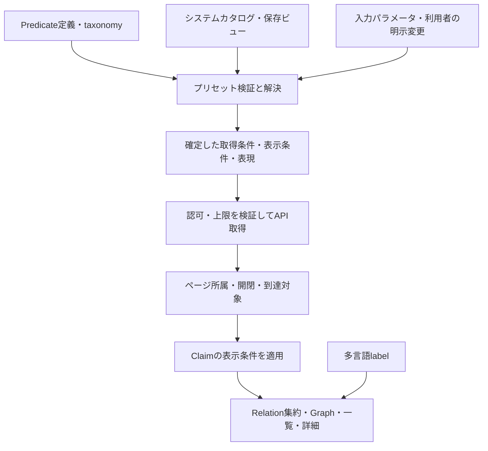

# 探索軸プリセット・taxonomy・多言語・保存ビューの設計レビュー

2026-10-18追記：[目的から選ぶ探索プリセット](DISCOVERY_PATH_PRESETS.md)で、4つの具体的な経路の形・版付き実行・条件変更・全候補／部分範囲表示を実装。以下の初回実装／設計時点の記述とは区別する。段ごとに別のRole・predicateを指定する汎用能力や分類全体は未対応。

2026-10-03。**設計提案、未実装**。現在の自由探索・開閉契約・Claimモデルを維持する。認証、PostgreSQL、管理UI、会員保存、条件APIは今回実装しない。

このレビュー後、既存predicate集合だけの条件付き近傍取得を実装した。最新契約は [CONDITIONAL_EXPLORATION_PHASE.md](CONDITIONAL_EXPLORATION_PHASE.md)。本レビューのtaxonomy・公式カタログ・会員保存・言語切替は未実装で、以下の現状分析はレビュー時点の記録。

保存・共有へ着手する時は、2026-10-06に共有された[Capsule構想](CAPSULE_AND_USER_CONTRIBUTION_VISION.md)も読む。本書のSaved View／保存ワークスペースは既存KGの見方・探索途中を保存する提案。local Entity・assertion・仮説等を持つCapsuleのコンテンツ保存とは区別し、Capsule公開をGlobal受入と同一視しない。Capsuleの具体方式は未決。

2026-10-09追記：[ブラウザ内保存ビュー](LOCAL_SAVED_VIEWS.md)として起点＋具体条件の保存・再訪を先に試作した。[探索途中保存](LOCAL_SAVED_WORKSPACE.md)もdatasetごと1件のローカルprototypeとして追加した。以下の会員保存・同期は未実装。

## 現状と判断

実際に確認したファイル:

- lib/domain/predicates.ts：4 predicateの安定キー、意味、方向、subjectKind / objectKind、日本語label / reverseLabel。分類階層と多言語はない。
- lib/client/graph-state.ts：取得キャッシュ、起点配列（UIは1件）、ページ所属、開閉意図、起点から導出した表示集合。条件ごとの取得スコープはまだない。
- lib/client/graph-presentation.ts：subject / predicate / objectでRelationを集約し、日本語ラベルを付ける。taxonomyを跨ぐClaim統合はしない。
- lib/server/http.ts / queries.ts：近傍はlimit / afterのみ。published Claimの両方向、一段階。条件はLIMIT前に評価する機能もプリセット解決も未実装。
- GRAPH_INTERACTION_AND_SETTINGS.md：操作の好み、表示調整、管理ポリシー、探索状態を分離する方針。

推奨は、**探索アプリケーション層に、検証可能で版を持つ探索条件テンプレートとしてプリセットを置く**こと。プリセットの保存場所と、その意味を解釈・実行する責務を分ける。Neo4jのClaimにpresetIdを付けたり、presentationのラベル選択だけで探索軸を実装したりしない。

## 分ける概念

| 概念 | 役割 | 保存・管理の推奨 |
| --- | --- | --- |
| Predicate定義 | 関係の意味、安定ID、向き、許容端点組 | 当面はコードと共通validator。Neo4jのClaimはこのIDを参照 |
| Predicate taxonomy | 関係を探す分類。「影響」「制作関与」等 | 最初は版管理した小さな分類定義。運営編集が必要なら管理メタデータとしてPostgreSQL |
| 多言語label | Predicate・分類・プリセットの名称、説明、順方向／逆方向の表現 | 安定ID＋localeで管理。predicate用は最初は翻訳リソース、管理対象のプリセット用は将来PostgreSQL |
| システムプリセット | 運営が提供する探索条件と表現の既定値、入力パラメータ、公開対象 | 最初は宣言的カタログ。管理UI導入時はPostgreSQLの版付き運営データ |
| 個人用条件テンプレート | 起点を固定せず、利用者の条件を別の対象へ再利用 | 将来PostgreSQL。システムプリセットと同じ条件型だが所有者・公開・更新権限は別 |
| 保存ビュー | 起点＋確定した条件＋表現設定。「この対象をこの軸で見る」を再利用 | 将来PostgreSQL。システムプリセットの出自も記録 |
| 保存ワークスペース | さらに開閉意図・受理済み範囲・座標等の探索途中を再開 | 保存ビューの後段の別機能。保存するのは意図と内部ID。DB結果やcursorの丸ごと永続化はしない |
| セッション状態 | 現在の通信、cursor、受理ページ、キャッシュ、選択 | 現在のReact state。プリセットとは別 |

「会員がプリセットを保存」は、公式プリセットへのお気に入り、独自条件テンプレート、対象付きの保存ビュー、途中のGraph保存のどれかで必要な機能が違う。共通の条件型は使うが、一つの保存機能で全て約束しない。最初の会員保存は**対象付きの保存ビュー**を推奨する。名称はUIで使い分ける。

## 層と処理の流れ



- 純粋な共通条件型・正規化・意味検証はdomain側に置く。
- カタログの公開・会員権限・保存・版解決はサーバーのアプリケーション層。保存先はインフラの責務。
- フロントはカタログの表示、入力、確定した条件のセッション適用。GraphCanvasはプリセットIDを知らなくてよい。
- Neo4j query層は検証されたpredicate IDs・端点条件・期間等をパラメータとして受ける。プリセット定義へCypherや実行コードを保存しない。
- 取得条件はLIMIT前、表示条件はClaim→Relation集約の前。見た目だけの変更は最後。自由探索は同じ条件型の「制限なし」の既定値とする。

会員保存だけが目的なら新しいGraphデータモデルは不要。将来管理画面でpredicate自体の意味も編集可能にする場合は、書込検証・既存Claimの整合・版互換が必要で、プリセット編集とは別の設計になる。

## Taxonomyは何を意味するか

最初は**閲覧・選択のための分類**とし、論理的なsubpropertyや推論体系とは区別する。複数カテゴリへの所属を許し、表示階層は小さく始める。「影響」に属することから同じpredicateだと判断しない。ASSISTANT_OFとCONTRIBUTED_TOを同カテゴリに置いても、独立したClaim・方向・端点制約は維持する。

分類ID、親カテゴリ、所属predicate IDsを分ける。カテゴリ階層を入れる場合は循環を検証する。カテゴリをプリセット作成の補助として使ってもよいが、**公開版では具体的なpredicate IDsへ解決して固定**する案を推奨する。分類の改編や新predicate追加で、既存プリセット・保存ビューの探索範囲が黙って増えない。

分類の表示順は操作上の並びであり、関係の強さや信頼度ではない。必要な時だけ多重所属や階層を導入し、全文化領域のtaxonomyを先に完成させない。

## 多言語labelの境界

多言語対応自体は採用済みの設計前提であり、必要性を将来判断するオプションではない。本節の具体的な解決方式と移行時期は設計案で、現在の実装は日本語のみ。

安定キーと意味、利用者に見せる文字列を分ける。ラベル・localeをpredicate ID、Relation ID、保存条件、query fingerprintへ使わない。

- predicateは順方向label / reverseLabel / 意味説明をlocaleごとに持つ。翻訳で保存方向を反転させない。
- taxonomyの分類名、プリセットのタイトル・説明・パラメータ名も別の翻訳対象。プリセットに独自のpredicate翻訳を持たせない。
- 否定、異説あり、期間不明などはUIメッセージの翻訳。肯否の値は翻訳文字列にしない。
- Entityの名称・別名は知識データでありUI辞書とは別。現在のname / descriptionの多言語化は別のAPI・データ設計が必要。
- 利用者の保存ビュー名は最初は本人の自由入力。システムが翻訳済みタイトルを保証しない。

フォールバックは要求locale→基本言語→定めた既定言語→IDの順を案とし、既定言語は製品判断とする。ja-JPからjaなどの解決を明示する。翻訳だけの修正は意味の版と分離できる。意味を変えるラベル修正は翻訳修正扱いにせず意味レビューを行う。

現状のdisplayRelationsは日本語labelを同時生成している。ラベル解決の実装を移行する際は、同じ安定Relationにlocale別ラベルを付ける責務へ分ける。言語変更だけでは取得キャッシュ・cursor・Node位置をリセットしない。

## プリセットの内容と版

最小の概念構造（未実装の提案。既存APIの返却型ではない）:

```text
SystemPreset
  id                         安定ID
  revision                   公開する意味の版（公開後は不変）
  specSchemaVersion          条件構造の版
  status                     draft / published / retired
  translations               locale別タイトル・説明
  parameters                 起点・時間範囲等の入力定義
  spec
    traversalRules           predicate＋許容端点組＋探索方向
    claimConditions          period基準・不明期間の扱い・肯否
    displayConditions        初期は辿る条件と同じ
    representation           graph / 将来のclaimTimeline
  supportedCapabilities      その版の実行に必要な機能
  audiencePolicy             提供対象。Claimの閲覧権限とは別
```

最初は自由形式のquery言語を導入せず、管理者も既知のpredicateと検証済み条件だけを選ぶ。デフォルト値を持つことと変更禁止のポリシーは違う。入力可能な変更範囲を明示し、利用者がプリセットを調整した結果は確定した条件として扱う。黙った優先順位や汎用深いJSONマージは使わない。

各ruleのpredicateと端点組を結び付ける。kindの配列の直積で混在した関係を許可しない。許容組はpredicate定義の制約をさらに絞るだけであり、プリセットから拡張できない。include / excludeの競合・空集合は明示検証し、「関係なし」と「無条件」を区別する。時間基準・欠けた日付の扱いも条件の意味の一部。

## 具体例：作品と作者の影響を時系列で見る

```text
プリセット: influence-history / revision 1
入力: 作品の起点、人物の起点、任意の期間範囲
rule 1: INFLUENCED_BY、work→work、両方向
rule 2: INFLUENCED_BY、person→person、両方向
Claim条件: affirmed / deniedの双方、時間基準はClaim.period
不明時期: 別レーンに残す
表現: Claim区間を作品の影響／人物の影響の2レーンで表示
```

これは将来例で、**現在は公開実行できない**。work→workのpredicate定義、複数起点の入力、条件取得、時系列表現が未実装。カタログへ設定を書くだけで対応済みとして表示しない。未対応なら公開検証で拒否、または設計用draftとし、無条件Graphへ黙って代替しない。

現状では人物起点でASSISTANT_OFだけを見る小さいプリセットから始める方が小さい。ただしこれも条件APIとセッション条件の導入が先に必要。「取得済みの主張だけ」のローカル絞り込みを先行する場合は、その範囲を表示し、DB全体の条件付き探索と同じ完全性を約束しない。

作者を作品から自動取得する場合は、著作者の出典付き関係を文脈として別に解決する。現在のCONTRIBUTED_TOを著作者判定に使わない。taxonomyやプリセットで欠けた意味を補わない。

## 適用・切替と現在の開閉モデル

プリセット適用は探索条件の変更であり、テーマ変更やクリック設定変更とは別。

- 適用時にpreset revision、入力、明示変更から確定した条件を解決する。出自IDと実際の条件は別に保持する。
- 初期の取得条件切替は同じ起点から新しい探索世代を開始する案。開閉記録の無条件混在を避ける。元の探索を無確認で自動移行する高度なUXは後回し。
- 取得記録・pending・cursorをEntity ID＋正規化した取得条件で識別する。ラベル・preset名・locale・配色は取得キーに含めない。同じ実効取得条件なら異なるプリセットもデータキャッシュを共有できる。
- 取得キーには必要な認可コンテキストとデータ失効の区切りも考慮する。共有可能なのは取得データであり、別セッションの開閉意図や受理範囲まで自動共有しない。
- representationのみの変更は同じ探索集合・開閉意図を再利用する。Claim単位の期間・肯否条件は集約前に適用する。条件外の主張も詳細では区別して比較可能にする。
- サーバーが同じ条件をLIMIT前に検証・評価し、cursorの条件一致を確認する。現在のafter UUIDだけを異なる条件へ使い回さない。

同じ条件・同じセッションで閉じる／再開する契約は維持する。保存ビューを開いた時は現在のデータを再取得し、古いcursorやAbortControllerを復元しない。

## 管理可能なカタログの保存先

| 案 | 利点 | 負担・判断 |
| --- | --- | --- |
| バージョン管理した宣言的カタログ | 小さく開始でき、レビューと互換性確認が容易 | 更新にデプロイが必要。管理者の画面編集を保証するものではない |
| PostgreSQLで管理 | 公開・版・権限・編集監査・ユーザー保存と相性がよい | 認証、管理UI、入力検証が必要。運営編集が必要な段階で採用 |
| Neo4jへPresetノードを保存 | 関係データと同じDBを使える | 保存ビューと運営メタデータが知識Graphへ混ざる。今回は推奨しない |
| フロントだけに登録 | デモが容易 | 実行検証・会員制御・共有・版互換の責務を持てない |

初期の「システム管理」はコード管理カタログでも成立する。**デプロイなしの管理者編集が要件ならPostgreSQLが自然**。runtimeカタログの正本は一つにし、コードとDBの定義を同じIDで黙って併合しない。DB移行時はseed／importによる一方向の導入と管理主体の切替を行う。

PostgreSQLへ置いてもプリセット解釈はアプリケーション層の責務。JSONBでspecを保持する案は小さいが、schemaVersionとアプリ側検証を必須にする。id・revision・status・所有・公開・監査など検索と権限に使う項目は通常の列にする。現時点で物理テーブルやORMを導入しない。

公開時にはpredicateとtaxonomyの参照、日付・パラメータ、実行能力、上限内の予算を検証する。意味を変える更新は新revisionとし、実行中の探索を勝手に差し替えない。廃止版を参照する保存ビューは明示的に扱い、未知predicateを黙って除外しない。

## 会員の保存ビューと再現性

最初の保存ビューは次を持つ案:

```text
ownerId / id / name / specSchemaVersion
resolvedSpec + rootEntityIds + representation
originPresetId + originPresetRevision（任意）
createdAt / updatedAt
```

出自参照に加え、**保存時の確定した条件**を保持する。プリセット更新や分類改編で変化しないようにする。最新の公式プリセットへ追従したい場合は明示的な更新操作と差分提示を追加する。最初から継承・差分パッチ・多数の追従モードを実装しない。

これは知識データの複製ではない。保存するのはpredicate IDs、条件、Entity内部ID、表現。名称、Claim内容、Source本文、Neo4j結果を第二の正本として保存しない。現在のデータを再検索するため、**条件は再現できても結果の完全な過去再現は保証しない**。過去Graphの証拠付きスナップショット保存は別機能。

探索途中まで保存するなら、明示閉鎖と休止を区別したopen意図、受理範囲の上限、対象ID、座標を追加検討する。初期保存ビューには受理済み全ページの復元を約束しない。復元時の最新権限・削除／統合されたEntity・上限超過を検査し、失われた対象を説明する。全履歴や無制限の自動多段再取得は導入しない。

## 会員限定・権限の責務

会員限定の保存は、サーバーの保存サービスで認証・所有者・利用権限・件数上限を検証する。ブラウザのボタン非表示だけでは成立しない。公式プリセットの管理権限、利用権限、個人の保存権限、共有ビューの閲覧権限、Claimの閲覧権限を分ける。

公式プリセットの利用は公開、保存のみ会員限定という商品設計が可能。「会員限定プリセット」は別の提供対象ポリシー。UIによる探索範囲の絞り込みはデータ認可ではなく、保存した条件でも現在のClaim認可を毎回適用する。もし有料プリセット自体を保護対象にするなら、コピーした保存条件からも利用できるかという方針を別途決める。

初期の保存ビューは本人のみのprivateを推奨。共有リンク、共同編集、公開検索、フォーク、課金プランの細かい権限エンジンは後回し。公開共有を導入しても、所有者のデータ閲覧権限を閲覧者へ引き継がない。

会員資格・課金が失効した時の扱いは製品判断。保存データは削除せず、少なくとも本人の閲覧・整理を可能にし、新規保存／更新の制限を分ける案を推奨する。実際に無料会員・有料会員のどちらを意味するか、保存数・エクスポート・共有範囲は未確定。

## 推奨する段階導入

1. 条件型と取得／表示／表現の境界、サーバー側条件検証、query key・cursorの条件一致を先に成立させる。現在の開閉を維持する。
2. 既存predicateだけを使う小さなシステムカタログをコード管理で導入。直接のpredicate IDs、少数の入力、対応済み表現だけで開始する。
3. 多言語を前提とするラベル解決を分離し、現在の日本語を最初の翻訳リソースとして扱う。新しいカタログの設計時点から安定IDと表示文字列を分け、対応言語と切替UIは段階的に実装する。分類選択が必要になった時に小さいtaxonomyを追加。どちらもプリセットの安定IDや保存条件に依存させない。
4. 運営の画面編集が必要になったらPostgreSQLカタログとdraft→検証→公開revision、認証・監査を追加する。
5. 会員保存の導入時にPostgreSQLのprivate SavedViewと保存権限を追加。画面編集より先に会員保存が必要なら、公式カタログはコードのままでよい。
6. 個人用の起点なしテンプレート、共有、途中Graph保存を具体的な需要に応じて追加する。

今はプリセット専用エンジン、汎用query DSL、オントロジー推論、翻訳管理システム、設定の万能テーブル、課金実装を作らない。ただし安定ID、意味の版、確定条件の保存、認可の責務は初回実装から守る。

## 実装前に決める事項と検証例

- 初期プリセットの軸・入力と対応表現。時間基準、肯否、不明値の既定条件。
- 管理者編集がデプロイを伴ってよいか。会員保存の最初の対象が条件ビューか途中Graphか。
- 保存資格と失効後の閲覧／更新、公式版の廃止、既定localeのフォールバック。

検証する例：翻訳変更でRelation ID・取得キーが変わらない／taxonomyへpredicateを追加しても公開版と保存条件が変わらない／新revisionが保存ビューを自動上書きしない／条件変更で旧cursor・旧応答を使わない／未対応表現と未知predicateを拒否する／保存・編集・閲覧の所有者認可／共有の閲覧者に合わせたデータ認可／肯否・出典・閉じる復元の維持。

今回の検証はコード・docsの責務照合と文書差分チェックのみ。アプリコード、API、DB、fixtureは変更せず、実行テストは行っていない。
