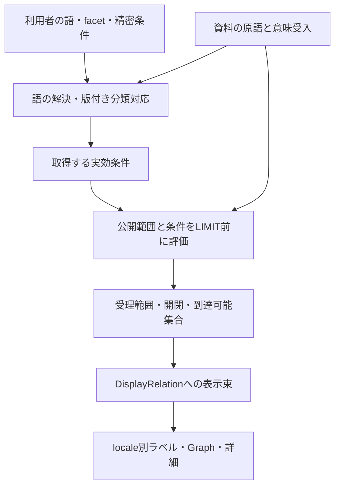

# 関係探索モデルの再レビュー：意味・具体語・探索分類を分ける

2026-10-06 / Phase 18。**レビュー完了、提案。runtime契約の変更・新モデルの採用ではない。** Phase 17のcommit `e8977cb`を基準に、コード、現役docs、凍結dataset、過去の研究台帳、追加の多分野資料を確認した。DB・API・UI・schema・語彙・datasetは変更しない。

目的は「利用者が関係をどんな軸で探せるか」を説明できること。Phase 16の実装で確認した境界を評価し直し、全分野で有限enumを増やす方式や、すべての補足をqualificationにする方式を既定の正解にはしない。

目的の基準：[PROJECT_CONTEXT](../PROJECT_CONTEXT.md)、現行契約：[ARCHITECTURE](../ARCHITECTURE.md)、[Phase 16原則](RELATION_MODEL_PRINCIPLES.md)、[Phase 17概要](ENTITY_OVERVIEW_PRESENTATION.md)。分類／presetの既存案：[EXPLORATION_PRESETS_REVIEW](EXPLORATION_PRESETS_REVIEW.md)。実資料とlocator：[比較資料v1](../research/phase-18-exploration-model/v1/SAMPLES.md)。新規事実の人間受入は行っていない。

後続の具体的な条件解決は[Phase 19の小さい探索分類検証](EXPLORATION_CLASSIFICATION_RESOLUTION_REVIEW.md)を参照。三つの関係入口は解決可能、活動軸の学術は未解決、仕事関係は非採用と評価した。分類runtimeを導入済みとするものではない。

## 1. 結論と留保

推奨は、**意味を持つ小さいPredicateと必要な限定を保持し、その上に複数軸の探索分類と語彙検索を置く**構造。具体語はまず資料の文脈・言語とともに失わず保持し、厳密な条件取得や限定比較に必要な意味だけを、定義された意味値へ対応させる。

これは「限定をtagへ移す」「全て自由文字列へ変える」という移行ではない。以下を別々に選べることが中心である。

- **何を主張するか**：Predicate、必要な意味限定、期間・scope、polarity。
- **どこから見つけるか**：関係の大分類、活動領域、語の索引、編集tag、preset。
- **どう読むか**：label、逆視点の表現、概要、DisplayRelation、原文と根拠への導線。

現VISITOR／ASSOCIATE_PROFESSOR／CHAIR／制作4 Roleは、既に限定込みの肯否・取得を約束するため、その契約を維持する。一方、**今後の原役職語をすべてコードenumとして追加する必要はない**。長尾の収集と意味正規化・厳密検索の提供を切り離す案を推奨する。

複数facetが自然であることは今回の資料でも支持された。ただし、全世界共通のfacet値集合、具体語の正規化単位、自由語を意味値へ昇格する方式は、まだ採用仕様にしない。資料比較から言えることと、利用者に使いやすいかという未検証の仮説を区別する。

## 2. 現状：何がどこで固定されているか

### PredicateとClaim

`lib/domain/predicates.ts`と`vocabulary/catalog.json`を照合した。現在は5 Predicate。単に端点kindが同じという理由でまとめていない。

| Predicate／保存方向 | 現在の命題 | 認定しないこと |
| --- | --- | --- |
| ASSISTANT_OF：person→person | 相手の制作をアシスタントとして補助した | 師弟、雇用、親交、影響。研究機関のAssistantをこの関係へ自動変換しない |
| INFLUENCED_BY：person→person | 主体が対象人物から影響を受けた | 尊敬・好意・強さ、作品を作者に置き換えること |
| CONTRIBUTED_TO：person→work | 対象作品の制作への関与を資料の範囲で述べる | 役割全般・全巻・全期間、原作由来だけから当該作品制作を認定すること |
| AFFILIATED_WITH：person→organization | その人物と組織の関わりが資料に述べられる | 雇用、所属、契約形態。組織を共有する人物間の面識等 |
| PARTICIPATED_IN：person→event | 同定した特定開催回に参加した | 招待・予定・写真だけからの参加、シリーズ全体、全日程参加 |

Claim UUIDは登録主張を識別する。polarityは対象・Predicate・限定・scope・期間込みの命題への肯否。Sourceは根拠資料、Citationは参照箇所と原表記、provenanceは取得・投影の由来。原資料があること、収集者が確認したこと、人間受入、世界の真実は同一ではない。

現Predicate catalogには制作Role導入前の説明文が残る箇所があるが、現行の限定契約は後続のdomain文書と型で補われている。今回、説明の古さを理由に使用済みIDの意味を変更しない。

### 三型と実データ

| 型・適用先 | 値／構造 | 実装検証の材料と限界 |
| --- | --- | --- |
| contribution／CONTRIBUTED_TO | SCRIPT_WRITING、SUPERVISION、PRODUCING、STORY_CO_CREATION。roleId nullable、publication scopeはISBN・言語・巻／版label | 漫画v2の14 Claim中5件がRole限定。資料の商品情報クレジットの範囲。映画等の全職能体系ではない |
| organizationParticipation／AFFILIATED_WITH | VISITOR、ASSOCIATE_PROFESSOR。一Claim一positionId、型全体nullable | 科学v2の10 Claim＝広い8＋限定2。Heisenbergの資料上の二立場・二期間。制度的同義性や全立場網羅は未検証 |
| eventParticipation／PARTICIPATED_IN | CHAIR。一Claim一roleId、型全体nullable | Event v1の13 Claim＝科学v2の10＋参加3。Lorentzの広い参加＋議長、Diracの広い参加。会議参加を伴う議長という狭い契約 |

漫画v1は9、科学v1は8 Claimの凍結版。Eventへ科学v2が引き継がれているので、datasetの件数を加えて独立した事実数にしない。架空demoの15 Claimも実資料の受入例には数えない。

### 検索・比較・表示・cursorへの用途

| 処理／実ファイル | 現契約 | 再利用性／限界 |
| --- | --- | --- |
| schema／各domain型、fixture.ts、evidence.ts | 適用先、strict payload、有限値、原語＋languageを検証 | 共通形の検証は再利用可能。文字の意味や正規化を保証しない |
| exploration.ts／qualifications.ts | predicate・3限定条件の正規化、一致、null／空集合、他Predicateへ限定条件を波及させない | 条件実行境界は有効。新型ごとの引数追加を無制限に続ける方式は未保証 |
| server/queries.ts | 条件をLIMIT前に評価、Claim単位ページング。原語・tag検索はない | 精密条件はここで評価する。取得後のGraph非表示で代替不可 |
| server/neighbor-cursor.ts | 条件キー、起点、datasetへ拘束する版付きcursor（限定／datasetによりv2–v4、旧demoの例外もある） | すべての将来分類に既存cursorがそのまま対応するわけではない |
| claimComparisonKey | SPO、構造化限定・scope、period値／精度／null。肯否・原語・Citationは除く | 登録値の機械的一致。自由注記まで含む意味同一性・矛盾認定ではない |
| relatedClaimIds | 同じ公開SPOの他Claim。条件・限定で絞らない | 広い関連集合であり比較キー一致や対立とは別 |
| client/graph-state.ts、snapshot、探索hook | 条件キー・探索世代、受理範囲、open意図、休止復元、直前復帰 | 三用途で共通処理が成立。将来条件追加でも状態の契約は維持できる |
| graph-presentation.ts | 表示中SPOを一線へ束ねclaimIds保持、限定語を短く表示 | 書込み意味・分類・Claim identityを決めない。限定値から就業実績一覧を作らない |
| overview-presentation.ts／EntityOverview | 種類と視点を先に、三domainの限定記録を補助表示、統計は折り畳み | 今の記録概要はtaxonomyではない。Claim統計と接続数の区別も維持 |
| search.ts／SEARCH_ENTITIES | Entity name／aliasesの名称検索、kind絞り込み | Visitor等の関係語キーワード検索ではない。Entity aliasと役職語aliasを混ぜない |

### 分類について既に決めたこと

既存presetレビューは、taxonomyを閲覧分類とし、複数所属を許し、論理的subpropertyとは分ける案。公開presetは具体的条件へ解決・固定し、分類変更で保存条件が黙って増えない。多言語は設計前提。taxonomy／classification／tag／presetの実行基盤は現在未実装。

今回はその境界を継承しつつ、**predicateだけを分類する一つのcatalogでは、関係ごとの活動領域や立場・文脈を表せない**と評価する。閲覧階層、複数facet、具体語の索引を分けて扱う余地が必要。

## 3. トップダウン：利用者が指定しそうな探索軸

以下は探索要求の仮説であり、全軸をフォーム・schemaへ追加する指定ではない。分類としての独立性は完全ではなく、重複や複数選択もあり得る。

| 利用者の問い | 軸候補 | 意味・取得へ落とす時の境界 |
| --- | --- | --- |
| 何に繋がっているか | 関係の種類：制作、親族、組織との関わり、影響、参加、派生等 | Predicate集合・必要な限定条件へ解決。親族の粗い分類は親子と配偶者の意味を置換しない |
| どの領域の関係か | 活動領域：学術、映画、音楽、スポーツ、政治、教育等 | 複数所属。人物の職業やdataset名をすべてのRelationへ転写しない |
| どんな立場で関わったか | 職能・立場・方式 | 厳密にその命題を探す場合はqualification／独立Predicate。単なる語の発見はlexical索引 |
| いつ／どの版・開催回か | Claim期間、刊行物scope、開催回 | 一時的／継続的を期間の短さだけから生成しない。Event自身の期間と個人期間は別 |
| 自分からか／相手からか | 保存方向、探索方向、視点 | 同じClaimの読み替え。因果の矢印、対称関係、主語位置を一律に扱わない |
| 何を根拠に述べられているか | Source／Citation、肯否、未確認、由来 | 真偽ランキングや「公式だから成立」へ変換しない |
| この語で見つけたい | 原語、訳語、alias、description、編集tag | 語のヒットと命題の成立を分け、検索対象欄・範囲を明示 |

「仕事関係」は利用者の粗い入口として有用な可能性があるが、雇用・業務・無償協力・組織職位・作品制作のどこまで含むかは編集定義を要する。`WORK`とwork Entity kindも別。資料のVisitorから仕事／雇用を自動認定しない。

公式／非公式、継続的／一時的、所属／訪問／雇用も同じ一本の階層へは収まらない。「公式」は任命の制度性、Source発行主体、運営受入の三つを指し得るので、未定義のboolean facetにしない。必要な具体命題・資料に分解して扱う。

### 一本の木・複数facet・複数tag

- **複数facetを基本案にする。** 関係の種類と活動領域を最初の二軸候補とし、役職・時期等は必要時に追加。映画音楽は二領域、科学者の親子は家族の関係として読める。
- **軸内の小さい階層は併用できる。** 画面の折り畳み用の木と、分類の多重所属は別。facetを横断する親子木を必須にしない。複数親を導入する場合は循環と検索展開の意味を検証する。
- **tagは複数持てる案が自然。** ただし「複数tag」を必須の第四モデル要素にはしない。言語を持つ原語索引、controlledな編集tag、意味限定を同名のtags配列へ混在させない。

## 4. ボトムアップ：資料が示した限界

[比較資料v1](../research/phase-18-exploration-model/v1/SAMPLES.md)に24研究記録を残した。以下は資料から得た事実と設計上の推論を区別した評価。

| 実例 | 壊れる単純化 | モデルに必要な境界 |
| --- | --- | --- |
| Heisenbergの二立場、Ryanの複合職位、Diracの翌年度名簿 | 職位／訪問形態の排他enum、全原語の同義対応、予定＝在籍 | 原語と意味値は別。職位と関与形態を分けられる可能性はあるが、複合語を自動分解しない。資料の時制・対象期間も必要 |
| [JobsのCEO辞任とBoard議長就任](https://www.apple.com/newsroom/2011/08/24Steve-Jobs-Resigns-as-CEO-of-Apple/) | 一つの永続的な仕事tag、全Chair共通 | 立場と就任／退任命題、会社とBoard scopeを分離。Event会議議長へ対応させない |
| [Guardiolaの選手／トップチーム監督](https://www.fcbarcelona.com/en/fitxa/648489/josep-guardiola-2008--2012) | 同じ二者には一役割、一期間 | 限定と期間を対に保持。個別役割の否定を組織関与全体の否定にしない。制度語は資料で確認 |
| [Thatcherの党首と首相](https://www.gov.uk/government/history/past-prime-ministers/margaret-thatcher) | 政治＝仕事Role、英国＝組織 | 公職・政府・政党の対象同定が先。分類・qualificationでは端点の誤りを補えない |
| [CollinsのPilot／Commander](https://www.nasa.gov/missions/space-shuttle/sts-114/eileen-collins-nasas-first-female-shuttle-commander/) | 一つのEvent Role体系、参加＝全開催期間 | ミッションは会議と違う対象・責任。任務を限定する意味はあるが既存CHAIRへ入らない |
| [Chaplinの映画音楽と複数職能](https://www.charliechaplin.com/en/films/6-Modern-Times/articles/132-The-Music-of-Modern-Times) | 映画／音楽を一領域へ、一Claim一Roleが常に一般解 | 対象score／映画、複数意味のAND／ORと独立肯否を確認。現行一値契約を全世界へ拡張しない |
| [SpielbergのCannes審査委員長の事前発表](https://www.festival-cannes.com/en/2013/steven-spielberg-jury-president-of-the-66th-festival-de-cannes/) | President＝会議議長＝参加済み | 役職就任合意と実参加、juryと開催回は別。taxonomy「Eventに関する関係」から参加を推論しない |
| [Malalaの共同設立と国連任命](https://www.un.org/en/messengers-peace/malala-yousafzai) | 非営利／教育／国際活動が一つの木、役職語は雇用 | 複数facetが自然。組織形成と任命は独立命題候補。教育の文脈と雇用の真偽条件は別 |
| Curie家、映画派生、Solvayの招待反例（既存研究・受入記録） | FAMILY Role一種類、派生と影響の同一視、参加＋invited | 独立Predicateの必要性、対称性、非排他的方式、base命題を支持しない値の不適用を維持 |

ここから「新Predicateを全部追加」「新職位を全部enumへ登録」という結論には進まない。表示を粗くまとめることと、原資料の必要な限定を捨てることも違う。

## 5. A〜Dの比較

| 案 | 得られるもの | 失う／過剰に主張しやすいもの | 取得・比較・運用の評価 |
| --- | --- | --- | --- |
| A：domain typed限定＋別taxonomy | 厳密な値条件、限定ごとの肯否・比較、適用先拒否 | enumを全原語へ増やすと語彙・コード・API変更が膨張。一値の軸が職位と訪問を混ぜる | 現三用途では成立。世界の全具体語を網羅する方式にはしない |
| B：粗いPredicate＋facet＋複数tag | 発見・粗い絞り込み、語の収集が容易 | tagが肯否対象に入らないなら「参加したが議長ではない」を表せない。入れるなら実質qualificationになり契約が必要 | 発見層として自然。精密条件の代用としては不十分。facet更新でClaim意味を変えない |
| C：限定型固定、具体語は自由値 | 長尾をschema追加なしで保持、原文語の一致を探せる | 文字列一致≠語義一致。翻訳・制度・同綴異義、型POSITIONへの不適切な割当。原文自由値を全domainの共通命題へできない | 文脈付き原語の保持・lexical検索候補。意味検索への対応付けは別段階。未対応値を既知enumへ丸めない |
| D：必要な場合のみqualification | 収集と厳密モデル化のコストを需要に合わせられる | 必要なscopeまで注記へ追いやると比較や否定範囲が曖昧。判定ルールなしでは担当者ごとにずれる | 推奨の判断方針。必要性はUI人気だけでなく命題・否定・scope保持で評価 |

**推奨はDの判断方針＋Aの厳密な意味契約＋Bの発見層。Cは文脈付き原語の保持に限定して検証する。** 四案のどれか一つを全データに適用する構成にはしない。

tagが「この人物が議長として参加した」という意味を持ち、比較キーや肯否に掛かるなら、それは名前がtagでも意味限定である。controlled tagを採ること自体でqualificationのガバナンス問題は消えない。逆に、編集者が付けた「学術」分類へClaim.polarityを掛けて、学術か否かという新しい主張を作らない。

## 6. qualificationを選ぶ最小の基準

1. 原資料が述べる狭い内容を、対象、期間、scopeを含めて書く。
2. base Predicateを肯定できるか確認する。予定・代理出席・招待しかないなら、参加をbaseにしない。
3. 補足を外した時、何が変わるか確認する。独立した関係意味・端点・方向が変わるならPredicate／対象モデル候補。原語の単なる言い換えならlabel／alias候補。
4. **その補足を含めた命題の肯否・scope・時期を別々に保つ必要があるか**を確認する。必要なら、検索需要が少なくても意味限定として保持すべき。必要な限定を落として広い事実にしない。
5. 厳密な条件取得・比較に繰り返し使うなら、domainの定義と適用先を持つ意味値へ対応させる。値集合の全世界網羅は不要。
6. 発見のための粗いまとめだけならfacet／編集tag。人間の対応付けや分類規則の根拠・版を残す。
7. 判断できない具体語は原文・言語・locator・対象・時制・scopeとして残す。保存先が注記であっても、比較不能／未正規化であることを隠さない。base命題すら確定できなければ研究保留。

### 現在の値を再評価する

| 値 | 評価／残す責務 | 粗い分類との関係 |
| --- | --- | --- |
| VISITOR | 当該組織への資料上のVisitor関与を限定し、期間別取得に意味がある。現契約は維持 | 学術・訪問に関する発見ラベルの材料になり得る。Visiting Fellow等の同義性は保証しない |
| ASSOCIATE_PROFESSOR | 資料上の立場・期間を限定する意味値として有用。日本の職位へ自動翻訳しない | 教育／学術カテゴリへ編集対応可能だが、雇用・常勤・Professor全般の意味階層ではない |
| CHAIR | 参加を伴う特定会議議長は限定が自然。参加の肯定と議長限定の否定を区別できる | 会議参加の入口で使える。組織・jury・名誉議長を同じ値にしない |
| PRODUCING等の制作4値 | 商品情報の具体クレジットと刊行物scopeを含む独立限定。単なる飾りtagにしない | 制作というカテゴリへまとめられるが、原作、作者、資金提供へ意味を広げない |

「議長ではなかった」から他役割、参加、招待を否定しない。資料にある短時間出席・代理・remote等も、単にattendanceMode enumを足せば解決するとは限らない。参加の運用定義、実際の主体、特定回／sessionのscope、資料の時制が先に必要。今回はそれらの実資料を受け入れていない。

### 有限enumを必須にするか

現在の有限enumは、少ない受入値だけで誤値・誤適用を拒否する良い手段だった。しかし**閉じたコードenumは実装方式、値の意味管理は設計責務**であり同一ではない。

将来候補は、型の適用先を制約し、意味として公開する値には安定ID・定義・locale label・包含／除外・変更履歴を持たせた、追加可能な管理catalog。DB／TypeScript enum／ファイルのどこへ置くかは別途決める。新語ごとにschemaの欄を追加する必要はないが、意味として公開する値のレビューコストは残る。

長尾については二段階の候補を置く。

- **資料語の記録**：原表記・言語・組織／時期／資料文脈とlocator。検索索引へ載せられるが、共通意味IDへの正規化は未承認。
- **意味値への対応**：既知意味への同義対応、新概念、発見用の近接対応のどれかを理由付きで記録。literalの安定参照を付ける場合でも、そのIDだけで語義が管理されたとは扱わない。

型だけ自由値にした`POSITION="Associate Professor"`は、原文の型付き記録には使えても全制度に同じ職位を認定する契約として弱い。語義、組織・時期、適用Predicate、欠けたscopeを含めて審査する。既知値、未正規化の具体語、Claimの限定なし、条件の省略を別状態として扱う必要があるが、**新しい公開payloadは今回決めない**。

C案でも「この資料・組織・時期で、この表記の立場だった」という狭い限定命題を保持することは可能であり、enumがないからpolarityを表せないわけではない。ただし、そのliteralを命題の一部にする契約、原文と編集解釈の区別、文脈を含む参照・比較単位が必要。語義対応が未確定なら、別資料の同じ文字列と概念一致したとはしない。将来この方式を公開する場合は、限定値が未正規化であることを明示し、意味上の比較は未確定として扱う。今回の原語保持だけで、その新Claimモデルを実装したとは扱わない。

## 7. 検索三種類の契約

| 探索 | 例 | 結果の約束／評価段階 |
| --- | --- | --- |
| キーワード | Visitor、客員、会議議長、Producer | 原語・label・承認alias等のどの欄にヒットしたかを示す。否定文のヒットもあり得る。役割成立を認定しない。現在のEntity検索とは別能力 |
| 分類／facet | 学術の組織関与、制作、家族 | 編集定義・対応版から具体的条件へ解決。候補未分類は未分類。分類なしをその関係の不存在にしない |
| 厳密な構造条件 | PARTICIPATED_INのCHAIR限定Claim | 明示した意味値・期間・scopeで一致。無限定や原文だけの記録を推定して混ぜない。affirmed／deniedを区別して返す |

「議長の記録を探す」はdeniedも含むClaim探索、「議長だったという肯定主張を探す」はaffirmed条件も必要。後者でも世界の真実を確定した人物一覧ではない。検索の一致と真偽の評価を分ける。

### 条件解決の位置

図は責務の提案であり、新しい汎用query engineの実装指定ではない。原語だけの条件と、管理された意味値条件を同じ入力へ黙って解決しない。

- predicate分類なら具体的Predicate集合へ、限定に対応する分類なら適用先付きの条件へ解決する。学術のようにClaimごとの文脈を要するものは、現在のpredicate集合だけでは完全には実行できない。
- 同一facet内の複数値はOR、異なるfacetはANDを初期候補とする。ただし、複数限定のANDは**同じClaimへ適用**する。他のClaimから訪問／教授を一つずつ拾って、同一のVisiting Professor命題へ合成しない。
- 現在の`eventRoles=CHAIR`等は適用Predicateだけを絞り、他Predicateは通る。facet全体の「議長参加だけ」はPARTICIPATED_IN選択も要する。この違いをresolverとUIで明示する。
- 関係の活動領域をkindやdataset名だけから決めない。必要ならClaimに対応する編集メタデータ／規則を別管理し、assignmentの対象と理由を明示。Entity全体のtagを無条件で全辺へ伝播しない。
- 編集分類や原語索引は再生成可能な検索用投影とし、Claim意味の第二の正本にしない。具体的な保存先は未決定。
- 新取得条件はLIMIT前に評価し、ページング・hasMoreと一致させる。現在取得済みだけの表示絞り込みなら、その範囲を明示しDB条件探索と区別する。
- 実効条件には意味値・必要な分類解決版／索引版を拘束する。具体条件へ解決済みなら分類名自体でなく解決結果を使う。動的assignmentで結果が変わる場合は、その版もcursor／探索世代に必要。
- locale・翻訳・配色変更は取得条件を変えない。原語の検索で入力言語が取得範囲に影響する場合は、UI localeと別の条件として扱う。
- 未対応条件を「広く見る」へ黙って退避しない。保存presetがある将来も、対応版の変更で取得範囲を無断拡張しない。

## 8. label・alias・original wording・分類・tagの境界

| 情報 | 何に属するか／何を保証するか | 比較・肯否への影響 |
| --- | --- | --- |
| 原表記＋language＋locator | Citation／収集記録の資料表現。制度・時期・対象を文脈で読む | 現比較キーに文字列そのものを入れない。新しい意味限定の根拠になるが自動変換しない |
| Predicate／意味値label・alias | 同じ定義へのlocale別表示・承認済み別表記 | 表示修正で意味やキーを変えない。同綴語・制度差をalias登録で消さない |
| Entity name／aliases | 対象の名称。歴史的名称・制度語と別 | 名前一致による同一性・関係生成をしない。現在の単一文字列モデルの限界は継続 |
| description・自由注記 | 説明・未構造化限定。原文と編集要約を区別 | 意味に必要な限定が残るなら比較の不完全性を明示。正規化済みキーだけで一致認定しない |
| facet assignment／編集tag | 発見のための対応。定義・理由・版・付与主体を持つ案 | Claimの命題・polarityへ入れない。意味限定をここに移しているなら分類ではなく意味設計を要する |
| Graph label／UI grouping | 現在表示している主張の圧縮 | 保存意味・identity・分類所属・担当認定を生成しない |

「同じ語」「近い語」「同義の概念」「同じ発見カテゴリ」を異なる対応として残す。同義対応の人間審査と、カテゴリへまとめる編集判断では必要な厳密さが違う。aliasとしての「客員」をすべてのVisitor制度に一括対応させることは今回提案しない。

## 9. Phase 14〜16を残す部分・再解釈する部分

| 知見 | 評価 |
| --- | --- |
| 制作・組織・会議の語義を別に保つ | 継承。職位語・scopeを共通Roleへ潰す理由は得られなかった |
| nullと条件省略、限定込み肯否、独立UUID、期間とscope | 継承。分類・自由語を足しても必要 |
| 適用先検証、正規化、一致、LIMIT前、cursor、世代、snapshot | 継承。値の保持方式が変わっても契約境界は有効。handler自体の無変更を約束しない |
| 有限値で三用途を実装できた | 小さい試験範囲の成功。全制度語を有限コードenumで網羅する原則に昇格しない |
| 同じ命題内の限定はtyped候補 | 候補という判断は継承。全description・具体語を直ちに管理値化する義務ではない。必要な限定を失わせないことを先にする |
| 組織立場を一position、参加立場を一roleで保持 | 現datasetに対して維持。訪問＋職位、複数職能、複数scopeの将来一般形としては未検証 |
| taxonomyをPredicate分類として始める | 小さな入口として妥当。関係ごとの領域、長尾具体語、多軸条件へはそれだけでは足りない |
| 原語はCitationへ保存 | 継承。将来lexical索引から引ける余地が必要。構造化意味値を持たない語を失わない |
| 共通比較キーで一致候補を出す | 継承。ただし未構造化scope／制度語を含む完全意味一致にはしない。分類・翻訳の差で比較キーを変えない |

現コードを全て作り直す必要性は見つからなかった。同型内の新値追加なら、catalog・enum・基準版・意味レビューの更新が中心で、語ごとにAPI引数やcursor版を増やす必要はない。一方、新しい限定型を増やす場合は、現在の型別API欄・Cypher・UI・条件キーへの追加が発生する。この二つのコストを分けて評価し、長尾語を一語ずつ新型にする方式は避ける。今回はその移行設計・実装には進まない。

## 10. 九つの問いへの回答

1. **qualificationの目的**：主張の内容を限定し、その範囲の肯否・期間・scope・厳密条件・比較を保つこと。descriptionの一律構造化ではない。
2. **有限enum必須か**：現三型では維持。一般原則としては必須にしない。意味公開には管理された定義が必要だが、全原語を列挙する必要はない。
3. **四つの代表値をどこに置くか**：現使用範囲では意味限定として残す。同時に発見分類へ対応できる。未見の近接語は原語保持から始める。
4. **classification／facetは単一か**：複数。関係の種類と活動領域を分離する小さい案から検証。
5. **tagは複数か**：複数を許す方が自然。ただしtag導入自体は必須でない。編集tagと原語索引と意味値を分ける。
6. **taxonomyは木かfacetか**：複数facet＋必要な軸内の小さい階層。全世界を一本の木へ固定しない。
7. **原語／labelと分類**：資料の表現、同義表示、編集カテゴリを別記録・別版にする。翻訳文字列で意味IDを作らない。
8. **残す／再解釈**：三用途の意味と機械処理境界は残す。有限enum・一値・predicateだけの分類を一般解とはしない。
9. **次の表示・条件設計**：発見用の粗い入口と精密な追加条件を分け、表示の圧縮から意味を生成しない。GraphラベルとClaim詳細の整合は、この条件解決境界を決めてから局所改善する。

## 11. 未解決事項と次フェーズ案

今決められる境界は、意味限定と編集分類の分離、多軸の発見、原語を失わない収集、未指定と未正規化の区別、検索三種類の結果契約。全facet値集合、職位の国際同義性、複合限定のAND／OR、任務・jury・公職等の新対象、長尾の公開payloadはまだ決めない。

**次の一フェーズは「既存条件へ解決する小さい探索分類の検証」を推奨する。** 最初は分類catalogの試案・具体条件への解決・利用者が読む文言を、現在の資料だけで確認する。

1. 新Predicateを足さず、「制作の関係」「組織との関わり」「特定回への参加」など3〜5の入口案を現Predicate集合へ明示的に対応させる。新しい意味カテゴリ名・IDはそのフェーズでレビューする。
2. 「役職語から探す」というlexical検索案と「記録された立場で絞る」という精密条件を並べ、違いを利用者が理解できるか確認する。まだ未対応の語検索を使えるようには表示しない。
3. 学術／映画等の活動領域は、R11/R14/R19等を用いた**研究上の付与表**で多軸を検証する。predicateだけでは解決できない条件を、dataset名で代用してruntime公開しない。
4. 既知VISITOR、未正規化Visiting Professor、限定なしClaimの三つを、書込みしない比較例へ当てる。値ごとのコード修正を避ける方式が本当に必要かを、この境界で判断する。
5. Graph表示の修正へ進む時は、粗い関係名、記録された限定、現在の実効条件、条件外の関連Claimを区別する。「異説あり」は肯否混在を中立表現へ揃える候補だが今回UIは変えない。

終了基準は、利用者の粗い探索語をどの取得条件へ解決したか、何が検索できず何が未分類か、詳細でどの命題・原語へ戻れるかを説明できること。全文検索基盤・汎用qualification engine・全領域taxonomyを先行実装しない。小さい分類案が現条件だけで足りるなら、その範囲のUI実装を次の依頼で決められる。

資料から判断できていない部分は[比較資料の追加調査](../research/phase-18-exploration-model/v1/SAMPLES.md#4-追加調査が効く箇所)へ残した。語彙数を増やす前に、分類／語検索／精密条件の違いを実際に理解できるかを検証する価値がある。今回の多分野比較は利用者調査・全世界のモデル妥当性の証明ではない。
