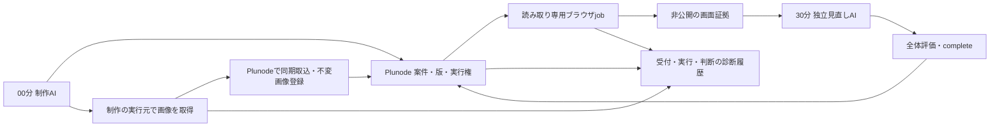

# テーマ自動制作の全体設計と実装計画

2026-11-20、設計評価用。対象は画像生成・登録、独立見直しの実画面検証、障害診断。実装の着手は設計評価の後とする。

## 推奨構成

当初の構想どおり、制作実行と独立見直し実行が、Plunodeに保存された同じ案件を進める。Plunodeは案件・実行権・版・送信受付・公開履歴の正本を持つ。**制作の実行元が画像を取得し、Plunodeは実ファイルを既存の検査・登録処理で受け取る。** 画像生成元と定期実行基盤を個別に選べるようにし、見直し用の実画面は専用ブラウザで採取する。00分の制作は画像の目的と仕様を判断し、30分の見直しは実画面を含む全体を判断する。20分の資料収集、通常編集・通常公開、運営登録のAI送信境界は従来の経路を使う。 [制作引継ぎの契約](THEME_PRODUCTION_HANDOFF.md)・[承認公開の契約](THEME_PRIVATE_PUBLICATION_20261117.md)・[API移行記録](../verification/THEME_EDITORIAL_PUBLICATION_20261120.md)

既存のmember PostgreSQLに画面job・結果目録と診断イベントを置き、実行権と再開は既存処理のパターンを再用する。ブラウザは管理下の常時稼働環境で、Webと分けた資源上限付きコンテナに置く。βでピーク時のCPU・メモリを測り、Webへの影響を吸収できなければブラウザだけ別ホストへ移せる。画像専用jobと生成APIは①の評価で採否を決める。初期は既存DB・配備と診断を使う。 [共通AIの責務と利用枠](AI_PROCESSING_DIRECTION.md)

既存βには添付受付診断、認証済みPlaywright採取、ブロック後の再開手順がある。ケース記録上はChatGPT側の添付送出拒否が最有力で、当時の本番アクセスログがなく未到達は推定。管理者補助の操作は隔離、匿名プレビューの拒否と代表経路はβで確認済み。新規生成から公開までの無人完走は今後の受入項目とする。 [調査・β検証・運営者手順](../runbooks/THEME_PRODUCTION_EXTERNAL_BLOCKERS.md)

## 方式比較

| 方式 | 利用者体験 | 実現性 | 運営コスト | 拡張性 |
| --- | --- | --- | --- | --- |
| ChatGPTの定期枠だけで画像・画面を処理 | 成功時は会話内で完結する | 添付送出と接続元ブラウザの制約が残り、期限切れや枠をまたぐ再開を安定させにくい | 見かけの追加費用は小さいが、同種の停止対応が続く | 外部仕様変更に依存 |
| 通常Chatで画像を登録し、運営者が実画面を採取 | 既存案件を人が復旧できる | 既存βの工具を使用可能。会員ログインと元画像が必要 | 固定費は小さく、案件数に比例して手作業が増える | 障害時の代替経路に適する |
| **現行の制作工程＋共通の画像取込＋専用ブラウザ** | 案件内で無人進行でき、例外は理由を追える | 画像は所持できる実行元から受け取る。定期枠の添付と見直し側の画面証拠読取は個別に実測する | 既存の取込を再用し、ブラウザの分離運用を追加。生成費は選定方式に依存 | 生成元・制作実行元・見直し実行元を個別に変更できる |
| 全制作を別の定期実行基盤へ移す | 制作を会話環境から独立して無人運転できる | 作成・検索・添付・見直しの運用を移す必要がある | 初期移行、モデル利用、保守の費用がかかる | 各工程で生成物の保存・再開を共通化できる |

推奨は3案目。手動経路は現在のヴァイキングと将来の例外処理に残す。定期Webが画像付きの検証証拠を読めない場合は、最初に**独立見直し実行だけ**を承認済みの画像入力対応AIランナーへ移す。切替はβで実測し、同じ案件に見直し実行元が重複しないようにする。

## ① 画像生成と登録

**既存の同期取込を共通経路とし、生成と再開の状態は原則として制作の実行元に置く。** 定期実行での `BLOCKED_FILE_REFERENCE` は添付の受け渡し経路を再検証する根拠になる。通常Chatからβへの `upload_editorial_image` は2件の登録実績があり、画像を所持する実行元には `upload_product_image` もある。Plunodeへ到達後の登録に非同期化が必要だという観測はない。 [通常Chatの添付実績](../verification/THEME_AUTHORING_COMPLETE_20261112.md)・[外部制約の調査](../runbooks/THEME_PRODUCTION_EXTERNAL_BLOCKERS.md)

### 受け渡しと実行方式

| 方式 | 利用者体験・実現性 | 運営コストと拡張性 | 判断 |
| --- | --- | --- | --- |
| ChatGPTから正式な添付で直接登録 | 通常Chatの登録は確認済み。定期枠では生成直後の正式な参照をMCPが受け取れるか、次回に受付から再開できるかが未確認 | 既存経路で変更が最小。送出と期限はChatGPTの仕様に依存 | 現行の定期枠では最初に限定検証。安定が確認できれば継続 |
| 実バイトの同期登録 | バイトを取得できる実行元は `upload_product_image` で即時に `imageId` を受け取れる。既存の運営者HTTP multipartは会員認証とOrigin制御を前提とする | 検査・来歴・保存と冪等受付を再用。実行基盤の移行後も共通 | **標準経路**。MCPの容量や機械認証が実測で不足したときだけ、最小権限のバイナリ取込を検討 |
| 生成から保存まで同期API内で実施 | 生成時間が短い場合は技術的に可能。依頼側のタイムアウト、Web再起動、応答喪失時の重複生成が課題 | 外部生成とWeb運用が結合し、長時間の要求枠を消費する | 初期採用しない。生成待ちは制作の実行元に置く |
| 既存ランナー／Workerの利用 | 生成を待って実ファイルを保存し、再起動後も登録から再開できる構成なら無人運転できる。現行の公開・調査・資料収集系Workerに挿絵生成機能はない | 既存の常時稼働環境・実行権・再開のパターンを再用可能。画像処理の権限と負荷は分離する | 直接転送が成立しない場合の推奨。後継の制作ランナーを優先し、現行予定を維持する場合は既存Workerの配備に画像用の役割を足せるか確認 |
| 画像専用のPlunode job | 定期枠が画像を待てず、実行元にも再開状態の置き場がない場合に、案件と連動した待機・復旧を提供できる | 受付・取得・回収・重複防止・監視の追加運用。後継ランナーと役割が重なる可能性がある | 既存ランナーやWorkerで状態保全・再開・負荷分離を満たせない場合に限り採用。既存DB・実行権の仕組みを再用する |

ChatGPTを試す場合は、βの予定実行で生成直後の画像を、現行のAppツール定義で正式な添付として渡す。既知の正常な添付を対照に、外部実行・入口・Webの受付を照合し、次の回では永続化された登録結果から再開する。保存前の参照が失効・拒否されたときは提供元の手段で取得できるか確認し、同じ条件の再送は止める。公式の添付契約は一時的なダウンロード参照を定義している。定期実行で生成した画像を引き渡せるかは実予定で確認する。 [添付の公式契約](https://developers.openai.com/plugins/reference#file-apis)・[定期実行のファイル制約](https://help.openai.com/en/articles/10291617-scheduled-tasks-in-chatgpt)

実バイトがある場合、base64を使う登録は現行MCPの2,100,000バイトのリクエスト上限に従う。元ファイルの上限はbase64とJSONの分だけ小さくなる。画像の登録と制作コマンドは分け、既存prepare・dispatchには `imageId` を渡す。運営者multipartを機械実行に転用する場合は限定権限で同じ取込処理を呼べるか検証する。会員セッションの共有や添付URLの許可範囲拡大は採用しない。 [MCP入口](../../app/api/knowledge-collection/mcp/route.ts)・[画像ツール定義](../../lib/server/knowledge-theme-registration-mcp.ts)・[運営者HTTP取込](../../lib/server/member/product-editorial-http.ts)

### 生成元と切替判断

| 生成元 | 実現性・運営コスト | 採用条件 |
| --- | --- | --- |
| 既存のChatGPT画像生成 | 現在の制作体験と生成物を活かせる。通常Chatで人が登録する手段もある | 上記の予定実行で元画像を機械的に取得・登録でき、参照拒否や失効から再開できる場合に無人経路として使う |
| 管理下のローカル生成 | 手元のPCでは8 GiBのGPUを確認した段階。画像生成サービスの稼働、モデル互換性、品質・安定性は未確認。機材・電力・保守を要する | 既存の常時稼働実行元で候補を試し、歴史・科学の挿絵の品質、モデルの利用条件、生成時間・VRAM、Kev等との資源競合、休止・再起動後の再開を確認する |
| 画像を実バイトで返す外部API | OpenAI Image APIなどが該当。GPU運用を省けるが、従量費、キー管理、利用上限、送信範囲の管理を要する | ChatGPTやローカルで必要な画質・稼働率・総費用を満たせない場合に比較する。利用する場合も後継ランナーの生成元の一つとして扱う。 [Image APIの返却仕様](https://developers.openai.com/api/reference/resources/images/methods/generate) |

定期実行基盤の後継が導入時期までに決まるなら、**そのランナーで画像取得と状態保全を先に確認する**。後継が未定で、現行の直接転送が成立しない場合は、安定稼働する既存ランナー／Workerで画像だけの取得・登録を試す。比較には同じ歴史・科学の挿絵を使い、採用可能な画質、期限内に登録できる割合、復旧時間、登録できた一枚あたりの費用と保守負荷を測る。外部APIの利用判断と専用jobの設置判断はそれぞれ行う。

案件には素材要求ID・版、用途、日英alt、来歴、試行と登録結果を残す。制作実行元がバイトを保持する経路では、登録まで保護した領域に元画像を保持し、ハッシュと安定した `requestId` または登録済みの `imageId` から再開する。受付応答喪失時は照会し、必要なら同じ内容・同じIDで再送する。課金送信の結果が不明なら照会・判断まで同じ指示の自動再生成を保留する。登録後は制作実行権と現行版を確認して既存prepare・dispatchで関連付ける。素材仕様が変わった場合は適合を再判断する。生成挿絵の注記とクレジットを持たせ、画像が必須の案件の障害は③で追跡する。

## ② 独立見直しの実画面検証

- **専用Playwrightランナーで既存の運営者プレビューを描画する。** βの操作・採取を再用し、ブラウザに会員のGoogleセッションを引き渡さない。サーバーは、認可された見直しjobについてのみ、案件・テーマ・版・評価digest・環境に束縛した短命の読取セッションを発行する。資格は専用の発行経路からヘッダまたはCookieで渡す。見直し用に絞った認可で、対象の画面と必要な従属データ・画像だけを許可する。匿名・一般会員や別案件の拒否、Cookie・トークンの失効、通常の運営者ログインとの分離を試験する。スクリーンショットの閲覧も別途認可する。ブラウザはジョブごとの隔離contextで、必要な既知のoriginに限り、出典リンクの内容確認は既存の根拠確認経路へ渡す。 [Playwrightのcontext分離](https://playwright.dev/docs/browser-contexts)
- 対象を採取前後で照合し、テーマ版・評価digest・ガイド版・Web build・環境・採取時刻・確認条件・証拠hashを記録する。現行の公開版進展、訳文、画像、参照先や表示コードが採取後に変化した場合は、現行版と再照合し証拠を取り直す。初期はPC 1440pxとスマートフォン相当390px、公開対象言語を確認し、DOMの数値とスクリーンショット、操作の成否を保持する。画像の切れ・見出しとの関係、年表、Story、出典・引用と戻る導線、横はみ出しを扱う。証拠の欠落とガイド上適用外の項目を区別する。
- 独立した見直し実行が、既存認証下で証拠一覧・限定サイズの画像を取得し、年表・本文・根拠と併せて全体を評価する。MCPから同じケース・版の画像出力を受け取って実際に視認できるところまで、βの実予定で確認する。テキストの「成功」だけで視覚確認済みとしない。読取に失敗する場合は上記の専用AIランナーへ移す。休止中のログイン済みセッションに依存させない。
- 自動操作の結果は証拠。合否は別実行の独立見直しが判断する。新経路を有効にした案件では、現在の評価対象に有効な必須証拠があることを `complete` 前のサーバー条件に加える。既に公開済みの案件と旧経路の再送を壊さないよう、適用範囲は案件ごとに明示する。公開後の正規URL確認は別の読取処理として記録し、失敗は運用へ通知する。後から出た通常公開との競合は既存の照合・再評価規則に従う。

## ③ 障害追跡と復旧

各コンテナの標準出力だけでは再配置前の要求を照合できない。専用の外部ログサービスは横断検索を早く使える一方、保存単価と接続・秘匿範囲の追加設計が必要。初版はDBの相関イベントと現行運用の永続ログを組み合わせる。

- **操作・jobの診断イベントをDBに残し、Web／Worker／プロキシの運用ログをローテーション付きの永続領域へ出す。** DBには状態変更と同じtransaction、または同じtransactionのoutboxで業務イベントを記録する。プロキシではMCP経路の方法・時刻・HTTP状態などを許可リストで採取し、本文や認証ヘッダ、URLクエリを記録しない。Webはβの受付診断を基礎に認証・入力検証・受付・公開を分ける。運用ログはコンテナ再作成をまたげることを確認する。初期は既存運用に適合する保管と検索で開始し、相関形式は将来のOpenTelemetry集約へ持ち運べるようにする。 [OpenTelemetryのログ相関](https://opentelemetry.io/docs/concepts/signals/logs/)
- 実行ID・案件ID・操作requestId・job／試行ID・環境・build・段階・安定した理由コード・時刻を関連付ける。入口で信用できる相関IDを付与し、公開画面用のログに非公開の原稿や画像を載せない。署名URL、file ID、Cookie、lease token、APIキー、画像本文を診断ログに保存しない。閲覧は運営者に限定し、保存量と保護・削除を分ける。診断ログは当初30日を目安に容量を測る。案件に紐づく状態・障害の要約と承認証拠は案件履歴の保存規則に従い、参照中の証拠を期限だけで削除しない。
- 実行の開始報告、プロキシ受信、認証、MCP受付、provider送信・応答、資材永続化、ブラウザ採取、証拠読取、全体評価と公開を区別する。開始報告も入口ログも無い回は「観測なし」と表示し、外部ランナーでの拒否を断定しない。外部側のエラーが記録された回は、実行日時・相関IDとプロキシ／Webログで照合する。運営一覧に最後に到達した段階、未解消の原因、次回試行、再開条件を出す。通知は新規ブロック、反復失敗の閾値、復旧に絞る。
- 一時障害は元受付と予算予約を維持してバックオフする。認証失効、予算枯渇、参照拒否、必要証拠の欠落などは再開条件を明示して `blocked` とし、待機中の案件実行権を解放する。条件が変わったら同じ案件、現行工程、最新状態版で取得し直す。解消済みの阻害だけを解除し、同じ添付の無条件再送や、見直しの代替となる自動公開は行わない。

## 実装順序と並行作業

| 段階 | 実装と依存 | 並行できる作業 |
| --- | --- | --- |
| **A 共通契約・診断** | 状態遷移・実行元の識別・冪等受付・入力版と結果目録・秘匿項目・ログの永続化を先に確定する | βで添付を切り分け、既存同期登録と後継ランナー候補を検証する。②の操作fixture・証拠読取と保存上限の計測を並行 |
| **B ①画像と②ブラウザ** | ①はAの結果から最小構成を選び、再開可能な生成・取込・関連付けをつなぐ。②は制限付き認可・採取・非公開証拠の取得を進める | ②は登録済み画像で先行できる。③の診断ビュー、通知、異常系試験も進める |
| **C 統合・β実予定** | 画像生成から既存版の保存・再開、独立評価、公開結果までつなぐ。画面証拠の実際の読取を確認して見直し実行元を決める。変更対象のAPIガイド・ツール定義を先に供給する | 通常Chat・収集・AI審査の回帰、保管量・所要時間・運用費の測定、正式リリースとWeb設定の引継ぎ文作成 |
| **D 正式導入** | 先に互換API・診断を追加して既存進行案件を読み戻す。承認後に限定案件で新経路を有効化。00分／30分の変更が必要なら、対象のApp・指示の反映と読み戻しをユーザーと確認し、20分は従来経路を観察する | ヴァイキングは既存手段で先に復旧できる。正式で影響範囲を段階的に広げ、失敗時は新規受付を止めて既存の受付・証拠・案件を保全 |

課金APIへの接続と外部へ送るデータ範囲は、採用時に費用上限と併せて承認を得る。実予定の切替も承認後に行う。β・正式で同じ案件を担当する主実行は工程ごとに一つにし、保留中の旧案件へ必須証拠を遡及適用する場合は案件単位で判断する。 [正式公開手順](../runbooks/PRODUCTION_RELEASE.md)

## 完了条件

- **①** βと正式の複数の対象回で、新規生成、画像登録、作業版への関連付けを人手なしで確認する。既登録素材の再利用、画像不要の案件、参照失効・応答喪失・実行元再起動からの安全な再開または条件付き停止を試す。二重登録と、結果不明の送信に対する無条件の二重課金を防げる。通常Chatからの手動復旧は代替経路として確認する。
- **②** 画像付きの実画面証拠を、接続元ブラウザのない独立見直し実行が実際に参照し、公開対象言語・両画面幅で全体評価を完了できる。匿名・権限外・失効した資格は拒否され、古い版・欠落した必須証拠では公開できない。正規公開を別に確認できる。
- **③** 外部送出、受信・認証、生成、保存、画面検証、公開の代表障害を別々に再現し、ログから最後に到達した段階と復旧条件を特定できる。Web再配置やWorker再起動後も同じ案件で追跡し、正常時の自動進行と障害時の安全停止・再開を確認できる。
- **全体** ヴァイキングの手動復旧だけで受入を閉じず、別テーマを含む対象回で再現する。00分の制作、30分の独立見直し、20分の資料収集、通常Chatの直接編集と公開、公開履歴・参照・一般投稿の審査の互換性を確認する。運用移管はAPI反映、ChatGPT Web側の反映・読み戻し、実予定の結果が揃った時点で完了とする。
