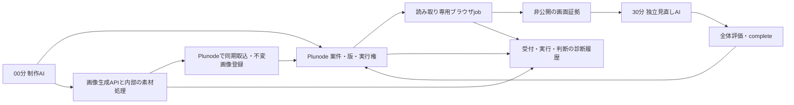

# テーマ自動制作の全体設計と実装計画

2026-11-20更新。生成APIを採用する決定に合わせ、画像／画面採取の内部処理と、定期実行の責務を明記した。β受入と正式導入は別に扱う。

## 推奨構成

当初の構想どおり、制作実行と独立見直し実行が、Plunodeに保存された同じ案件を進める。Plunodeは案件・実行権・版・送信受付・公開履歴の正本を持つ。**制作実行が画像生成APIへ素材を依頼し、Plunodeは既存の検査・登録処理を再利用する。** 画像生成元と定期実行基盤を個別に選べるようにし、見直し用の実画面は専用ブラウザで採取する。00分の制作は画像の目的と仕様を判断し、30分の見直しは実画面を含む全体を判断する。20分の資料収集、通常編集・通常公開、運営登録のAI送信境界は従来の経路を使う。 [制作引継ぎの契約](THEME_PRODUCTION_HANDOFF.md)・[承認公開の契約](THEME_PRIVATE_PUBLICATION_20261117.md)・[API移行記録](../verification/THEME_EDITORIAL_PUBLICATION_20261120.md)

既存のmember PostgreSQLに画面job・結果目録と診断イベントを置き、実行権と再開は既存処理のパターンを再用する。ブラウザは管理下の常時稼働環境で、Webと分けた資源上限付きコンテナに置く。βでピーク時のCPU・メモリを測り、Webへの影響を吸収できなければブラウザだけ別ホストへ移せる。生成と画面採取は同じDBの受付を使う。素材処理・画面採取の実行は現行予定の制作／見直しとは独立した内部操作とする。初期は既存DB・配備と診断を使う。 [共通AIの責務と利用枠](AI_PROCESSING_DIRECTION.md)

既存βには添付受付診断、認証済みPlaywright採取、ブロック後の再開手順がある。ケース記録上はChatGPT側の添付送出拒否が最有力で、当時の本番アクセスログがなく未到達は推定。管理者補助の操作は隔離、匿名プレビューの拒否と代表経路はβで確認済み。新規生成から公開までの無人完走は今後の受入項目とする。 [調査・β検証・運営者手順](../runbooks/THEME_PRODUCTION_EXTERNAL_BLOCKERS.md)

## 方式比較

| 方式 | 利用者体験 | 実現性 | 運営コスト | 拡張性 |
| --- | --- | --- | --- | --- |
| ChatGPTの定期枠だけで画像・画面を処理 | 成功時は会話内で完結する | 添付送出と接続元ブラウザの制約が残り、期限切れや枠をまたぐ再開を安定させにくい | 見かけの追加費用は小さいが、同種の停止対応が続く | 外部仕様変更に依存 |
| 通常Chatで画像を登録し、運営者が実画面を採取 | 既存案件を人が復旧できる | 既存βの工具を使用可能。会員ログインと元画像が必要 | 固定費は小さく、案件数に比例して手作業が増える | 障害時の代替経路に適する |
| **現行の制作工程＋共通の画像取込＋専用ブラウザ** | 案件内で無人進行でき、例外は理由を追える | 画像は所持できる実行元から受け取る。定期枠の添付と見直し側の画面証拠読取は個別に実測する | 既存の取込を再用し、ブラウザの分離運用を追加。生成費は選定方式に依存 | 生成元・制作実行元・見直し実行元を個別に変更できる |
| 全制作を別の定期実行基盤へ移す | 制作を会話環境から独立して無人運転できる | 作成・検索・添付・見直しの運用を移す必要がある | 初期移行、モデル利用、保守の費用がかかる | 各工程で生成物の保存・再開を共通化できる |

推奨は3案目。手動経路は現在のヴァイキングと将来の例外処理に残す。定期Webが画像付きの検証証拠を読めない場合は、最初に**独立見直し実行だけ**を承認済みの画像入力対応AIランナーへ移す。切替はβで実測し、同じ案件に見直し実行元が重複しないようにする。

## ① 画像生成と登録

ChatGPT定期実行の添付制約を回避するため、サーバーが画像の実バイトを取得する方式を採用した。通常Chatの既存添付・登録済み素材の再利用を継続できる。生成先は `ThemeImageGenerator` で分離し、初期候補は OpenAI Image API の `gpt-image-2.6-flare`、横長1536×1024・medium・1枚。既存登録に合うJPEGを直接受け取れ、GPU運用が不要。Flareは速度を重視したモデルであり、採用する画質と一枚あたりの費用は承認後の実測で確定する。βの無課金検証は固定画像のアダプターを使う。 [モデル仕様](https://developers.openai.com/api/docs/models/gpt-image-2.6-flare)・[画像生成API](https://developers.openai.com/api/reference/resources/images/methods/generate)

`generate_theme_image` は有効な案件実行権で素材を受け付ける。外部生成はHTTP応答時間をまたぐため、受付後の生成と画像保存だけを内部で処理する。既存の制作予定が `read_theme_automation` で取り出し、`prepare_theme_production_submission` の `generatedImage` で指定した言語のpresentationへ自動関連付けする。送信は既存dispatchを使い、権限・版・参照・公開制御を経る。素材準備の完了はテーマの公開を意味しない。将来の実行基盤や生成元はこの契約を使える。

外部送信前に試行ID・UTC日次件数を予約する。投入指示と同じ受付は再利用し、保存済みバイトから登録を再開できる。送信結果が不明な試行は `IMAGE_GENERATION_UNKNOWN` で止め、費用重複を避ける。キーと有効化はWorkerに限定する。モデルへ送る入力は用途に必要な単独の生成指示。非公開原稿や会員データを自動送付する仕組みは設けない。

## ② 独立見直しの実画面検証

- **専用Playwrightランナーで既存の運営者プレビューを描画する。** βの操作・採取を再用し、ブラウザに会員のGoogleセッションを引き渡さない。サーバーは、認可された見直しjobについてのみ、案件・テーマ・版・評価digest・環境に束縛した短命の読取セッションを発行する。資格は専用の発行経路からヘッダまたはCookieで渡す。見直し用に絞った認可で、対象の画面と必要な従属データ・画像だけを許可する。匿名・一般会員や別案件の拒否、Cookie・トークンの失効、通常の運営者ログインとの分離を試験する。スクリーンショットの閲覧も別途認可する。ブラウザはジョブごとの隔離contextで、必要な既知のoriginに限り、出典リンクの内容確認は既存の根拠確認経路へ渡す。 [Playwrightのcontext分離](https://playwright.dev/docs/browser-contexts)
- 対象を採取前後で照合し、テーマ版・評価digest・ガイド版・Web build・環境・採取時刻・確認条件・証拠hashを記録する。現行の公開版進展、訳文、画像、参照先や表示コードが採取後に変化した場合は、現行版と再照合し証拠を取り直す。初期はPC 1440pxとスマートフォン相当390px、公開対象言語を確認し、DOMの数値とスクリーンショット、操作の成否を保持する。画像の切れ・見出しとの関係、年表、Story、出典・引用と戻る導線、横はみ出しを扱う。証拠の欠落とガイド上適用外の項目を区別する。
- 独立した見直し実行が、既存認証下で証拠一覧・限定サイズの画像を取得し、年表・本文・根拠と併せて全体を評価する。MCPから同じケース・版の画像出力を受け取って実際に視認できるところまで、βの実予定で確認する。テキストの「成功」だけで視覚確認済みとしない。読取に失敗する場合は上記の専用AIランナーへ移す。休止中のログイン済みセッションに依存させない。
- 自動操作の結果は証拠。合否は別実行の独立見直しが判断する。新経路を有効にした案件では、現在の評価対象に有効な必須証拠があることを `complete` 前のサーバー条件に加える。既に公開済みの案件と旧経路の再送を壊さないよう、適用範囲は案件ごとに明示する。公開後の正規URL確認は別の読取処理として記録し、失敗は運用へ通知する。後から出た通常公開との競合は既存の照合・再評価規則に従う。

## ③ 障害追跡と復旧

各コンテナの標準出力だけでは再配置前の要求を照合できない。専用の外部ログサービスは横断検索を早く使える一方、保存単価と接続・秘匿範囲の追加設計が必要。初版はDBの相関イベントと現行運用の永続ログを組み合わせる。

- **操作・jobの診断イベントをDBに残し、Web／Worker／プロキシの運用ログをローテーション付きの永続領域へ出す。** DBには状態変更と同じtransaction、または同じtransactionのoutboxで業務イベントを記録する。プロキシではMCP経路の方法・時刻・HTTP状態などを許可リストで採取し、本文や認証ヘッダ、URLクエリを記録しない。Webはβの受付診断を基礎に認証・入力検証・受付・公開を分ける。運用ログはコンテナ再作成をまたげることを確認する。初期は既存運用に適合する保管と検索で開始し、相関形式は将来のOpenTelemetry集約へ持ち運べるようにする。 [OpenTelemetryのログ相関](https://opentelemetry.io/docs/concepts/signals/logs/)
- 実行ID・案件ID・操作requestId・job／試行ID・環境・build・段階・安定した理由コード・時刻を関連付ける。入口で信用できる相関IDを付与し、公開画面用のログに非公開の原稿や画像を載せない。署名URL、file ID、Cookie、lease token、APIキー、画像本文を診断ログに保存しない。閲覧は運営者に限定し、保存量と保護・削除を分ける。診断ログは当初30日を目安に容量を測る。案件に紐づく状態・障害の要約と承認証拠は案件履歴の保存規則に従い、参照中の証拠を期限だけで削除しない。
- 実行の開始報告、プロキシ受信、認証、MCP受付、provider送信・応答、資材永続化、ブラウザ採取、証拠読取、全体評価と公開を区別する。開始報告も入口ログも無い回は「観測なし」と表示し、外部ランナーでの拒否を断定しない。外部側のエラーが記録された回は、実行日時・相関IDとプロキシ／Webログで照合する。運営一覧に最後に到達した段階、未解消の原因、次回試行、再開条件を出す。通知は新規ブロック、反復失敗の閾値、復旧に絞る。
- 一時障害は元受付と予算予約を維持してバックオフする。認証失効、予算枯渇、参照拒否、必要証拠の欠落などは再開条件を明示して `blocked` とし、待機中の案件実行権を解放する。条件が変わったら同じ案件、現行工程、最新状態版で取得し直す。解消済みの阻害だけを解除し、同じ添付の無条件再送や、見直しの代替となる自動公開は行わない。

## 実装順序と並行作業

| 段階 | 実装と依存 | 並行できる作業 |
| --- | --- | --- |
| **A 共通契約・診断** | 状態遷移・実行元の識別・冪等受付・入力版と結果目録・秘匿項目・ログの永続化を先に確定する | 既存同期登録、無課金アダプター、実案件と独立したβ素材を検証する。②の操作fixture・証拠読取と保存上限の計測を並行 |
| **B ①画像と②ブラウザ** | ①は同じ受付状態から再開できる生成・取込・関連付けをつなぐ。②は制限付き認可・採取・非公開証拠の取得を進める | ②は登録済み画像で先行できる。③の診断ビュー、通知、異常系試験も進める |
| **C 統合・β実予定** | 画像生成から既存版の保存・再開、独立評価、公開結果までつなぐ。画面証拠の実際の読取を確認して見直し実行元を決める。変更対象のAPIガイド・ツール定義を先に供給する | 通常Chat・収集・AI審査の回帰、保管量・所要時間・運用費の測定、正式リリースとWeb設定の引継ぎ文作成 |
| **D 正式導入** | 先に互換API・診断を追加して既存進行案件を読み戻す。承認後に限定案件で新経路を有効化。00分／30分の変更が必要なら、対象のApp・指示の反映と読み戻しをユーザーと確認し、20分は従来経路を観察する | ヴァイキングは既存手段で先に復旧できる。正式で影響範囲を段階的に広げ、失敗時は新規受付を止めて既存の受付・証拠・案件を保全 |

課金APIへの接続と外部へ送るデータ範囲は、採用時に費用上限と併せて承認を得る。実予定の切替も承認後に行う。β・正式で同じ案件を担当する主実行は工程ごとに一つにし、保留中の旧案件へ必須証拠を遡及適用する場合は案件単位で判断する。 [正式公開手順](../runbooks/PRODUCTION_RELEASE.md)

## 完了条件

- **①** βと正式の複数の対象回で、新規生成、画像登録、作業版への関連付けを人手なしで確認する。既登録素材の再利用、画像不要の案件、参照失効・応答喪失・実行元再起動からの安全な再開または条件付き停止を試す。二重登録と、結果不明の送信に対する無条件の二重課金を防げる。通常Chatからの手動復旧は代替経路として確認する。
- **②** 画像付きの実画面証拠を、接続元ブラウザのない独立見直し実行が実際に参照し、公開対象言語・両画面幅で全体評価を完了できる。匿名・権限外・失効した資格は拒否され、古い版・欠落した必須証拠では公開できない。正規公開を別に確認できる。
- **③** 外部送出、受信・認証、生成、保存、画面検証、公開の代表障害を別々に再現し、ログから最後に到達した段階と復旧条件を特定できる。Web再配置やWorker再起動後も同じ案件で追跡し、正常時の自動進行と障害時の安全停止・再開を確認できる。
- **全体** ヴァイキングの手動復旧だけで受入を閉じず、別テーマを含む対象回で再現する。00分の制作、30分の独立見直し、20分の資料収集、通常Chatの直接編集と公開、公開履歴・参照・一般投稿の審査の互換性を確認する。運用移管はAPI反映、ChatGPT Web側の反映・読み戻し、実予定の結果が揃った時点で完了とする。
