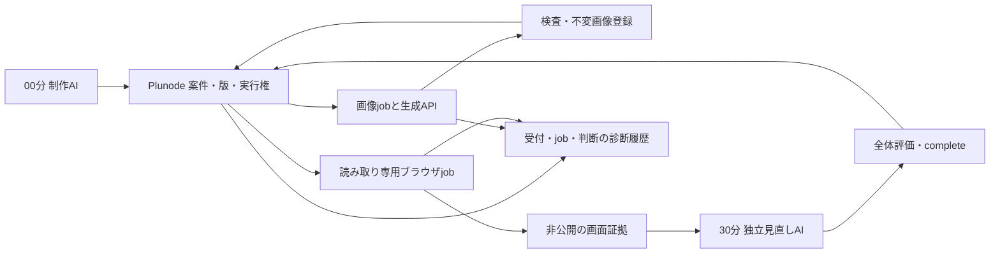

# テーマ自動制作の全体設計と実装計画

2026-11-20、設計評価用。対象は画像生成・登録、独立見直しの実画面検証、障害診断。実装の着手は設計評価の後とする。

## 推奨構成

当初の構想どおり、ChatGPTの制作実行と独立見直し実行が、Plunodeに保存された同じ案件を進める。Plunodeは案件・実行権・版・送信受付・公開履歴の正本を持つ。今回は、会話環境をまたぐと失われる画像バイトとブラウザ実行を、Plunodeが管理する案件単位の非同期処理に接続する。00分の制作は画像の目的と仕様を判断し、30分の見直しは実際の画面と全体を判断する。20分の資料収集、通常編集・通常公開、運営登録のAI送信境界は従来の経路を使う。 [制作引継ぎの契約](THEME_PRODUCTION_HANDOFF.md)・[承認公開の契約](THEME_PRIVATE_PUBLICATION_20261117.md)・[API移行記録](../verification/THEME_EDITORIAL_PUBLICATION_20261120.md)

既存のmember PostgreSQLへ画像job・画面job・結果目録と診断イベントを追加する。ジョブ取得、期限付き実行権、再開、利用枠予約は既存の非同期処理の実装パターンを再用する。画像とブラウザは同じ配備手順を使いつつ、プロセス・権限・同時実行枠を分ける。初期配置は管理下の常時稼働環境で、ブラウザはWebとは別の資源上限付きコンテナ。βでピーク時のCPU・メモリを測り、Webへの影響を吸収できなければブラウザだけ別ホストへ移せる。追加の汎用キューサービス、全文ログ基盤、LLMオーケストレーターは初期要件から外す。 [共通AIの責務と利用枠](AI_PROCESSING_DIRECTION.md)

既存βには添付受付診断、認証済みPlaywright採取、ブロック後の再開手順がある。ケース記録上はChatGPT側の添付送出拒否が最有力で、当時の本番アクセスログがなく未到達は推定。管理者補助の操作は隔離、匿名プレビューの拒否と代表経路はβで確認済み。新規生成から公開までの無人完走は今後の受入項目とする。 [調査・β検証・運営者手順](../runbooks/THEME_PRODUCTION_EXTERNAL_BLOCKERS.md)

## 方式比較

| 方式 | 利用者体験 | 実現性 | 運営コスト | 拡張性 |
| --- | --- | --- | --- | --- |
| ChatGPTの定期枠だけで画像・画面を処理 | 成功時は会話内で完結する | 添付送出と接続元ブラウザの制約が残り、期限切れや枠をまたぐ再開を安定させにくい | 見かけの追加費用は小さいが、同種の停止対応が続く | 外部仕様変更に依存 |
| 通常Chatで画像を登録し、運営者が実画面を採取 | 既存案件を人が復旧できる | 既存βの工具を使用可能。会員ログインと元画像が必要 | 固定費は小さく、案件数に比例して手作業が増える | 障害時の代替経路に適する |
| **ChatGPTの制作・独立見直し＋Plunode管理job** | 通常の案件が設定後に自動で進む。例外は案件画面で理由が分かる | 画像の実バイトと認証済み実画面を管理下で取得。定期枠での画像証拠読取を実測する | 生成API使用料とブラウザの分離運用。既存DB・配備・保持制御を再用 | 画像提供元、ブラウザ配置、見直し実行元を個別に差し替え可能 |
| 全制作をAPIベースのLLMランナーへ移す | ChatGPT Webの制約から切り離せる | 作成・検索・添付・見直しの全運用を移設する必要がある | 初期移行、モデル料金、保守とも大きい | 高いが初期費用も大きい |

推奨は3案目。手動経路は現在のヴァイキングと将来の例外処理に残す。定期Webが画像付きの検証証拠を読めない場合は、最初に**独立見直し実行だけ**を承認済みの画像入力対応AIランナーへ移す。切替はβで実測し、同じ案件に二つの見直し実行元を常時割り当てない。通常のWeb制作、会員の投稿審査、共通Kev本体に今回の変更を広げない。

## ① 画像生成と登録

管理下のGPUでの生成は外部課金への依存を減らす一方、画質検証・GPU確保・運用を先に要する。初版は外部APIで小さく開始し、品質・費用の実測で必要性が見えた場合にローカル生成を評価する。

1. 制作AIは案件の実行権を使い、画像が必要か、生成挿絵か確認済み既存画像か、用途・構図・生成指示と日英alt・来歴を保存する。サーバーが案件の素材要求版を固定し、画像jobを受け付ける。同じ素材要求の再送は既存jobを返し、意図的な再生成は新しい素材要求版として区別する。
2. 初期providerは画像の実バイトを返す **OpenAI Image APIを第一候補**とし、事業者を差し替えられる薄い境界を置く。初期は一つのモデルを実測で選び、モデルと設定を版付きで固定する。ヴァイキングに代表される歴史・科学の挿絵で、品質・表示サイズ・所要時間・実使用量を測る。画像生成用の別projectで、送信前の予約、案件／期間の上限、事業者側の利用制限を併用する。価格や契約の承認を経て本番接続する。会員情報・非公開原稿は既定で外部送信せず、用途に必要な生成指示に絞る。 [Image APIの実バイト返却仕様](https://developers.openai.com/api/reference/resources/images/methods/generate)
3. 応答の実バイトを保護した一時領域へ保存し、既存の形式・容量・画素数・役割・来歴検査を通して不変の `imageId` を確定する。生成挿絵を史料写真として扱わず、公開する注記とクレジットを版に含める。保存済み画像の再取込は同じ内部受付を使う。外部送信の応答が消えた場合は、不明な試行と予算予約を残して照会可能なら照会する。照会不能な送信の完全な一回性を仮定せず、同一jobの再送で新しい課金を自動発生させない。失敗が確定した一時障害は上限付きで再試行する。
4. jobは素材を用意する。制作AIまたは担当する実行が有効な案件実行権で再取得し、既存prepare・dispatchを通してその `imageId` を作業版に関連付ける。作業対象が変更されていたら画像は未関連の素材として扱い、適合を再判断する。画像が不要な案件は品質ガイドに沿って理由を残す。画像必須の案件は送出・予算・生成障害を理由に自動で省略しない。

## ② 独立見直しの実画面検証

- **専用Playwrightランナーで既存の運営者プレビューを描画する。** βの操作・採取を再用し、ブラウザに会員のGoogleセッションを引き渡さない。サーバーは、認可された見直しjobについてのみ、案件・テーマ・版・評価digest・環境に束縛した短命の読取セッションを発行する。資格は専用の発行経路からヘッダまたはCookieで渡す。見直し用に絞った認可で、対象の画面と必要な従属データ・画像だけを許可する。匿名・一般会員や別案件の拒否、Cookie・トークンの失効、通常の運営者ログインとの分離を試験する。スクリーンショットの閲覧も別途認可する。ブラウザはジョブごとの隔離contextで、必要な既知のoriginに限り、出典リンクの内容確認は既存の根拠確認経路へ渡す。 [Playwrightのcontext分離](https://playwright.dev/docs/browser-contexts)
- 対象を採取前後で照合し、テーマ版・評価digest・ガイド版・Web build・環境・採取時刻・確認条件・証拠hashを記録する。現行の公開版進展、訳文、画像、参照先や表示コードが採取後に変化した場合は、現行版と再照合し証拠を取り直す。初期はPC 1440pxとスマートフォン相当390px、公開対象言語を確認し、DOMの数値とスクリーンショット、操作の成否を保持する。画像の切れ・見出しとの関係、年表、Story、出典・引用と戻る導線、横はみ出しを扱う。証拠の欠落とガイド上適用外の項目を区別する。
- 独立した見直し実行が、既存認証下で証拠一覧・限定サイズの画像を取得し、年表・本文・根拠と併せて全体を評価する。MCPから同じケース・版の画像出力を受け取って実際に視認できるところまで、βの実予定で確認する。テキストの「成功」だけで視覚確認済みとしない。読取に失敗する場合は上記の専用AIランナーへ移す。休止中のログイン済みセッションに依存させない。
- 自動操作の結果は証拠。合否は別実行の独立見直しが判断する。新経路を有効にした案件では、現在の評価対象に有効な必須証拠があることを `complete` 前のサーバー条件に加える。既に公開済みの案件と旧経路の再送を壊さないよう、適用範囲は案件ごとに明示する。公開後の正規URL確認は別の読取処理として記録し、失敗は運用へ通知する。後から出た通常公開との競合は既存の照合・再評価規則に従う。

## ③ 障害追跡と復旧

各コンテナの標準出力だけでは再配置前の要求を照合できない。専用の外部ログサービスは横断検索を早く使える一方、保存単価と接続・秘匿範囲の追加設計が必要。初版はDBの相関イベントと現行運用の永続ログを組み合わせる。

- **操作・jobの診断イベントをDBに残し、Web／Worker／プロキシの運用ログをローテーション付きの永続領域へ出す。** DBには状態変更と同じtransaction、または同じtransactionのoutboxで業務イベントを記録する。プロキシではMCP経路の方法・時刻・HTTP状態などを許可リストで採取し、本文や認証ヘッダ、URLクエリを記録しない。Webはβの受付診断を基礎に認証・入力検証・受付・公開を分ける。運用ログはコンテナ再作成をまたげることを確認する。初期は既存運用に適合する保管と検索で開始し、相関形式は将来のOpenTelemetry集約へ持ち運べるようにする。 [OpenTelemetryのログ相関](https://opentelemetry.io/docs/concepts/signals/logs/)
- 実行ID・案件ID・操作requestId・job／試行ID・環境・build・段階・安定した理由コード・時刻を関連付ける。入口で信用できる相関IDを付与し、公開画面用のログに非公開の原稿や画像を載せない。署名URL、file ID、Cookie、lease token、APIキー、画像本文を診断ログに保存しない。閲覧は運営者に限定し、保存量と保護・削除を分ける。診断ログは当初30日を目安に容量を測る。案件に紐づく状態・障害の要約と承認証拠は案件履歴の保存規則に従い、参照中の証拠を期限だけで削除しない。
- 実行の開始報告、プロキシ受信、認証、MCP受付、provider送信・応答、資材永続化、ブラウザ採取、証拠読取、全体評価と公開を区別する。開始報告も入口ログも無い回は「観測なし」と表示し、外部ランナーでの拒否を断定しない。外部側のエラーが記録された回は、実行日時・相関IDとプロキシ／Webログで照合する。運営一覧に最後に到達した段階、未解消の原因、次回試行、再開条件を出す。通知は新規ブロック、反復失敗の閾値、復旧に絞る。
- 一時障害は元受付と予算予約を維持してバックオフする。認証失効、予算枯渇、参照拒否、必要証拠の欠落などは再開条件を明示して `blocked` とし、待機中の案件実行権を解放する。条件が変わったら同じ案件、現行工程、最新状態版で取得し直す。解消済みの阻害だけを解除し、同じ添付の無条件再送や、見直しの代替となる自動公開は行わない。

## 実装順序と並行作業

| 段階 | 実装と依存 | 並行できる作業 |
| --- | --- | --- |
| **A 共通契約・診断** | 状態遷移、実行元の識別、冪等受付・jobの実行権、入力版と結果目録、秘匿項目、運用ログの永続化を先に確定。既存案件の読取・再送を保つ追加変更で始める | β用生成APIと利用枠の確認、画像の評価セット、実プレビューの操作fixture、既存の画像出力を用いた定期枠での読取の先行調査、保存上限の計測 |
| **B ①画像と②ブラウザ** | Aの契約を使って別々に実装。①は生成→実バイト検査→不変保存、②は制限付き認可→採取→非公開証拠の取得 | 両jobの実装・異常系試験を同時進行。②は①の完成前に登録済みの検証用画像で試す。診断ビューと通知も並行 |
| **C 統合・β実予定** | ①と②を受け付け、既存版の保存・再開、独立評価、公開結果までつなぐ。画像出力の実際の読取を確認して見直し実行元を決める。ガイド・ツール定義を先に供給する | 通常Chat・収集・AI審査の回帰、保管量・所要時間・運用費の測定、正式リリースとWeb設定の引継ぎ文作成 |
| **D 正式導入** | 先に互換API・診断を追加して既存進行案件を読み戻す。承認後に限定案件で新経路を有効化。既存Appのツール更新と00分／30分の指示の反映・読み戻しをユーザーと確認し、20分は従来経路を観察する | ヴァイキングを既存手段で復旧する作業は本計画とは独立。正式で影響範囲を徐々に広げ、失敗時は新規受付だけ止めて既存job・証拠・案件を保全 |

初回の決定は、管理下の常時稼働環境に小さく配備、画像providerは一つ、ログはDBのイベントと既存運用の永続化、定期Webは画像証拠を読める場合に継続する構成とする。事前の承認が必要なのは、画像・見直しのAPI課金上限、外部へ送るデータ範囲、実予定の切替。レビュー方式の分岐はCの実測で決める。β・正式とも新旧を同時に書き込ませず、保留中の旧案件へ必須証拠を遡及適用する場合は案件単位で判断する。 [正式公開手順](../runbooks/PRODUCTION_RELEASE.md)

## 完了条件

- **①** βと正式の実予定で、新規生成から画像登録・作業版への関連付けまで、手動の添付・ブラウザ操作なしにできる。既登録素材の再利用、画像不要の案件、失敗後の再開で二重登録と無条件の二重課金を防げる。
- **②** 画像付きの実画面証拠を、接続元ブラウザのない独立見直し実行が実際に参照し、公開対象言語・両画面幅で全体評価を完了できる。匿名・権限外・失効した資格は拒否され、古い版・欠落した必須証拠では公開できない。正規公開を別に確認できる。
- **③** 外部送出、受信・認証、生成、保存、画面検証、公開の代表障害を別々に再現し、ログから最後に到達した段階と復旧条件を特定できる。Web再配置やWorker再起動後も同じ案件で追跡し、正常時の自動進行と障害時の安全停止・再開を確認できる。
- **全体** ヴァイキングの手動復旧だけで受入を閉じず、別テーマを含む対象回で再現する。00分の制作、30分の独立見直し、20分の資料収集、通常Chatの直接編集と公開、公開履歴・参照・一般投稿の審査の互換性を確認する。運用移管はAPI反映、ChatGPT Web側の反映・読み戻し、実予定の結果が揃った時点で完了とする。
