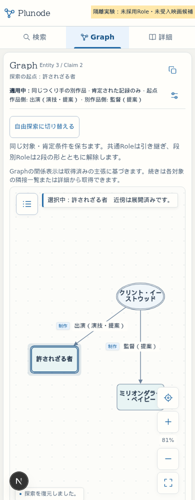

# Issue #41 映画収集v1の隔離実証
2026-10-26。目標は映画専用adapterから候補・根拠レビュー・受入前検証を揃え、人が最低2 Claimを判断できる状態にすること。独立branch codex/issue41-film-collectionで実施した。

main比較基準はb34e9ebe9df23835226651adbbda072908c933ab。先行Astra研究461cd1cとIssue #40実装12f3476をmergeして再利用した。元の研究・12 Claim・段別検索実装は変更していない。

## 完成したもの
- [映画専用recipe](../../../datasets/film-collection/v1/recipe.json)と scripts/collect-film-v1.py。ネットワーク処理のない独立CLIで、固定3作品・12候補を生成する。
- [判断用レビュー](../../../datasets/film-collection/v1/trial/README.md)、[固定本文](../../../datasets/film-collection/v1/trial/review/proposed-records.json)、[未承認の判断雛形](../../../datasets/film-collection/v1/trial/review/decision-draft.json)、[技術preflight](../../../datasets/film-collection/v1/trial/preflight.json)。
- 12候補はhidden、人物別creditの追補が揃った2件を判断待ち、残る10件を保留。全cut／地域への拡張、公開年のperiod転記、ISBNの代用はしていない。
- [実ブラウザ結果](browser-validation.json)：PC1440px／スマホ390pxで検索条件→結果→根拠→Graph→人物展開→途中保存→自由探索→保存再開→再読込を成功。APIは実Next handler、DBは使い捨てNeo4j。画面データやAPIをmockしていない。

## 最低2 Claimの受入準備
| 判断対象 | 仮UUID | 人物別原役割・根拠 |
| --- | --- | --- |
| Clint Eastwood → 許されざる者 / ACTING | 4c88b8e8-154d-47ad-bf82-f19876ecaebd | [AFIのCAST欄](https://catalog.afi.com/Film/67274-UNFORGIVEN)。人物名とBill Munnyという役柄を同じ欄で確認 |
| Clint Eastwood → ミリオンダラー・ベイビー / DIRECTING | 34b41d23-f4e6-4fc6-aa6f-2905f3c2a890 | [AFIのDIRECTORS欄](https://catalog.afi.com/Catalog/moviedetails/54369)。人物名に対応するDirを確認 |

短い原語抜粋、URL・locator・取得時刻・元response hash・人物／作品同定注記を[追補資料](../../../datasets/film-collection/v1/evidence/supplements.json)に固定。S10のカンヌは403で、同じ作品のAFIを補助資料として追加した。旧S09/S10/S11の記録は不変。ページ全文・映画画像はcommitしていない。

AFIはミリオンダラー・ベイビーを2005年の米国公開として表示し、保存済み作品同定は2004年を用いる。同一タイトル・監督・主要出演者の対応を記録し、別映画やClaim期間へ変換していない。この同定注記とscope:null（未構造化）を含めて判断できる。

## 検証
[検証記録](VALIDATION.md)を参照。通常のRole enumは8件のままで映画Roleを拒否する。提案Roleと空きDBポートを一時ソースコピーにだけ追加し、候補全12件と推薦2件を実スキーマで検証した。公開形式へのvisibility変更も、この新しい使い捨てDBだけに限定した。

## 漫画収集への影響
[コード・固定hash比較](manga-impact.json)で、既存manga-discovery-v2のcodeSha256・入力hash・上限がmainと一致することを確認した。collection-themes/workflow/acceptance/worker、既存承認、control branch、旧receipt、語彙catalogは変更していない。本実験CLIをWorkerのdispatchやregistryへ登録していない。共有gateの変更による承認hashの更新も不要だった。

比較資料は保存済み本番backupと、全参照hash・本文・scopeを確認した正式receipt 10件から凍結した。公開／撤回／正式受入済み未公開の状態を残し、候補・保留を正式受入と扱わない。これは固定時点のオフライン比較で、現在の本番を再取得した結果ではない。実受入前には最新snapshotとreceipt集合を再確認する。

## 残る人間判断と次の作業
1. #40の狭いDIRECTING／ACTING定義を正式採用するか。声・吹替・archive・総監督は今回含めない。
2. 上記人物別資料を根拠に、作品単位・scope:nullの2 Claimを個別に受け入れるか。仮UUIDを採用するか、最新同定結果に応じて既存UUIDへ対応づけるか。
3. 映画収集の本運用範囲・取得予算と、映画reviewを既存正式受入へ接続する実装を承認するか。

今回の2 Claimの資料判断に、追加の全件再調査は不要。**正式採用・正式受入へ実際に進むには、判断後にもう一度Codexで語彙登録・最新比較・映画review接続を行う作業が必要**。その変更範囲は[本線統合の残条件](INTEGRATION.md)に整理した。未採用のRoleを先にcatalogへ登録したり、漫画v2を名乗る架空jobやapproved票を作成したりしていない。

## 再現
~~~sh
npm run film:test
npm run film:prepare
npm run film:e2e
python3 scripts/collect-film-v1.py verify --output datasets/film-collection/v1/trial
~~~

Node 24・既存依存・Docker・PlaywrightのChromiumとOS依存ライブラリを使用する。試験ホストでは既存のprivateライブラリcacheをLD_LIBRARY_PATHで参照した。システムパッケージ、稼働Web、共有DBの設定は変更していない。ブラウザ試験は毎回一時ソース・固有コンテナ・空きloopbackポートを作成し、終了時に撤去する。実環境の.envや会員認証を読み込まない。
