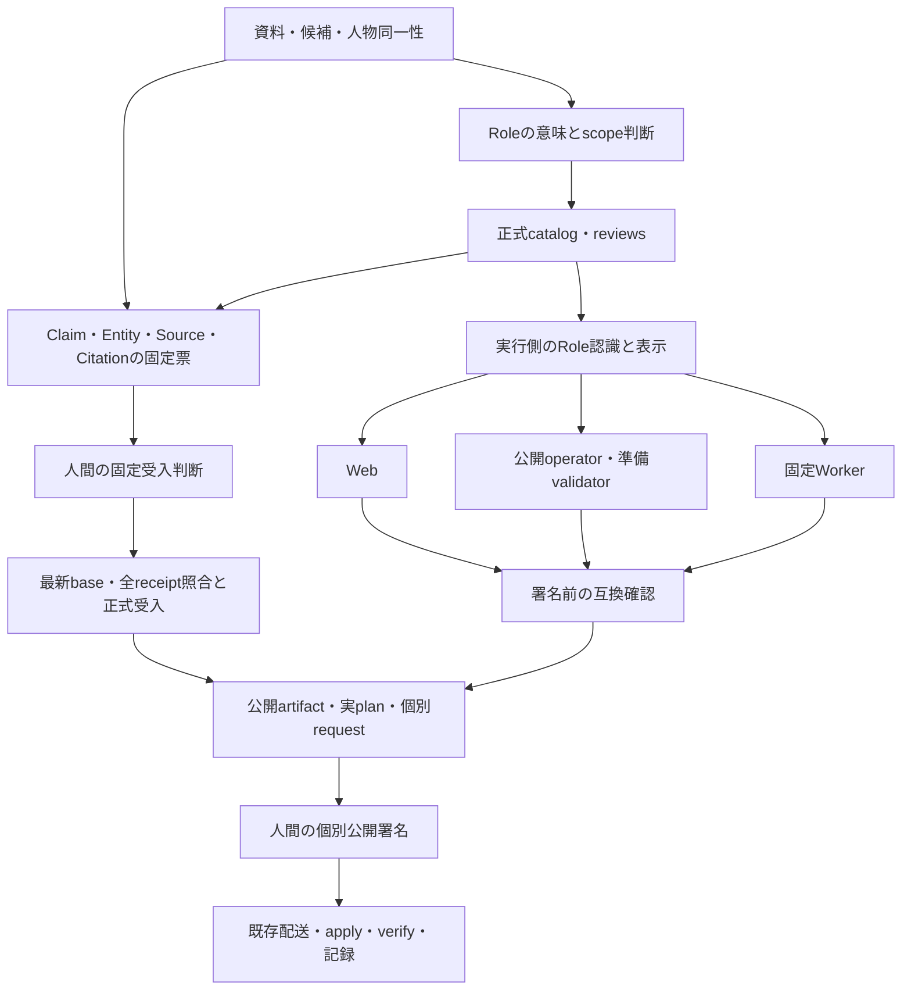

# Plunode：知識追加から正式公開までの設計レビュー

2026-10-28。対象main：`129c1eb411cece336cce02996c520f8f21b12f0a`。提案・隔離実証のみ。正式受入、承認契約の変更、配備は行っていない。

## 1. 採用判断

**既存の公開自動化を維持し、先に「利用側すべての互換確認」と「保存済み候補をまとめて判断できる入力」を整える。その後、意味判断と実行条件の束縛を分け、排他と再開を短くする案を推奨する。**

最初からRoleを動的読込へ変えたり、CI/CDを置き換えたりする費用対効果は、今回の記録では支持されない。旧WorkerのRole列挙不足は実在するが、公開準備・Web・Workerが別々の固定版で動き、互換確認の終端にWorkerが含まれていなかったことが、公開後まで残った主因である。型を残して承認済み語彙からID・表示・互換情報を生成する方が、小さく移行できる。

優先順位は次のとおり。

1. **#55の最小互換修正と、残る研究成果のレビュー準備を進める。** 恒久設計の完成を待たせない。
2. **既存#33に互換情報・固定成果物・再開診断を補う。** 新RoleがWeb・operator・Workerすべてで通ることを、公開署名の案内前に確認する。JSONの直列化とoperator pinの引継ぎもここで直す。
3. **今後の承認票を、意味判断・技術検証・個別公開署名の三つに分ける。** 同じ提示機会にRoleと依存Claimを判断できるようにするが、対象と決定は別に記録する。ロック範囲の縮小は、この再検証契約と一緒に導入する。

#33は、正式受入後の候補準備から未署名request登録、署名後の配送・検証・記録まで、すでに稼働している。「自動化がないから12往復した」という説明は誤りである。今回追加すべきなのは、新しい意味・版・環境が入ったときにも、この経路へ入れる前提を一度で揃える仕組みである。

## 2. 根拠と調査範囲

| 根拠 | 確認したもの |
| --- | --- |
| 現行仕様 | [PROJECT_CONTEXT](../../PROJECT_CONTEXT.md)、[ARCHITECTURE](../../ARCHITECTURE.md)、[文書索引](../../README.md)、[AI処理方針](../../design/AI_PROCESSING_DIRECTION.md)、[自動開発協調](../../AUTOPILOT_COLLABORATION.md)、AGENTS.md |
| 公開の実記録 | [本番完了検証](../../verification/FILM_INITIAL_PRODUCTION_20261028.md)、[実行手順](../../runbooks/FILM_INITIAL_RELEASE.md)、[正式登録・票確定](../film-release-20261027/role-registration-and-claim-readiness.json)、[公開完了記録群](../film-release-20261027/publication-completed/) |
| 稼働する自動化 | [#33](https://github.com/isinxnisi/graph-knowledge/issues/33)、[候補自動準備の完了](https://github.com/isinxnisi/graph-knowledge/issues/33#issuecomment-6371968273)、[映画公開の自動完了記録](https://github.com/isinxnisi/graph-knowledge/issues/33#issuecomment-6446632010) |
| 今回の障害・後続 | [#53](https://github.com/isinxnisi/graph-knowledge/issues/53)、[#55](https://github.com/isinxnisi/graph-knowledge/issues/55) |
| 研究の全体 | [124候補と97 Entity](../film-discovery-pilot-20261026/CANDIDATES.json)、[資料照合](../film-discovery-pilot-20261026/source_reviews.json)、[未収録の引継ぎ](../film-release-20261027/ASTRA_RESEARCH_BACKLOG.md)、[歴史的全件台帳](../film-release-20261027/ASTRA_RESEARCH_COVERAGE.json) |
| 時間 | 参照可能なローカル2本のセッションログ。12完了turnの開始・終了、対応するツール呼出し／返却、モデル設定を抽出。[集計結果](results/timeline.json)に元ログ名・対象時点までのhash・時刻を保存 |
| 追加読取・実証 | 配備済みWSLコード・設定の必要項目、固定Gitソース、保存済み公開artifact。[出典スナップショット](results/sources.json)、[実証結果](results/probes.json)、[全件回収計画](results/coverage-plan.json) |

分析時点のWSL準備・配送は固定commit `7392d8e343a11644b1047364c71653779ad0c93c`、Workerは `973c7b0c599f79905a029b28b524f4924e169376`。準備・配送とも有効。準備のNode imageは正式10 Role版 `2bf646a2…`。mainの新しさだけでは、これらの更新は証明できない。

特に配備済み `publication-preparation.py` と `publication-delivery.py` は、対象mainには存在しない。今回は固定commitのソースと設置ファイルを読んだ。#33の古い本文の「最新公開」は10月24日時点であり、映画の完了commentと後続記録で補った。歴史的な台帳や手順を現在の状態として上書きしなかった。

本レビューでは本番・betaへ接続して再度E2Eを行っていない。過去の公開成功・画面検証は保存記録に基づく。最新mainは公開完了時の `89ea84b4` 以降の別機能を含むため、過去のWeb build IDを現在の稼働版だとは扱わない。現在の稼働環境全体の健全性を再認証する調査でもない。

## 3. 実際の依存関係と主因



この図の「署名前に全利用側を確認」は推奨する終端である。実際にはWebの不足をrequest登録後、Workerの不足を公開後に発見した。

### 3.1 主因A：同じデータを読む実行版が、一つの互換契約で閉じていない

- [contribution.ts](../../../lib/domain/contribution.ts)の `CONTRIBUTION_ROLE_IDS` を、API入力・保存条件・fixtureの検証が使う。[relation-conditions.ts](../../../lib/domain/relation-conditions.ts)、[saved-views.ts](../../../lib/client/saved-views.ts)、[表示辞書](../../../lib/i18n/contribution.ts)にも依存がある。
- [public-dataset.ts](../../../lib/server/public-dataset.ts) 29–34行は、schemaによる認識に加え、catalog/reviewsによる正式採用とデータhashを検査する。**「列挙に入っている」と「正式採用されている」は別条件**である。
- [publication-runtime.ts](../../../scripts/publication-runtime.ts) 10–12行のcapabilitiesは `originalStory/guardedApply/manifestFileSha256`。任意のRole集合・catalog版・schema版の互換証明にはなっていない。
- [collection-worker.py](../../../scripts/collection-worker.py) 206行以降の `sync_inputs` は、固定コードに対するscripts/domain/server/package類の一致を要求し、入力archiveはdatasets/docsを対象とする。新しいcatalogをmainに置くだけで、固定Workerのコードや語彙が更新される経路ではない。

映画2 Claimを追加した公開artifactは、Web・正式operatorでは通り、旧WorkerではACTING/DIRECTINGの2箇所で拒否された。これは「漫画収集が映画を扱わないから無関係」とはできない。累積baseに含まれる映画を読む処理が影響を受ける。ただし、既存の固定recipeすべてがその新baseを読むという証拠はなく、全Worker停止と断定するのも誤りである。

**必要だった作業**：各実行側の互換確認、固定版の安全な更新、既存Role・scope・保存条件の維持。

**避けられた作業**：公開直前のWeb対応発見、公開後のWorker互換調査、利用側ごとの更新漏れをその都度探索すること。

### 3.2 主因B：意味の受入票が広いコード・環境集合に束縛される

[collection-film.py](../../../scripts/collection-film.py) 10–19行の `programs` は、domain/server/i18n配下のTypeScriptとworkflow・adapter・表示準備・package・語彙などを束縛する。実票の `boundProgramFiles` は159。109–128行の `bundle` はその全体一致を要求し、保存した根拠bytesに加えて、審査時CODE_ROOTのrecipeも参照する。

したがって、Claimの人物・作品・Role・根拠が変わらなくても、関係の薄いserver/表示コード変更や審査用worktreeの撤去で再開できなくなる。現在の契約下ではこの拒否を回避してはいけないが、**将来の意味判断まで159ファイルの一括hashに結び続ける必然性はない**。

一方、[collection-acceptance.py](../../../scripts/collection-acceptance.py) 278行以降の判断票・用途・記録hash・base照合、319行以降の全receipt照合、commit直前の再確認は、二重受入・同一性競合・承認対象のすり替えを防ぐために必要である。

今回のRole正式登録後にはcatalog/reviewsが変わり、Claim票を確定し直した。さらにCitationの「未採用」注記を採取時点の説明へ直したため、Citationのrecord hashも変わった。後者を「同じ内容なので承認はそのまま」と扱うべきではない。今後、現在の採用状態をCitation本文へ混ぜず、状態表示として導出すれば、この種の書き直しは減らせる。

**必要だった作業**：意味・原文・同一性・選択集合・scope/periodの一致、最新baseと全receiptの再照合。

**避けられた作業**：無関係なコード差分による意味判断票の再生成、凍結した入力が元worktreeへ戻らないと使えない保管方式。

### 3.3 主因C：長い共通ロックと、作業間の取得順序が開始を遅らせる

現行AGENTSは変更・テスト・DB操作からcommit/pushまで共通holdを要求する。隔離worktreeのbuildやブラウザ確認も、その期間に入る。[autopilot_review.py](../../../scripts/autopilot_review.py)の共通flockと、[collection-evidence.py](../../../scripts/collection-evidence.py) 227–241行の `worker_guard` を確認した。

手動受入は **共通lock → Worker lock**。WorkerのtickはWorker lockを保持した上で共通lockを使う。配備済み[Coordinator](https://github.com/isinxnisi/graph-knowledge/blob/7392d8e343a11644b1047364c71653779ad0c93c/scripts/publication-coordination.py)は **coordinator → Worker → 共通** を試し、失敗時には途中lockを解放して最大30秒の範囲で待つ。非blocking取得があるため、今回を恒久的なdeadlockと断定する証拠はない。競合停止・再試行・開始遅延は実在する。

ログでは、枠8は20:20の開始から共通lock取得可能まで約43分、枠9は22:17から約31分。その後Worker lockにも競合した。これらは読取調査や案内を含む時間帯であり、全時間がCPU待機ではない。枠10のoperator pin更新は、更新前にlockで止まったがroot staging directoryが残り、新規専用の `test ! -e` 条件では再試行できず、再開対応を追加した。

配備済み準備には、すでに短いCoordinator barrierや重複validateを避ける処理がある。これを新規提案として数えず、手動経路と更新経路も同じ原則へ寄せる。

**必要だった作業**：受入commit・公開適用の排他、所有者・期限・revisionの照合。

**避けられた作業**：隔離build・読取・転送を含む全工程の共通排他、lock取得前に作った資材の再開不能、競合中の短周期の再調査。

### 3.4 主因D：実証用adapterが、研究成果全体を受け取る境界になっている

[collect-film-v1.py](../../../scripts/collect-film-v1.py)は3作品・2 Role・12候補、AFI補足の対象を固定する。[collection-film.py](../../../scripts/collection-film.py)はready 2／held 10を要求する。これは当初の小規模実証の境界として正しいが、79記録を同じ入口へ渡すことはできない。

件数制約を削除するだけの一般化も不適切である。代わりに「今回選ぶ候補ID、資料hash、既存UUIDへの対応、Roleごとの意味判断、最大件数、保留集合」を固定manifestにする必要がある。少数実証の成功を多数の意味検証の代わりにはしない。

### 3.5 従属する問題：直列化、実行環境、再開表示

| 問題と根拠 | 発生理由 | 対処を置く場所 |
| --- | --- | --- |
| PythonとNodeでJSON値が同じでもhash不一致 | [receipt_projection](../../../scripts/collection-sequence.py) 104行以降が作るbytesと、[public-dataset](../../../lib/server/public-dataset.ts)がschema parse後に再直列化するbytesのキー順が違う | producerで既存schema順のbytesを一度確定し、以降同じbytesを使用。既存gate・旧receiptは変えない |
| pin更新後に古いoperator digestを継承 | 配備済み[preparation](https://github.com/isinxnisi/graph-knowledge/blob/7392d8e343a11644b1047364c71653779ad0c93c/scripts/publication-preparation.py)が前回completed requestを次候補の根拠にする | 検証済みの現在の実行版から次候補を作る。古いrequestは変更せず失効／保留を明示 |
| 一時ファイルがvalidatorから見えない | DockerNodeのread-only mount外の既定/tmpに生成 | 管理されたscratchを資材契約に含める。広域mountやネットワーク許可を増やさない |
| Node12/24、Git認証・DNS、ブラウザ/port調整 | 実行入口・依存版・到達条件が再開時に未確定 | バージョン付き実行入口と開始時preflight。環境障害と意味判断を区別 |
| 署名後のgeneric error | 署名済み、配送待ち、公開済みfinish待ちを同じ失敗表示で案内 | 既存[delivery](https://github.com/isinxnisi/graph-knowledge/blob/7392d8e343a11644b1047364c71653779ad0c93c/scripts/publication-delivery.py)の永続stageとroot状態を照合して提示。同nonceで再開 |
| 採用済みでもadoptionBlockersが残る | 固定チェック項目と実際の充足状態が混在 | チェック名・結果・根拠hash・次操作を分離して表示 |

generic errorの直接原因を表示だけから特定することはできない。今回、署名と公開完了の記録が残っており、再署名・別nonce・再applyは不要だった。署名や公開の状態が不明なときは、まず既存状態を読むという契約を維持する。

## 4. 時間と12対応枠への反実仮想

元ログから再計算した合計は **458.4分**。同期ツール待ちは **82.6分で内数**。残り375.8分にもモデルの生成、考察、ツール間の処理などが含まれ、「人間なら同じ時間でできる作業量」ではない。枠間は約38時間11分で、人間の実作業時間は測れていない。研究～試験betaの枠1–4は163.5分、その後は295.0分。

以下の小工程はログの作業区間を整数分へ概算配分したもの。実測総時間との端数差があり、同期待ちを別加算しない。「確認・lock待ち」の区間には読取作業も含む。今回の設計レビューの時間は表に含めない。

性質は **開発＝初回の研究・機能整備、運用＝次回も必要な処理、手戻り＝不足発見・再実行、待機＝他処理/人間/環境を待つ区間** と統一する。

| 枠／大項目・工程 | 実測分／うち同期待ち | 小工程の概算分 | 主な性質 | 推奨案を当時適用した場合に減るもの／残るもの |
| --- | ---: | --- | --- | --- |
| 1 研究／資料収集・探索評価 | 36.6／5.6 | 指示・資産2、資料14、探索評価9、記録・Git12 | 開発・手戻り | 初回研究と資料判断は残る。再利用台帳により次回の取直しを防ぐ。Git環境調整は定型preflightへ |
| 2 機能／Role定義・段別検索 | 26.1／4.4 | 再利用・設計5、Role/検索6、DB/型調整8、検証・記録7 | 開発 | 新しい探索機能の設計・検証は残る。共通形式の次Role追加では再開発しない |
| 3 機能／映画adapter・受入準備 | 41.4／4.7 | 根拠3、adapter13、hash/レビュー8、ブラウザ8、回帰・記録9 | 開発・運用 | 3作品専用コードを候補manifest方式にすれば次集合での個別改修が減る。根拠・人物別対応の確認は残る |
| 4 統合／main・試験beta | 59.4／8.6 | 状態・lock6、統合12、backup7、build/画面7、票草稿9、切替3、画面再試行10、記録5 | 開発・運用・手戻り | 同じ固定image/データでの重複確認と環境調整が減る。新UI・検索・会員保全の検証は残る |
| 5 正式化／登録・受入・公開経路 | 41.5／7.7 | 現況6、正式化経路9、受入/operator10、検証9、配置・記録8 | 開発・運用 | 全利用側と固定版を最初に棚卸しすれば後段の発見を前倒し。初回の正式化経路整備は一度限り |
| 6 再開／現況・backup案内 | 5.9／0.6 | 現況3、運営者コマンド3 | 運用・待機 | 署名前提まで含む案内と状態読取があれば独立の再指示を減らせる。現在の権限で必要なSSH/sudo操作は残る |
| 7 再開／backup・重複照合 | 6.3／1.0 | backup/全記録4、重複2 | 運用 | 取得完了を状態として検出し次工程へ継続できれば、結果貼付だけのCodex枠を統合できる。最新性・全receipt照合は残る |
| 8 正式化／Role登録・Claim票 | 65.0／25.7 | 事前確認・共通lock待ち43、登録/検証8、Citation注記3、beta3、記録8 | 運用・待機・手戻り | 長い共通排他と状態注記の修正を減らす。新契約ならRole・依存Claimの意味判断を同時提示できる。正式判断自体は残る |
| 9 正式化／Claim受入・公開候補 | 79.6／11.1 | 事前確認・共通lock待ち31、Worker競合/準備15、受入3、候補/環境修正18、更新資材7、記録6 | 運用・待機・手戻り | 互換情報、直列化、scratch、active pinで候補作り直しを減らす。最新baseとの競合検査・正式receipt作成は残る |
| 10 復旧／operator更新競合 | 7.1／1.3 | 診断3、再開修正3、記録1 | 手戻り・待機 | stagingの冪等再開とlock取得範囲の改善で、原則は新たな人間の結果貼付・再指示を不要にできる。不整合は人へ戻す |
| 11 公開準備／実plan・Web更新 | 59.6／4.6 | ACK/plan8、Web前提17、隔離image/検証17、運営者案内9、統合9 | 運用・開発・手戻り | Web旧8 Roleの発見が署名案内後にならない。build自体は必要だが、前段で作成した同一imageを再利用。実plan・権限操作・個別署名は残る |
| 12 公開後／確認・beta整理・終了 | 30.0／7.4 | 公開状態/finish6、本番画面2、beta正式DB7、切替/画面4、記録/base同期待ち6、Worker問題/記録5 | 運用・手戻り・待機 | 状態別再開とWorker事前検証で原因調査を減らす。公開後の全件照合・代表画面・beta試験データの整理は残る |

モデル設定は、枠1–2が **gpt-6-astra / high / default**、枠3–4が **gpt-6.1-sol / xhigh / default**、枠5–12が **gpt-6.1-sol / high**。service tierは枠5でpriority→default、枠6–7はpriority、枠8–12はdefault。priorityはログの配信設定であり、UIの「高速モード」表示や、同じ作業の速度差を直接証明しない。

枠8の約43分、枠9の約31分とWorker競合区間を82.6分へ足して「総待機」を計算してはいけない。同期ツール待ちには実行・build・通信も入り、その間に遠隔処理は進む。逆に非同期プロセス待ちや、lockを確認しながら資料を読む時間は、同期待ちだけでは表せない。完全なAI無稼働時間は未計測である。

また、12枠の間には「研究→機能開発→beta→正式公開」というユーザーの範囲拡張がある。最初から全公開が許可されていたとみなして、これを全て段取りの失敗に数えない。減らせるのは、最初から同じ目的内で許可された機械処理を、資材不足・状態不明・互換不足のため再指示させる往復である。

全buildや回帰テストを重複とはしない。catalog・コード・image・データが違えば再検証の理由がある。同一の実行物・入力・検証器の組で通った結果だけ再利用し、適用直前のbase/receipt/drift検査は毎回行う。過去のfull testで約90秒→再試行約28秒という事例はあるが、それだけで数時間の原因を説明できない。請求token量やモデル別の費用効果は、累積・再掲を含むログから正確に算出できなかった。

## 5. 比較した案と選定理由

| 案 | 消せる作業 | 残る作業 | 増える負担・移行時の危険 | 採否 |
| --- | --- | --- | --- | --- |
| 現行方式を保ち、#53/#55を個別修正 | 今回既知の列挙不足、pin継承、scratch、直列化、案内の手戻り | 次Roleごとのconsumer探索・手更新、159ファイル束縛、3作品adapter | 初期費用は最小。ただし修正漏れを次回も発見する運用負担 | **直近の救済に採用**。恒久案としては不足 |
| 型・enumを維持し、語彙から生成＋全利用側の互換確認＋既存自動化の入力整備 | ID/表示の重複更新、対応漏れ、環境ごとの同一build、再開調査の一部 | 新Roleの意味判断、各固定runtime更新、新しい構造の実装、最新base照合、公開署名 | 生成元の整理、互換manifest、実配備版の棚卸しが必要。認識と正式採用を混同する生成は危険 | **推奨の中心**。既存安全検査を使い、小さく実装可能 |
| Roleを承認済みデータとして動的読込 | 共通形式のRole追加時の再build・コードpin更新を将来減らせる | 意味・同一性・根拠判断、配布と版固定、Web/Worker/operator互換、公開署名 | 全Zod境界、保存条件、SSR/client、キャッシュ、信頼できる語彙配布・旧版との共存を変更。既存WorkerはJSONを置くだけでは読めない | **初手では不採用**。実際の複数回の追加でbuild/配備が支配的と分かれば再評価 |
| CI/CD全体の刷新 | build・テスト・配備操作の一部 | 根拠不足、同一性、意味判断票、base競合、公開承認 | secret/権限/復旧/監査を再設計。#33と二重の状態機械になりうる | **不採用**。今回の主因に対し費用と移行リスクが大きい |

生成だけで対応枠が減るわけではない。推奨案には、次節の判断票・再開・排他の改善を組み合わせる。動的Role案を否定した理由も「enumが安全だから」ではない。狭い共通IF、承認済み語彙の固定配布、全利用側の互換検証が成立すれば有効な選択肢だが、現在その前提が欠けているためである。

実行時間では、最小修正は既知の再試行を減らし、生成案は探索・手更新・重複buildを減らすが各runtimeのbuildは残る。動的Role案は共通形式の追加時のbuild削減が強みだが、移行時は全境界の検証が増える。CI/CD刷新は既存処理時間より配備手順の短縮が中心になる。AI利用量も、再開調査・個別改修を減らせる順に改善が見込まれる一方、動的RoleとCI/CD刷新は初期設計・移行の利用量が増える。いずれも今回だけではtoken削減量を実測できず、数値効果は未確認とする。

保守負担を抑えるため、WebとoperatorとWorkerを一つの巨大imageへ統一する案は採らない。各imageの責務・権限を保ち、同じ語彙/schema契約に適合した**検証済みの各成果物**を環境間で再利用する。

## 6. 推奨する境界の具体像

### 6.1 意味判断・技術検証・公開承認を別の対象として固定する

以下は新契約の提案であり、現在の票や既存承認に遡及適用しない。

| 対象 | 固定する内容 | 何が変わったら止めるか |
| --- | --- | --- |
| 意味判断票 | 選択Claim集合、各Entityの同一性とUUID対応、Role定義hashとscope解釈、Source/Citation原文・locator・hash、null/periodの意味、判断用途、保留/未選択集合 | 意味、根拠、同一性、選択集合、Role定義の変更。勝手な対象削減も不一致として扱う |
| 技術検証票 | 意味判断票hash、実行コード・schema・catalog・toolchain・実imageの版、生成bytes、検証結果、照合したbase revision・全receipt集合 | 関係する実行版・入力・base・receiptの変更。再計算し、意味競合が出たら人へ戻す |
| 個別公開request | 実際のartifact、最新base、全receipt、root実plan、operator digest、環境、期限、nonce | 現行と同じく署名対象との不一致、期限切れ、消費済み、drift。署名の使い回しや未来のartifactの事前承認は禁止 |

Role定義と依存Claimは、**一つの資料で提示しつつ、別の決定として記録**する。未登録Roleを「承認済み」にした仮catalogで審査を通すのではなく、未採用の候補定義hashに依存する提案として隔離評価する。判断後はRole登録→その定義hashに依存するClaim受入の順で機械実行し、不一致なら停止する。

既存[accept-sequence](../../../scripts/collection-sequence.py)には、保存した判断から後続のreceipt照合・受入を進める考え方がある。別の万能approval機構を作るより、これと既存receipt契約の延長で設計する。ただし現在の映画経路が上表の契約を満たすと主張するものではない。

技術検証票は、承認された実行コード・設置契約の内側でのみ有効とする。passという結果だけで新executorの配備や権限拡張を許可しない。実行コードとimageの改変検査・更新判断は、意味判断を分離した後も残す。

baseが進んでも意味判断を無条件に温存しない。既存Entityとの衝突や同じClaimの受入が発生した場合は、再比較し、既存決定との一致を証明できる範囲だけ機械継続する。公開requestのbase/hashが変われば個別署名は取り直す。

### 6.2 互換情報を最初に揃える

語彙の正本から、ID・必要locale・定義hash一覧を生成し、次の内容を成果物に添える。

- データ側：schema/serialization版、必要Roleとその定義hash、必要scope構造、保存条件形式。
- 利用側：読めるschema/serialization版、認識するRole集合、適用するcatalog/reviews hash、実行image/code hash。
- 検証側：Webの検索・根拠・Graph・保存復元、operatorのvalidate/追加のみplan、Workerのcollect-review/受入準備の結果と固定入力hash。

label生成の隔離試行では、catalogにない英語labelが既存i18nには存在し、単純なcatalog置換は失敗した。初回に既存表示を正本へ統合する必要がある。既存8 Roleの意味やlabelを黙って変えて生成を通してはいけない。

検証済みimageをbetaから本番へ昇格させる際は、同じimage digestを使う。会員DBや環境設定まで同一とはみなさず、接続先・読み取りデータ・環境変数の許可差分と代表smokeは各環境で確認する。無関係なmain更新は同じリリースへ混ぜない。

### 6.3 JSONは作成時に確定し、署名後に変換しない

直近は既存 `fixtureV4Schema` のparseと直列化をproducerの一箇所に寄せ、Python側は出力bytesを受け取る。schema前後の値の一致、未知field/値の扱い、manifest/data hash一致を検査してから封印する。受入receiptや既存公開artifactのbytesは保存する。

意味判断用の正規化hashを導入するなら、別のversion付き形式にする。公開gateのraw file hashと置き換えない。本実証でPython/Nodeのソート済みJSONは一致したが、任意の数値・Unicodeを含む一般標準を証明したわけではない。正規化仕様と許容値の試験なしに本実装へ移さない。

### 6.4 排他を確定部分へ寄せ、再開に人を呼ばない

将来契約では、読取snapshotの作成、私有worktreeでのbuild/test、資材転送は共通lockの外へ出す。受入commit時に短い共通/Worker排他を取得し、読んだbase・receipt・コード・判断票を再照合する。変更されていれば解放して再計算する。lockの全取得順序、期限、所有者tokenを統一する。

公開署名を待つ間の排他は、既存の永続ticket・fencing・単回nonceで維持する。OSのflockを人間待ちやnetwork待ちの全期間に握る方式にはしない。予約を無断で解除したり、競合中のWorkerを終了したりする案でもない。

再開コマンドは、未着手／資材あり／署名済み配送待ち／適用済み検証待ち／完了を読み、同じ対象で次の機械工程へ進む。root stagingが既にある場合は内容hashを検査して再利用し、相違なら停止する。人へ求めるのは新しい意味判断、権限操作、固定公開署名、または状態不整合の解決だけとする。

## 7. 判断を変えうる最小実証と限界

実行入口は [reproduce.py](reproduce.py)、TypeScript部分は [runtime-probe.ts](runtime-probe.ts)。Gitの固定版を隔離ディレクトリへ展開し、保存済み公開artifactを読んだ。DB・network・稼働コード更新・正式受入・公開は0。入力artifactの実行前後hashも一致した。

| 実証 | 結果 | 設計判断／証明していないこと |
| --- | --- | --- |
| 旧固定Workerのschemaで実公開artifactをparse | claims[370]と[536]のRoleで拒否 | #55を再現。旧Worker全ジョブの失敗を証明したものではない |
| 同じ旧schemaのRole IDだけを正式10件へ拡張 | 実artifactをparse成功 | 狭い互換修正の見込みあり。稼働Worker更新やcollect-review/accept-release一巡の完了ではない |
| 現行mainの公開release validator | 正式catalog/reviews・保存済みartifactの検証成功 | 現行validatorの読取検証。新たな受入ではない |
| 合成11番目Roleを追加 | 未変更mainは拒否。生成ID/labelを置いた隔離版はparse・label・段別条件のJSON往復成功 | 共通形式の追加には生成が有効。実Web build、実image、全Worker処理は未検証 |
| 既存8 Roleのnull/有効ISBN scope、未知Role・新film-cut構造・不正ISBN・別predicateへcontribution | 旧8 Roleのparse結果不変。不正な拡張はすべて拒否 | 自由文字列化や新構造への黙った拡張は不要 |
| 実artifactのobjectキー順だけ変更 | 値は同じだが現行validatorはhash不一致で拒否。schema順へ戻すと元bytesに一致 | gateを緩めずproducerで解決すべきことを確認 |
| Python/Nodeの正規化比較、Role/scope/period/locator/source/identityの変更 | 実資料JSONで一致。各変更をdigest差分として検出 | 既存receiptのhash変更や一般的canonical JSON規格の採用はしていない |
| 意味票と技術票を分けた合成試行 | 根拠・選択減・Role定義・同一性変更は意味hash不一致。base/receipt/executor変更は技術票再検証を要求 | 安全性の全証明ではない。競合/二重適用/権限/署名は本実装前の試験が必要 |
| 合成79/1000件の分割・hash・件数保全 | 79件は約0.5–1.1ms、1000件は約7.5–18.1ms（各5回、1環境） | 台帳処理の計算量だけ。人間レビュー、意味品質、DB、公開throughputの測定ではない |

合成11番目Roleは `PILOT_SYNTHETIC_ROLE` と明記し、語彙登録も正式台帳追加もしていない。1000件は保存済み根拠を1000件検証したものではない。

## 8. 研究成果全体の回収

全件を [coverage-plan.json](results/coverage-plan.json) に保持した。**124候補＝公開済み2＋照合済み未収録79＋構造化候補37＋保留6**。97 Entity候補のうち正式UUID対応は3、未対応94。94件すべてを新Entityとして作るという意味ではなく、既存KG/全receiptとの同一性照合で再利用・保留がありうる。

| 回収群 | 79記録の内訳 | 固有の関係先候補数／未対応数 | 収録前に必要な確認 |
| --- | ---: | ---: | --- |
| A 既存映画Roleの根拠確認 | DIRECTING 10、CAST 27＝37 | 38／35 | CASTからACTINGへの対応を人物別クレジットで確認。未転記の原役割見出しが26件。既存3 UUIDを同一人物・作品の場合だけ再利用 |
| B 既存Roleへの意味対応 | SCREENWRITING 15、PRODUCING 11＝26 | 30／27 | SCRIPT_WRITING/PRODUCINGの狭い定義に合うか確認。肩書の差を一律変換しない。未転記16件 |
| C 新Roleの意味検討 | MUSIC 9、CINEMATOGRAPHY 3＝12 | 17／15 | 音楽の作曲・演奏等を混同しない定義、撮影の範囲、既存IFとの適合。未転記7件 |
| D 関係構造の検討 | SEQUEL_OF 1、BASED_ON 2、SERIES_MEMBERSHIP 1＝4 | 7／7 | person→workのRole追加では表せない関係を区別。predicate・対象型・scopeの判断 |

関係先候補数は群をまたいで重なるため加算しない。79記録全体では64候補を参照する。94未対応候補全体を、A〜Dだけの対象と取り違えない。残る37構造化候補・6保留も個別ID・資料・利用Entityとともに台帳へ残した。

「原役割見出しが未転記」は、先行CANDIDATESの当該fieldを数えた値である。ページ未存在や根拠不存在を意味せず、後からAFI補足された公開済み記録にも先行fieldの空欄は残る。資料照合81件は正式受入可能81件の意味ではない。13件のsource review、短い見出し・人物対応メモ、保存済みデータを使い、不足する人物別原役割・版scopeだけ確認する。

計画用にAを20+17、Bを20+6、Cを12、Dを4へ分割し、**79件が重複なく一度ずつ現れることを検証**した。この6分割はレビューを読みやすくするためのもので、6回の人間呼出しを要求する契約ではない。同じ意味判断の機会に複数ページ・複数Roleを提示できる。対象数20も将来の性能制限ではない。

進め方は次のとおり。

1. Aの37件を先に全件点検し、各件を「提出可能／根拠補足／同一性判断／保留」にする。提出可能件数を事前に37と約束しない。
2. Bの26件は既存Roleとの対応を並行して準備する。Aの公開をB〜Dの定義確定待ちにしない。
3. 提出する集合と保留集合を一緒に明示し、共有Entity/Sourceを閉じた依存集合にする。部分承認の場合も人間が選んだ集合を別hashで確定し、未選択分を消さない。
4. 受入後は既存#33へ渡し、公開済み2件の再受入・再公開をしない。各回、候補ID→正式UUID/Claim/receipt→公開revisionの対応を追記した派生台帳を出す。
5. C/Dと37構造化候補・6保留は後続へ残す。先行研究で選外だった178出演記録と別扱い2仮説は124件の外側であり、このレビューで新規収集範囲へ加えていない。

歴史的ASTRA_RESEARCH_COVERAGEの `productionPublished:false` は当時の状態として保存し、今回の派生台帳はroot completed記録と照合した。昔の研究台帳を現在の公開状態の唯一の正本にしない。

## 9. 移行計画と、次の実装指示の単位

以下は提案する次タスクの境界であり、今回の作業で実装・適用していない。工程名を減らすだけでなく、「入力が揃ったら次の人間判断まで止まらない」ことを合否に含める。

| 順序／一度の指示で進めるまとまり | 到達環境・成果物 | 合否基準 | 次に必要な人間判断 |
| --- | --- | --- | --- |
| 1 #55救済＋次のデータ集合の準備 | 独立worktree・隔離Worker。旧base/新公開base/全receipt/既存依頼を棚卸し、最小10 Role対応候補、A全37件とB26件の台帳更新、最初の提出可能集合を作る | 実際のcollect-review/受入準備が漫画追加＋映画入り累積baseで通る。旧依頼・旧8 Role・ISBN scope・候補UUID・根拠hashを維持。未知Role拒否。既承認依頼のcodeSha/peer binding変更を自動承認しない。79/94を欠落させない | Worker固定版更新に関わる承認対象・影響依頼、提出可能な固定受入票をまとめて提示。現在の契約に従う |
| 2 既存自動化への互換確認・資材固定の接続 | 独立worktree→許可された確認環境。語彙ID/label生成、利用側manifest、producer直列化、active pin選択、scratch、状態別案内。既存#33の固定実装を対象に差分を作る | 生成結果で旧定義/表示不変。実Web/operator/Workerすべての固定成果物で同じ入力を検証。署名案内前に未対応を拒否。同じimageの再利用。既存nonceの停止再開・署名後不明・二重apply拒否が維持。会員DB無変更 | 固定資材の配備・権限操作を必要なものだけ一括提示。個別公開署名は実plan確定後 |
| 3 判断票・排他・再開契約の改善 | まず隔離検証とshadow読取。新旧の判断票を並行保持し、次の明示承認された集合で導入 | 意味/根拠/同一性/選択減を検出。コードだけ変更時は技術票のみ失効。base/receipt競合は確定前に停止。lock順序・CAS・kill後再開・期限切れ・改変・二重適用試験を通す。旧判断の解釈不変 | 新契約の採用判断。旧承認を移し替えず、新票だけ適用 |
| 4 データ拡充を継続 | A/Bの採用可能集合から正式受入→既存#33→許可されたbeta/本番 | 保留を待たず、明示承認された依存閉集合だけ進む。全件台帳の差分とreceipt/publication対応を毎回出す。C/D・構造化候補・保留の残数を維持 | 各集合の意味/同一性判断、実際の個別公開署名。C/Dは必要に応じ新しい意味/構造の設計判断 |

まとまり4は1の後から進められ、2・3の完成待ちにしない。1で最初の集合を作る際、現行3作品/2件adapterの制約を越えるために必要な**候補manifest対応だけ**を隔離実装する。汎用の新公開基盤を作らず、既存receipt/受入契約へつなぐ差分を明示する。

#55では、単にmainのenumを修正して完了にしない。設置済みコードの固定commit、codeSha、approval/peer binding、参照するbaseとreceiptを確認し、実Workerが使う経路を通して検証する。既存の承認済み依頼を新コードへ付け替える必要があれば、それを別の判断対象として提示する。公開済み映画の再受入・再署名は不要である。

移行は、(a)既存記録の読取棚卸し、(b)隔離で旧版と比較、(c)固定成果物の承認、(d)既存更新手順で設置、(e)一つの承認済み集合で確認、の順とする。不具合時はコード/設定の固定版を戻せるようにし、receipt・署名・journal・公開済みデータを巻き戻しの都合で削除しない。新Role入りbaseを拒否する旧Workerへ戻す場合は、新baseを読む処理の再開条件も満たす必要がある。

次の実装指示には、まずまとまり1を指定するのがよい。モデル推奨はプロジェクト方針に沿って **gpt-6.1-sol / high**。これは今回の時間比較で性能優位を証明したものではなく、複数契約を扱う実装の既定としての推奨である。

> #55の固定Worker互換修正を隔離実装し、実際のcollect-review／受入準備で旧依頼と映画入り累積baseを検証する。同じ指示内で、保存済み研究のA37件・B26件を全件点検し、提出可能集合・不足根拠・同一性判断・保留を固定台帳へ整理する。79記録・94 Entity候補の残件を維持する。新しい公開基盤や語彙の動的読込は作らない。必要な候補manifest対応だけを既存契約へ接続し、Worker更新の固定差分と最初の受入判断票が揃うまで進める。稼働版更新・既存承認の付替え・正式受入・公開は、その固定対象の人間判断まで行わない。

## 10. 対応回数の見積もりと前提

数える単位は、**一度指示した後、運営者不在で次の本当に必要な人間判断まで進む範囲**。Codexのtool回数・Issue数ではない。人間介入は「結果を判断または権限操作するために戻る機会」で、最初の実施指示は含めない。同じ席で複数決定をしても記録は別。公開署名は実planを見て行うため、未知hashの先行承認で回数を縮めない。

以下は上記の恒久改善が採用された後の**計画値**であり、実測ではない。

| 類型 | Codex対応まとまり | 運営者介入 | 根拠・増える条件 |
| --- | ---: | ---: | --- |
| 既存Roleのデータ追加 | 2–3回 | 2回を基本 | ①固定受入票まで、②受入判断後に公開候補まで、③公開後確認が自動化の範囲外なら追加。人は意味/同一性の受入と個別公開署名。#33が正常に準備・検証・記録まで担えば受入後の定常Codex呼出しは不要になりうる |
| 共通形式の新Role追加 | 3–5回 | 2–3回を基本 | Roleと依存Claimの同時提示、互換資材を先に準備。人は意味判断、必要な固定runtime更新、実plan後の署名。更新からplan生成まで同じ介入機会で進められなければ署名は別回。既存契約のままRole/Claimを順次判断する期間はさらに1回増えうる |
| 新しい構造が必要な拡張 | 5–8回以上 | 3–5回以上 | 意味・対象型・scope/保存形式の設計判断と実装実証が前段に加わる。既存データ移行や権限変更が必要ならさらに増える。C/Dの内容確定前に上限保証しない |

いずれも、資料と必要なアクセスがあり、同一性の未解決質問をまとめて提示でき、署名期限内に本番baseが変わらない通常経路を前提とする。現在の手動backupのように権限付き読取が別途必要なら、人間介入とその後のCodex再開が各1回増える。意味の差戻し、署名期限切れ、同時公開競合、機密資料へのアクセス取得は別途である。

現状の#33でも、対応済みRole・対応済み実行版については「正式受入後は人が固定公開署名をするだけ」の経路がある。上の2–3回は資料整理から公開後の要求確認まで含めた端から端の見積もりで、既存自動化より多い呼出しを強制する提案ではない。

今回の12枠に対しては、枠6–7の結果受渡し、枠10の再開修正、枠11で初めて分かったWeb前提、枠12のWorker調査を独立再指示の理由から外すことが狙いになる。ただし枠1–4の初回研究・新機能開発と途中の目的拡張は消えないため、「12→3」と単純換算しない。人間待ちの38時間11分のうち何時間消えるかも、その人の可用性が未計測なので算定しない。

## 11. 改善の合否を測る方法

次の2回程度の実データ追加で、同じイベント項目を記録する。

- **対応まとまり数と人間介入数**：停止理由を意味判断／権限操作／個別署名／機械的障害／情報不足に分ける。結果貼付だけで呼び戻した回数も数える。
- **時間**：工程開始終了、lock取得待ち、lock保持、同期tool待ち、非同期処理待ち、人間待ちを区間として記録し、重複しない集計をする。
- **再利用と手戻り**：同一artifactの再build・再validate回数、入力変更理由、失効した証拠の範囲、再開時の調査時間。
- **成果の回収**：候補総数、提出可能、受入済み、公開済み、保留と理由、共有Entity対応、未選択集合。収録対象を減らして回数改善にしない。
- **費用**：利用可能ならturn別の実請求token/料金、モデル/思考量/service tier、テスト計算時間、保守変更量。今回の経過時間だけからAI費用削減率を推定しない。

合格は、「1つの指示で権限内の機械処理が終わり、必要な判断を固定対象とともに提示できる」「判断後は同じ対象で自動再開できる」「部分集合を公開しても全件台帳の未収録を失わない」の三点。語彙生成やCI設定を導入しただけでは合格としない。

## 12. 再現と今回の完了範囲

`reproduce.py` は作業用Git repositoryに上記2固定commitがあり、既存Node依存と保存済み公開artifactを読めることを前提とする。実行環境はNode v24.15.0、既存main作業環境のzod 4.6.5／tsx 4.23.15。旧Gitソースの比較もこの依存を用いたため、配備済みWorker一式の実行と区別する。外部DB、API、Docker、資格情報を使わない。

```bash
python3 docs/research/knowledge-publication-review-20261028/reproduce.py \
  --artifact /path/to/saved/publication-film-initial-20261027 \
  --dependencies /path/to/existing/node_modules \
  --node /path/to/node-v24
python3 docs/research/knowledge-publication-review-20261028/timeline.py \
  --logs /path/to/sessions/2026/10/26 \
  --output docs/research/knowledge-publication-review-20261028/results/timeline.json
```

実artifactのdata SHAは `c8c59c6d5f9a78b616ffe6ca733cad341ec17b414ea7abe8783969449777c56c`、manifest SHAは `d25627720d2d77e5efaaa5b1fe2adb8d788291e39799f424746f22d840dd8187`。時刻ログの対象は12完了turn、終端は `2026-10-27T16:19:31.058Z`。元ログ本文・思考内容・資格情報は成果物へコピーしていない。小工程配分は自動計測ではなく上表の概算である。

今回作成したのはこの設計レポート、三つの最小検証スクリプト、実証・全件回収・時間・出典のJSONだけ。現行契約に従って共通holdを取得した独立worktreeで作成した。main、稼働Worker、control、承認・receipt、公開KG、VPS、3200、beta、本番、既存Issueは変更していない。#55の実修正、新契約の承認、配備、未収録分の正式受入は、次の実装・判断事項として残す。
