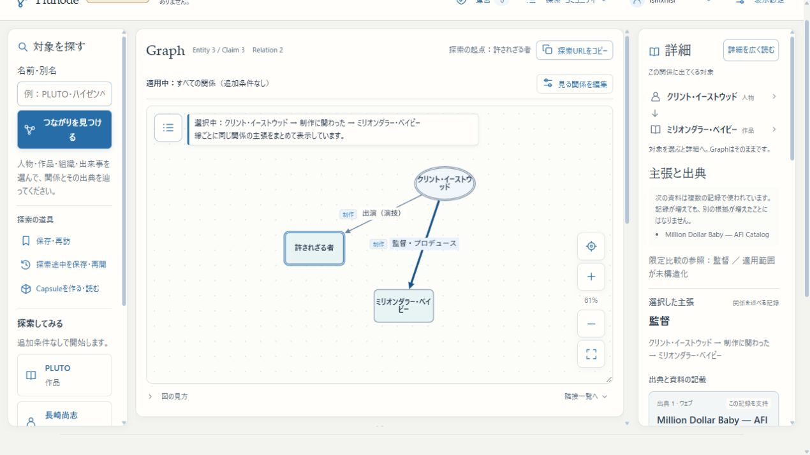

# 公開パイプライン・まとまり2 更新完了

2026-10-28、固定判断票 `142a0dd04342b5429cc9dd736804965646bb6da9e39e7573a2065c97f02fab82` の承認範囲を反映し、実設置版の検証を完了した。追加の運営者操作はない。**受入・公開署名・KG apply/restore・会員migration・鍵／権限変更は0件**。判断票・元資材・過去request／receiptのbytesは書き換えていない。

## 反映先

|対象|実際の反映・確認|
|---|---|
|main|固定実装 `fe3fcb6a` を `32e8fe47` で統合。その後の実行補助修正は `fed0af80` まで反映。専用branchとmainへ記録をcommit/push|
|3200／HTTPS beta|固定Web build `lNabFN3qBIdd5U2lV6e6A`。既存KG revision `34befbcd…` を維持|
|本番Web|同じ固定build、OCI image `sha256:f4e2a8e…`。Webだけ切替。本番KG revision `f5dbf83f…` を維持|
|VPS gate／operator|承認済み2ファイル・program manifest・設定2項目を反映。実operator `sha256:8099094f…` を現在のgate statusでも照合|
|WSL delivery／approver|固定source `fe3fcb6a…`、delivery設定SHA `1b4e49af…`、approver SHA `7b97f3a6…`。署名しないself-check成功|
|Windows Delivery Task|Actionの参照sourceだけ `fe3fcb6a…` へ更新。trigger/principal/settings/DACLを保持|
|固定CollectionWorker|指定5ファイルを反映。base pin `973c7b0c…`、config、collector、旧依頼・承認を保持。Node v24.21.0、実173ファイルのpolicy照合成功|

完全hashは [WSL返却結果](wsl-installed-result.json)、[独立照合](wsl-installed-verification.json)、[VPS返却結果](vps-installed-result.json)、[最終集約](final-verification.json) を参照。root内の退避確認は運営者実行の成功JSONを根拠とし、Codexが追加sudoで読み直したとは扱わない。

## 実設置版で確認したこと

- **同じ公開済み1,931 Claim**を、固定Web image・固定operator image・実Workerの3利用側で検証。全利用側の能力hash `a10cc7e0…`、Node v24.21.0、定義hash・catalog/reviews・scope契約が一致した。VPS側でも同じoperator artifactの公開済みfixture検証成功を確認済み。
- 固定証明を再利用して再検証に成功。再利用時は実image・Workerファイル・Node・live Webを再照合する。未知Role、未採用定義hash、schema／scope／catalog不一致、古いoperator pinは拒否した。実Worker CLI自体も未知Roleを拒否した。
- 全オブジェクトのJSONプロパティ順を逆転しても、実Workerのschema順直列化は元の固定bytes／SHA `908e6f3c…` と一致。旧artifact、receipt、requestのファイルは変更していない。初期の補助検査はCLI戻り値のenvelopeを文字列と誤認して停止したため修正した。本体・固定資材の変更ではない。
- 3200／本番APIで「許されざる者→イーストウッド→ミリオンダラー・ベイビー」の出演→監督2 Claim、未知Role400、漫画PLUTO検索を確認。本番実ブラウザで保存済みURLの再読込による映画3 Entity／3 Claim復元、監督AFI原表記 `Dir`、既存ログインと保存済みCapsule読取を確認した。3 Claimには既公開PRODUCINGも含まれ、新たな受入ではない。
- beta実ブラウザでも映画3 Entity／2 Claim、監督AFI根拠、build／revision／能力を確認。CLIにはCloudflare 403（1010）が返ったため、保護を変えずブラウザで照合した。
- 既存12 receiptの全hashを維持し、棚卸しで未公開の正式受入データは全種別0件。既存公開nonceはcompleted／exclusion finished／監査待ちなし。新nonce・新候補・署名を作成していない。
- 手動hold解放後の**通常スケジュール**で配送Task（12:35:23〜12:35:51 UTC）と収集Workerがともにexit 0。準備は `up-to-date`、stateはidle、Workerはonline・pauseなし・実行中attemptなし。Taskの強制起動・停止、Windows設定変更は使っていない。確認中の一時的な `waiting-local-lock` と稼働中TaskのLastResultを終端失敗として扱わず、Ready／exit 0まで確認した。

[3利用側の完全記録](installed-all-consumers-compatibility.json)／[要約](installed-compatibility-summary.json)／[実Worker直列化・拒否](installed-worker-negative-and-serialization.json)／[正式receipt棚卸し](installed-formal-receipt-inventory.json)／[環境別API](final-environment-api-regression.json)／[通常運転](normal-operation-verification.json)／[Windows Task](final-scheduled-tasks.json)。過去の隔離回帰・30件の更新補助テストは工程履歴に残す。今回は実装を再変更せず、反映後の実検証を追加した。

## 保全・残件

全12 receipt・映画36 Claim・旧UUID/根拠/署名/監査を維持した。VPS反映時は会員29表・11 migration、env、他containerを保全。その後のWSL更新と今回の確認では会員migrationや会員コンテンツの保存操作を行っていない。通常のログイン確認に伴うsession処理までゼロ書込みと主張しない。

VPS `/root/plunode-bundle2-update-9955a6dbf84c/backup`、WSL `/root/plunode-bundle2-update-946674efaea5/backup` と旧stageを保持する。WSL backup manifest SHAは `bc9b841f6f2ba3913d6b670aa9dd2aaacf088a61e6e4ed5446cf96808a6267aa`。旧Web build・元image archiveも保持。復旧は [既存手順](../RECOVERY.md) のコード／設定／Task差戻し範囲で行い、KG/member restoreや過去journalへの巻戻しはしない。完了した更新コマンドを再実行しない。

未収録**45記録・65 Entity候補**の回収を妨げる実行版の不一致は解消した。採用済みRoleで提出可能な集合は、保存済みmanifest・全件台帳を使って次の固定受入判断へ進められる。根拠不足・同一性・新Roleの意味判断は残り、未収録全体を収録済みとしない。

旧漫画依頼のNDL 429技術待ち、および固定Workerの自動catalog更新保留（07:18 UTCの既存記録）は変更していない。今回の正常Task終了と、各収集依頼の完了は別である。古いPowerShell失敗の直接原因も、当時のstderr欠落により未確定のまま残す。最終固定更新は成功し、今後の子処理エラーは工程・原例外・HRESULT・差戻し結果を保持する。

## 次回減る工程

既存Roleのデータ追加では今回のWeb/operator/Worker更新・image再build・環境別pin調査を繰り返さず、固定済み実行版を使う。新Roleでは共通定義からの生成・CI照合で利用側の手更新漏れを検出し、必要な実行版更新を一括固定できる。候補の直列化と検証済みartifact/image/proofを再利用し、環境ごとの再生成・再buildを減らす。互換不足や古いpinは署名案内前に停止する。

意味／同一性／固定受入判断、個別公開署名、実際に必要なsudo等は残る。ロック構造や承認契約の全面変更は今回行っていない。今回のTask競合・待機は履歴に残し、再開を自動再署名・新nonce・再applyで解決しない。
