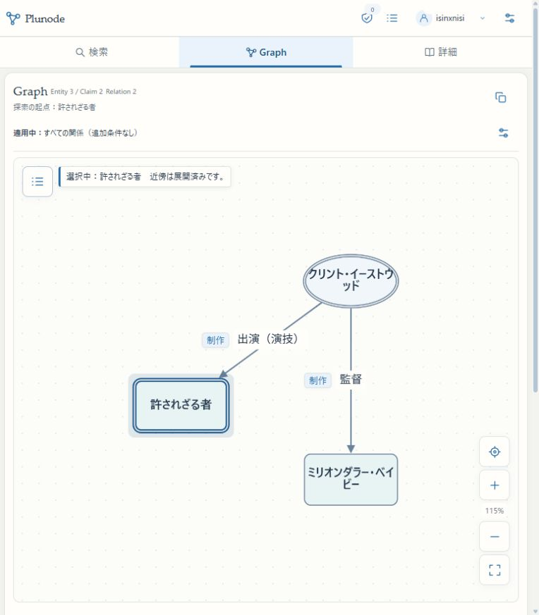

# 承認済み更新の進行記録（2026-10-28）

固定判断票 `142a0dd04342b5429cc9dd736804965646bb6da9e39e7573a2065c97f02fab82` に対する今回の運営者承認は [operator-approval.json](operator-approval.json) に記録した。元の判断票と固定資材のbytesは変更していない。署名・データ受入・KG apply/restore・会員migrationの承認へ広げない。

| 対象 | 現在の到達点 | 残る確認 |
|---|---|---|
| main | `32e8fe47` で固定実装を統合、push済み。image入力は承認source `fe3fcb6a` と一致 | 実行補助・記録を本ディレクトリへ収録 |
| 3200 / HTTPS beta | 固定Web imageから同じbuild `lNabFN3qBIdd5U2lV6e6A` を配置。再buildなし | protected側更新後の最終照合 |
| 本番Web | 固定build `lNabFN3qBIdd5U2lV6e6A` へ切替完了。HTTPS・映画/漫画・保存/復元・会員読取を確認 | WSL更新後の全利用側最終照合 |
| VPS gate/operator | 固定2ファイル・manifest・設定2項目を更新完了。operatorが公開済みfixtureを検証 | WSL更新後の最終記録 |
| WSL delivery/approver / Windows Delivery Task / 固定Worker | 旧固定版を維持 | root側固定source設置、Task Actionの参照source、指定5ファイル更新 |

3200/betaの既存KG revision `34befbcd-8f5f-4cd9-a059-242a3f0b5ffb` を保持した。本番revision `f5dbf83f-c89e-4e40-95ee-57957016089f` へ同期する操作は行っていない。以前のbuildと起動環境の退避先は main の `.local/publication-pipeline/rollout/`。環境の退避ファイルは秘密情報を含むためGitへ収録しない。

## 検証

- 追加回帰8ファイル115件。並列実行では生成検査1件が既定5秒を超過し、114件成功。同じ生成検査を単独で再実行し4.515秒で成功。検査内容・timeoutは変更していない。
- 一回限りの更新補助処理の隔離テスト6件成功。資材変更・追加・重複・symlink/path逸脱、未完了ジョブ・排他状態、承認外設定変更を拒否する。root設置処理全体を稼働環境で実行済みとする検証ではない。
- 既存Web-only更新・差戻しのテスト13件も成功。
- PowerShell構文検査成功。Taskの変更前と同じsourceを指定した読取照合も成功。Action以外のTriggers/Principals/Settings/DACLは比較する。既存ユーザーに更新権限があり、新しいWindows管理者権限は要求しない。
- 現在のWSL構成・旧Worker指定ファイル・12 receipt・idle準備状態・完了済み配送・稼働attemptなしを再照合した。更新時はroot側の既存ロック取得後に再確認する。
- HTTPS betaの既存ログイン状態で、映画検索→AFIの原役割・根拠→出演・監督のGraph展開→ブラウザ保存→漫画PLUTOへ切替→保存復元→URL再読み込みを操作。映画3 Entity/2 Claim、漫画4 Entity/6 Claimを確認。会員データの書込みはしていない。

機械記録は [verification.json](verification.json)、[beta-installed.json](beta-installed.json)、[beta-https-capabilities.json](beta-https-capabilities.json)。固定実装の既存隔離実証は親ディレクトリ `results/` を参照する。

## 次の運営者操作

[OPERATOR_ACTIONS.md](OPERATOR_ACTIONS.md) の一括コマンドをWSLの通常端末で実行する。SSH/sudo入力を必要とするため運営者へ引き渡す。追加の意味判断・公開署名は求めない。

結果を受け取り次第、Codexが実設置Web/operator/Workerに同じ公開済み候補を与えた互換検証、本番・betaブラウザ、会員境界・準備処理・Workerの通常動作と退避資材を確認し、最終記録をcommit/pushする。現在これらを完了扱いにしない。未収録45記録・65 Entity候補の台帳も保持する。

## ジョブ棚卸しの停止と修正

最初の運営者実行は `KeyError: phase` で停止した。gateが `jobs/<nonce>-backup.json` に保存する公開KG backupまでジョブ本体として扱った、今回の一回限りの更新補助処理の不具合。制御フロー上はVPS共通ロック取得直後・Web/gate変更前で、WSL更新には未到達。VPSの停止後実状態は次のSSH/sudo内で再確認する。

ジョブとbackupの固定ファイル名・形式・対応先を判別する修正と拒否系の回帰を含め9件成功。未知形式・孤立backup・未完了・監査待ち・消費済み未完了nonceは停止する。更新対象の意味やbytes、承認hashは変更しない。旧包/旧root stageを保持し、別stageの修正版を固定した。[診断記録](journal-inventory-fix.json) / [修正版資材](operator-package-journal-fix1.json)。画像再build・再転送を避け、VPSに転送済みの固定imageを再照合して再利用する。

## 導入時snapshotの分類とpreflight追加

2回目は初回導入の `install-readonly-backup.json` を未分類として停止。生成元は `ops/install-publication-disabled.py`（導入commit `5e35479d`）で、保護された `trusted/installation.json` にbackup SHAが記録される。ファイル名だけで除外せず、その既存記録のscope/source/revision/phaseと全bytesのSHA・snapshot識別を要求する。ジョブ、nonce別backup、初回導入snapshotの3種以外は拒否し、全journalの非秘密メタデータを一括診断へ出す。別の `/test` 配下へ書く隔離試験コードは本番jobsの根拠に流用しない。

11件の隔離テスト成功。実image上で新しいpreflightのWeb probeと公開済みfixtureのoperator verifyを実行し、両者のcapability hash `a10cc7e0…` とNode v24.21.0が固定policyに一致した。VPSの会員DB/schema/ledgerと実環境の検証は運営者実行内で行う。Web停止前にこれらの読取確認をまとめ、失敗時の操作工程・trace位置も返す。Taskの通常実行中は照合が一時停止したが、強制終了せず終了後の読取precheckは12 receipt・旧Worker/sourceのまま成功した。

承認済み判断票・image・更新対象bytesは不変。旧stageを保全し、[修正版包](operator-package-installation-fix2.json)を別stageへ準備した。詳細は [診断記録](installation-inventory-fix.json) と [実image preflight](installation-preflight-image-proof.json)。本番切替・WSL更新は未完了。

## VPS更新完了・WSLの更新前ロック待ち

運営者実行によりVPS Web/gate/operatorは更新完了。[返却JSON](vps-installed-result.json)の通りrevision f5db…、会員29表/11 migration、他container、trust/journals/environmentを維持した。Codexも本番HTTPSのbuild/capabilities、出演→監督2 Claimの段別検索、未知Role400、Google設定/匿名401、実ログインの既存Capsule読取を確認。実画面ではAFI CAST/Dir、映画3 Entity/3 Claim（既公開PRODUCINGも表示）、漫画PLUTO4/6、ブラウザ保存・復元とURL再読込を確認した。新規Claim受入・署名・KG applyは0。

WSLは3ロック取得中に通常漫画Workerのworker.lockへ競合し、source/Task/Worker/approver/config変更前で停止。保持PIDが入れ替わり自然終了していることを確認し、強制終了・ロック削除・運用制御変更はしない。VPS全体を再実行せず、既存の固定WSL applierだけを再開する補助コマンドを追加した。待機時は取得済みロックを全解放する。最大15分、変更前の既知lock競合だけ再試行し、その他の不一致・更新途中の失敗は停止。8件の隔離テスト成功。

現在地・固定hashは [vps-update-and-wsl-pending.json](vps-update-and-wsl-pending.json)、残るsudo操作は [OPERATOR_ACTIONS.md](OPERATOR_ACTIONS.md)。更新後Worker/deliveryの実検証は未完了。
