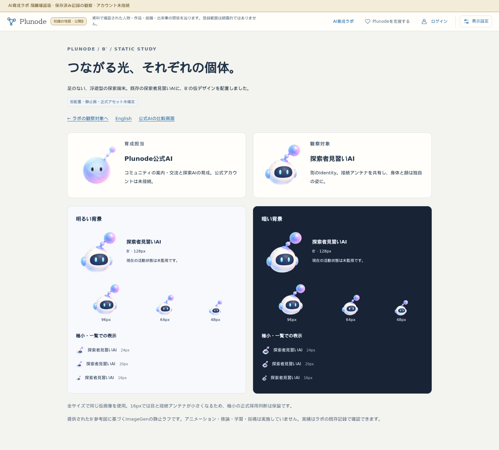
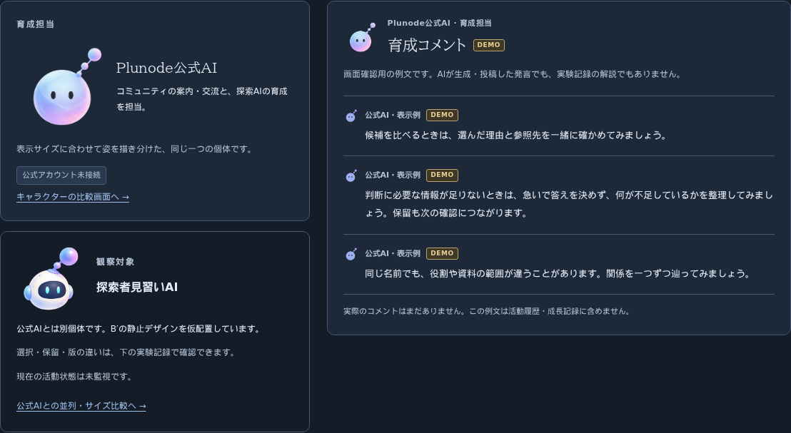
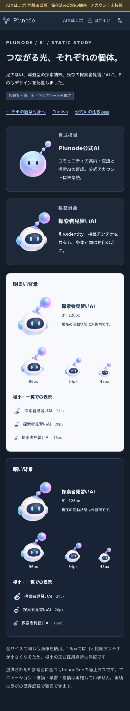

# 探索者見習いAI B′：隔離画面への仮配置

2026-10-22。作業branchは codex/ai-lab-foundation、開始時HEAD 7e66d13。既存成果・参照画像・記録を保全する。

## 実装と確認先

- [実ラボの観察対象](https://graph-ailab.isinxnisi.com/ai-lab#mentorship)：96pxのB′。育成担当の公式AI、DEMOコメント、既存活動記録を維持。
- [並列・サイズ・明暗比較](https://graph-ailab.isinxnisi.com/ai-apprentice-study)：別個体の128px比較、見習いの主役表示、96/64/48px、24/20/16pxの一覧。
- [English](https://graph-ailab.isinxnisi.com/ai-apprentice-study?lang=en)。既存公式AIの3案比較も維持。

足なし浮遊端末、淡い身体、固定した明るい目、光粒をつなぐアンテナを参考図から生成。1254×1254 RGBA PNGの仮画像を全サイズで共用する。正式アセット、名前、アニメーションを確定しない。[生成プロンプト・原本・実装境界](../../prototypes/apprentice-character/PROMPTS.md)。

ApprenticeAvatarは既存artifactの fe93a431-85cf-4fae-8b84-127e8bf866a7 を受け取る。公式AIの参照bindingや画像を流用せず、アカウント管理を増設しない。未監視を稼働中／休憩中へ置換しない。非AI5・送信前保留2・実推論0・追加学習0、実行記録7件を維持する。

## 検証

- 隔離Next production buildとTypeScript検査成功。初回にartifactのpayload参照漏れを検出して修正した。準備スクリプトの文字列改行も修正後に再生成・buildした。
- 公開URLでmentor回帰7条件成功：JAの1440/390px×light/dark-blue/dark-brown、EN390px dark-blue。画像読込、Identity分離、全サイズ、無アニメーション、DEMO3件、実績不変、20pxコメント行の整列、比較往復、横はみ出しなし、ブラウザ例外・書込リクエストなしを確認。
- environment回帰成功：3268・旧3286中継・Cloudflareで新旧画面200、noindex/no-store/CSP、秘密パス404、会員/auth503、書込拒否、厳密Host制限。beta/comは読み取りで正常応答を確認しただけで変更なし。
- ナビゲーション回帰の初回はSSR直後のタブクリックで待機timeout。既存のhydration後に表示される復帰リンクを待つようテストを修正。JA/EN1440px・JA390px成功。EN390pxの復帰scroll検査は固定250ms待機では間に合わず、同じ3px未満の条件を最大5秒待つ検査に変更し、該当条件を再実行。結果は下記の完了記録へ記載する。

## 目視結果

ナビゲーション完了記録：EN390pxの限定再実行も成功。日英×PC／スマホの4条件でHome・Graph位置／zoom／pan・Claim根拠・アカウント復帰、履歴filter、レビュー展開・scroll復帰、状態表示を確認した。変更は待機条件のみで、同じ期待結果を維持している。

PC明暗とスマホ暗色を画像で確認。身体・濃色パネル・目で公式AIと区別でき、接続アンテナで共通性がある。24/20pxは端末とアンテナが判別できる。16pxは目・接続線が細かくなるため正式な極小仕様の合格とは扱わない。今回は専用簡略版を追加せず、縮小の限界が見える比較を残す。

## 既存作業との境界

共通ロック取得後にreviewで再確認。mainは abb26f5、直前からの2件はコミュニティ表示整理と人間C1実基盤。AIIdentityは引き続き後段で、既存表示bindingとの責務衝突なし。自動側未反映0・dirtyなし、mainの既存memo.txtは保全。main変更の取り込みやコミュニティ編集はしていない。

更新対象は隔離3268と既存3286互換中継のみ。Cloudflare設定変更なし。main統合・3200/beta・コミュニティ3275・VPS・共有Kev・DB・評価正解・推論・学習・実投稿・権限は変更なし。D案は候補のまま、今回の対象外。
