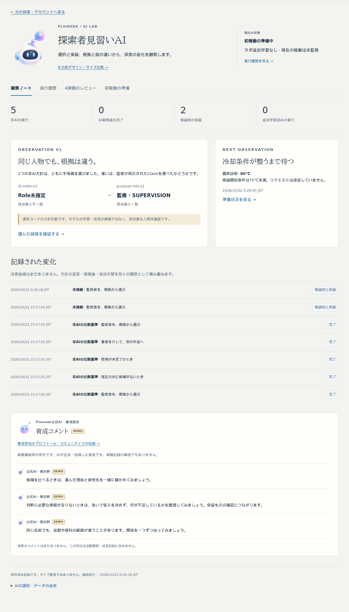
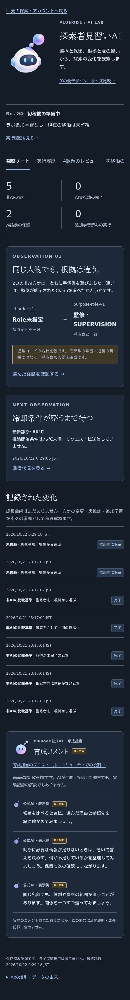
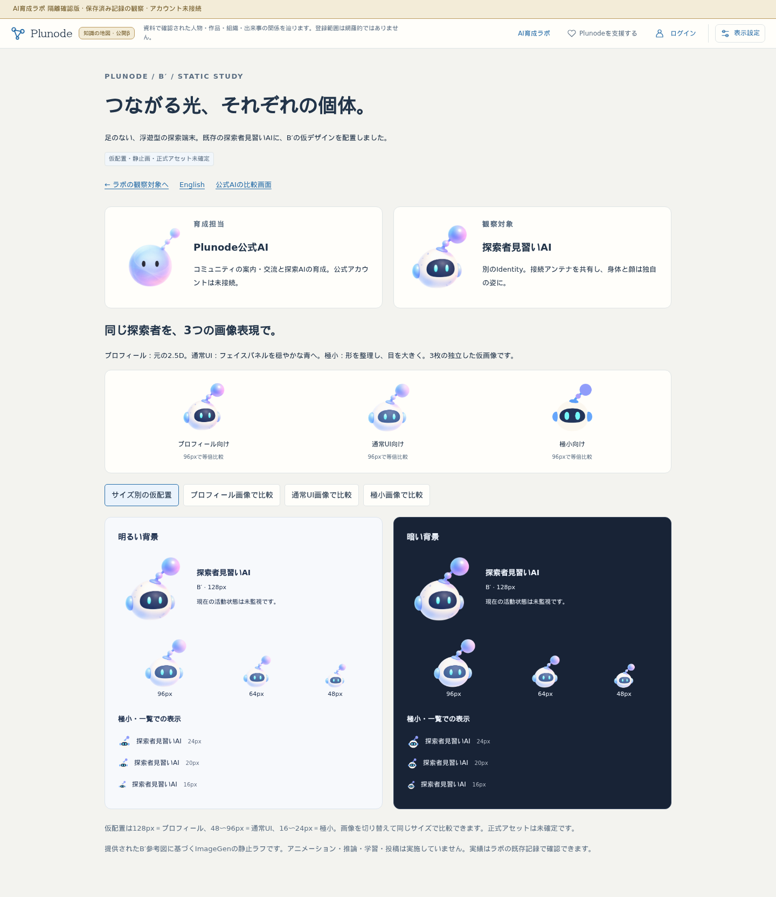

# AI育成ラボ：探索者を主役にする配置とB′サイズ別画像

2026-10-22。開始HEAD b22be64、codex/ai-lab-foundation。共通ロック下で作業。main abb26f5、自動側未反映0・dirtyなし。mainの既存memo.txtを保全し、他作業を変更しない。

## 確認先と変更

- [実ラボ](https://graph-ailab.isinxnisi.com/ai-lab#apprentice)：最上部に探索者見習い128px・段階・未学習／未監視・実行履歴への入口。実績と既存記録を中心に、コメントは履歴の後へ移した。
- [育成コメント](https://graph-ailab.isinxnisi.com/ai-lab#mentorship)：公式AIは48pxの育成担当と20pxのDEMO署名として登場。大きな自己紹介は撤去。
- [公式AIのプロフィール・役割](https://graph-ailab.isinxnisi.com/ai-character-study#official-profile)：既存比較画面へ導線を集約。コミュニティ案内・交流・探索AI育成、公式アカウント未接続・権限未付与を説明する。
- [B′の3段階比較](https://graph-ailab.isinxnisi.com/ai-apprentice-study)：プロフィール・通常UI・極小の別画像を96pxで並列比較し、明暗の128/96/64/48/24/20/16pxでも切替できる。既定はサイズ別仮配置。比較専用画面だけ二人を対等に並べる。

プロフィールは前回の2.5D原本を保全。通常UIは濃色パネルを穏やかな青へ、極小は目と輪郭を整理した新規ImageGen画像を追加。足なし、顔の形、接続アンテナ、既存aiIdを維持する。画像別のIdentity・アカウントは作らない。[保存画像・実際の生成プロンプト](../../prototypes/apprentice-character/SIZE_PROMPTS.md)。全て仮画像で、正式採用・アニメーションの決定ではない。

## 検証

- 隔離Next production build（TypeScript含む）成功。
- Cloudflare、3268、旧3286で新旧画面の正常応答、noindex/no-store/CSP、Host制限、秘密パス非公開、会員/auth未接続、書込拒否を確認。beta/comは読み取り応答のみ確認。
- 画面回帰では主役h1、公式大プロフィール不在、履歴がコメントより先、公式AIの同一参照、DEMO3件、各画像の別ファイルと切替、サイズ、静止、コメント整列、横はみ出し、比較導線を検査。7条件成功。
- ナビゲーション回帰はJA/EN×1440/390pxの4条件成功。Home／Graphの位置・zoom・pan／Claim根拠／アカウント往復、履歴filter、レビュー展開・scroll復元、直URL、レビュー資料downloadを確認。今回の検証で失敗なし。

既存の非AI5、推論前保留2、実推論0、追加学習0、実行記録7件・根拠・版比較を維持。実発言／成長を捏造しない。現在の段階は初稼働準備であり、ライブの活動状況は未監視と明示。

## 画面結果

画面回帰7条件（JA1440/390px×light/dark-blue/dark-brown、EN390px dark-blue）成功。ブラウザ例外・書込リクエストなし。PC明色とスマホの実ラボ、3画像比較を目視確認。見習いの識別と段階が先に見え、公式AIは記録後のコメント欄に限られる。通常用のパネルは元のプロフィール画像より穏やかで、極小用は目とアンテナの形を簡略化している。生成ラフの微細な縁は残り、正式品質の確定はしていない。

## 反映範囲

隔離3268と既存の旧3286中継のみ。main統合、3200/beta、コミュニティ3275、VPS、Cloudflare設定、共有Kev、推論・学習・投稿・権限の変更なし。
