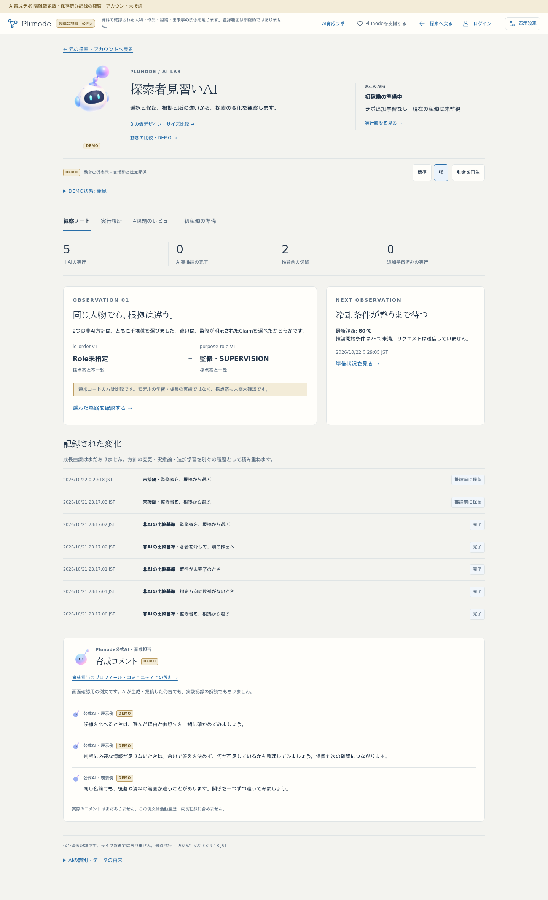
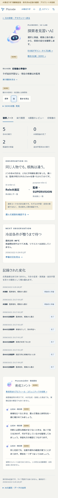

# AI育成ラボ：見習い主表示の動き仮組み込み

2026-10-22。開始HEAD aa0602b、branch codex/ai-lab-foundation。main214b5c4の差分2件は公開ゲートの配布準備。今回取り込まず保全。自動側未反映0／dirtyなし、既存memo.txtは維持。共通ロック取得・token review後に作業。

## 確認先と表示

- [ラボ主表示](https://graph-ailab.isinxnisi.com/ai-lab#apprentice)：プロフィール用PNG128pxの全体浮遊・傾きだけを仮適用。初期強度は標準、再生は停止から開始する。
- [独立した比較画面](https://graph-ailab.isinxnisi.com/ai-apprentice-motion-study)：初期強度は強。PNGと独立アンテナの簡易SVGを維持。

両画面とも標準／強のみ。弱はUI・型・CSSから除外した。ラボ主表示下にDEMO・標準／強・再生／停止をまとめ、5状態の手動選択と控えめ設定は折り畳む。主表示にもDEMOバッジを付け、実際の「初稼働の準備中・追加学習なし・現在の稼働は未監視」と区別する。実推論や実活動へ連動させない。

主表示の画像・顔・目は既存のまま。アンテナも一枚絵の一部として動く。ラボ内で簡易SVGへ差し替えたり別アンテナを重ねたりしない。公式AI本体／コメント横／比較の公式AI、極小アイコンは静止。ラボ主表示以外へアニメーションを増やさない。

操作欄とアバターのための余白を確保し、transformが文字や他の表示を押し動かさない。標準を初期選択にし、強との違いは同じ場所で確認できる。うるささ・好ましさの最終判断と正式採用は未確定。[動きと停止の設計](../design/AI_LAB_MOTION_STUDY.md)。

## 検証

production build・TypeScript成功。主表示の検証では、標準／強それぞれの5状態の時間位置を指定し、描画範囲が本文・実状態・操作欄へ重ならないことを検査する。通常の再生時にも本文のbounding boxが変化しないことを測定する。軌道の手動サンプリングは停止／再開・低減の通常UI検査の後に実行し、テスト操作による干渉を避ける。

DEMO操作のdetailsを実験記録の開閉・scroll復元から除外し、Graph往復用の従来のdetails順を保つ。見習いID、実行記録7件、非AI5・AI実推論0・推論前保留2・追加学習0、根拠・履歴を維持。

機能検証の初回結果：JA/EN×1440/390px×light/dark-blueの8条件成功。主表示だけが動くこと、2強度・5状態の切替、強の方が大きい実変位、文字との離隔、動きによる本文位置ずれなし、停止／再開、控えめ・OS低減、画面外／非表示停止、公式AI・極小の静止、比較画面への往復と強の初期選択を確認。ブラウザ例外・書込・Kev呼出なし。

既存Graph・Claim根拠・Home・アカウント、履歴filter、レビューの開閉・scroll・位置／zoom／pan復元は日英×PC／スマホ4条件で成功。独立比較画面の詳細な5軌道／標準・強／停止回帰も代表条件で成功。3268・旧3286・Cloudflareの画面とnoindex/no-store/CSP・Host制限・秘密パス非公開・会員未接続／書込拒否も成功。beta/comは読み取りの応答だけ確認した。

目視でスマホのタイトル末尾だけの折り返しを検出し、24pxの指定とDEMOラベル行／強度・再生行を調整。追加検査で、既存lab-heroのgap:32pxが残ってタイトル幅が170pxとなる優先順位の問題を検出した。専用の二重class selectorでPC24px／スマホ16pxのgapを確実に適用し、スマホのタイトル幅を186pxへ確保する。最終build後にPCと日英スマホを追加確認する。

最終結果：仕上げのproduction build・型検査成功。PC日本語明色・390px日本語明色・390px英語暗色の3代表条件を再実行し、すべて成功。フォント読込後の日本語タイトルが一行に収まることも検査した。5状態・2強度で画像と文字の重なりなし、本文の位置ずれなし、停止／低減／画面外・非表示停止、公式AI・極小の静止、実績・履歴と比較往復を再確認。最終のPC画面全体とスマホを目視確認した。

掲載画像はDEMOの発見ピークを固定した比較フレームで、実活動や実推論の記録ではない。[標準の主表示](hero-motion-20261022/desktop-standard.png) / [強の主表示](hero-motion-20261022/desktop-strong.png) / [英語スマホ暗色](hero-motion-20261022/mobile-dark.png)。

## 反映範囲

既存隔離3268と旧3286互換中継のみ更新。Cloudflare設定、main統合、beta3200、コミュニティ3275、正式VPS、会員DB、共有Kev、モデル、実推論／学習／投稿／実状態連動は変更なし。
