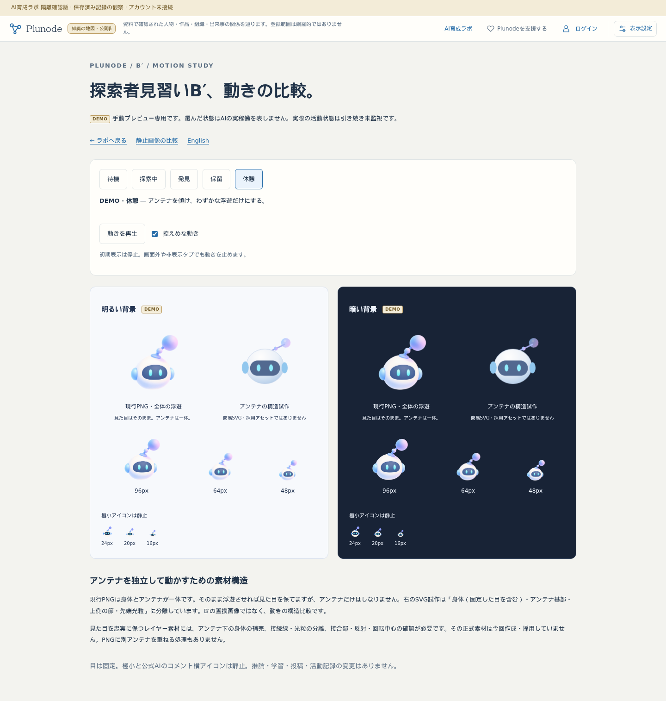
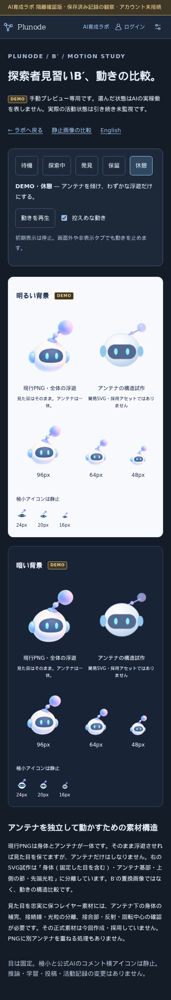

# B′ アニメーション比較：隔離検証

2026-10-22。作業開始HEAD f5bcf7b、branch codex/ai-lab-foundation。main abb26f5、自動側未反映0・dirtyなし。既存mainのmemo.txtを保全し、共通ロック取得・token review後に作業した。

## 確認先

- [動き比較](https://graph-ailab.isinxnisi.com/ai-apprentice-motion-study)
- [英語](https://graph-ailab.isinxnisi.com/ai-apprentice-motion-study?lang=en)
- [ラボの入口](https://graph-ailab.isinxnisi.com/ai-lab#apprentice)
- [既存の静止比較](https://graph-ailab.isinxnisi.com/ai-apprentice-study)

5状態・明暗・再生／停止・控えめ設定を用意。初期は停止。目と極小、公式AIアイコンは静止。現行PNGはそのまま全体浮遊させ、独立アンテナは別枠の簡易SVGで比較する。正式造形の置換やPNGのアンテナ上への重ね描きはしていない。[設計・素材構造の検討](../design/AI_LAB_MOTION_STUDY.md)。添付HTML/MDはreferencesに保全し、HTMLを公開ページとしてそのまま実行しない。

## 検証結果

- 隔離Next production build・TypeScript成功。
- 本体3268、旧3286中継、Cloudflareで新旧画面200、noindex/no-store/CSP、Host制限、秘密パス404、会員/auth503、書込拒否を確認。beta/comの正常応答は読み取りだけで確認。
- 動き検証は状態別transformの時間変化、停止中のtransform不変、控えめ振幅、目／極小のアニメーションなし、キーボードSpace操作、DEMO表記、reduced-motion動的変更と解除後の停止維持を実ブラウザで検査する。非表示タブの分岐はdocument.hiddenとvisibilitychangeの明示的シミュレーション、画面外停止はスマホでの実scrollとIntersectionObserverで検証する。OS全体の設定画面や実端末のバックグラウンド動作を実機評価した記録ではない。
- 上記の動き検証はJA/EN×1440/390px×light/dark-blueの8条件で成功。ブラウザ例外、書込リクエスト、Kev呼出なし。横はみ出しなし、ラボから比較画面への入口と復帰を確認。
- 既存ナビゲーション回帰もJA/EN×1440/390pxの4条件で成功。Home・Graph位置／zoom／pan・Claim根拠・アカウントの往復、履歴filter、レビュー展開／scroll復元、直URL、レビュー資料downloadを維持。今回の検証で失敗なし。

実行記録7件・非AI5・推論前保留2・実推論0・追加学習0、同じ見習いID、公式AIのDEMOコメントを維持。既存3PNG、公式AIの素材、保存済み実験artifactに差分なし。操作から書込・Kev呼出を行わない。

## 反映範囲

PC明色・スマホ暗色を目視確認。明暗それぞれで現行PNGと簡易SVGの区別、手動DEMO、状態ボタン・停止、通常／極小のサイズを確認できる。アンテナの形は簡易構造のため原本との差を残しており、忠実な分離素材の完成とは扱わない。

既存ラボのプロセス識別を確認して停止・再buildし、隔離3268（旧3286互換中継）だけを再起動。Cloudflare設定変更なし。main統合、beta3200、コミュニティ3275、本番VPS、会員DB、共有Kev、推論／学習／投稿／権限の変更なし。

正式な身体／アンテナ分離アセットとアニメーション方式の採用は未確定。SVGの形・接合部・しなりは動作構造の比較用であり、現行B′の正式な見た目ではない。
