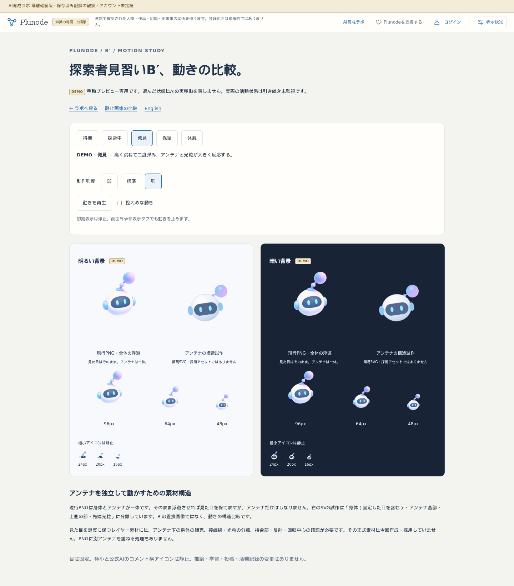
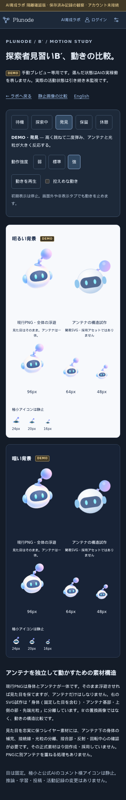

# B′：状態差と動作強度の強調比較

2026-10-22。開始HEAD 421e9b8、codex/ai-lab-foundation。mainは02bc6a8へ進み、差分2件は公開ゲートの実機試験記録。今回取り込まず保全。自動側未反映0／dirtyなし、既存mainのmemo.txtを維持。共通ロック取得後にtoken reviewを実施。

## 確認先

[動き比較](https://graph-ailab.isinxnisi.com/ai-apprentice-motion-study) / [English](https://graph-ailab.isinxnisi.com/ai-apprentice-motion-study?lang=en)

待機＝大きな上下浮遊、探索＝左右の移動・傾きと広いスキャン、発見＝高いジャンプと二段の弾み、保留＝片側へためらって短い首振り、休憩＝深い傾きとゆっくりした呼吸。別々のkeyframesで状態差を出した。光粒も発見時に二段で膨らみ、目は固定。

「弱・標準・強」を追加し、倍率0.55／1／1.6、初期は強。再生は停止から開始する。控えめ設定は選んだ強度へ振幅0.4倍・周期1.7倍を重ねる。OSの動き低減設定、画面外／非表示停止を維持。通常の小サイズ表示はサイズに合わせて振幅を縮小する。比較枠を拡張し、強での発見ピークも確認する。

素材・実活動状態・記録の変更はない。SVGは引き続き独立アンテナの簡易構造試作で、正式アセット／アニメーション採用ではない。[現在の動作仕様](../design/AI_LAB_MOTION_STUDY.md)。

## 検証

隔離production build・型検査、実ブラウザの状態別軌道・強度順の変位・控えめ低減・停止／再開・目／極小の静止・reduced-motion・非表示／画面外停止・入口／復帰を確認する。状態軌道はWeb Animations APIで時間位置を指定し、実際のtransformを採取する。非表示分岐は従来どおり明示的なvisibilitychangeシミュレーション、スマホの画面外停止は実scrollで検査する。

最初の実行では、軌道採取用のWAAPI play/pauseがCSS play-stateに優先するため、測定後の停止検査へ干渉した。軌道測定と通常UIの停止検証の間にreloadを入れ、操作されていないアニメーションで停止・再開を検査するようテストを修正した。製品の停止実装は変更していない。

強い発見動作の18%位置を固定してPNGとSVGの描画範囲を測定し、比較パネル内に収まることを確認する。スクリーンショットはこの比較用の最大反応の静止フレームで、再生状態の記録ではない。PC明色・スマホ暗色で目視確認し、ボタン配置、サイズ比較、見切れを確認した。

最終結果：隔離production build・TypeScript成功。JA/EN×1440/390px×light/dark-blueの8条件で、5軌道の特徴、弱＜標準＜強の実変位、控えめの追加低減、再生／停止、動き低減と解除後の停止維持、非表示／画面外停止、キーボード、目・極小・公式AIの静止、入口／復帰、記録7件／実績5・0・2・0維持、横はみ出しなしを確認。再実行8条件すべて成功、ブラウザ例外・書込・Kev呼出なし。本体3268・旧3286・Cloudflareの環境境界検証も成功。既存の公開KG／Graphコード・API・記録に差分なし。

## 反映範囲

既存隔離3268と旧3286中継だけを更新。main統合・beta・VPS・コミュニティ・共有Kev・実験artifact・PNG・推論／学習／投稿は変更しない。実活動と連動しないDEMOを維持する。
