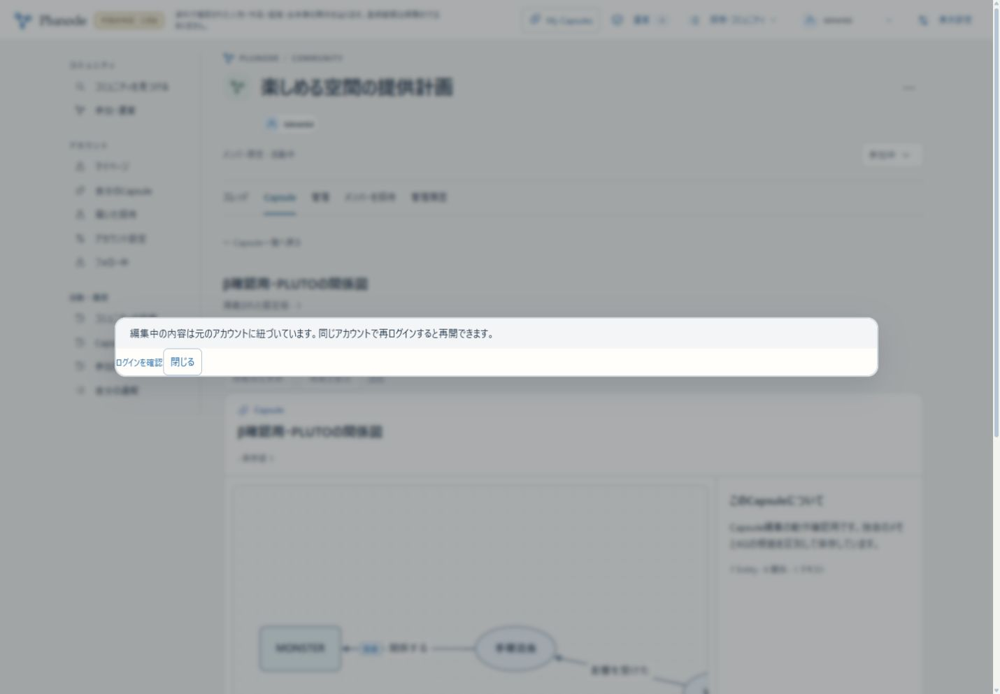

# Capsule編集の3200／HTTPS β反映記録

2026-10-29 / Issue #63 / 開発PCでの手動確認。
[現行契約](../design/CAPSULE_EDITOR.md)・[更新手順](../runbooks/CAPSULE_EDITOR_RELEASE.md)に従う。
ユーザーの今回の指示により、終了点は既存3200／HTTPS β。**本番VPSへは転送・切替・DB更新をしていない。**

## 確認先と操作

- [HTTPS β](https://graph-beta.isinxnisi.com/)：Googleログイン・会員保存・共有・コミュニティはこちら。
- [開発PCの3200](http://localhost:3200/)：同じpublic-kg build。未ログインのブラウザ内保存も利用できる。
- [PLUTOから開始](https://graph-beta.isinxnisi.com/explore/2b7c6289-d050-4dc0-93e3-9307681253cc)。Graphの「Capsule作成」で編集へ入り、Ctrl／⌘クリックで複数選択して移動。「独自Entity」「テキスト」で追加し、「保存」後、My Capsulesから開き直す。
- 保存版の閲覧中に位置を変え、「編集」でその配置を引き継ぐ。さらに動かして「破棄」→「変更を破棄」で、編集開始前の閲覧配置へ戻る。
- 会員保存した検証用サンプルは「β確認用・PLUTOの関係図」。独自対象・根拠・テキスト・独自関係を含む。検証用の関連付けはKGの事実として登録していない。

## 配置と保持した環境

| 項目 | 実測・結果 |
| --- | --- |
| 受入済み基点 | `2c2339553f0327fa44d4baef6c2252bdc22a2c91`（PR #72） |
| 最終アプリケーションSHA | `a84bc81d74fce87e2a7d605440614f0a77029fb9`（会員一覧の修正） |
| 最終3200／HTTPS β build ID | `KlzhsY2TdKsioyteKtm_Y`。両originのHTMLで一致を確認 |
| 初回配置build ID | `a_Y1rFzqceI2MpGVLTEAk`（受入済み基点） |
| 更新前build ID | `z1Zc8JJyZg6u6jzdwr1wI` |
| Node / Next.js | 24.21.0 / 16.3.8。既存public-kg設定、webpack production buildと型検査 |
| 起動 | 既存 `scripts/start-local-previews.py beta --node /tmp/graph-knowledge-node/bin/node`。作業終了後も起動を保持 |
| KG | 既存確認KG・bolt 7697。revision `34befbcd-8f5f-4cd9-a059-242a3f0b5ffb` を前後で照合。ホーム表示は2,112対象／1,846関係 |
| 会員DB | 既存beta PostgreSQL（55433）。別作業の55432は使用・停止しない |
| 認証 | 既存Google、`MEMBER_ORIGIN=https://graph-beta.isinxnisi.com`、既存Cookie prefix。認証設定を変更していない |
| 他機能 | runtime設定21項目、既存container12個のID／起動時刻、既存AIラボartifact27ファイルのhashを前後照合 |

既存 `.env.public`、private runtime、`beta-confirmation.json`、会員・コミュニティ・運営・プロフィール・広告・AIラボの設定を引き継いだ。本線KG、KG用ops、収集・公開Worker、Kev、AI教育・日次予定、管理Connectorは変更していない。既存Capsuleや会員・コミュニティの削除／resetはしていない。

共通holdを取得してtoken reviewを実施。mainは受入済みSHAまでfast-forwardした。未反映Autopilot候補は0、Git操作途中なし。手元の無関係な `memo.txt` を保持し、今回のcommitに含めない。候補受入・失敗ログの一括acknowledge・予定設定変更はしていない。長時間作業のため一度所定のEnterで解放して120分holdを再取得・reviewし、変更／検証／commit前に保持を確認した。

## Docker資材と移行復旧

既存Dockerfileからlinux/amd64の両targetを実際にbuildした。**β Webの配信は既存Node launcherであり、Web imageへの切替ではない。**

| 資材 | 識別情報 |
| --- | --- |
| 移行に使用したops | `graph-knowledge-ops:capsule-2c233955` / `sha256:2dbc32b7a2277c3649d6328ad7983eade605f950c9dbee79376f8a166dbd7ea1` |
| 初回Web image | `graph-knowledge-web:capsule-2c233955` / `sha256:ad94c1e61a725ac608f27478d1392b1078088dd36ded0e6c93ff0cb3313973a0` |
| image内build ID | `SfsD5tL6jLGCiXMJtL4_Y` |
| image archive SHA256 | `da0b9a0eeb12b46778820bca3cf88ba9a276019e82014b78846dd206bdefbe17` |
| 移行前custom dump SHA256 | `be87e85f4ade0146f64bec94eb54576e83c2d41e8d9c31b5ea9ba54b2a70311d` |

これらのimageは基点2c233955の資材。最終UI修正a84bc81を含まないため、次回VPS用のWeb imageは最終受入SHAから再build・固定・検証する。archiveをそのまま最終版として公開しない。

1. 既存000〜010の全11件についてrepoとledgerのchecksum一致を確認。
2. beta Web停止中にprivate custom dumpを採取。
3. 既存DBとは別の一意なDocker PGへ復元。旧29テーブルのschema／全旧column・全行のfingerprint一致を確認。
4. 固定ops imageで復元DBへ011／012を適用し、同一コマンドの再実行が無変更になることを確認。
5. 同じops image、betaのprivate設定、正しいoriginで既存betaへ明示適用。再実行も成功。ledgerは000〜012の**13件**、全checksum一致。旧29テーブルの既存行を保持。追加tableは3個。

使用した明示オプション：

```text
--communities --site-operations --public-profiles
--capsule-documents --community-capsules
--confirm-origin https://graph-beta.isinxnisi.com
```

011 checksum: `7f16684ea9bd43148586362d095dd3d88cf5f4881502f7dab04cd9a401aef8b9`

012 checksum: `cbde4ac6caf678a92f48100603b7bbacf41cc2f7b5e1632a0b1810ea3a4a03ea`

dump、復元比較、全13件ledger、runtime照合、image archive、build／testログ、旧buildは開発PCのGit対象外 `backups/capsule-20261029/` に保持（directory 0700、private設定0600）。秘密・session token・共有tokenは本記録に含めない。

## 検証

[クラウド記録](CAPSULE_EDITOR_20261029.md)の938単体／UI、12匿名browser、1 fixture会員browserを基点の証拠として利用し、今回は実設定・Docker・復旧・実Google・既存経路を重点確認した。

| 実Docker PostgreSQL suite | 成功数 |
| --- | ---: |
| Capsule document | 13 |
| 会員（DB停止復旧を含む） | 32 |
| cold startup | 1 |
| community | 29 |
| community safety | 14 |
| site operations | 14 |
| public profiles | 26 |
| **合計** | **129、skipなし** |

専用の使い捨てPGはnetwork none、Node test containerはそのnetwork namespaceを共有。hostへportを公開しない。suiteごとのschema再作成は専用DB内だけで行い、既存55432／55433へ向けていない。初回の容量テストは並列buildによるstatement timeoutで再実行し成功。runnerのprofile flagとbackup内testの二重探索を修正し、最終結果のみを上表へ計上した。

一覧修正後の `member-ui.test.tsx` 16件＋`member-client.test.ts` 4件は**20 passed**。旧形式／新document形式のsummary表示、別dataset拒否、既存の所有者切替・private入力保持を確認。変更ファイルのESLint、`git diff --check`、production build内の型検査も成功。最初の再buildは追加testのmock型指定で停止し、既存testと同じ呼出し型を指定してから最終buildに成功した。

| 実ブラウザ経路 | 確認結果 |
| --- | --- |
| 通常Graph→Capsule編集 | 表示中の4対象／6Claimと閲覧配置をそのまま引継ぎ |
| 複数移動 | 通常Graph・Capsule双方でCtrl複数選択と同時移動。CapsuleはUndo／Redoも確認 |
| 編集・明示保存 | 独自Entity「読書メモ」、根拠、自由テキスト、任意ラベル「読んで考えたこと」を保存し再訪 |
| KG追加 | 浦沢直樹のKG関係から手塚治虫を追加。検索でMONSTERを追加し、接続を独自関係として区別 |
| 閲覧配置・破棄 | 閲覧時に動かした位置を編集へ引継ぎ、追加移動の破棄後に編集直前の閲覧位置へ戻る |
| 現在KGとの比較 | 取得範囲と未確認範囲を分離して表示。比較・閲覧移動・破棄後も保存版1のcontent hash不変 |
| HTTPS会員保存 | 本人アカウントへ7nodes／9relations／1text／1evidenceを保存。My Capsulesから再読込 |
| 実Google | ログアウト→Googleログイン操作→本人へ復帰。既存Google SSOで追加の本人入力なし。新sessionは12:55:49 UTC、providerはgoogle |
| 限定リンク | 固定版1を作成しログアウト後の匿名閲覧も成功。共有tokenは記録・commitしない |
| コミュニティ | 本人管理のメンバー限定コミュニティへ検証用固定版1を掲載。掲載時の参加者限定。既存会話へ往復し、会話側の関連Capsuleも表示。会話本文への投稿はしていない |
| 既存画面 | 通常Graph、公開プロフィール、運営一覧、AIラボの記録表示へ移動できる。AI実行は行わない |
| localhost | 匿名でGraph→編集→ブラウザ内保存→reload→My Capsulesから再訪 |
| 表示幅 | PCと390px幅を確認。狭幅のdocument横overflowなし。実機スマホ／タッチ操作は未確認 |

会員サンプルの初回保存後と比較・破棄・共有・掲載後で、revision 1／schemaVersion 2／contentのMD5 `2d39fa0094a69d40e3037ba92839083e` が一致した（変更有無の照合用であり署名ではない）。

両originについてホーム、dataset、member、communities、operations、ai-labのHTTP成功と匿名capsule-capabilitiesの401を確認。ホームHTMLのbuild IDとdataset応答を照合する。権限の必要な経路はHTTPSの本人UIで確認した。

## 見つかった問題と残る事項

- **修正**：アカウントページが一覧summaryを完全なCapsule本文として検証していた。metadata／省略documentにより読取が失敗するため、一覧schemaで検証済みのsummaryはdatasetだけ追加照合し、本文検証は詳細／版読取に限定した。API認可・明示保存・document契約は変えていない。
- 認証の定期再確認・タブ復帰でprivate表示を一時的に閉じる既存挙動により、詳細panel／共有link表示が閉じる場合がある。保存済み内容や草稿を失う挙動とは区別し、今回は認可方針を変更しない。
- 共有ページ冒頭には旧Reader向けの「現在のデータを取得」の説明、掲載確認の旧参照数にはKG対象だけの数が残る。実際のdocument表示は保存断面7対象／9関係で、固定版も不変。説明・数の統一は次の表示改善候補。
- 青い枠の光は控えめで編集状態を示す。短い画面では追加ボタンがGraph下端に寄るため、固定操作列や追加操作のまとまりを検討できる。保存ボタンと補助ボタンの質感・コントラストは本人の操作確認後に調整する。
- 知識申請・審査・本線KGマージは「準備中」のまま。自動保存は追加していない。
- VPSは未更新。次回は最終受入SHAのimage再build／固定、本番private設定とoriginの照合、backup・復元、011／012適用、Compose Web切替、正式originでの実Google／保存／共有確認が必要。

## 最終切替後

- 修正版buildへ既存launcherで切り替え、3200／HTTPS βの14経路を再確認。build ID・KG応答・保持対象の設定／container／artifact照合はすべて成功。
- HTTPSの本人アカウントページで新旧Capsule一覧が表示されることを確認し、検証サンプルを「内容と根拠を読む」から再訪。確認中の他のCapsuleには変更を加えていない。
- サンプルの説明だけを明示更新して**本人保存版2**とし、reloadで再訪した。既存の限定リンクとコミュニティ掲載は**固定版1**のまま、追記した説明も反映されないことを実画面で確認。
- 編集画面を確認用タブに残した。390px幅の一時overrideは解除。ブラウザ内保存はorigin／ブラウザごとに分かれるため、別ブラウザには自動同期しない。
- アプリケーション修正は `a84bc81`。本記録の追加commitは文書・証拠画像のみであり、再buildを必要としない。通常pushと共通hold解放の結果は作業完了報告に記す。


