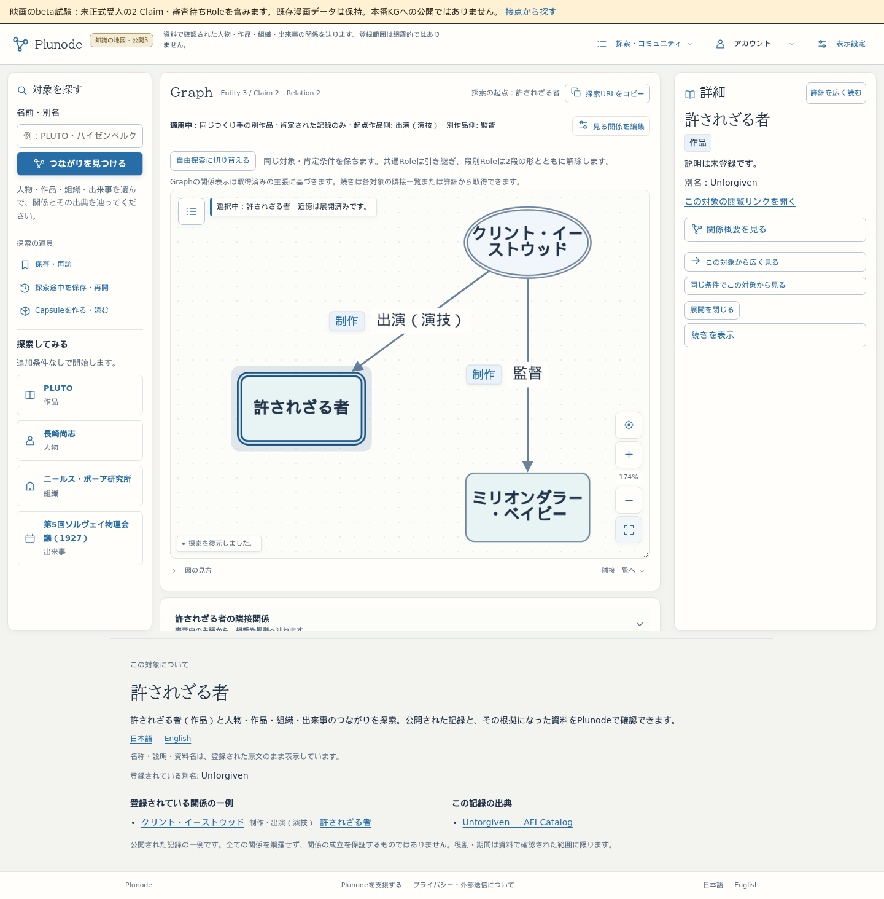
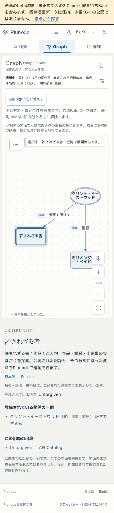

# Issue #43 洋画の本線・beta接続

2026-10-26。作業branch codex/issue43-film-beta。最新main b34e9ebを基準に、#40・#41の固定成果をmergeした。正式語彙承認・Claim受入・本番公開は未実施。

## 統合前の検証

- 単体74 files / 865件成功。型検査・lint・webpack build成功。
- 映画収集16件＋映画dispatch3件、既存受入16件成功。
- 候補buildのPC1440／スマホ390で検索→根拠詳細→Back後の検索再表示→Graph展開→保存→条件変更→復元→reload→逆順Role該当なしの2件成功。全て実API、応答stubなし。
- 既存beta会員DBのprivate custom dumpを別名・外部networkなしのPGへrestoreし、29テーブルの全行fingerprint一致。所有roleを試験PGへ準備して検証した。元PGのschema／行・設定は変更しない。
- 既存beta KGのbackupを専用Bolt7696へ実restore。fixture全値・graphDigest・既存DB receiptを照合してから、3 Entity・2 Claim・2 Source・2 Citationだけを追加。元KG7694は未変更。

## 本番比較とbetaのデータ版

本番のlive revision b74a4b00-9454-412f-af5d-1317713a543c と、完了済み配送結果に結びつく公開release manga-issue-34-obata-drawing-20261023、全正式receipt10件を読み取り確認。2,175 Entity / 1,895 Claim / 1,795 Source / 1,932 Citation。映画2 Claimの重複なし。比較gz・recipe・固定判断draftを datasets/film-collection/issue43 に保存した。この照合は新しい本番DB完全backupではない。正式受入前の最新権威backup・全receiptの再照合を省略しない。

beta元のKGは古い独立版で、revision 82b01515-594c-48ca-b4b6-515eefac83ca、2,109 Entity / 1,844 Claim。公開KGとの同期を勝手に行わず、その全件を保持して試験2 Claimを追加。試験版は2,112 Entity / 1,846 Claim、revision film-beta-issue43-unaccepted-v1。正式published履歴を増やさずFilmBetaStateで区別し、通常公開backupの出力拒否を実測。

private復旧控え：~/.local/share/plunode-backups/film-beta-issue43-20261026/ （0700、秘密env・dumpは0600）。元WebのPID/cwd/build、元起動env、KG backup、PG dump、clone/project/restoreの検証を保持する。PG dump SHA256 d46c51026bb4cfd02207a6c8c9f85f30a8aba75a1b332e2efbd816f66160b34b。

## 配置確認

実装固定 b99bd9c、main統合 5d22751d73232b4be959d95827a056f4a7bc561f。候補とmainのapp/components/lib/scripts/db/public/vocabularyがbyte一致することを確認し、型検査込みwebpack build iHWHWVq9QOp2LZxWl76g9 を既存3200へ配置。旧buildはprivate old-buildへ保全した。3200／HTTPS betaのHTML内build、dataset APIの試験revision、Google providerが一致した。beta専用の再起動設定 beta-film.json を0600で配置し、既存 .env.public／.env.member-beta のbytesを維持する。

配信中の3200／HTTPS betaで各3件、計6件が成功（Chromium PC1440／スマホ相当390pxタッチの映画2件＋旧機能1件）。API stubなし。検索→AFI原役割表記CAST／Dirを両方確認→実Claim詳細→ブラウザBack→検索復帰→Graphの人物を実クリック／タップ→3 Entity・2 Claim・2 Relation→途中保存→自由探索へ切替→保存から復元→reload→全体表示→段別Roleを逆順にして該当なし、を操作した。PC・スマホとも横はみ出し1px以内、映画操作中pageerror0。旧漫画PLUTOからのGraph、既存other-worksプリセットでのPLUTO検索、Google会員入口、匿名会員／Capsule／プロフィール401、コミュニティ・AIラボと英語試験表示も確認。

初回実行は原語と資料言語が同じ段落にあることを考慮しない完全一致セレクタで停止した。Back直後のdialog復元待機も補修し、上記最終6件を再実行して成功した。アプリへの応答stubや強制DOMクリックで通していない。

配置後、元KG7694のrevision／完全fixture／graphDigest、会員PG29テーブル全行、正式receipt10件のhash集合、既存設定2ファイルと利用者memo.txtの不変を再照合。本番metadataも元revisionを維持する。VPS・正式Web／KG、漫画Worker設置コード・制御branch・収集承認・正式受入receiptは変更していない。

Google再ログイン・実会員のCapsule新規書込は今回行っていない。既存認証／Capsuleデータの全行保持と匿名境界を確認した。スマホはChromiumの幅・タッチ再現であり、iPhone/Safari実機評価と区別する。

実測JSON・画像： [browser-validation.json](../research/film-beta-issue43/browser-validation.json)、[deployment.json](../research/film-beta-issue43/deployment.json)、[validation.json](../research/film-beta-issue43/validation.json)。

## 次の判断

1. betaの操作・狭いDIRECTING／ACTING定義を評価し、固定afterHashを持つRole審査票へ正式判断を記録する。
2. 最新の権威ある本番KG backupと全receiptを隔離data rootへそろえて再照合し、仮UUIDの昇格／既存対応、2 Claimの本文・AFI根拠・scope:null・依存hashを固定判断する。未承認draftをapprovedへ自動変更しない。
3. 正式受入済みの固定releaseを作る段階で公開差分を検証し、本番Web／KGの公開を別途承認する。今回の試験KGを正式releaseや公開backupへ流用しない。

操作入口：[betaの接点探索](https://graph-beta.isinxnisi.com/?discovery=presets)。今回のmainコード統合・3200／beta配置・実画面検証は完了。正式Role／Claim承認と本番公開は上記の具体判断待ち。
