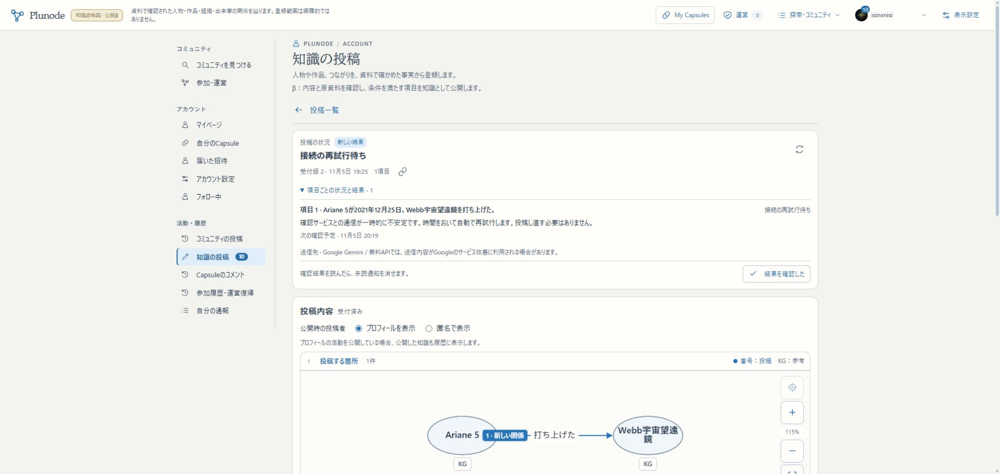

# 投稿確認の一時障害・診断・自動再開

2026-11-05。利用者提示のAI Studioに503 ServiceUnavailableがあり、[公式の503とretryの説明](https://aistudio.google.com/docs/troubleshooting#retry-strategy)と照合した。[現行の再開契約](../design/KNOWLEDGE_AI_FAILURES.md)。過去3回のログ欠損を外部サービスの障害と断定せず、記録を補って通常の自動再開を確認した。

## 現在の確認先と到達点

[同じ本人投稿](https://graph-beta.isinxnisi.com/member/submissions?id=3ee28b84-30c2-4cfd-a60a-1e5b1fb0afa6)の受付版2を、実Googleの既存sessionで確認した。旧3回上限のattentionから、入力や受付を作り直さず自動で再開し、4回目を実行した。運営承認・再送ボタン・直接DB更新での再開はしていない。

4回目の実ログは **DNS / EAI_AGAIN**。HTTPに到達する前の名前解決の一時失敗であり、この回を503とは報告しない。過去2回のdelivery-unknownの内訳や、過去HTTPエラー1回の正確なstatusは復元できない。AI Studioの503とPC側DNS失敗が併存する可能性を残す。

20:06 JSTの読取時点ではretry／試行4回、次の確認予定は2026-11-05 **20:19 JST**。βの項目別結果にも、自動再試行・投稿し直し不要・次回予定を表示した。次の実送信も同じreceiptと現在の参照・同意・無料予算を再確認する。**実AIでの最終「登録済み」到達はまだ未確認**。R1b全体を受理確認済みに変更しない。

[診断・保全の値](assets/knowledge-ai-retry-results-20261105.json)。

## 原因の照合

- ユーザー提供のGoogle AI Studio画面では当該projectに503が記録されていた。Google公式も503は一時的な過負荷／停止とする。[公式エラー一覧](https://aistudio.google.com/docs/api-errors)。無料枠の有効性やAPI key不正を503の意味と取り違えない。
- 更新後に保存した4回目のattemptの分類はdns、通信codeはEAI_AGAIN。Workerログにも同じattempt IDと分類を出した。API key・provider本文・生の例外messageは出していない。
- その後の照合では、Windows Resolve-DnsName、WSLのPython getaddrinfo、Workerと同じNode24のdns.lookup／dns.resolve4がすべて成功した。WSLは既存のnameserver 8.8.8.8とgenerateResolvConf=falseを保持。共有DNS設定変更、WSL再起動、他projectやKev停止はしていない。固定的なDNS不通と断定せず、瞬断とservice側503の両方を追えるようにした。
- 原Record内容版2とhash、知識の全object数・全revision hash、貢献履歴、Capsule関連tableは投稿前と再試行待ち時点で一致。受付の保存・試行履歴だけが増え、未確認の知識を公開していない。

## 変更

1. HTTP status／分類／安全なRetry-Afterと、DNS・接続・TLS・timeoutの許可したcodeを既存private payloadへ保存。成功応答とkindで区別し、失敗のJSONを成功として回復しない。HTTPクライアント内の隠れたretryは増やさない。
2. 投稿確認は503等の一時障害と認証・設定エラーを分ける。一時障害は3回でattentionへ送らず、指数バックオフ＋jitter、project共通の待機、Retry-Afterを使う。
3. 1項目はquota日付あたり8送信まで。既存のproject全体・用途別・tokenの日／月／分上限も保持。到達後は次の利用日に自動再開し、管理者の個別承認を通常経路に増やさない。送達・消費不明は0ではなくnull・予約分確保。
4. 旧3回上限で止まった投稿だけを、固定理由・最後の試行種別・現在の受付と会員状態で確認して自動再開。取消、内容への判定、認証エラーを一括で復活させない。原資料・現在参照・重複・最終受理は省略しない。

今回は利用者投稿の確認queue。収集読解・翻訳生成・原資料取得の各上限まで全面変更した意味ではない。これらにも一般的な一時障害の自動再開を共通適用する残件を維持し、初版の自動化から外さない。

## 検証

- transport／backoff単体 **17件成功**。503分類、timeout／DNS／接続code、Retry-After・jitterと上限、機密のエラー本文／header文字列を診断に残さないことを確認。
- fixture OIDC＋PostgreSQLの投稿／参照 **54件成功**。503が3回続いても4回目の正常応答へ進む。8送信で翌日待ち→再開。旧一時停止からの回復、認証403を再開しない、期限切れlease、取消・停止・退会、再送と受理の冪等性、別DB復元を確認。
- 相談・運営経路 **13件成功**。合計84件、skip 0。fixture結果を実Geminiの成功と混同しない。
- ESLint・diffチェック・型検査・public build成功。検証harnessの所有するコンテナと一時DBだけを終了時に片付けた。

## 配置・再開・引継ぎ

配置source **a9682921eaa3f3f44c3e5d18073e3f1297c48b6f**、build **xJavi_2YvZdx26ouGAToE**。main／localhost:3200／HTTPS βへ配置。追加migrationなし、member029まで30件／knowledge001/002/004/005/006を保持。旧appは616f1840／AQsmThdwxZZSYkAt7EMg0。

切替前に対象Webと4 Workerだけを停止し、会員・知識dumpと旧buildをprivate backupへ保存。再起動前の全table行fingerprint一致・private設定8file hash一致を確認した。既存の認証・無料project・API key・KG・Capsule・コミュニティ・AI artifactを保持。3276・正式VPS・共通Kevは変更していない。schema変更なしのため新たな本番向けmigration／restoreは行っていない。fixtureでの別DB復元は上記の通り。

既存launcherによる再開手順は[R1b記録](KNOWLEDGE_R1B_IDENTITY_DUPLICATES_20261105.md#再開)を共用する。確認用の投稿はWorkerが自動再試行するため、投稿者や管理者の操作は不要。状態を読み直し、成功後に元Record再利用・原端点と断面の保全を確認する。別受付の作成や直接DBでの成功化をしない。

通常pushとmainのfast-forwardを行う。文書追補のHEADと配置sourceは区別し、文書だけの再buildはしない。Autopilot review／holdとtokenを確認し、未確認候補は取り込まず、mainのmemo.txt／作業側.localを保護。hold解放結果は完了報告に記載する。
