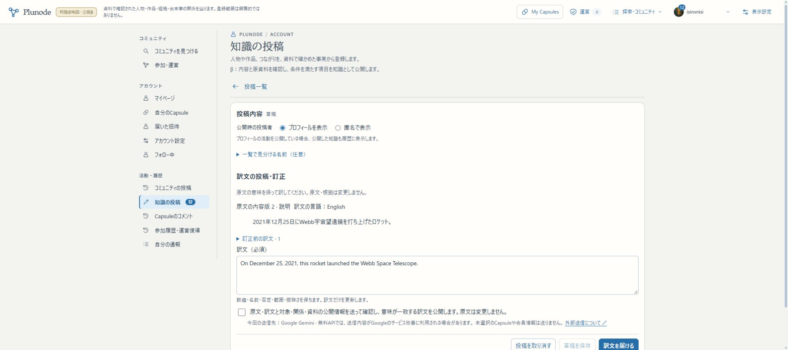
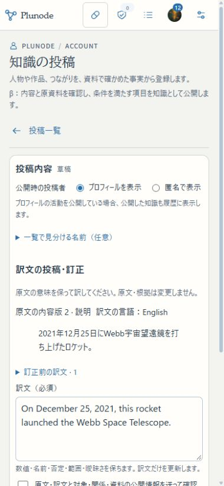

# R1j 配置別認可・共通境界照合（2026-11-06）

アプリsource：`db9303fe282bb4c4afc9d01a4e2d5e8cf409872b`。build：`2QST9Iieq0L0g-6y3nJDa`。設計は[配置別認可](../design/KNOWLEDGE_DEPLOYMENT_AUTHORIZATION.md)。

## 今回の変更

- 私有profileへorigin／許可Host／知識DB／Neo4j／機能権限／確認依頼の会員範囲を固定。設定不整合は停止する。各入口のβ literalを共通契約へ移し、productionはprofileなしで有効化しない。
- 公開Webのread-only poolとpublisherのpoolを分離。managed環境でTOPを開いてmigrationを実行しない。
- 本人セッション・所有権・運営role・用途別Worker資格・leaseは維持し、送信・公開・再開時にも現在の配置権限を確認する。全有効会員向けの明示modeを別DBで検証し、実βは現在の会員allowlistのまま。
- 横断テストで見つけた外部翻訳取込の未接続を修正。公開文脈／hash／依存版を固定して同じ意味一致確認へ接続し、保存wire／digest／attempt／方針を公開decisionへ結ぶ。原文を訂正しない。許可範囲外の文脈を送らず、推論中の公開停止も再検査する。
- 運営例外の古いテストfixtureが取得証明を単なる `proof` としていた。変更前sourceでも同じ失敗を再現し、実際の抜粋照合器が作るhashへ修正した。実サービスの証明検査を緩めていない。通知・公開帰属テストのmockに欠けていた固定版readerも現行契約へそろえ、停止・匿名・退会時の非開示を含む15件を確認した。

## 自動検証

重複実行分を除く208件／11ファイルが成功。実AIは呼び出さず、AI応答はfixtureとして区別する。

| 検証 | 件数 |
| --- | ---: |
| deployment / 公開reader | 32 / 2 |
| 会員投稿・固定参照（OIDC＋使い捨てPG） | 52 / 12 |
| 収集・読解（別用途tokenとlease） | 7 / 11 |
| 運営例外・取消・復旧 | 13 |
| 通知・未読・帰属・公開範囲 | 15 |
| 外部取込・Entity訂正・範囲・再送・翻訳 | 37 |
| 翻訳生成・受理plan | 19 / 8 |

型検査込みNext16.3.8 webpack build成功。変更したTS/TSXのESLintは0件。Python launcher構文検査成功。会員統合で別DBへdump復元とmigration再実行不変も確認。

初回のテスト呼出ではshellのglob展開で過去の `.local` 内のコピーも対象へ入ったため、その実行を中止した。以後はPythonの引数配列で明示ファイルと除外を渡した。対象外コピーの件数は上記191件へ含めない。

## 配置と保全

main／3200／HTTPS βへ最終sourceを反映し、実ブラウザで確認した。追加migrationなし。会員000〜031／ledger32、知識001/002/004/005/006/007、旧KG・会員・コミュニティ・AI公開artifact・モデル／予算・既存11個のprivate設定を保護する。新規profileだけを0600で追加し、βの会員範囲を広げない。3276／正式VPS／共有Kevは未更新。

## R1の区切りと後続

R1a〜jで、言語・版判定、同一性と意味重複、取得証明、新旧全件対象台帳、認証付き取込、Entity訂正／固定版reader、翻訳文脈、対象識別／資料リンク、配置認可の共通契約を接続した。**R1の共通契約はここで完了し、次はR2へ進める。**未実装の自動化が完成した意味ではない。

- R2：旧KGを含む全件巡回、永続cursor、変更追従、候補生成、根拠・文脈確認、条件を満たす自動整理。管理者の必須個別操作を置かない。
- R3：一度のテーマ設定からChatGPT側のURL／情報探索→定期配送→認証付きAPI→取得・確認・重複・登録。直接配送を実証し、成立しなければIssue等の同package配送を実証する。Plunode用URL検索APIは前提にしない。
- R4：新旧検索・訳名・Graph・Theme訳・時刻／周期／定性等の入力・Capsule／活動への利用接続。
- R5：二つの実テーマとテーマなし、三入力経路、通常会員・低速／再開・共有／コメント／OGP等のβ全体一巡。各工程で増えるAI入力の攻撃例も検証する。
- R6：別の公開工程。正式VPSの実設定・DB権限・移行・Linux脆弱性対応・正式URL確認。今回のproduction設定fixtureを本番配置と数えない。

初版の機能実装完了＋β統合検証まで残り5〜9回程度、正式公開は別に1〜2回の粗い推定。実装量や検証で変わる見込みで、回数に合わせて範囲を縮めない。

## 最終配置・実操作の結果

- main／3200／HTTPS βは上記source・build。同じ配置profileをWeb・確認・publisher・取得・読解の5プロセスが読み、全てmainの作業ディレクトリから稼働している。
- この区切りで2回配置した。初回 `14d6b9d8`／`3CMromkdGUkmy_lFRcd8Q` の確認後、通知・メニュー・投稿ページと公開modeのcapability参照もそろえた。最終配置は `db9303fe`／`2QST9Iieq0L0g-6y3nJDa`。
- 最終切替前に両DBを別dumpへbackupし、停止中の全テーブルの件数・行hash、migration台帳の不変を照合した。既存11個のprivate設定に、新規deployment profileを加えた12ファイルを最終切替でも保持した。新たなmigrationや本番側のbackup操作はない。
- localhostのTOP→紹介テーマ→中央の年表・関係図を確認。既存の通常探索とテーマ読取を維持した。
- HTTPS βの実Googleの既存本人セッションで、公開訳文・投稿者を読む→訂正用草稿を作成→訳文と確認用タイトルを編集→草稿保存→reloadして再訪を確認。新規OAuthや別の実Google会員の検証ではない。
- 確認用草稿は `4f67b434-6a9a-49c0-b71e-30099247e950`、草稿版3。公開文脈hashを保存し、review jobは0。AIへの確認を依頼しておらず、原文Entity版2・公開訳文版1・Recordの版総数28は変わっていない。
- 運営本人で意味整理一覧を読めることも確認。手動の整理・公開処置は行っていない。
- PC幅と390px幅で保存内容を確認し、390pxのdocument.scrollWidthは380px、横溢れなし。viewportは解除した。iPhone実機・長時間運転は今回未確認。
- 実HTTPで公開テーマ200／3件、未許可Host403、無認証の会員投稿・運営・取得Worker・取込APIはいずれも401。profileだけで本人や用途別資格の代用にならない。
- production origin／DB／authenticated modeは隔離fixtureで検証した。本番VPSの実接続や一般提供を完了した証拠にはしない。共有・コメント・OGPを含む総合一巡はR5で行う。

[確認用草稿（本人ログイン）](https://graph-beta.isinxnisi.com/member/submissions?id=4f67b434-6a9a-49c0-b71e-30099247e950)／[公開訳文](https://graph-beta.isinxnisi.com/translations?id=translation%3A2ac8145383159797d0cef5b4d181e60dc74cae244fc3bd27&revision=1)。

最終backup：`/home/isinxnisi/1.projects/.worktrees/graph-issue75-theme-foundation/.local/submission-repair/r1j-final-activation-backup-20261106T011406Z`。停止中の照合対象テーブル数：会員69／知識23。追加migrationなし。
