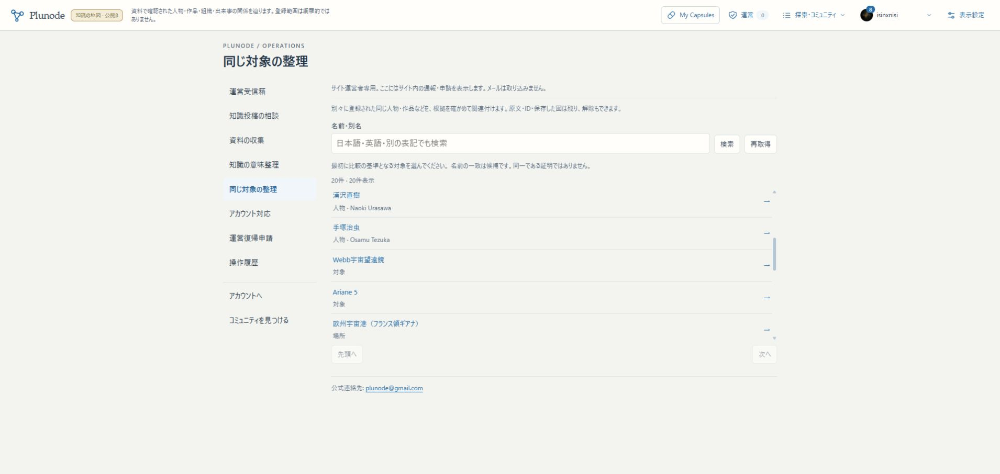

# U6d 対象の関連付け・検証記録

2026-11-05。現行仕様は[設計](../design/KNOWLEDGE_ENTITY_IDENTITIES.md)、全体の現在地は[進行表](../PLUNODE_PROGRESS.md)。

## 配置前の検証

- 隔離PostgreSQL＋検証用Neo4jを使い、7ファイル・46件成功。対象整理、運営認証、比較UI、既存の意味整理と公開投影の回帰を含む。
- 同名でも未関連のままであること、全候補からの名前／別名検索・ページング、二重送信の再利用、request IDの内容差し替え拒否、内容版の競合、別分類、間接経路・20件上限、解除履歴を確認。
- 非公開対象・公開停止した資料・訂正済みEntityの古い関連付けを使わないことを確認。現在版を再確認した判断を古い公開投影のEntity版へ流用しない。
- 名前検索は関連先の原文IDを返し、Recordの両端を置換しない。関連付け変更後に古い検索カーソルを拒否する。
- UIで適用前の確認、結果不明時の同じ操作の再送、保存後の読込失敗を保存失敗と混同しないことを確認。
- 停止していた検証用Neo4jの起動・専用設定の照合と、cold start時のテスト待ち時間の調整を行った。途中失敗を成功数に含めず、最終46件を成功確認した。
- 小さい関連付け集合の検索ではSQLのJIT準備が不要な待ちになり得るため、対象transaction内だけJITを無効にした。共通DB設定は変更していない。

## migration・保全

知識DBの追加006だけが今回のschema変更。既存001／002／004／005、member ledger30は維持。member・知識DBをそれぞれ別DBへ復元し、必要な移行を再実行して旧行の値が一致することを確認した（移行前65／16テーブル）。live DBをdumpで上書きする復旧は行っていない。秘密値を含むdump・設定・詳細logはprivate作業領域に保持する。

## 反映・実操作

配置したapp source：1533a9fd1da9d04c6480f65278af251ec1390b55。build：QoUVviDCX8He2jvYcdER7。main／localhost:3200／HTTPS βへ反映。VPS正式サイト・旧3276のWebは未更新。

実Googleの運営アカウントで次を一巡した。

1. [対象整理](https://graph-beta.isinxnisi.com/operations#identity)から、投稿由来の「Webb宇宙望遠鏡」（分類：対象）を基準に選択。同名候補を一件表示。
2. Theme由来の「Webb宇宙望遠鏡」（分類：宇宙望遠鏡）を選び、両方のNASA Launch資料・ID・内容版1を比較。自由な細分類を再定義せず関連付ける。
3. [投稿由来の対象](https://graph-beta.isinxnisi.com/?kentity=submission%3A47181407aa48fae85513c57ff2d92fa1%3Aentity%3A3b8d31737c458f1c)の詳細から「同じ対象の別の登録」を開き、もう一方の探索へ移動。移動前2対象・1関係、移動後9対象・10関係を確認。元の図の両端を置換していない。
4. 直接の関連付けを解除して完了表示を確認。再訪して関連付けが無い状態を比較し、390px幅で再関連付け。再訪後、関連付け済み・操作版3を確認。現在は有効な一ペア・判断三版（適用→解除→再適用）をβに残している。
5. PCの比較二列、390pxでは縦並び、確認モーダル内の保存操作、候補一覧からページへの通常スクロールを確認。横はみ出しなし（innerWidth／scrollWidthとも390）。既存の運営画面CSSがチェックボックス幅へ干渉していたため、ラベル横にそろえて再build・再反映した。



[スマホの結果・履歴](assets/knowledge-identities-mobile-20261105.png)。[HTTP・保全・Workerの記録](assets/knowledge-identities-20261105.json)。

最終buildは型検査込みで成功。変更したTS/TSXはeslint成功。ローカルHTTPでTOP・従来PLUTO Entity・公開Entity検索・公開関連付けを200、未ログインの運営APIを401として確認。HTTPS βは実ブラウザと実Googleで確認した。一方、Python標準HTTPクライアントによるβの匿名取得は403で、ブラウザで確認した結果とは区別する。今回その403の原因調査やCloudflare設定変更は行っていない。

原記録76版と既存Capsule26件は、適用前後の行fingerprintが一致。知識ledgerは001／002／004／005／006、既適用checksumは全件一致、member ledger30。Webと四つの専用Workerはmainから稼働し、private設定・旧KGを保持。検証のため一時起動した旧専用Neo4jは検証後に停止状態へ戻した。

## 再開

既存private profileを使い、mainで次を実行する。稼働済みなら不要。

```sh
python3 scripts/start-local-previews.py beta --node /home/isinxnisi/1.projects/.worktrees/graph-issue75-theme-foundation/.local/issue75/node
```

認証を伴う操作はHTTPS βを利用する。新しい環境への構築時は[runbook](../runbooks/KNOWLEDGE_BETA.md)に従い006を明示適用し、Web読取から移行しない。dump・旧buildはprivate作業領域の identity-activation-backup-20261105T013303Z／013854Z に保持している。

## 残件

Graphのノードを物理的／表示上で一つに畳む変更は含めない。外部パッケージ取込、収集時の対象候補選択との全面接続、異なる二テーマ＋テーマ無しの通し確認はU6残件。新たなAI照会・料金は発生させない。U7統合受入・U8正式公開は別工程。
