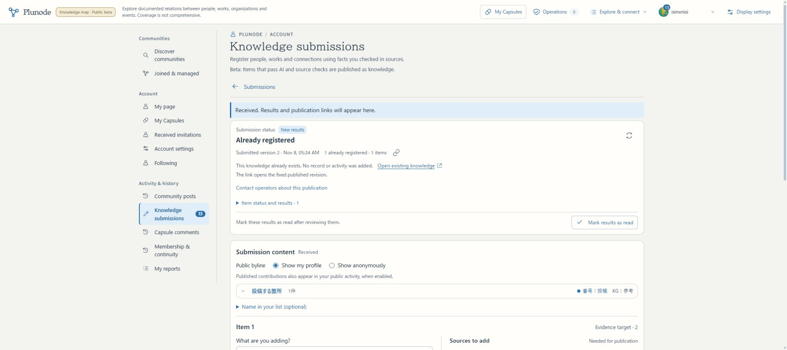
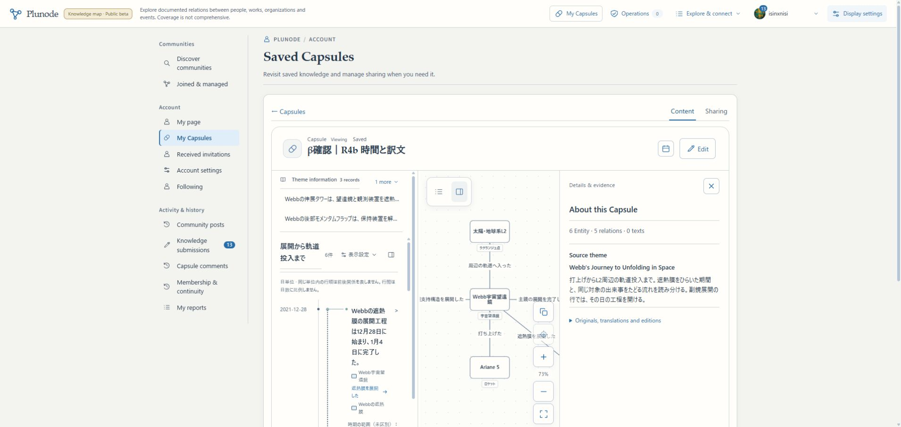
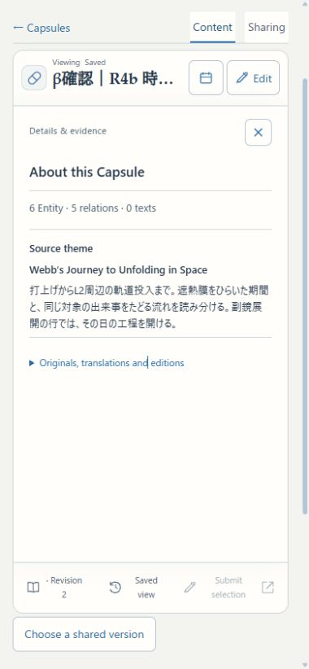

# R5 統合受入・復旧確認

2026-11-08。R5a（利用接続）・b（復元／publisher）の統合確認を完了。初版の機能実装＋β統合検証を区切る。全件AI処理の完了や正式公開を意味しない。

## 確認先

- [HTTPS β](https://graph-beta.isinxnisi.com/)／[localhost:3200](http://localhost:3200/)。本人ログインはHTTPS βを使う。
- [保存内容と取得元の確認用Capsule](https://graph-beta.isinxnisi.com/member?capsule=54059647-872e-4b4a-a2e3-0c7369a6c72f)：本人の非公開「β確認｜R4b 時間と訳文」。下部の本アイコンから既存の詳細を開く。原文・訳文・版は同じ場所へまとめ、初期表示の上部に訳文専用欄を置かない。
- [漫画テーマの確認用Capsule](https://graph-beta.isinxnisi.com/member?capsule=64e8bb21-acc0-4c05-abc3-f026c9de3e41)：新しく保存した「β確認｜R5 漫画をつくる人々」。保存版3。共有更新・旧版コメント・停止を確認した試験リンクは停止済みで、非公開保存を残す。
- [英語の通常探索](https://graph-beta.isinxnisi.com/en?ktheme=u3%3Afbaa9ee12f288cfa%3Atheme&krev=5&kview=split)：公開済みのテーマ題名と本文の訳を使う。訳のない項目や引用は原文を残す。

## 今回の修正

1. Capsuleの原文／訳文の情報を「保存内容と取得元」へまとめた。取得元と同一の説明を二度表示しない。作者の題名・説明・Graph編集値、保存版と共有反映の区別は保つ。
2. 公開停止した訳文を含むCapsuleが既存リンク・コミュニティ一覧から読めてしまう不足を修正した。共有読取の共通参照照合に訳文を含め、停止後は既存の公開面も閲覧不可になる。所有者の非公開保存は維持する。
3. 公開済み訳文を通常の関係図／年表の表示へ接続した。100対象ずつの公開読取で、AI生成は起こさない。対象ID・原文の版・field・言語・原文字列が一致する場合だけ使う。遅延・失敗時も原文の図を残す。Capsuleでは取得した訳文の版を固定し、作者が変えた文言を上書きしない。
4. 自動で使った訳文も原本と別に保存する。既存の2MB文書上限は維持し、最大400記録の表示fieldに対応するため訳文参照は1200件、更新比較の受信上限は512KBへ揃えた。原資料の引用を訳文で置換しない。旧KGの既存表示語と、共通原本の整数版の翻訳を混同しない。
5. 古い内容版を固定したThemeから選択投稿すると現在版との競合で止まることを実操作で確認した。固定版を勝手に置換せず、エラーのそばに「最新版を開いて選び直す」を追加した。Theme版5はRecord版1を保持し、現在のRecord版2へ明示的に移動する。同じ草稿2版の受付は成功し、確認サービスの混雑による1回のretry後、通常Workerの2回目で「登録済み」と判定された。既存の同じRecord版2へ案内され、記録・保存版・活動履歴を増やさなかった。投稿の作り直し・手動承認・再試行時刻の手動変更はない。

6. 選択投稿の「根拠を追加」で、既存根拠を保持していても受付が400で止まる不具合を実Googleで再現した。PostgreSQL JSONBとschema parseの項目順の違いをJSON.stringifyで比較していたことが原因。オブジェクトの項目順によらず全値で比較し、配列順・原文・根拠の変更は引き続き拒否する。3境界テストと既存投稿UI32件を確認。同じ草稿2版を作り直さず受付へ送れた。

## 統合確認の範囲

| 境界 | 今回の確認と活用した証拠 |
| --- | --- |
| 二実テーマ | Webbの時刻／工程年表と漫画の異種関係。今回の実Google操作で既存Webb保存を再訪、漫画7対象・4関係を作成／保存。R3cのNASA訂正・漫画の自動受理と検索、R4の時間入力／原語訂正の記録を活用 |
| Themeなし | R3cの任意Web貼付とテーマを強制しない登録／公開、R4aの通常Graph・Record直リンクを活用。Themeなしへ架空の年表やEntityを作らない |
| 三入力経路 | 運営入力／Web貼付、会員の直接・選択投稿、ChatGPTのAPI直送。R1・R3の実Gemini受理／自動公開とR3b是正の同じ会話・API直送を活用し、全テーマ×全入口の再収集は繰り返さない |
| 一般会員・異言語訂正 | 独立Member DBとfixture OIDCで、許可リストに依存しないauthenticated配置で受付→自動受理、英語の事実訂正でも日本語原文と原語・投稿者を保持する2件を確認。今回の実Googleは本人アカウントのみ |
| 共有・版・会話・コミュニティ固定 | 実DB・fixture OIDCの36件で、新しい時間型・訳文を含む固定保存、同URL更新、私有保存だけでは共有変更なし、旧コメントの投稿版、コミュニティ掲載版の固定、停止した訳の404・所有者保存の継続を確認。実Googleでは漫画の保存版2→3の明示反映、旧版コメントを確認。更新通知後も読者の表示版2に投稿を束縛し、明示読替え後は3となった。共有停止後は現在版・旧版・両OGP画像が404、本人の非公開保存3は保持。 |
| 旧成果・旧保存 | 既存PLUTO等の保存一覧を再訪。R4bの独自時期・固定Theme5／訳文1を再parse・再訪。容量上限20件のため、古い検証用「β確認用・PLUTOの関係図」1件だけを復元可能なごみ箱へ移動。完全削除なし |
| 全件巡回・定期配送 | R2の新旧全件走査・差分追従・代表例の実AI・自動適用、R3bの専用ChatGPT会話から配送→既存再利用の実績を活用。毎時20分のChatGPT予定とPAUSEDのCodex予定を変更せず、全件のAI完了待ちを追加しない |
| URL・未信頼入力・配置認可 | R1h/i/jの公開URL確認・原文／文脈hash・限定資格・認可の境界を継承。今回の新しい訳文取得は公開読取のみ、有限件数・50KB受信・host照合・公開停止の再照合を行う。βの一般会員許可範囲を拡大しない |

テストは今回累計126件成功（UI／domain45、独立PostgreSQL2、Capsule integration36、一般会員／異言語訂正2、探索復帰／投稿競合6、投稿UI32、JSONB比較3）。Member投稿の残り62件は今回filter対象外であり、成功数に含めない。Vitestの `.local/**` 除外、関連lint、standalone型検査と型検査込み最終build成功。最終buildはコンパイル52秒・型検査84秒、全体189.8秒。既存の投稿UIのHook依存lint warning 1件は既知のまま、変更境界のlint errorなし。無関係な全体再検証は追加していない。

選択投稿の実Google確認：Theme版5の固定Record版1から現在版2へ明示移動し、同じ草稿2版を受付。2回目の自動確認で既存再利用となり、公開リンクは元のRecord版2。

## backup・別DB復元・新旧publisher

開発PCのprivate領域 `.local/r5-live-backup-20261108/` にcustom dumpとmanifestを保存。ファイル0600／directory0700。秘密値・dump・会員行はGitへ入れない。

| DB | dump bytes | SHA256 | 復元の照合 |
| --- | ---: | --- | --- |
| Member | 8,045,321 | `73ca549a0bece07fddecfacd80340ce79c2e0b389791b88b8a095c8505fc9699` | 84表の内容fingerprint・件数・所有者。現行migrationを2回再実行して不変 |
| Knowledge | 193,047,064 | `a86693a21e4a70a8ef4b8b8d321d58670bf6d5bc50d5c804ac1f68b7c176246a` | 29表。26表の内容fingerprint、3派生表の件数、全表の所有者 |

両dumpは各DB内で同じexported snapshotから取得した。**オンラインで個別に取得した二つのsnapshotであり、DB間の同時点backupではない。** R6本番切替では受入Webと対象Workerを止め、同じ区切りで両DBをbackupする。β dumpを本番へ戻す手順にはしない。

約2.3GBあるpublication_recordsを本文ごと逐次fingerprintする初回手順は中断した。full dumpは範囲を減らさず、publication_records／publication_entities／target_inventory_entriesの3派生表は件数照合と投影再構築に変更した。初回の復元は180秒上限で中断、上限を600秒へ直した。次の試行はGraph再構築まで進み、最後の検査SQLのAS欠落で止まったため確認用SQLを修正。最終試行は全検査成功。これらは検証手順の修正で、稼働データの不整合やアプリ復旧失敗として扱わない。

新規の所有ラベル付きPostgreSQL／Neo4jへ復元し、以下を確認した。

- PGのactive pointerがあっても空のNeo4jを読ませず、`GRAPH_GENERATION_UNAVAILABLE` で止まる。
- 投影後・activate直前に注入した失敗では旧active pointerを保持する。
- 明示rebuildで新namespaceを完成させてから有効化し、近傍読取を再開する。
- 旧KGのEntityラベルに置いたmarkerは維持する。元Record・資料・訳文など23正本表も再構築前後で不変。
- Member migrationは再実行不変。Knowledgeは復元内容・既存checksumを保持し、publisherが使う基盤schemaの再検査を通した。全Knowledge migrationの一括再実行をした意味にはしない。
- 終了時に今回作ったcontainerとvolumeだけを所有ラベル照合して除去。β DB・通常KG・既存volumeは触れない。private結果は `.local/r5-restore-result.json`、手順は同じ作業領域の `.local/r5-restore.py`／`.local/r5-restore-verify.ts`。

## 配置と引継ぎ

実行ソース `48ab1d7f8237d9404f23515c53593f3de38ffcf1`、build `EOtr5ZgylN49Vxbsuv22i`。作業branch `codex/issue75-theme-foundation` からmainへFFし、3200／HTTPS βへ反映。追加migrationなし。会員000〜035・知識の適用済みchecksumは変更しない。既存16のprivate設定とGoogle認証をhash照合し、Webと既存5 Workerを同じソースへ揃えた。3276・正式VPS・共有Kev・AI教育・ChatGPT予定は未変更。

再起動時はmainで `python3 scripts/start-local-previews.py beta --node /home/isinxnisi/1.projects/.worktrees/graph-issue75-theme-foundation/.local/issue75/node`。既存のprivate profileと台帳から再開する。再build・DB reset・資格の作り直しは不要。

PC幅1910pxと390pxのChromeで確認。モバイルは既存の詳細領域で表示され、document幅／scroll幅380pxに差がない。viewport overrideは解除した。iPhone／WebKit実機の確認ではない。

残るR6では、正式環境の実物監査、Linux脆弱性対応、現行本番データからの移行・一般提供の設定、providerの提供地域／年齢など既存の公開条件、正式originでのGoogle・Worker・API直送接続、整合したbackupと復旧、正式URL操作を行う。βのテスト原本・会員DB・認証値・仮想時期・実験artifactを本番へコピーしない。必要な意味整理・収集・利用機能をR6の残り箱へ移すための区分ではない。VPS切替は別の公開実行指示による。

SNS上の実カードの再取得、二人目の実Google、iPhone／WebKit実機は今回未確認。サイト側のメタ情報と1200×630 PNGはTwitterbot UAで取得し、共有2／3に一致した。一般のurllib UAでは画像403が一度あり、外部SNSの表示成立を確認した意味にはしない。βのnoindex設定は維持した。アプリと本記録は日本語commit・通常pushで作業branchとmainを同期する。結果はGitの実測と完了報告を正とし、記録の存在だけでpush成功としない。
