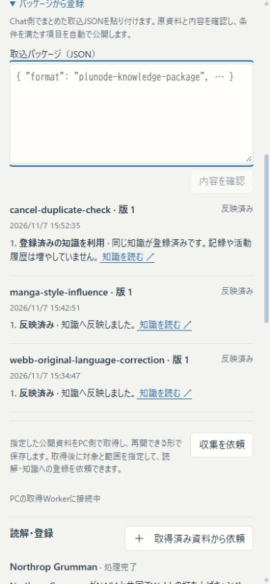
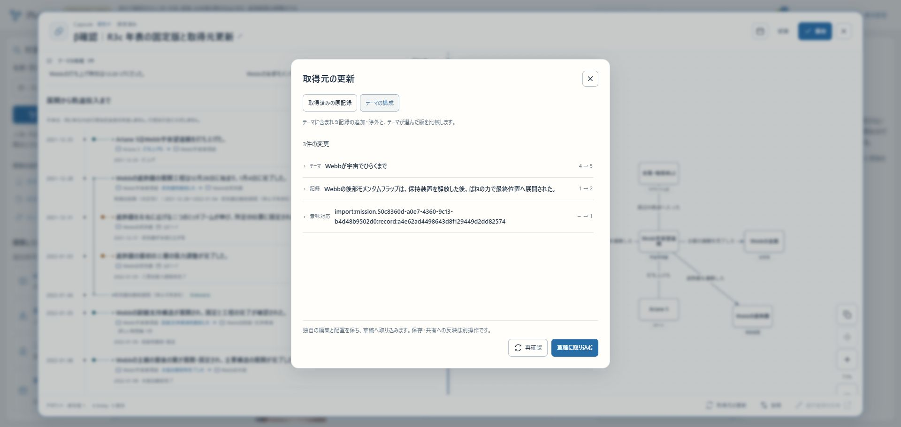
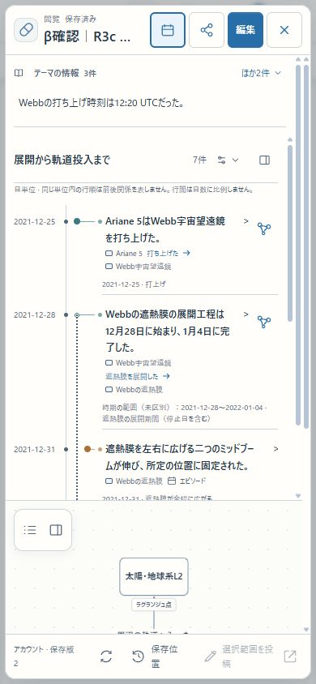

# R3c 差分更新・入力経路・通し確認

2026-11-07追補。**R3c完了、次はR4｜R3はcまで｜全体はR6まで。** R3の機能接続と代表確認を完了した。本運用初版の全体完成・R5の総合受入・正式公開を意味しない。

確認先：[Web取込・収集](https://graph-beta.isinxnisi.com/operations#collection)、[Webbの更新後・Theme版5](https://graph-beta.isinxnisi.com/?ktheme=u3%3Afbaa9ee12f288cfa%3Atheme&krev=5&kview=split)、[漫画テーマ版2](https://graph-beta.isinxnisi.com/?ktheme=u3%3Areal-manga%3Atheme&krev=2&kview=graph)。保存したCapsuleはGoogleログイン後にMy Capsulesから `β確認｜R3c 年表の固定版と取得元更新` を開く。

配置app source `adcc5adad872abaf6bb88f95fd2fd48a0372d73b`、build `WhSi2CEV7-AmSOpITEVrB`。main／localhost:3200／HTTPS βへ反映。追加migrationなし・適用済み会員034までを保持。15のprivate設定・既存認証・5 Workerと通常の日次計画を維持。本番VPS・共有Kev・3276は変更していない。

## 実Googleの入力から公開・保存まで

| 対象 | 実際に通した操作と結果 |
| --- | --- |
| NASAの原語訂正 | Web JSON貼付→内容確認→受付 `82317a05-23bb-4d8c-87f9-7f0d930147d1`。1回目はtimeout・送信結果不明、通常の自動再試行2回目がHTTP200。Record版2／Theme版5へ自動公開。事実文ja・箇所en・引用enを明示し、元の本文は完全一致。旧Record版1のunknown・Theme版4の版1 pinを保持した |
| 異種テーマ | [本人インタビュー](https://www.kanto-ba.org/series/211/)から、絵のタッチについての浦沢直樹→石ノ森章太郎の影響関係を同じWeb経路で入力。受付 `facf25bb-ea19-4d86-8228-bbbf3f0943ea`、実確認1回で人物1件・関係1件を公開し、漫画Theme版2へ追加。日付を捏造せず、質問への回答という範囲を保持。人物検索・知識検索から到達し、通常Workerの意味対応も現在版に反映された |
| 重複 | 同じNASA情報の別packageは `7583d977-5ef7-4ca6-93ec-296c817cabbd` で既存Record版2を再利用。新しい記録・活動を増やさない。取消しようとした時点で既存再利用まで完了していたため、その結果を取消成功と混同しない |
| 未反映取消 | 別の同じ事実2項目を受付 `9c5f4caa-4841-40c0-9916-88af979e369e` へ送り、Webの説明を開いて取消。両項目cancelled、結果・公開先なし。1項目は推論中だったため利用1回を保持し、もう1項目は送信0回。原記録・Themeを増やしていない |
| 年表・Capsule | 旧Theme版4から作成・明示保存。現在のTheme版5を自動で押し付けず、取得元の比較でTheme 4→5／Record 1→2を表示→草稿へ取り込む→保存版2として明示保存。別タブのMy Capsulesから再訪し、Theme版5／Record版2のpinを確認。初回の未共有Capsule保存版1を共有用immutable履歴として保持したという意味ではない。新しい共有リンク発行とSNS確認は今回繰り返していない |

登録時に人が補ったのは、根拠箇所・短い原文引用・具体的な事実文・適用範囲・原語指定・追加先の版。NASAは1 package／1訂正・新規Entityなし、漫画は1 package／1関係・新規Entity1件。テーマ専用コードは0。手入力時間のストップウォッチ実測は行っていないため、所要分数は推定で出さない。API／Webの共通受理・意味重複・原資料照合を使い、管理者の通常承認を足していない。

Capsule保存時にアカウント上限20件へ達したため、ユーザーの既存の削除許可の範囲でテスト用 `β確認・形と矢印` 1件をごみ箱へ移した。復元可能で会話は保持される。会員・独立したコミュニティ・本線KGは削除していない。

R3bの予定実行からの探索・配送・自動公開、R3c初回の実APIによるobserveと訂正受付、今回の実Google Web経由の訂正公開を、それぞれ実際に確認した範囲として分ける。旧停止leaseやtest計画を再開して回避していない。Themeなしの既存取得・登録はU6bの実証を再利用し、新規Web入口の全変種を実AIで反復してはいない。

## 修正・検証・配置

実画面で、資格停止により全項目が取消されたreceiptを「反映済み」と表示する不具合を発見した。全取消はcancelled、一部公開＋取消はcompleted-with-issuesとし、未公開のappliedをprocessingのまま保持する。Web／計画履歴に項目別の確認待ち・自動再試行・枠待ち・公開へ反映中・反映済み・既存再利用・取消済みを表示する。説明用の行や大きなカードは増やしていない。

追加修正の検証は取込38件、UI5件、対象lint、型検査込みbuild。混在する公開済み／取消、資格失効、公開前状態、理由が空の確認待ちを含む。最初の混在状態テストではappliedとpublishedを同一としたfixture期待が誤って失敗し、公開前はprocessingとする検査へ直して38件を通した。実データの値を書き換えてテストを通していない。初回のR3関連61件・034のbackup／別DB復元・checksum／再実行確認は前掲の結果を活用し、理由なくやり直していない。

buildは121.5秒、Node heap 3072MiB、C最低実空き10,636,652,544byte。旧Web資材をprivate backupして切替。DB変更はなく、review Workerのみ再起動し、他の既存Workerは維持した。3200／HTTPS βのTOP・operationsは200、Web受付APIは匿名401、旧Theme版4は14記録のまま200。

PCと実測390×844 CSS pxで入力・結果・年表・保存Capsuleを確認。390pxのdocument幅は380pxで、横方向のはみ出しなし。viewportは確認用タブで測定してから使い、最後にresetした。実iPhone・ソフトキーボード・SNSカード再表示の確認は行っていない。

## 操作接続と次の工程

Windows汎用操作は現在URLを特定できず停止したが、Chrome拡張は有効・native-host設定も正常だった。Chrome専用の`cua_repl`経路でブラウザ一覧→βタブを選ぶとURL・内容・クリックを取得できた。最初の直接タブ取得にはtimeoutがあったが、一覧取得後は成立した。Windowsの安全確認を無効化したり、Plunodeの投稿URL対策を解除してはいない。今後も専用接続を先に確認する。

R4は旧KG／common／訳名の通常探索、焦点引継ぎ、複数時間と時刻・周期／定性等のフォーム、Theme訳・差分取込・文脈／cache・活動固定版の利用接続。R5は一般会員・共有／コメント／コミュニティ固定・旧保存・新旧publisherを含めたβ全体一巡。R6はLinux脆弱性対応・本番向け移行・正式公開。年表同士の比較／マージと直接作図は構想として保持する。

## 初回配置時点の記録（以下の未確認は当時の状態）

2026-11-07。R3c実装・β反映済み、最終確認は未完了｜R3はcまで｜全体はR6まで。

確認先：[運営・資料の収集](https://graph-beta.isinxnisi.com/operations#collection)／[既存Theme版4](https://graph-beta.isinxnisi.com/?ktheme=u3%3Afbaa9ee12f288cfa%3Atheme&krev=4&kview=split)。Googleで運営ログインし、「パッケージから登録」を開く。JSON貼付→内容確認→受付と結果の欄を追加した。PC／スマホの実画面確認は下記の理由で残る。

配置source `8ebd580eb90ea6cd6a6fe63d7ce2f84ef2c2a3a1`、build `T2REsZ0j7OT8ieC_nrXcn`。main／localhost:3200／HTTPS βへ反映。VPSは変更していない。

## 今回の変更

- 計画単位の資料本文・取得hash・前回取得との比較、本文／HTMLだけの変更の区別。
- 実行snapshotのRecord固定版と理由を指定する明示訂正。使用資料のobserveを必須にし、共通の原文照合・確認・意味重複・現在権限を通す。異言語の事実文と引用のtextLanguagesを保持する。
- Entityを持たないThemeの背景収集。無関係なEntityを作って収集を開始する操作を要求しない。
- 任意の運営Web貼付。元JSONを保存し、専用namespaceへ変換。内容確認・受付・結果・公開先・未反映の取消を同じ欄で扱う。受付後の断絶は既存review Workerが同じreceiptへ回復する。

[設計](../design/KNOWLEDGE_MISSIONS_R3.md)／[探索手順](../runbooks/KNOWLEDGE_MISSION_RESEARCH.md)。

## 検証済みと残件

隔離DBのmission／client／UI／配置61件、既存取込37件、対象lintを確認。固定Record版の明示訂正、旧本文・原語の保持、範囲外訂正拒否、資料原文の旧版保持、HTMLのみの差、停止・期限・世代・再送、Web受付のACK喪失回復を含む。AI応答はfixtureであり、実Geminiの成功とは扱わない。

型検査込みbuild成功。最終buildは44.7秒、Node heap 3072MiB、Windows Cの最低実空き9,290,788,864byte。最初のbuildは94.2秒。理由のない全件AI完了待ち・全評価のやり直しは行っていない。

会員034を追加。既存73テーブル・適用済み34件のledgerから35件へ進め、既存行・checksum・再実行不変を確認。会員dump 6,303,907byte、知識dump 178,923,021byteをprivateに保持。会員dumpを別DBへ復元し、同じ移行・保全を確認してから稼働DBへ適用した。知識DBはmigrationせず、原本3テーブルのfingerprintを比較した。巨大な可変cacheの全文集約は行っていない。

初回の復元検証では `--no-owner --no-acl` によりアプリ用roleが復元先schemaを読めず停止した。稼働DBへ適用する前に元のWeb／Workerを復帰し、所有者とACLを保持する復元へ修正して成功。失敗した配置用stagingだけを検証して除去し、dumpや既存データは保持した。15のprivate設定・資格はhash一致、共通Kev・他プロジェクトのコンテナ・正式VPSは変更していない。

HTTPでは3200とHTTPS βのTOP／operationsが200、Web貼付APIの匿名GETが401、固定Theme版4が14記録のまま200。識別可能な `Plunode-ReleaseCheck/1.0` を使用。Python標準UAではCloudflare 1010／403だったため、それをアプリの認証失敗と混同していない。画面の操作確認とは区別する。

## 実資料APIの確認

[NASAの元資料](https://science.nasa.gov/blogs/webb/2021/12/30/webbs-aft-momentum-flap-deployed/)をサーバーの安全な取得器で取得し、本文hash `bff32dfc23dd6979245a6a4d8dc1a3df322b0ff19bdf1486125d32d0c752e821` と圧縮原文をprivate DBへ保持した。異なる2回のHTML hashでも本文hashが同じであることを確認。事実文ja・資料箇所en・原文引用enを補う明示訂正をβの実配送APIで受付した。計画作成は既存の設定済みactive operatorを照合する内側のfixtureであり、Googleブラウザ認証の確認ではない。

- receipt `34239245-cab9-4506-837d-6bb42ad0e31e`：原資料照合後、外部確認がtimeout・送信結果不明。利用1回を保持。
- 診断scriptを読み込むつもりで再実行し、追加の確認計画を作ってしまった。receipt `fa4d43a4-336e-425f-aacc-6ff4e2935c7c` はHTTP 503。追加計画も停止し、scriptは明示phaseを指定できるよう修正した。利用1回を保持し、成功や未使用扱いにしていない。

確認用2計画はいずれも停止、未反映項目はcancelledを確認。通常のWebb日次計画はrevision6・active・既存のnextDueを維持。元Record版1・Theme版4／14件は不変で、今回の実公開・原語更新の成功とは報告しない。[機械可読の記録](KNOWLEDGE_MISSIONS_R3C_20261107.json)。

ブラウザ確認用のWindows制御が「現在のブラウザURLを安全に判定できない」として当該ターンのComputer Useを停止した。その後の画面操作や別手段による迂回は行わない。Chrome再起動で直ると判明した障害ではない。

残件：実資料の訂正で外部確認→公開が成功すること、登録→訂正→検索・年表→Capsuleの固定版／更新の一巡、異種の二つ目のテーマ、Web貼付を含むPC／390pxの実画面。R3bの実予定実行2件をR3cの新経路の確認済みに転用しない。R3c全体完了・R4着手とはまだしない。

## 次の再開

Chromeでβを開いた状態から操作接続を確認する。停止した当該ターンのComputer Useを別手段で迂回しない。実Googleで任意のWeb貼付→結果・取消を確認し、外部確認の回復後に明示訂正とCapsuleまでを一巡する。確認用の停止計画や旧leaseを再開して回避しない。予定実行と元の日次計画はすでに接続済みなので、作り直しや新しいtoken発行は不要。
