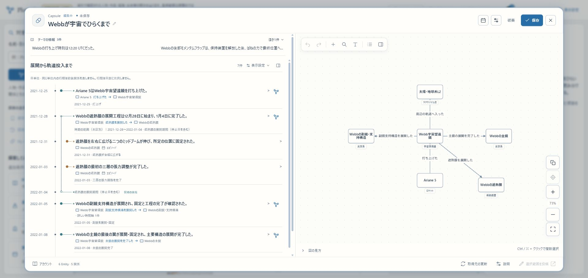

# R6a 正式公開の準備と未実施の境界

2026-11-08。**R6a作業中｜R6はbの正式確認まで｜全体はR6まで。** R5完了後の継続指示を受け、正式公開の準備へ進んだ。本番のDB・Web・OSはまだ更新していない。資材の検証やVPSへの転送を公開完了と扱わない。

## 確認先と現在の実行物

- [localhost:3200](http://localhost:3200/)／[HTTPS β](https://graph-beta.isinxnisi.com/)：セキュリティ更新を配置済み。実行ソース `999df702e89c13063261964d060c5f37f371c2f8`、build `GKCLvKsSR-vkRGVFw_sJ5`。本人ログインはHTTPS βを使う。
- [Webbの年表・関係図](https://graph-beta.isinxnisi.com/?ktheme=u3%3Afbaa9ee12f288cfa%3Atheme&krev=5&kview=split)：Googleログイン済みのChromeで表示、Capsule作成画面、未保存の作成を破棄して探索へ戻る操作を確認。新しい保存や共有は作っていない。
- [正式サイト](https://plunode.net/)：従来版のまま。今回の本番内のimage／build／ledgerは管理者監査の結果待ちであり、過去の記録だけから確定しない。

R5の原文・訳文・版の表示整理、共有更新・コメント・公開停止、移行・復旧の実績は[前段の検証](KNOWLEDGE_INTEGRATION_R5_20261108.md)を活用した。これらの全操作を今回もう一度実施した意味にはしない。今回のブラウザ確認はPC幅で、R5の390px検証は再利用した。iPhone／WebKit実機ではない。

HTTP単独確認では3200と正式サイトのdataset APIは200。Python urllibからのHTTPS βはCloudflareの403／1010となった。アプリ由来の500やトンネル停止と同一視せず、実Chromeで確認した年表・Capsuleの結果と分けて残す。今回Cloudflareの保護設定は変更していない。

## 公開資材の修正

1. registryのadvisoryに基づき、Next／eslint-config-nextを16.3.8から16.4.5、fflateを0.8.2から0.8.3、Viteのtransitive lockを8.3.2から8.3.6へ更新。ReactとNodeの版は変更していない。`npm audit --omit=dev`の検出は0。実際のアプリ機能からの攻撃成立を実証したものではなく、VPS OSの検査結果とも別である。[Next advisory](https://github.com/advisories/GHSA-2464-fhr4-w9xw)／[fflate advisory](https://github.com/advisories/GHSA-px8p-9vwx-vf98)。
2. 既存の変更境界81テスト、移行CLIのlint、型検査込みβ buildが成功。β buildは192.2秒。既存16設定とGoogle認証を引き継ぎ、Webと既存5 Workerを再開。βのDB migrationや利用量上限は変更していない。
3. 本番Docker buildで、収集MCPが使う共通clientとテーマ設定の同梱漏れを確認し修正。Web／運用imageに実行時のchecksum照合用SQLを含めた。秘密値・private profile・β DBはbuildしない。
4. `data/theme-discovery.production.json`を正式用の紹介テーマ設定として分離。初期値は空で、βの実験用テーマIDを正式用に使わない。新着一覧は正式DBの公開テーマを読む。元のβ紹介設定は維持する。
5. 既存のWeb／member-opsへoverlayし、publisher／review／patrolを別processで起動する資材を追加。既存のKG opsを置き換えない。設定はread-only、収集APIの再送checkpointだけはWeb専用の永続ディレクトリへ保存する。新Workerにも既存KGの接続先を明示継承する。

## 検証した正式候補image

固定ソース `12273b176ffd788da42c0f41eb4e4b0dcde63254`、linux/amd64。ソースのgit archiveを使い、未コミット変更・`.local`・環境ファイルはcontextへ混ぜない。

| 資材 | 識別情報 |
| --- | --- |
| Web | `plunode-web:r6-12273b17`／config `sha256:986eb6472e4ca5b3241bb6b0632398f1ac776a2a09be041212ce1379c76f315c` |
| 正式候補build | `4HA4J9PvlJxJdsWuxlIBA` |
| 運用CLI・Worker | `plunode-knowledge-ops:r6-12273b17`／config `sha256:65a26eb72991857a680a65b6533c823fc34f9f21bec3b6907990ec2b075c733b` |
| image archive | 580,830,980 bytes／SHA256 `917e31d92d89778a73f289b9fdfe69afc79fa7a936f0b2ae03e8117e63097266` |

Webのmanifest IDは `sha256:e04a25e8228720c25b84b82e7576cda8f0896671fbab9f662e4baa998861252d`、運用imageは `sha256:64d1aa221699d1960ed02dc92aac9fe662c483f6cbbfca96357e24c27ca5d913`。既存のarchive照合関数を再利用し、config・manifest・全layer bytesの対応を照合した。Dockerのimage storeの違いを、imageが違うと誤判定しないため両IDを記録する。

ビルドはWeb156.2秒、運用image21.1秒。Cドライブの最小空き17,020,317,696 bytes。既存image／cache／volumeの一括削除は行っていない。候補資材をVPSのprivate staging `/home/develop/plunode-r6-20261108/`へ転送し、同じarchive SHA256を確認。**load・起動・切替はしていない。** 公開条件や実機監査により追加修正が必要なら、確定資材は別に記録する。

backup持出し用の新しい復旧用鍵も準備し、公開鍵だけをstagingへ転送した。秘密鍵はPCのprivate領域に0600で保持する。候補資材5点のSHA256をVPS側で再照合済み。これは本番データのbackupを作成した意味ではない。

## 別DBとimageの境界確認

今回だけの所有ラベル付きPostgreSQLで、image内のCLIをproduction profile・正式origin・独立DB／roleで実行した。実Googleのsecretやβのdumpは使わず、外部AIへの送信は行わない。

- 会員migration000〜035の36件を空DBへ適用し、再実行してname／checksum／applied_atが不変。
- 知識migration001〜009の9件を空DBへ適用し、全9件を再実行して台帳不変。原本objectは0のままで、seedしない。
- 誤ったorigin、会員DBを指定した知識移行、適用済みchecksumの変更は拒否。既存SQLのchecksumを書き換えない。
- standalone Webだけで起動し、会員capability200、未認証session200/null、非公開Capsule API401を確認。Web内に36 migration＋role準備SQL、知識9 SQLがあり、`.env.public`と`.local`はない。正式用の紹介テーマIDは空。
- Composeの結合を検査し、9サービス、既存KG接続の継承、設定read-only、再送状態の書込先がWebだけであることを確認。
- 運用imageでreview／patrolのstatusを読み、AI送信台帳0を確認。追加した空のNeo4jへ初回の公開世代を投影し、standalone Webのテーマ一覧が200・0件になることも確認。検証後は今回の所有ラベルを照合してcontainerとnetworkだけを撤去した。

これは**本番のbackup／復元／移行の成功を意味しない**。本番の追加migrationは現在のledgerを監査してから確定し、本番Member DBからのbackupと別DB復元を行う。R5のβ backupを本番へ戻さない。

初回のimage buildは同梱漏れで停止した。検証手順ではrole準備SQLをmigration数へ誤算入したassertを修正し、Neo4jのcold startを8秒／30秒で打ち切る待機処理も見直した。これらを公開成功や本番障害と扱わない。privateな手順・ログは作業領域の `.local/r6-production-20261108/` に保持する。

## 残り・再開

R6aの残り：本番の実物監査、Linux security pocketの確認と適用計画、本番Member DBに対する未適用migrationの確定・backup／別DB復元、正式用private profile／一般提供条件／共有AI予算の確定、切替runnerの実機条件との照合。

SSHは接続できるが、既存sudoはパスワード必須で、developからDockerを操作する権限もない。読み取り専用 `audit.py`を転送し、SHA256 `a67f893209700f1bfdd21002c50904b48a1bede548c791980d82063ad59c96fe` を確認して本人へ実行を依頼した。結果の `/home/develop/plunode-r6-20261108/audit-result.json` を取得し、秘密値を出さずに確認して再開する。転送済みの監査scriptを途中で差し替えない。

加えて、Gemini無料APIの一般提供条件（18歳以上・提供地域）と、同一projectを使うβ／本番の予算配分を質問中。回答前に利用者の範囲を勝手に縮小したり、βと本番へ各400回を設定したりしない。[公式条件](https://ai.google.dev/gemini-api/terms)。課金・別キーでの迂回・管理者による通常の承認作業は追加しない。

R6bは本番切替、正式originでのGoogle・PC Worker・既存の同じChatGPT会話へのAPI接続、代表操作、OGP・正式URL、必要なLinux更新後の復帰確認。本人のOAuth同意が必要な操作は、その時点で具体的に示す。まだ実施していない。

3200／HTTPS βの再開はmainで `python3 scripts/start-local-previews.py beta --node /home/isinxnisi/1.projects/.worktrees/graph-issue75-theme-foundation/.local/issue75/node`。既存台帳・private設定から再開し、DB resetや資格の作り直しをしない。3276、共有Kev、AI教育、ChatGPT／Codexの予定は今回変更していない。
