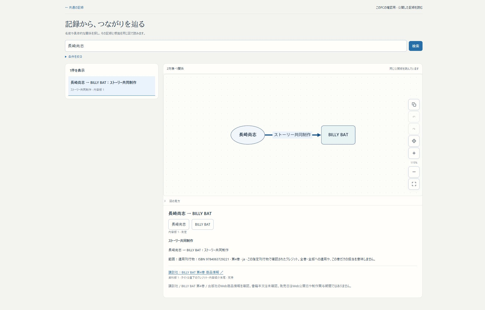
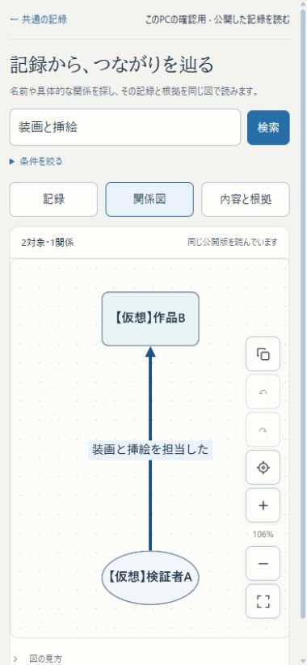

# 公開読取・検索・Graph U2の検証

2026-11-02。[統合計画](../design/PLUNODE_PRODUCTION_INTEGRATION.md)のU2を、既存の独立worktreeと3276へ接続する。契約・再開・再投影は[U2設計](../design/KNOWLEDGE_PUBLIC_READ_U2.md)を参照する。

## 確認先と完成範囲

`http://localhost:3276/themes/explore`。検索→記録の選択→関係図と根拠、図の対象→周囲の展開／経路を確認する。登録・訂正は「共通の記録」から既存の `/themes/records` へ戻れる。関係の具体語を表示・語検索まで保持し、分類・Role・ISBN・意味条件と混同しない。

作業branchは `codex/issue75-theme-foundation`。main・3200・HTTPS β・正式VPS・会員DB・旧Workerは更新しない。この段階で本運用全体の完成、会員Capsuleへの接続、一般投稿のAI審査が済んだとはしない。

配置sourceは `5d9ab5d7a3448a8901262be9ffb57bc5a1a1cab3`、buildは `sF8VDlqJ0YGnEhPOPExhY`。アプリ変更はこのcommitで固定し、検証記録の追記では再buildしない。

## 検証した実装境界

- 実公開KGの保存済み6Claimを再利用し、具体語・方向・肯否・Role・刊行物限定・組織立場・Event参加・開催日・根拠を新DTOへ運ぶ。資料の引用版を固定し、同一Sourceの異なる版も一つへ丸めない。
- 索引検索・keyset cursorは世代・全filter・limitに束縛する。検索条件を変えたcursorや、異なる世代の続きは拒否する。
- PGの不変読取行と専用Neo4jの完成後にactiveを切り替える。原記録の保存と公開投影を同期で待ち合わせない。
- outbox連番の確保順とcommit順が逆転する再現を追加。観測した変更ID集合だけをACKし、遅れてcommitした小さい番号を次回対象へ残す。
- 旧世代でもRecord・両端Entity・引用Sourceの現在の表示停止と公開済み版を確認する。検索・facet・詳細・図・近傍・経路へ同じ境界を適用する。
- Neo4jの世代headerが欠落した場合は503とし、「関係がない」という空成功へ変えない。forceは新しい世代IDで部分破損から再構築する。
- 内容訂正は新世代の通知に留め、利用者が最新版を明示的に読む。表示停止だけは旧世代を再認可して除く。遅い取得が新しい検索・展開・選択を巻き戻さない。

## 自動検証

| 検証 | 結果 |
| --- | --- |
| 新公開domain＋旧legacy＋年表time/timeline＋Capsule document＋Graph path、6ファイル | 64件成功 |
| 実PG＋専用Neo4j、`knowledge-publication.test.ts` | 16件成功、65.04秒 |
| 遅い初期取得／poll、明示最新版、停止prune、poll排他、`knowledge-explorer.test.tsx` | 6件成功 |
| 担当変更ファイルのESLint | 成功 |
| 公開APIのread-only HTTP受入、`test-knowledge-public-preview.py` | 25リクエスト・205 assertion成功、書込み0 |
| 既存U1のHTTP境界・二テーマ固定参照、`test-knowledge-preview.py` | 最終配置後も16 assertion成功 |
| Next production build（webpack、型検査込み） | 成功 |

実DBテストは `plunode_knowledge75_test_*` の新しいDBで実施し、終了時にそのDBだけを削除した。Neo4jも既存KGとは別の専用コンテナを用い、P0のラベルを変更しない。16件の結果は実行時標準出力を確認したものであり、保存済み機械ログがあるとは扱わない。

検索のtrigram索引とtyped索引を検査し、`enable_seqscan=off` のEXPLAINでGINが利用可能であることを確認した。小標本での索引適格性の確認であり、大規模な実運用性能の測定ではない。

再実行する単体・UIテストはNode24から `node_modules/vitest/vitest.mjs run` へ各ファイルを指定する。実DBテストには一時DBを表す `KNOWLEDGE_TEST_DATABASE_URL` と専用Neo4jの `KNOWLEDGE_TEST_NEO4J_PASSWORD` を子process環境へだけ渡す。本番や3276のDBをテスト対象に指定しない。

## backup・復元とデータ保全

- 変更前backup：`.local/issue75/u2-before.dump`、325,945 bytes、SHA256 `1dd2efef152568f642b9f893d224eaff627637b29805c55368bee716b85c5028`。
- `scripts/verify-knowledge-publication-restore.py` で別DBへ復元し、追加002を初回・再実行した。[機械結果](../research/issue75-foundation/u2-restore-results.json)。原データ10表の全行hashと、適用済み001の既存ledger行は不変。002の5表だけを追加し、再適用は変更なし。一時DBのみ削除済み。
- 001 checksum：`efa53919c3529edb48b5ae1ef5ffb10b77716a81773a42af8be404f02fe87e69`。002 checksum：`b81e854faed616520202e89c86c80321f266f45fd912a63788b73c1ab7befc19`。
- 3276の実DBでも、投影起動後・今回の仮想動作確認追加前に原データ10表がbackupと一致した。[実DB照合](../research/issue75-foundation/u2-live-preservation.json)。既存16テーマ・18Capsule・9共有・4意味定義、U1の版固定A/Bを維持する。
- 仮想動作確認後も、自分で追加した4対象と6操作を除く原データ10表がbackupと全行hash一致した。同結果JSONに前後を保存。仮想データの履歴は消さず、Record・Entity2件・Sourceの4対象をhiddenにして残した。

## 今回直した問題

レビューで、outboxのMAX連番だけによる取りこぼし、Neo4j世代欠落時の偽の空結果、遅いpollによる画面巻戻しを発見し、再現する回帰を付けて修正した。初期検索と再認可の同一pollで新しい結果を空にしてしまう問題も、応答競合のUIテストで発見して修正した。

## 残る範囲

U3で既存探索・テーマ・年表・並列表示の自然な接続と作業再開を進める。U4で会員Capsule・origin・OGP・同URL更新・旧版コメント・固定掲載と、新しい停止判定を統合する。U5の利用者投稿審査と、U6の運営収集・後追い整理・AI利用量管理は別の方針のまま残す。

投影は公開断面全体を構築し、世代を自動削除しない。近傍・経路はPGで拒否Record集合を取り、Neo4jの候補数制限より前に除外する安全性優先の初版。全量データでの差分投影・retention・認可条件の性能は未実測。年表同士の比較／マージは未実装の構想として保持する。

## 配置・実ブラウザ・終了記録

Chromeの実ブラウザで次を確認した。スマホは390×844のviewport検証であり、iPhone実機・iOS Chromeの確認とは区別する。ブラウザコンソールにerror／warnは見られなかった。

1. 制作Role「ストーリー共同制作」＋ISBN `9784063729221` から長崎尚志→BILLY BATの1件へ絞り、図・内容版1・第4巻の限定・固定した資料版と出典リンクを読む。
2. 未知語「装画と挿絵」で既存U1の仮想記録を検索し、具体語の辺と内容版2を表示。スマホで記録・関係図・根拠を切り替える。詳細の対象名から周囲を展開し、行き先を選んで経路1本を読む。経路と因果を区別する表示も確認。
3. `verify-knowledge-publication-live.py create / correct / hide --token TOKEN` の3段階を実施。これは既存U1のPOST入力経路を通し、実在情報を改変せず、明示した仮想記録だけを扱う。[機械結果](../research/issue75-foundation/u2-live-results.json)。手動publishは呼ばず、通常publisherが保存から新activeへ進めた。
4. 版1を図で読んだまま訂正する。更新通知が出ても版1の図と根拠を保ち、「最新版を読む」で版2の新しい具体語が検索へ出ることを確認。続いて版2を選び、表示停止後は再読込を強制せず検索・図・根拠から消えることを確認した。
5. `issue75-preview.py reproject` の所有publisher停止・force再構築・通常publisher再開を実行。Webを維持したまま同じ原断面から別世代を公開できた。欠落headerを注入する試験そのものは、別DBの16件に含む。
6. モバイルの絞り込みを開閉し、横はみ出しがないことをDOMのviewport幅とscroll幅でも確認。図のガイドと詳細欄の重なりを修正し、最終buildで解消を再確認した。

最終activeは `k75-1f5ae6ce5b093f07857d3bba1b85c36a`、読取Record7件、`pending=false / lastFailure=null`。PCでは実データの記録を開いた確認タブを残した。





[スマホの根拠](../research/issue75-foundation/u2-mobile-detail.png)／[旧版を維持した更新通知](../research/issue75-foundation/u2-update-notice.png)も保存している。後者は明示した仮想の動作確認記録であり、実在する事実の根拠ではない。

初回buildはテストの未対応optionによる型エラーで停止した。optionを修正し、UI回帰6件と型検査を含む最終buildを通した。途中build `ozbS3D7q8tkj49SOs7KF8` は画面重なり修正前であり、今回の最終配置として扱わない。

確認環境の再開はPowerShellから次で行える。既に3276が使用中なら上書きせず停止するので、先に末尾の `start` を `status` に替えて状態を確認する。

```powershell
wsl -d Ubuntu --cd /home/isinxnisi/1.projects/.worktrees/graph-issue75-theme-foundation python3 scripts/issue75-preview.py start
```

ユーザーが短時間で試す場合は、確認先で「長崎尚志」を検索→記録を選択→図と出典を読む。「条件を絞る」で制作クレジット・役割・ISBNを試せる。自由語の例は「装画と挿絵」。登録と訂正は左上「共通の記録」へ戻る。現時点の本番操作・Googleログイン・SNS/OGPは今回の確認対象外。

Autopilotのreview・共通hold・token照合で作業を保護した。自動候補の受入・一括確認は行わず、mainの未追跡 `memo.txt` と並行Workerを保持した。通常pushとhold解放の最終結果は完了報告に記す。
