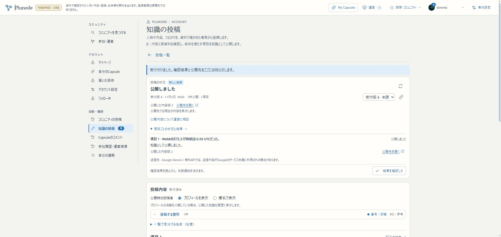

# R1a：原語指定の訂正と旧断面の保全

2026-11-05。[再計画](../design/PLUNODE_IMPLEMENTATION_REPLAN_20261105.md)のR1aを実装・β確認した。**R1全体、本運用初版は未完了**。次は同一性と重複・対象選択、資料同一性、外部package／認証付き取込APIの共通契約を揃える。ChatGPT側からの配送・全データ巡回・定期収集を今回完成した意味ではない。

## 確認先と操作

- [公開された記録](https://graph-beta.isinxnisi.com/?krecord=submission%3A9ac202ad-e212-42f8-ae3a-dbd1b2b4ce1e%3Arecord%3Aca7666b1909e7cef)：本文は以前と同じで、内容版2・原文の言語jaを表示する。
- [本人の訂正受付](https://graph-beta.isinxnisi.com/member/submissions?id=35022136-cde4-477a-a7d0-a9236e51d985)：検証に使ったGoogleアカウントで、受付版4の「公開しました」「公開した内容版2」を確認できる。
- [元の固定テーマ](https://graph-beta.isinxnisi.com/?ktheme=u3%3Afbaa9ee12f288cfa%3Atheme&krev=2&kview=split)：構成版2を保持。原記録の訂正だけでテーマの参照版を差し替えない。

試す場合は公開記録の「訂正を提案」から草稿を作り、本文と根拠を保持して本文の言語だけ変更する。保存・確認依頼は通常の投稿と同じ。新しい訂正を試すときは現在の内容版から開始する。言語指定を変えても別のRecord IDを作らない。

## 変更と判断

1. `accept-record`の無変更判定が`duplicateMeaning`と根拠だけを比較し、Recordの`textLanguages`を落としていた。言語指定の比較を加え、追加・変更・解除を内容版へ保存する。言語の違いを別の事実の判定には使わず、意味重複の再利用は維持する。
2. 運営の訂正草稿が元のRecordを展開し、書換えた本文／関係語に旧言語指定を残していた。既存の`retainedTextLanguages`を共用し、変更した欄だけ未指定にする。未変更の範囲・関係語・引用・資料pinと草稿の訂正元は保持する。元の文に戻した場合は元の指定を維持する。
3. β実操作で、`aboutTheme`を保った訂正でも、テーマ追加を選ばなければ公開に失敗する別の不整合を再現した。現在版をロック・照合したうえで、同じTheme文脈を保つ訂正は追加先の再選択を要求しない。新規追加／別Themeへの付替えの同時公開条件と、現在の公開範囲検証は維持する。訂正と固定テーマの更新を一つの操作へ強制しないための修正。

## 再現と検証

- 修正前：専用の空のPostgreSQL検証DBで、言語のみの訂正1件と、運営本文／関係語の変更2件が想定通り失敗した。検証DBは終了時にそのDBだけ削除した。
- 最終：10ファイル **103件成功、skip 0**。PostgreSQL統合試験を含む。元の言語指定、異言語への書換えと草稿再開、言語指定の解除、本文無変更の言語訂正、引用／記載箇所だけの訂正、意味重複・URL違いの再利用、同時受付、再送、無変更no-op、旧原文・独立した訳文・固定Theme／Capsuleの保持を確認。
- Theme文脈の試験では、同じThemeの訂正を許可し、追加先を指定しない新規追加／別Themeへの付替え、非公開Themeに属する情報の再公開を拒否した。
- ESLint：追跡中の951ファイルを対象に0 error。既存の凍結研究ファイル1件は設定通り除外のwarning。語彙・role・限定契約のcheckも0 error（既存の人による意味確認warningは維持）。`eslint .`は未追跡`.local/`の検証資材まで探索したため、その自分の実行だけを止め、追跡ファイルを明示して完了した。以後の検証でも未追跡資材を対象に含めない。
- Node24.21.0／Next16.3.8、本番相当public buildとTypeScript検査成功。Nextの現行`use client`ガイドを確認済み。画面レイアウトは変更していない。

実Google・実Gemini・実NASA資料で、公開記録の内容版1から草稿を作成し、本文・引用・記載箇所・対象Themeを変えず、本文の言語だけを日本語へ指定して送信した。最初の受付版2では上記Themeの不整合で止まった。修正後、通常の草稿保存・再受付（版4）を行い、Geminiの1回目の一時HTTPエラー後、キューが自動再試行して2回目に応答を受信。原資料照合→共通受理→内容版2の公開まで完了した。管理者の例外承認・直接DBでの受理・キュー状態の付替えは行っていない。

公開先を実ブラウザで開き、内容版2と`原文の言語 · ja`を確認した。DBの読取照合でも、旧Record版1のhash、元Themeの構成版1／2、原記録に属する訳文3版のhashが一致した。会員側のCapsule関連10tableは切替前後と実操作後の行fingerprintが一致。新しい訂正はRecord版2だけで、本文は旧版と同一。

結果の値：[保全・版の照合JSON](assets/knowledge-r1a-results-20261105.json)。実画面：



## 配置・保全

| 対象 | 状態 |
| --- | --- |
| 作業branch | `codex/issue75-theme-foundation`。日本語commit・通常push済み |
| アプリsource | `117eb865294e9d2386dd6f32f4275ff3706893ae`（言語訂正本体`04c7cf08`を含む） |
| public build | `uPWWdnHXPI_CAwfJa0T1O` |
| main／localhost:3200 | 上記source/build。Web・既存の投稿確認／publisher／収集Workerを同じsourceで再開 |
| HTTPS β | 上記3200へ接続し、本人Google認証・投稿・自動確認・公開先を実操作確認 |
| 3276 | 未更新。運営の訂正草稿の挙動は今回の単体／UIテストで検証し、旧3276の画面で新版を確認したとは扱わない |
| 正式VPS | 未更新。R6／U8での正式公開とLinux脆弱性確認は残件 |
| migration | 追加なし。会員000〜029／30件、知識001/002/004/005/006を保持。適用済みchecksumの変更なし |

切替時のprivate backup：作業worktreeの`.local/submission-repair/r1a-activation-backup-20261105T085840Z/`。会員・知識のcustom dump、旧Web build、全tableの行fingerprintを保持した。コードだけの切替でmigrationを実行せず、再起動前の全既存行一致を確認した。別DB復元は直前の006導入時の検証記録を活用し、今回新たな復元試験を実施したとは扱わない。

既存の認証・private profile・KG・AI artifactを引き継ぎ、private設定hashの一致を確認。mainの未追跡`memo.txt`、作業側`.local/`と旧資材を保護した。自動開発の未反映commitは0で、固定候補`5c357e44`を新たに取り込んでいない。

再開は検証済みmainで、Autopilotのreview／holdを行ってから既存launcherを使う。

```sh
python3 scripts/start-local-previews.py beta --node /home/isinxnisi/1.projects/.worktrees/graph-issue75-theme-foundation/.local/issue75/node
```

既に3200が稼働しているときに重ねて起動しない。[β runbook](../runbooks/KNOWLEDGE_BETA.md)の所有PID・cwd確認に従う。DBや保存Capsuleをresetしない。

## 残る範囲

R1aの修正と代表実操作まで完了。R1全体の同一性→重複接続・資料同一性・packageと認証付きAPI契約、外部送信元の実接続、全件巡回と定期収集、検索・多言語表示・時期フォーム等の初版残件は再計画のまま維持する。今回の小区切りを理由に範囲を縮小しない。

β全体一巡までの概算6〜11回、正式化1〜2回はまだ粗い推定。R1の共通契約・送信元接続を閉じた時点で見直す。R1aはその一部であり、R1全体を1回で完了したとは数えない。

新しいiPhone実機試験・全画面の再評価・全データへの言語推定は今回行っていない。旧データへ言語を遡及付与せず、実AI検証は上の日本語指定の1記録。異言語の事実訂正の広範な精度検証や訳名検索は後続の必須範囲として残す。
