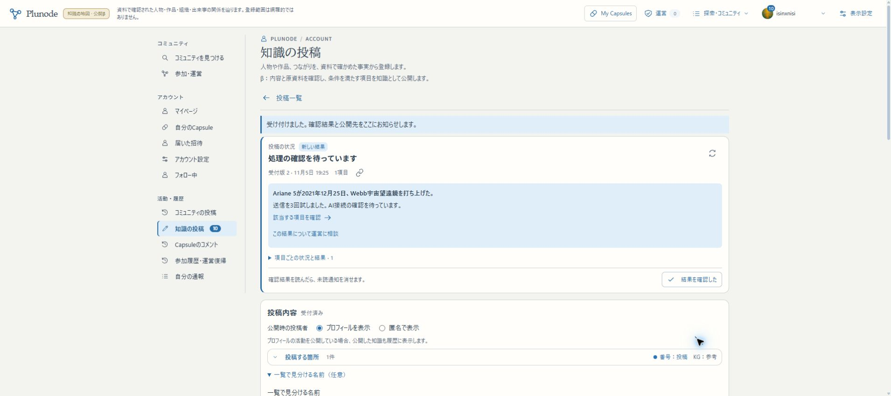

# R1b：同一性を使う重複照合・資料比較・外部取込契約

2026-11-05。[再計画](../design/PLUNODE_IMPLEMENTATION_REPLAN_20261105.md)の部分実装。**R1全体／初版の機能実装完了＋β統合検証は未達**。APIは[契約](../design/KNOWLEDGE_IMPORT_CONTRACT.md)を具体化した段階で、HTTP受付・永続package・配送は未実装。

## 確認先

- [本人の確認投稿](https://graph-beta.isinxnisi.com/member/submissions?id=3ee28b84-30c2-4cfd-a60a-1e5b1fb0afa6)：今回の実Googleログイン本人で受付版2と結果を確認できる。
- [元の公開記録](https://graph-beta.isinxnisi.com/?krecord=submission%3Ab68bc162-6a51-4282-8282-54381405332b%3Arecord%3A310d43a1a577fd4d)：Ariane 5によるWebb打上げ、内容版2。
- [同じ対象の別登録](https://graph-beta.isinxnisi.com/?kentity=u3%3Afbaa9ee12f288cfa%3Aentity%3Ae7a84d267f62548ef726)と[対象整理](https://graph-beta.isinxnisi.com/operations#identity)。

試す場合は、通常の知識投稿で同一性の有効な別登録を選び、既存と同じ事実・時期・限定と根拠を送る。新しい事実や独立した資料を加えていない場合は既存Recordへの「登録済み」になる。同名だけで関連付けのない対象はこの扱いにしない。

## 実装と判断

- 検索と重複候補取得のEntity resolverを共用。現在公開中・確認時の内容版が一致する関連付けだけを使う。共通原本と、関連付け組に含む旧KG UUIDの候補へ接続した。
- 比較用の代表IDだけを使い、保存したRecordの元端点は保持する。既存Recordの再利用に必要な元端点の現在pinも照合する。旧Theme／Capsuleは書き換えない。
- 最終受理のtransactionで同一性判断の変更と排他し、候補と参照を再確認。旧decisionだけで解除後に受理しない。
- URL／書誌の比較keyを分け、追跡parameterとfragmentを除いてもdocument選択parameterは残す。URL比較は安全な取得先の証明にはしない。
- 取得証明はrequested URLとredirect後URLを保持し、抽出方式＋有効な本文hashの組で比較する。別方式のhashや外部側の自己申告を同一資料の証明にしない。
- 外部packageはAPI第一候補、Issue等は同じ形式の代替配送。送信資格・許可範囲・原語・pin・原payload/hash・再送・項目別結果・部分不正・取消を契約化。新しい有料検索APIは前提にしない。

## 自動検証

- 14ファイル **143件成功、skip 0**。専用の一時PostgreSQL DBを作り、終了時にそのDBだけ削除した。
- 同名だけの別IDを照合対象にしない。有効な関連付け後は元Recordを再利用し、端点・内容版・固定Themeを保持する。解除で候補から外し、古い捕捉結果の適用を拒否する。
- 版変更／公開停止／間接接続／同時操作／再送は同一性の既存試験も実行。最終受理の共有lockに対して同一性の排他lockを取得できず、commit後に取得できることを実PGで確認。
- URL queryの保持、書誌との衝突回避、抽出方式差、無効hash、redirectとrequested URLによる照合、同じ本文を返す別URLの再投稿、私有IP転送拒否を確認。
- member/OIDC fixtureの投稿50件、相談13件成功。本人・停止・再送・訂正・decisionの回復等を含む。各harness所有の検証コンテナを終了時に片付けた。実Google確認とは分ける。
- 変更ファイルのESLint、diffチェック成功。Node24.21.0／Next16.3.8のpublic buildとTypeScript検査成功。最初のbuildでは取得証明の推論型とfixtureの共通型の差が出たため、戻り値を明示した共通型へ揃えて再検証した。
- 一度の追加vitest実行はfilterが未追跡の旧build内試験も拾った。現行26件に加え旧copy75件が走っただけで、上の現行143件へ重複加算しない。主要harnessは明示excludeで実行する。

## 実Google・βの操作確認

実Googleの既存sessionで通常の投稿UIから草稿保存→対象選び直し→受付版2を提出。元RecordのWebbと同じ対象として関連付けた別IDを使い、同じ本文・2021-12-25の発生時点・同じNASA引用とlocator、tracking parameter付きURLを入力した。対象のpinは保存後の読取照合で確認した。

- subject: \`submission:47181407aa48fae85513c57ff2d92fa1:entity:a1a2003878f456ff\`
- 提出object: \`u3:fbaa9ee12f288cfa:entity:e7a84d267f62548ef726\`
- 元Recordのobject: \`submission:47181407aa48fae85513c57ff2d92fa1:entity:3b8d31737c458f1c\`
- 資料: NASA [Webb Launch](https://science.nasa.gov/mission/webb/launch/)、原文のLaunch Date。
- 受付job: 67a28c1d-48e3-488d-840d-38cd0b3c60a5。
- β実行物が生成した確認payloadを読取り照合し、policy v2・両Webb IDの同一性・元Record内容版2の候補・比較上の完全一致を確認。
- 外部AI接続は3回未成功（delivery-unknown、http-error、delivery-unknown）。通常キューが再試行し、最終的にattentionとなった。「処理の確認を待っています」と未読通知を実ブラウザで確認。HTTP失敗の正確なstatusは既存attempt台帳に残らないため断定しない。送信回数3は計上、実token量は取得不能のnullで、0と報告しない。
- **今回の実Google／実Geminiでの最終「登録済み」到達は未確認**。原本取得／最終受理まで成功したとは報告しない。隔離DBでの実際の既存Record再利用と、βの受付・候補生成を分ける。管理者の例外承認や直接DBの状態変更で成功を作らない。
- 投稿前と接続待ち時点で、原Record内容版2／内容hash、知識の全object数・全revision hash、貢献履歴、Capsule関連tableのfingerprintが一致。これは接続待ち中の保全結果で、受理後の保全確認の代わりにはしない。接続回復後に既存の再確認経路から再開し、登録済みと受理後の同じ保全項目を確認する。

[確認値](assets/knowledge-r1b-results-20261105.json)／実画面：

対象検索で一時的な部分取得失敗／再試行を観測し、再検索で候補を選択できた。同名候補は名称と「公開された知識」だけでは識別しづらく、R1の対象選択残件へ引き継ぐ。登録先のIDを通常利用者がDBで確認する運用にはしない。

## 配置・保全

- 実装commit \`c773fd45\`、単体確認追補 \`d4d77b95\`、型調整を含む配置source **\`616f1840728f8607131fa7e1d83a73f25d18cdd9\`**。
- build **\`AQsmThdwxZZSYkAt7EMg0\`**。main／localhost:3200／HTTPS βへ反映。後続の文書commitと配置sourceを区別する。
- 追加migrationなし。会員ledger30件／029まで、知識001/002/004/005/006を保持。適用済みchecksumの変更なし。
- 停止は当該preview Webと関連する4 Workerだけ。private backupに会員／知識のdumpと旧buildを保持。コード切替前後で全tableの行fingerprint一致、private設定8file hash一致。schema変更がないため新たなrestore rehearsalは行わず、既存の復元検証を引き継ぐ。
- 3276／本番VPS／共通Kev／他projectは変更しない。既存KGのデータ再投入なし、認証・コミュニティ・Capsuleは保持。
- 通常pushを行い、mainは検証済み固定sourceへfast-forward。文書の確定後もmainをfast-forwardし、不要な再buildはしない。

## 再開

通常の確認先はHTTPS β。既存launcherとprivate profileを保持している。

\`\`\`sh
cd /home/isinxnisi/1.projects/7.graph-knowledge
python3 scripts/start-local-previews.py beta --node /home/isinxnisi/1.projects/.worktrees/graph-issue75-theme-foundation/.local/issue75/node
\`\`\`

起動済みのものを無闇に重複起動しない。停止していた場合に現行runbookとPID・cwdを確認して使う。private設定やDBをβから本番へコピーしない。

## 必須残件

共通取得証明台帳、旧KG／commonの対象台帳、外部packageのschema・永続receipt・専用認可・API／実配送、Entity原文訂正・固定版reader・対象選択・翻訳文脈／cache・安全境界をR1で継続する。会員decisionの資料hash比較だけを全経路対応としない。R2全データ巡回と自動整理、R3設定後の自動資料探し・定期収集、R4利用接続、R5統合検証は未完了。

残りの見込みは[進行表](../PLUNODE_PROGRESS.md)。本番移行・Linux脆弱性対応・正式URL確認は後の公開工程であり、機能の未実装をそこへ押し出さない。年表直接作図・年表同士の比較／マージは明示された後続構想のまま。

作業はAutopilot review／共通hold・token保持下で行った。固定自動候補の未反映0を確認し、無関係な候補は取り込んでいない。mainの未追跡memo.txtと作業側.localを保護。hold解放の結果は完了報告に記載する。
