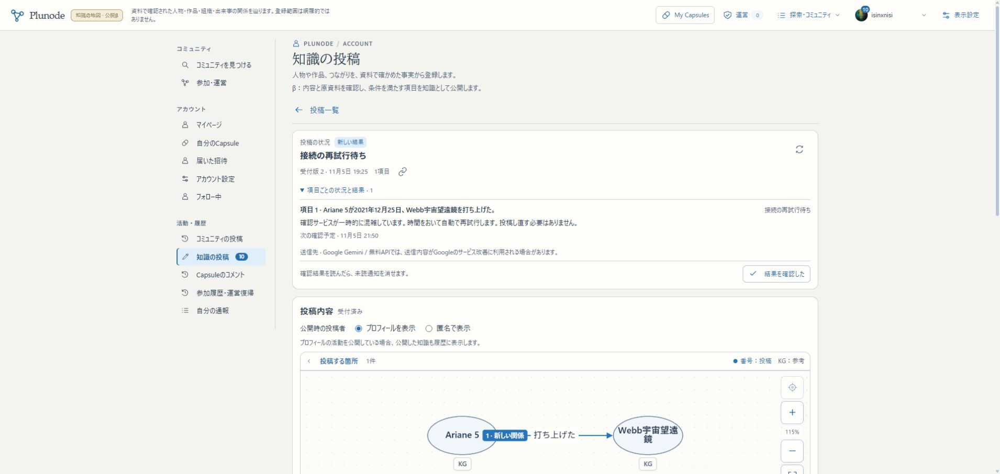
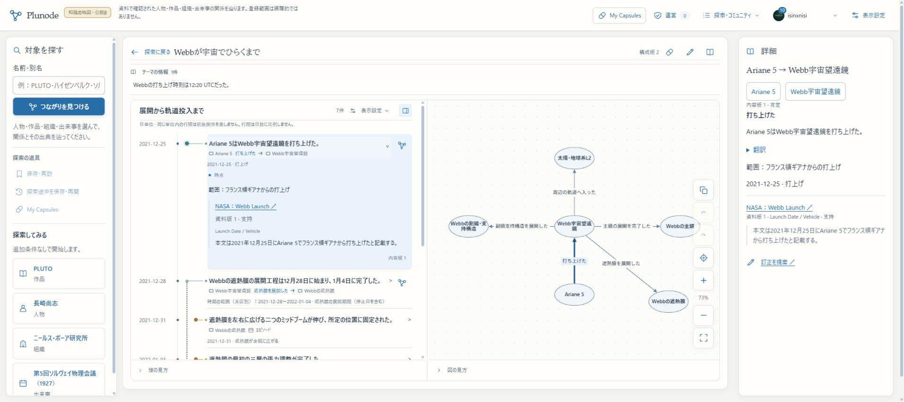

# R1c：取得証明・新旧対象台帳の検証

2026-11-05。R1の部分実装。[設計と再開方法](../design/KNOWLEDGE_ACQUISITION_INVENTORY.md)。app `94bcf7dce341bc8aea1364296c166c9de9611e60`／build `VgN_c2H7-gtkdB7qFcShz`をmain・localhost:3200・HTTPS βへ反映済み。

## 実装した範囲

- 追加migration007、共通の取得証明保存と固定Source／Record版への対応。
- 会員受理・収集登録での原子的な証明保存。会員の本文hash比較を共通台帳へ接続。
- 旧公開receiptからの検証付き再構成、冪等な再実行。
- common全件・旧KG全件のページ列挙、永続継続位置、完了／staleの区別。
- private runtimeを引き継ぐmigration／backfill／scan CLI。

外部取込API受付・専用資格・package receipt・配送の実接続、収集／外部取込の意味重複判定の全面共用、R2の周期巡回・候補生成・自動適用は未完了。これらを公開工程へ押し出さず初版の残件として維持する。

## 別DBへの復元と移行実測

稼働βの会員DB・知識DBをdumpし、それぞれ別名の検証DBへ復元。追加migration007適用、証明backfill、再実行、実際の旧KGに対する読み取り列挙を行った。

- 既存migrationのchecksum保持、追加は007だけ。
- 公開済み会員receipt6、適用済み収集receipt2から、取得証明8・版への対応8を再構成。
- commonの71対象、旧KGの5,711対象を全件列挙。137件ずつ保存し、111件ずつ読み戻して件数一致。
- 再migration／再backfillで証明・対応・ledgerは不変。
- 既存の全知識テーブル（migration台帳への追加以外）と会員全テーブルのfingerprint不変。
- 検証に作った別DBだけを削除。dumpはprivate作業記録に保存。

これは全件列挙の確認であり、全5,711件についてAI確認・整理が済んだ意味ではない。

## 再試行の実測

同じ投稿・受付版2・jobの自動再試行を継続して確認した。4回目はDNS `EAI_AGAIN`、5回目（20:19 JST）はHTTP503／unavailable。過去の3試行は詳細が保存されておらず、すべて503とは断定しない。上限・無料予算を守る待機を続け、DBで成功へ書き換えたり、手動で再投稿したりしていない。6回目の結果と次回予定は後段の最終確認に記載する。

## 検証と実際の配置

- 基盤・取得・重複・台帳151件、会員投稿／参照54件、収集／証明backfill11件、**計216件成功・skip0**。lint、型検査、public webpack build成功。
- β切替前にWeb／専用Worker5プロセスを停止し、会員・知識の新しいdumpをprivate保存。移行・2回のbackfill・全件scan後に、既存全テーブルのfingerprintを再照合した。追加migration台帳以外の原本・会員行は一致。
- 追加は知識007のみ。旧checksum保持、知識001/002/004/005/006/007、会員000〜029の30件を維持。証明8／対応8、common71／旧KG5,711の台帳を実βにも作成。
- private runtimeの8ファイルhashは不変。Google認証、DB接続、共有Kev、Cloudflared、3276、正式VPSへ設定変更なし。
- 配置前build `xJavi_2YvZdx26ouGAToE`とdumpはprivate backupに保存。追加007は既存テーブルを変えない移行。復旧で古いdumpを現行DBへ上書きする手順は採らない。
- localhost:3200はHTTP200、紹介テーマは初期HTMLに存在。HTTPS βは実Chromeで成功。WSLのPython HTTP確認は403であり、CLI側も200だったとは報告しない。

実Chromeで、同じ受付版2の待機理由／次回予定、TOP→Webb年表・関係図→Record内容版1の根拠→探索へ戻る→既存PLUTOの4対象・6主張を確認した。未読通知は既読にしていない。新しいCapsuleの保存／共有や、本番URLでの操作はこの回には行っていない。

## 再試行の最終確認

6回目（20:53 JST）もHTTP503。次回は**11月5日21:50 JSTごろ**、上限・無料予算を守って同じjobが自動再試行する。最終の「登録済み」は未確認。投稿本文・対象・受付版は保持され、比較対象Recordの版とhash、全原本の件数／版hash、投稿者活動、Capsule関連テーブルは待機前baselineと一致した。

取得証明／対象台帳はAI応答を待たずに検証できたが、実AIによる同じ投稿の最終再利用まで成功したことにはしない。[機械判定可能な結果](assets/knowledge-r1c-results-20261105.json)に区別して保存する。

## 次の作業と再開

R1cは部分完了。次は取込契約の専用資格・厳密schema・永続package／項目receipt・部分結果・取消と再送をHTTPへ接続し、小さい実配送を確認する。外部データを人間の投稿者へ偽装しない。Entity原文訂正、固定版reader、翻訳文脈／cache、参照・公開範囲・配置別認可と安全境界もR1残件として維持する。

全件列挙ができたことをR2の全件自動整理完成と混同しない。周期巡回・候補生成・支持確認・通常分の自動適用は初版に含むまま未接続。管理者がCLIを毎回実行する前提へ戻さない。

通常再起動は既存の `scripts/start-local-previews.py beta --node /home/isinxnisi/1.projects/.worktrees/graph-issue75-theme-foundation/.local/issue75/node`。private stateを引き継ぎ、Web3200と専用Workerを復帰する。証明・対象台帳だけの再実行方法は設計書に記載。

作業branchは `codex/issue75-theme-foundation`。コードcommit `94bcf7dc`。検証・進行表は後続の日本語commitへ記録し、branchとmainの通常push、最後にholdを解放する。最終結果は進行表・完了報告にも残す。

## ユーザー指示による変更後リクエストの単発確認

ユーザーから「変更後で成功するか確認し、それ以上は不毛な調査を長引かせない」と指示があったため、変更後の現在コードを使い、同じ保存wireを1回だけ送信した。5,639 bytes、同じmodel・同じrequest hash。約6.8秒でHTTP503／UNAVAILABLE。Googleの応答本文は「This model is currently experiencing high demand.」と需要集中を明示していた。

- 新しい投稿・公開依頼・原本変更は行っていない。通常jobは6試行・次回21:50ごろの予定を維持。
- 共通の無料project／利用量台帳で評価1回を予約・計上。日月の回数・token枠・分間制限は共用し、欠測tokenはnullのまま。key・project・モデルの切替は行っていない。
- 手動確認に限り、10分以上前の503・Retry-After指定なしを確認したうえで、ローカルで設定した一時的なproject cooldownだけを予約transaction内で例外にした。cooldownはcommit前に元へ戻し、通常Workerの待ち・設定は変更していない。提供元のRetry-Afterや無料利用上限を迂回した確認ではない。
- 元Record・全原本の版hash・投稿者活動・Capsuleは待機前baselineと一致。
- 成功はまだ実証できていない。ユーザー方針に従い、一時的なサービス不調として扱い、DNSやHTTP clientの調査をこれ以上広げない。通常の自動再試行は維持する。

文書・検証記録のみ更新。app source 94bcf7dc／build VgN_c2H7-gtkdB7qFcShz、main／3200／HTTPS βの実行物は不変。3276／正式VPS／共有サービスの変更なし。
