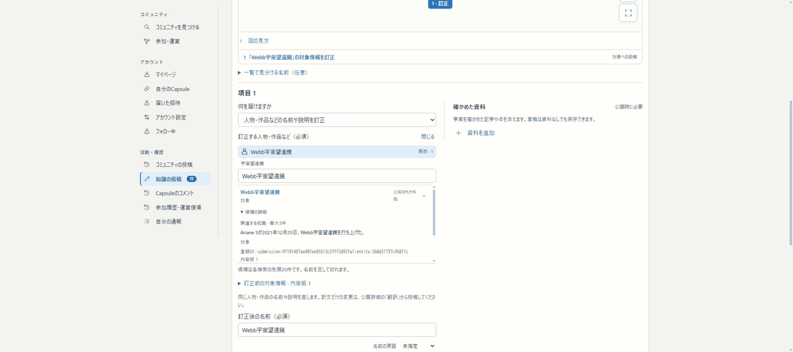
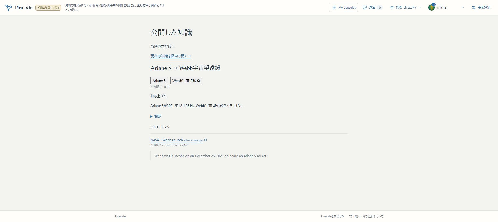

# R1h：投稿対象の識別と共通資料リンク

2026-11-06。R1の対象選択・外部資料遷移の区切りをmain／localhost:3200／HTTPS βへ反映した。R1全体・初版全体は未完了。

## 確認先と操作

[知識の投稿](https://graph-beta.isinxnisi.com/member/submissions)から既存対象を選ぶと、名前に加えて分類・説明・関係端点を読める。「候補の詳細」で別名・資料名・版・登録IDを確認し、人物などは関連する公開知識を最大3件だけ取得する。説明がない同名候補でも比較できる。スマホでは長いIDより関連知識を先に読む。

既存Google本人の[確認用草稿](https://graph-beta.isinxnisi.com/member/submissions?id=e5a5ab54-e6e0-405e-91fe-0faf3c56a13c)は「Webb宇宙望遠鏡」の対象訂正。変更→同名で検索し、分類「対象」と「宇宙望遠鏡」の2件を比較できる。これは公開しない検証用草稿であり、実際の訂正依頼は行っていない。

[公開済みNASAの知識](https://graph-beta.isinxnisi.com/records?id=submission%3Ab68bc162-6a51-4282-8282-54381405332b%3Arecord%3A310d43a1a577fd4d&revision=2)では、資料名にscience.nasa.govが並ぶ。通常KG・共通知識・年表・Capsule・確認／収集画面の8コンポーネントが同じUIを使う。通常のHTTPS資料は直接別タブへ開く。HTTP／IDN／公開IP／非標準portは実hostを確認してから開く。資格情報付き・非HTTP・ローカル／私有先等はリンクにしない。

## 実装と判断

[設計](../design/KNOWLEDGE_SELECTION_AND_c70aa3c05cb395f3c610aa2d79b6607a5fb7312a_LINKS.md)に従い、常時見せる情報は短く、詳しい比較は必要時だけ開く。候補一覧の上限190px・先頭20件の明示・スクロールチェーンを保持した。分類や説明だけで自動同一視せず、選択は従来の認証付きtargets処理でID・版を固定する。

検索結果を逆転させていた重複排除を修正し、元の順位と同IDのcommon優先を保つ。common専用検索の失敗を、架空の空成功により一部成功へ見せる問題も修正した。関連知識は検索時の公開世代を引き継ぐ。

資料名の見かけだけで遷移先を誤認しにくいよう、実hostをASCII表示し、双方向文字の影響を分離する。全リンクを一律モーダルにはしない。ブラウザ向けURL判定は安全認定ではなく、遷移後redirectや一般ドメイン上のフィッシングを完全検知しない。自動取得は既存の公開IP判定・DNS先固定・redirectごとの再検査・容量／時間／形式制限を維持する。

## 検証

- 6ファイル計187件成功。投稿UI32、探索状態104、外部リンク22、取得ネットワーク6、原資料確認20、対象変更3。lint・型検査を含むproduction build成功。
- 同名・別説明／別名、選択後と再訪の説明、失敗表示、詳細を開いた時だけの最大3件取得、世代引継ぎを確認。URLは資格情報／数値IP／私有先／IDN／HTTP／port／偽の題名／双方向文字等を検証した。
- 実GoogleログインのChromeで2つのWebb同名候補の関連知識を比較し、Ariane 5から分類「宇宙望遠鏡」のWebbへ変更。対象名・取得版・訂正本文／図の対象が一致し、草稿保存→reloadでも選択を維持した。確認依頼・AI送信は行っていない。
- PC幅と390×844を操作し、候補詳細を開けることを確認。390pxで文書幅380px、横はみ出しなし。実iPhoneのキーボードやタッチスクロールは未確認。
- NASA公開Recordで実host、別タブ、noopener／noreferrer／no-referrerを確認。異常URLの確認UIとブロックはコンポーネント試験であり、実際の危険サイトへ遷移していない。8画面すべてのブラウザ再走査は行っていない。
- 3200／HTTPS βのTOPがHTTP200で、同じ最終buildを返すことを確認。HTTP確認だけでなく上記の実操作を行った。

実行開始時にshellが未引用globを展開し、古いbuildコピーも対象となった試験を停止した。最終検証はPythonの明示引数リストで指定した6ファイルのみを実行した。停止した広域試験は成功件数に含めない。既存ui-stateのact警告は残るが失敗はない。

## 配置と保全

- アプリsource：c70aa3c05cb395f3c610aa2d79b6607a5fb7312a
- 最終build：CCFcwQNpAsu6DO5SpjnZU
- mainへfast-forwardし、既存launcherでWebと4つの知識関連Workerを再開。
- 追加migrationなし。会員000〜031のledger32、知識001/002/004/005/006/007と全既存行を切替前後で照合。11個のprivate runtime／認証／専用資格、旧KGを保持。
- 最終backup：.local/submission-repair/r1h3-activation-backup-20261105T182252Z（作業tree内・非公開）。今回の切替用の会員／知識dumpであり、古いdumpで上書きしていない。schema変更がないため、追加の別DB移行リハーサルは不要。R1gの復元済み移行を再実行していない。
- 初回反映後に実データの説明不足を見つけ、詳細内の関連知識を追加。さらにスマホでIDが比較情報を押し下げるため順序を補修した。最終の上記buildを正とする。
- 3276／本番VPS／共通Kev／AI教育runtimeは今回未変更。AIモデル・利用量上限も変更なし。新規AI送信0回・課金サービス追加なし。

## 残件と再開

R1iでは、現在のβ専用origin／host／DB literalとallowedUsersから、配置別の公開read／会員投稿／運営／Worker資格を明示的なcapabilityへ整理する。β用の秘密値を本番用と扱わず、旧KGとの接続も照合する。本番への切替自体は今回の範囲ではない。

R1gで完成したのは翻訳草稿生成の公開文脈とcacheである。`knowledge-review-job.ts`の訳文意味一致確認は、現在原文・訳文・field/kindだけを送り、周囲の公開文脈を固定していない。この差分をR1残件として記録する。生成と確認を混同せず、意味確認の送信／受理時にも固定文脈・公開状態を検査する。

AIの自由文がactor・予算・取得先・公開権限を変更しないことの横断確認も残る。R2全登録データの自動巡回／整理、R3設定後の資料探し・定期配送／収集、R4探索／入力／多言語、R5β全体一巡は初版必須範囲として維持。任意運営画面を必須承認へ戻さない。残り6〜11回程度は粗い推定であり、範囲縮小の根拠にしない。

再開時はAGENTS、現行引継ぎと本記録を読み、review／hold／token確認。既存private runtimeを利用して `scripts/start-local-previews.py beta --node <既存Node24の絶対path>` で再開する。秘密値を新規生成したり、旧build・旧dumpへ機械的に戻さない。

[機械可読結果](assets/knowledge-selection-links-r1h-20261106.json)。作業branchはcodex/issue75-theme-foundation。日本語commit／通常pushとhold解放の最終結果は完了報告に記載する。

