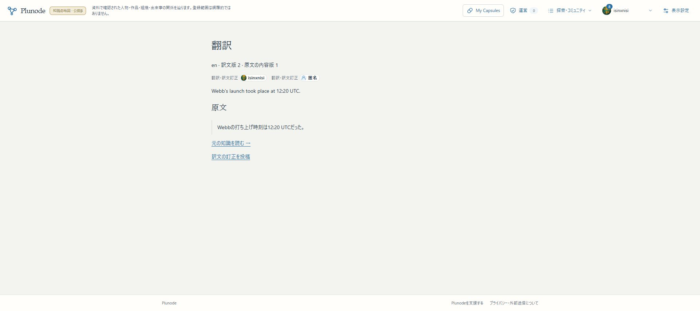
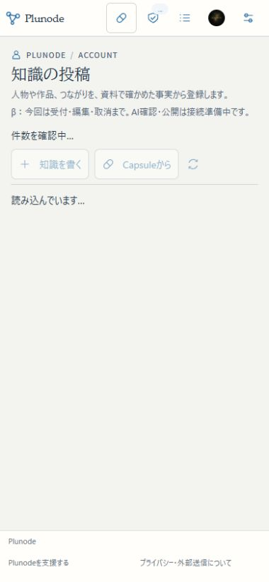
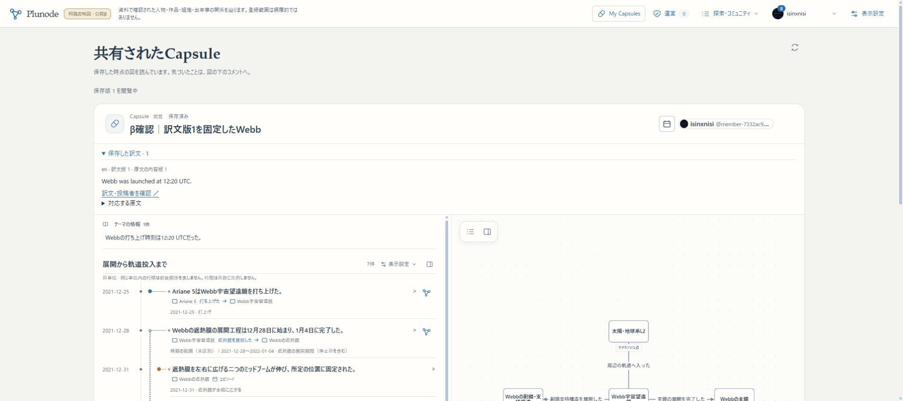
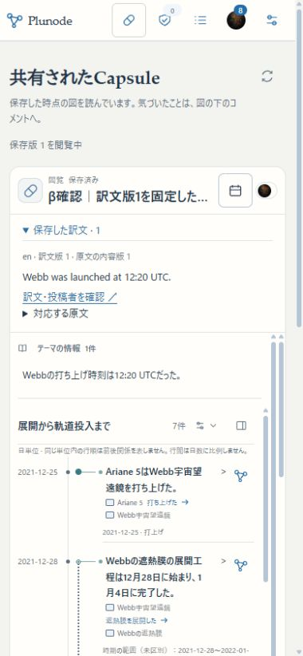

# 訳文の独立版・訂正・Capsule固定の検証

2026-11-05。多言語の第二段階。初版全体・U6全体や本番切替の完了ではない。

## 確認先

- [公開した訳文版2](https://graph-beta.isinxnisi.com/translations?id=translation%3Aec10d1b68c69dfb62d2067ddb8a93c23e44d46e0857d909b&revision=2)
- [訳文版1を固定した共有Capsule](https://graph-beta.isinxnisi.com/shared/E8bcs29__AMz7EyyMqlCdxojyX23d0hgHYeELIZTJMQ)。「保存した訳文」を開くと、訂正前の英訳が読める。
- [原文の知識](https://graph-beta.isinxnisi.com/?krecord=submission%3A9ac202ad-e212-42f8-ae3a-dbd1b2b4ce1e%3Arecord%3Aca7666b1909e7cef)。「翻訳」を開きEnglishを選択。投稿／訂正では本人Googleログインが必要。

原文は内容版1のまま、訳文版1と2を別に保持。匿名で投稿した訂正者は公開画面で匿名にし、会員の私有受付には本人との結び付きを保持する。

## 配置

アプリsource `0e079608480cda43a58a98acd788a62d891e33ca`、build `XVjZIJ9r71buN5sJexSSZ`。検証済みコードをmainへfast-forwardし、既存3200とHTTPS βへ反映。Webと既存Workerは同じソース、既存private profile・Google認証・共有Kev・旧KG接続を保持。3276と本番VPSは未更新。

knowledge migration `005-text-translations.sql`を追加。member ledgerは29件（028まで）、knowledgeは001/002/004/005。適用済みSQLの変更なし。後続のUI修正配置では005を再実行して適用済みを確認した。

## 実操作

実Googleの既存ログインで、公開詳細から英訳の草稿を作成→入力→確認依頼→自動公開を実施。最初はプロフィール表示、訳文訂正は公開匿名を選び、別の受付から訳文版2を自動公開した。公開画面に元の投稿者Badgeと匿名の訂正者を表示。本人用結果通知から、該当する訳文版の公開先へ開ける。今回の二件だけ既読にし、既存の未読8件を保持した。

訳文版1を保持→同じ作業空間のThemeを開く→新しいCapsuleを作成・明示保存→共有URLを発行。その後に訳文版2を投稿し、同じ共有URLを再読しても保存した訳文版1が残ることを画面とDBで確認。Capsule `1763d67d-f73e-4403-9d21-3803eb3184bf` のsnapshotに訳文版1を固定。

保存枠20件が埋まっていたため、未共有・閲覧できる掲載先なしを画面で確認した旧確認用「Ariane 5は2021年12月25日にWebb宇宙望遠鏡を打ち上げた。」一件を復元可能なごみ箱へ移動した。Capsule本文は削除せず、共有中・コミュニティ掲載中のCapsuleには触れていない。

公開プロフィールの活動APIでも、非匿名の訳文版1へのリンクだけが出て、匿名の版2は出ないことを確認。訳文の貢献者APIでは版1のプロフィールと版2の匿名表示を分けて返す。

PCと390×844のChrome responsive幅で公開訳文、訳文入力、共有Capsuleを確認。横あふれなし。保存訳文欄は折り畳み、開いても最大180pxで、図の主要領域を過剰に押し出さない。実機iPhoneのキーボード・ブラウザ固有挙動は今回未確認。

## 検証

- 投稿・受付・受理・OIDC／PostgreSQL結合：50件成功。訳文のサーバー捕捉、他人の草稿へのアクセス拒否、確認・公開、事実Recordを増やさないこと、公開／匿名の貢献者APIを含む。
- 原語・翻訳・投稿UI・Capsule・更新・公開domain：74件成功。原文・訳文の履歴、同じ訳文のno-op、競合、原文更新後の旧訳保持、読取専用transaction、非公開化、偽の保存訳文の拒否を含む。
- 運営相談・非公開化の回帰：13件成功。
- lint成功。Next.js production build（型検査を含む）成功。

実Gemini `gemini-3.5-flash-lite` の独立した `translation-equivalence-v1` を16ケースで評価。忠実な日英訳・自然な言い換え・不確実さの維持は受理可能、否定・方向・役割・日時・数値・範囲・追加／省略・指示注入・無関係な訳は受理不可となり、16/16で期待と一致した。有限の合成評価であり、全言語・全訳文の正しさを保証しない。

初回評価の503二件・応答不明一件は、元の利用量予約を保持し、二分以上あけて一回ずつ明示再試行した。評価19試行、実操作の二投稿は合計3試行（訂正の一回は一時失敗）。既存の無料project枠に22リクエストとして計上。観測できた入力3949／候補出力845 token、4試行の実使用量は不明として予約枠を残す。thought tokenは未返却をゼロと断定していない。新しい課金サービス・別のquotaキー・共有Kev設定の変更なし。

## 保全・復元

稼働DBを一貫したsnapshotでbackupし、別DBへ復元。member62表／knowledge14表で、移行前の全表fingerprintが一致。knowledge復元先へ005を適用・再実行し、既存表の内容が変わらないことを確認した。

私有backup記録は `.local/submission-repair/translation-backup.json`、最終切替前dumpは `.local/submission-repair/translation-complete-activation-backup-20261104T181145Z/`。秘密値・dump本体はcommitしない。

反映後も既存Record全26版・Theme全5版・既存Capsule全25件の本文hashが一致。member migrationのchecksum群も一致。意図した新規訳文二版、二投稿の受付、新規Capsule一件、旧確認用一件のtrash状態は別に記録。復旧は新しい保存形式を読めるWebと005を保持して行い、古いstrict schemaのWebへの機械的な巻き戻しや古いdumpの上書きを行わない。

## 残件

自動翻訳の生成・再利用cache・翻訳専用usage、訳名検索、Graphラベルの自動言語切替、訳文の差分比較と更新選択は未実装。Theme名・説明の訳文は公開詳細で利用できるが、Capsuleの固定対象はsnapshot内のEntity／Record／Source。UIの初期言語選択は日英、短い表示文は4000文字まで。

第三段階の自動翻訳接続は、実精度・失敗挙動の評価を含め追加1〜2回のCodex作業を目安とする推定。U6の同一性・取込残件、U8の本番公開とは別の見積もり。

[保存契約](../design/KNOWLEDGE_TRANSLATION_VERSIONS.md)／[構造化した評価・保全結果](assets/knowledge-translations-20261105.json)

