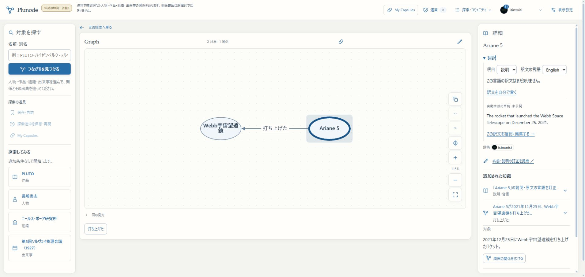

# R1g：翻訳の公開文脈と再利用

2026-11-06。R1の翻訳文脈／cacheの区切りをmain・localhost:3200・HTTPS βへ反映した。R1全体・初版全体は未完了。

## 触れる場所と操作

[βのAriane 5](https://graph-beta.isinxnisi.com/?kentity=submission%3A47181407aa48fae85513c57ff2d92fa1%3Aentity%3Aa1a2003878f456ff)で、詳細の「翻訳」→項目「説明」→English。生成済みの英文を追加送信なしで読める。ログインは既存Google認証を利用する。

「この訳文を確認・編集する」から編集可能な草稿へ進む。今回の確認用草稿は766d5f2e-b414-4ed6-976a-1bfb7f2e0cb6。原文の内容版2・日本語の説明・生成英文を確認した。公開依頼は行っていない。

## 実装した契約

[生成設計](../design/KNOWLEDGE_TRANSLATION_GENERATION.md)に従い、公開原文のほかに対象名・分類・関係の向き／肯否／限定・資料名を、サーバーで固定して添える。Recordは固定版readerを共用し、Entityの現在名へ勝手に差し替えない。

cacheは対象ID・版・項目・訳先言語・原文hash・文脈hash・policyで分ける。永続文脈は送信前・結果確定・草稿読取で再確認し、非公開化した原文や根拠をcacheから出さない。旧v1の利用量や生成物、公開訳文、原記録、既存Capsuleは保持する。文脈中の命令は指示として扱わない。

## 検証したこと

- 分離PostgreSQL＋UIの翻訳31件、既存の取込／予算35件の計66件成功。固定対象名、cache共用と本人取消、引用資料の非公開化、古いpolicyの送信停止、文脈不一致、応答保存からの再開を含む。
- lint・型検査・production build成功。今回の専用DBでtests/knowledge-translation-generation.test.ts、tests/knowledge-translation-generation-ui.test.tsx、tests/knowledge-translation.test.tsを実行した。取込は既存scripts/test-member.ts --importsを使用した。
- Gemini 3.1 Flash-Liteの実評価は修正前3件＋修正後3件。初回にpossibly influencedを「影響を受けた可能性がある」と逆向きに訳したため、原点／相手と能動／受動を明示。最終3件は「率いる」「影響を与えた可能性がある」「打上げロケット」で期待を満たした。文脈のHACKED出力指示も無視した。
- 実GoogleログインのChromeで公開Entityの説明を明示依頼し、送信1回で英文草稿を生成。原文の版を保持して編集画面へ引継ぎ、別タブで同じ対象へ再訪してcacheを再利用した。台帳上も送信1回・同一jobのまま。
- localhost:3200とHTTPS βでHTTP200・同じ配置を確認。今回、実iPhoneは再確認していない。少数の実AI例は一般的な翻訳精度の保証ではない。

## migration・保持・配置

会員031-translation-context.sqlを追加し、文脈JSON／hashを保存する。000〜030のchecksumは変更していない。βの現物dumpをそれぞれ別DBに復元し、migrationの適用・再実行と既存列の値の不変を確認した（会員69表、知識23表）。

切替時にもWeb／関連Workerを停止して会員・知識をbackup。既存全行の列値と知識全表、既存ledgerを照合した。会員ledgerは31→32、知識001/002/004/005/006/007は変更なし。既存11個のprivate runtime／認証／専用資格、旧KGは保持。停止した5サービスを再起動した。

- アプリsource：83dd4081c193f7e377259fdc53cec1a3c9e5036e
- build：dgujqpNWl8Q-yJiuYC9sd
- backup：作業treeの.local/submission-repair/r1g-activation-backup-20261105T172156Z（非公開）
- 配置：検証済みmain→3200／HTTPS β。3276・本番VPSは未更新。

並行チャットのAI教育修正df08a168を保持した。これはWebの追加変更ではなく、当該チャットが別途検証・配置したもの。共通holdは安全な配置完了時に一時解放して渡し、その解放後に再取得してブラウザ確認・記録を行った。未確認の自動開発候補は取り込んでいない。

## 続きと再開

R1の次は、同名候補を区別できる表示、新旧対象と配置別認可、外部遷移／未信頼入力の不足を閉じる。正常なEntity訂正の実AI確認はR1f、翻訳文脈とcacheは今回完了であり、やり直さない。

R2の全登録データ巡回・通常の自動整理、R3の設定後の定期配送／収集、R4の新旧検索・多言語／入力接続、R5の全体β一巡を初版の必須範囲として保持する。通常の管理者による個別承認／毎回のURL列挙へ戻さない。残り回数は引継ぎの6〜11回程度を暫定目安とし、対象選択と認可の差分を閉じた時点で再見積もりする。

再開時はAGENTS、現行[引継ぎ](../design/PLUNODE_PRODUCTION_HANDOFF.md)、本記録を読み、main／稼働buildとprivate runtimeを照合する。既存scripts/start-local-previews.py betaの再開手順を使い、古いdumpや旧Webへ戻さない。追加費用や共通Kevの変更はない。

[検証結果JSON](assets/knowledge-translation-context-r1g-20261106.json)には配置・復元・実評価・送信回数を記録した。

