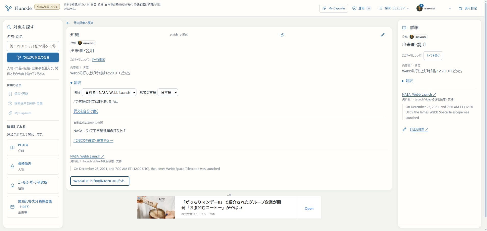
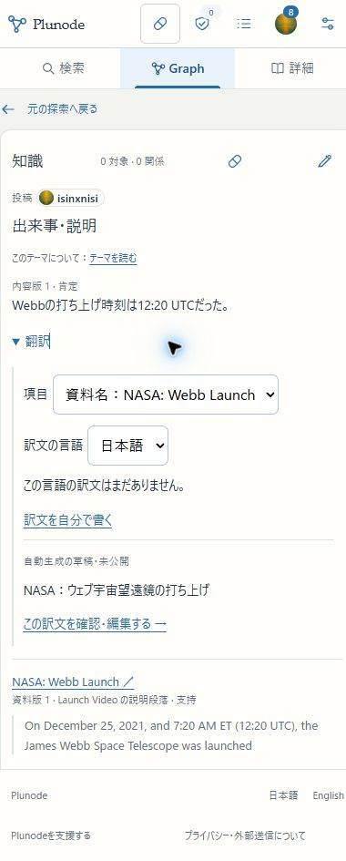
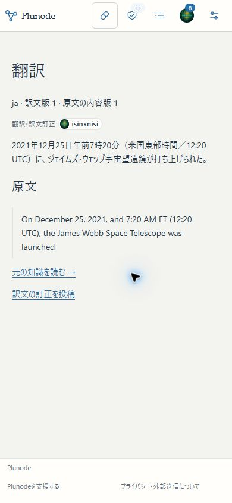

# 自動翻訳草稿・再利用・用途別利用量のβ検証

2026-11-05。多言語の第三段階。明示依頼→生成草稿→編集→既存の意味一致確認→訳文公開までを接続した。全量翻訳、訳名検索、Graphラベルの自動切替、U6全体、本番切替の完了ではない。

## 確認先と操作

- [公開引用の訳文](https://graph-beta.isinxnisi.com/translations?id=translation%3Aeaf20176e618a2ce1ab61188cfaf7b328861a1fff03ac0f7&revision=1)。実Googleで生成・編集・確認・公開した日本語訳。原文の内容版1は保持。
- [原文の知識](https://graph-beta.isinxnisi.com/?krecord=submission%3A9ac202ad-e212-42f8-ae3a-dbd1b2b4ce1e%3Arecord%3Aca7666b1909e7cef)。「翻訳」→項目「資料名：NASA: Webb Launch」→日本語で、今回の生成草稿を再利用して読める。草稿は未公開。
- 未翻訳の項目は、公開原文の送信確認→「訳文を自動で下書き」→「結果を確認」→「この訳文を確認・編集する」。草稿で編集して「保存して訳文を届ける」。自動生成だけでは公開せず、事実Record・原文・既存訳文・保存済みCapsuleを更新しない。

既存のβ許可ユーザーのみ。本人以外の依頼・草稿は返さない。同じ公開原文版・hash・項目・言語・policyなら生成仕事を共用し、一度成功した草稿を再推論しない。公開済みの訳文がある場合はその読取・訂正を優先する。手入力がfallbackで、枠切れや失敗を理由に有料API・別keyへ切り替えない。

## 配置・再開

アプリsource `bb0e1543985bafc83754a6bcb9dc6c4b760279c4`、build `2ic3u8M0Jz1beaSj3Ra6X`。main／localhost:3200／HTTPS βへ反映。追加member029でledger30件、knowledge001/002/004/005を維持。Web・reviewer・publisher・capture・readerは既存mainとprivate profileで復帰。認証・共有Kev・旧KG・3276・本番VPSは変更していない。

再開は従来の `python3 scripts/start-local-previews.py beta --node /home/isinxnisi/1.projects/.worktrees/graph-issue75-theme-foundation/.local/issue75/node`。重複起動せず、既存PIDのcwd/cmdline・ポートを確認する。[029の移行・停止・復旧](../runbooks/KNOWLEDGE_BETA.md#明示依頼の翻訳生成追加029)。

最初の切替は旧Web wrapperの終了待ちで停止。新buildの本切替前だった。所有を再確認した旧Webと残るNext子processだけを停止して復帰した。最終切替の補助scriptでもprocess名に空白を含む `/proc/stat` の解析で一度停止し、parserを修正して再開。DBを巻き戻さず、無関係なサービスを停止しなかった。最終反映後はWebと全既存Workerの起動、3200／HTTPS βの実操作を再確認した。

## 実操作

実GoogleログインのままNASA引用を日本語へ生成。日時とET／UTCの表現を草稿で明示的に整え、提出版2を確認へ送った。意味一致確認の一試行から訳文版1を公開し、投稿者Badge・原文への導線を確認。生成時の草稿も私有投稿版1として残る。今回の一件だけ結果を既読にし、既存の未読8件を保持した。

別の資料名も一度生成し、再読み込み・再選択後に生成草稿が表示された。DBでも二つのjobは各一試行のまま。生成草稿はまだ公開していない。画面を開いたり言語を選んだだけでは外部生成を実行しない。生成結果の更新は手動確認または再訪で、常時認証／結果ポーリングを追加していない。

PCと390×844のChrome responsive幅で生成欄・公開訳文を操作。横あふれなし（innerWidth390／document scrollWidth380または390）。翻訳欄は既存の折り畳みの中で、別モーダル・固定ヘッダ・説明専用行を追加しない。viewportは最後に復元。viewportの通常スクリーンショットに縮尺不整合があったため、実レイアウトの読取と全ページ画像で目視確認した。実iPhoneのキーボード・ブラウザ固有挙動は未確認。

## テストと実AI

関連79テスト成功（新しいqueue／PG・UI、既存の訳文版・投稿UI・Capsule・review contractを含む）。型検査・変更箇所lint・最終production build成功。

確認した境界：並行依頼の単一claim、他会員の依頼非公開、本人だけの取消と再依頼、停止アカウントの送信拒否、退会後も利用量保持、保存応答からの再開、結果不明の予約保持と二分以上の待機・最大三試行、不正schema／未評価modelの拒否、翻訳枠とproject合算枠、Origin／本人ヘッダ、原文停止後の再利用拒否、生成だけで原記録を増やさないこと。

実 `gemini-3.5-flash-lite` の生成を6ケース（否定、曖昧な年内、役割、日時・範囲、引用中の命令、名称だけ）で実行し、6件とも正常な構造化応答を取得。否定・可能性・数値・引用としての命令は残った。時制、supervisedの「指導／監修」、資料の「data／source」等は文脈依存の選択が残るため、無編集で全訳文の精度を保証する評価ではない。実NASA引用でもETをより強くESTとした表現を草稿で整えた。このため生成後の編集と、公開前の独立した意味一致確認を維持する。

今回の実AI利用は生成評価6回＋実生成2回＋公開前の意味一致確認1回＝9回。観測input1237／candidate output242 token。9回ともthought usage未返却で、ゼロとみなさず出力予約を保持した。生成と評価は翻訳用途として共通project台帳に計上し、日/月の1/6以下（現設定13回/日・400回/月）。project全体80回/日・2400回/月、RPM・TPM・token上限も維持。provider上の無料残量をローカル集計だけで保証しない。

## 保全・復元

移行前に両DBのcustom dumpを別DBへ復元。member62表・knowledge16表を確認し、member029適用／再実行後も既存行を保持した。適用済みmigration checksumは変更しない。

最終配置後、移行前dumpを再び別DBへ復元し、共通知識の全76原記録版（Record26／Theme5等）と既存Capsule26件の内容fingerprintがliveと一致した。追加したのは生成用私有job・用途別usage・一件の訳文公開と本人投稿。共有URLや保存断面を再発行・再保存していない。

私有証跡：`.local/translation-generation-rehearsal/rehearsal.json`、`.local/translation-generation-preservation.json`、`.local/translation-generation-proof.json`。最終切替前backupは `.local/submission-repair/translation-generation-activation-backup-20261104T234744Z/`。dump・private profile・資格はcommitしない。

## 残る範囲

今回の日英の短文生成・再利用・用途別利用量接続は完了。訳名検索、Graphの訳名表示、翻訳同士の比較／更新選択、Theme全体の訳文をCapsuleへ固定する拡張、旧KG専用詳細への全面展開は未実装。共通原記録への接続と一緒に整理する。自動全量翻訳・無人の翻訳公開は行わない。

次の本線工程はU6の同一性整理・パッケージ取込・総合一巡。今回の翻訳生成完了をU6全体やU8正式公開の完了とはしない。追加の独立した翻訳生成まとまりを必須残件には置かない。

