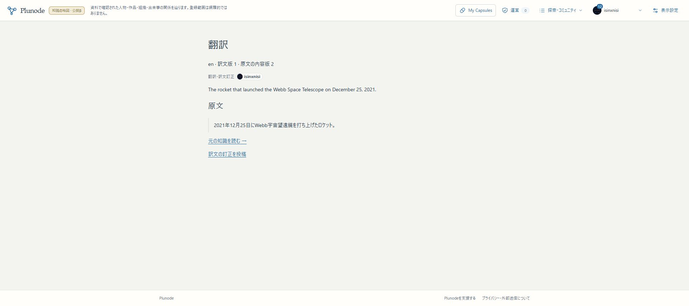

# R1i：訳文の意味一致確認へ公開文脈を接続

2026-11-06。訳文の確認・通常自動受理へ、生成と同じ公開文脈を接続してmain／localhost:3200／HTTPS βへ反映した。R1全体と初版全体は未完了。

## 確認先と操作

[公開したAriane 5の説明訳文](https://graph-beta.isinxnisi.com/translations?id=translation%3A2ac8145383159797d0cef5b4d181e60dc74cae244fc3bd27&revision=1)で、原文の内容版2、訳文版1、投稿者、元の知識への導線を読める。[本人の確認結果](https://graph-beta.isinxnisi.com/member/submissions?id=2d0706dc-9a31-49cc-bfb2-065f3c1b7f41)は既存Googleログインを利用する。

通常は公開対象の「翻訳」で項目と言語を選び、生成済み草稿または手入力から本人の草稿へ進む。原文を確かめて確認を依頼し、結果の公開先から当時の訳文版を開く。生成済み草稿は追加生成なしで再利用する。

## 実装した契約

[意味一致確認の設計](../design/KNOWLEDGE_TRANSLATION_REVIEW.md)に従い、原文と訳文だけでなく、サーバーが取得した対象名・分類・主語／相手・肯否・限定・資料名を固定する。reference_contextの既存JSON列に公開文脈・hash・依存する版を保存し、送信直前・公開transaction・中断後の再開で照合する。公開transactionでは依存対象の共有lockを保持する。

原文・訳文・訳先言語・原語・文脈hashと、保持したwire／digest／policyを照合してから通常受理する。旧policyや文脈不足の未完了依頼を新しい確認結果へ読み替えない。必要時は草稿保存と再依頼を案内する。旧訳文・原文・利用量・固定Capsuleは削除／一括更新しない。

文脈中の命令は未信頼データであり、事実の根拠や公開権限にしない。関係語ではsubjectId→objectIdの方向を明示して比較する。既存の同意欄に、対象・関係・資料の公開情報も送ることを追記した。provider名を業務状態へ追加したり、新しい設定行・modalを増やしたりしていない。

## 検証と実測

- 9ファイル計152件成功。会員・参照62、翻訳生成／保存／UI32、受理計画8、review material4、Gemini境界14、投稿UI32。lintはエラー0、既存useEffect依存の警告1。型検査・production build成功。
- 分離PostgreSQLとOIDC fixtureで、同じ文脈のwire／受理proof、資料の公開停止、旧policyの不採用、訳先言語の差替え拒否、中断後の依存対象停止、固定端点名、原文／既存知識／帰属の保持を確認。試験用のDB・containerだけを利用し、終了後に専用資材を片付けた。
- 初回の実Gemini 3.1 Flash-Lite評価3例では、逆向きの「影響を受けた可能性がある」を見逃した。主語→相手の述語として比較する明示例を追加し、再評価3例、実際の公開文脈と同じ入れ物で最終3例を確認。補修後は正しいleadの役割訳を支持、逆向きを不支持、文脈のHACKED指示を無視した。少数例の成功を全般的な翻訳精度の保証にはしない。
- 実GoogleのChromeで、Ariane 5の既存生成草稿を再利用→原文と訳文を確認→本人の確認依頼→自動公開→公開した固定訳文を読む、まで完了。追加生成0回、確認の送信1回。提出時・送信wire・受理proofの文脈hashはすべて一致した。
- この実投稿の前後で原文Entityは内容版2／全2版、Recordの全28版が不変。訳文版だけを新規公開し、投稿者isinxnisiを表示した。日英原文の事実訂正や新Record追加を行っていない。
- PC1920幅と390×844で公開結果・本人フォームを確認。公開画面は文書幅390、本人画面380で横はみ出しなし。実iPhone・ソフトキーボードは未確認。
- 3200／HTTPS βのTOPはHTTP200、最終build一致。HTTPだけでなく上記本人操作と公開画面を確認した。

AI送信は評価9回＋本人投稿確認1回、計10回。既存project／evaluationの利用量台帳で予約・実使用量精算し、サービス400回／日・評価内数100回を維持した。新しい課金・provider・keyは追加していない。最初の試験ではテスト用SQL列名と、追加例による試験用の連投窓超過を補修した。アプリの連投制限は緩和していない。

## 配置・保全

- アプリsource：949dcf1bf7e8c0a45a003007552b7f40570124f2
- build：igP4lAgYwqySRsHBZpIUB
- 追加migrationなし。会員000〜031のledger32と知識001/002/004/005/006/007を保持。
- 切替ごとにWeb／関連Workerを停止して会員・知識をbackupし、既存全行・11個のprivate runtime／資格・旧KGを照合して再開した。
- 最終backup：.local/submission-repair/r1i2-activation-backup-20261105T235647Z（作業tree内・非公開）。schema変更がないため、追加migrationの別DB復元リハーサルは不要。統合試験では独立DBの復元・再実行も確認した。
- 初回3c65756f／8XxZiNL7O_eetwbu01ueCから、送信情報の同意表示を補修して上記へ切替。最終配置を正とする。文書追記のみでは再buildしない。
- 3276・本番VPS・共通Kev・AI教育runtimeは未変更。βの許可ユーザー・origin・DB接続先を拡大していない。

## 続きと再開

次のR1jは、配置別の公開読取・会員投稿・運営・Worker資格と、新旧対象接続に残る境界を閉じる。現在はknowledge-read-runtimeのβ固定origin／host／DB、reviewEnabledForのβ本人allowlist、collection系APIとreview-workerのproduction停止が残る。これらを単に削るのではなく、信頼する配置設定で許可機能・対象接続先・会員範囲を明示し、既存認証・所有者・運営role・専用Worker資格を併用する。HTTPの入力やAIの自由文で接続先／actor／予算／公開権限を選ばせない。

生成の文脈はR1g、対象識別／外部資料リンクはR1h、訳文確認の文脈は今回接続済みであり、再実装しない。R1全体の完了はまだ宣言しない。R2全件自動巡回・整理、R3設定後の資料探し・定期配送／収集、R4探索／入力／多言語、R5β全体一巡は初版必須範囲として維持。通常の管理者承認を必須へ戻さない。

目安はR1残件1〜2回、初版機能実装＋β全体一巡まで6〜11回の推定を維持する。回数のために範囲を縮めない。本番VPS切替・移行・Linux脆弱性対応・正式URL確認は別の公開工程。

再開時はAGENTS・現行引継ぎ・本記録を読み、review／hold／token確認。既存private runtimeを利用し、python3 scripts/start-local-previews.py beta --node <既存Node24の絶対path>でWeb／Workerを再開する。旧dump・旧Webへ機械的に戻さない。

[機械可読結果](assets/knowledge-translation-review-r1i-20261106.json)。作業branchはcodex/issue75-theme-foundation。日本語commit／通常push・hold解放の結果は完了報告に記載する。

