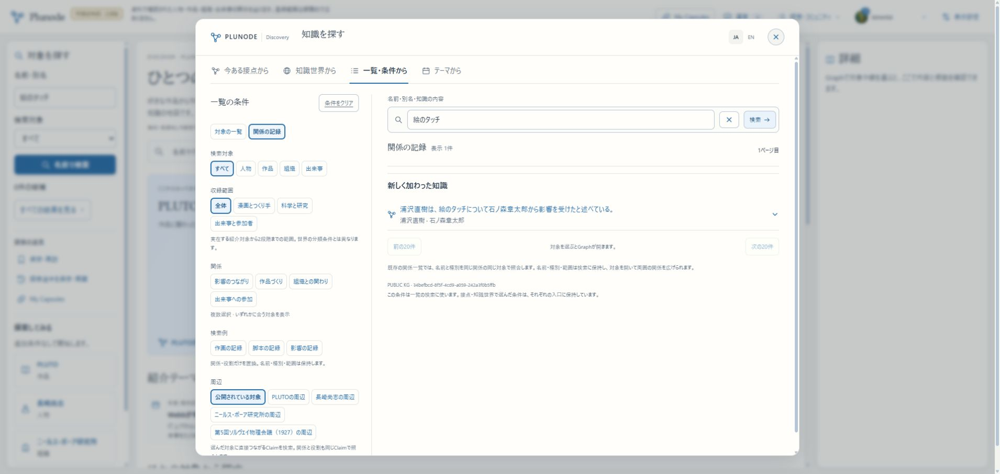
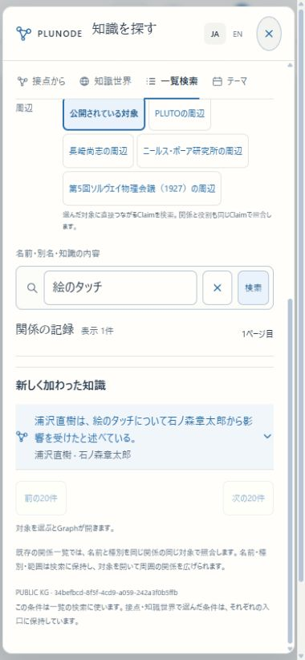

# R4a 通常検索・探索・テーマ焦点の接続

2026-11-07。**R4a完了、次はR4b｜R4はbまで｜全体はR6まで。** R4全体・本運用初版の完成とはしない。

## 確認先と試し方

[HTTPS β](https://graph-beta.isinxnisi.com/)／[localhost:3200](http://localhost:3200/)。

1. 通常の名前検索で「石ノ森」と入力し、石ノ森章太郎を開く。追加された知識・根拠と「漫画をつくる人々」を読む。テーマへ入った対象を選択したまま表示し、「探索に戻る」で元のGraphへ戻れる。
2. 「すべての結果を見る」→「関係の記録」で「絵のタッチ」と検索する。表示1件から本人インタビューを根拠とする関係を開き、URLをリロードして同じ記録を読む。
3. 分類・関係・収録範囲を切り替える。新公開分にも取得前に条件を適用し、続きがある場合は「対象／知識の続きを表示」で読む。

## 実装と判断

旧KGを一括再登録せず、既存検索に新しい公開原本の結果を同じ行表現で接続した。新旧はそれぞれ全件を条件照合してからページングする。旧側は前後の20件、新原本側は「続きを表示」で読む。共通の表示件数は現在読み込んだ行数であり、両ストアを一つの順番へ統合した総件数ではない。片側の取得失敗で別側の結果を消さない。

人物／personなどの既存分類表記を検索時に対応させる。名前・別名には、公開中かつ対象の内容版が一致する訳名を含める。原文は置換しない。関係条件・制作役割・周辺は同じ公開Recordで照合する。紹介対象から2段階の収録範囲を旧KG／共通原本の公開関係から解決し、20,000対象を超えた場合は条件の絞込を要求する。無言で先頭だけを採用しない。

同一対象の判断を近傍・経路・Theme候補へ接続した。判断時の内容版と現在公開されている版が一致するリンクだけを使い、元Recordの端点・旧版・Capsule断面を変更しない。経路中の同一性移動は `identitySteps` に分け、架空の事実関係や追加の関係hopにはしない。リンク解除時は近傍cursorのグループ照合も変わる。

対象からThemeへ `kfocus` を渡し、その固定snapshotに含まれる実IDを選択する。年表の対象ラベルを控えめに強調し、行を絞り込んだり展開したりしない。元探索の条件・位置・表示倍率を保つ。Recordの直リンクは `krecord` として保存する。

## 検証結果

対象63件成功（PostgreSQL／実Neo4jの公開検索19、近傍unit2、workspace21、検索UI4、URL遷移5、公開活動3、年表5、read service2、runtime2）。全体テストを無条件に繰り返さず、変更境界を検証した。対象lint・最終build内の型検査成功。テストDBと専用Neo4jは隔離・終了後整理済み。

βのHTTP確認はTOP、人物名、漫画／科学の収録範囲、同じRecordでの関係条件、知識本文検索、固定公開世代の次ページ、旧Theme版4の14記録保持まで成功。実GoogleのChromeで新しい対象・知識の検索、根拠、直リンク再訪、common対象と既存KG対象からのTheme焦点・探索復帰を確認。commonは115%、既存浦沢直樹は83%の表示倍率を保持した。390×844の検索・詳細表示を確認し、文書幅380で横はみ出しなし。viewportはreset済み。実iPhone／WebKitを確認した意味ではない。

実操作で、範囲検索SQLの曖昧な列参照による503、旧側0件だけを使う件数／空表示、検索結果の不要な余白、直リンク初期のホーム表示、通常Graphからの記録取得をホーム復帰と混同する競合を修正した。最後の競合は回帰テストを追加し、修正後βで検索から根拠まで開けることとリロードを確認した。

## 配置・保全

app `3d40f9ea20f7b9f47798906f4bfd46e36fe481a6`／build `SzWVz9U5EEJUwjunCF1OH` を検証済み固定SHAからbuildし、main／3200／HTTPS βへ反映。日本語の修正commitは通常pushする。文書commitによりmain先頭が進んでも、稼働資材のapp SHAはこの値。

追加migrationなし。会員034まで・既存認証・15のprivate設定を保持。Webと既存review Workerだけを再起動し、他の4 Workerは継続。共通Kev、3276、本番VPS、会員／KGデータのresetは変更なし。今回の確認は公開データの読取りのみ、追加のAI送信0。最終build43.3秒、Node heap3072MiB、C空き最小9,989,853,184 bytes。配置資材の退避先とHTTPの実測は[JSON](KNOWLEDGE_USAGE_R4A_20261107.json)。

## 次回と残る範囲

**R4b**では、時刻・前期後期等の部分期間・周期／定性軸・複数時間・子軸の入力と表示／保存、旧KGを含む翻訳fieldの入口、Theme訳のCapsule固定保存・取得元更新比較、公開文脈とcache条件を閉じる。年表の直接作図だけが明示後続であり、必要なフォームや保存を除外しない。

その後のR5は二実テーマ＋Themeなし・三入力経路・一般会員・共有／コメント／コミュニティ固定・旧保存・新旧publisherの統合確認。R6は本番向け移行・Linux脆弱性対応・正式公開。残り機能側はR4b＋R5で概ね2〜3回、R6は別に1〜2回という見込みで、追加差分に応じて更新する。

再開は既存private設定を使ってmainで `python3 scripts/start-local-previews.py beta --node /home/isinxnisi/1.projects/.worktrees/graph-issue75-theme-foundation/.local/issue75/node`。新しいtokenやDB初期化は不要。手動変更前にはAGENTSのreview／hold／token確認を行う。mainの `memo.txt` と作業worktreeの `.local/` を保護する。
