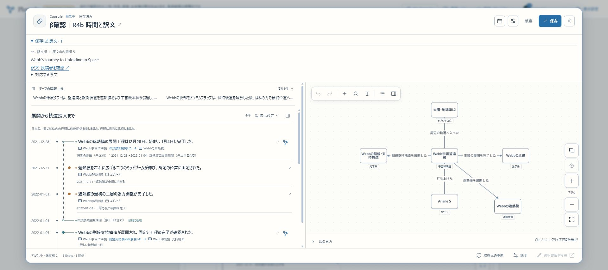
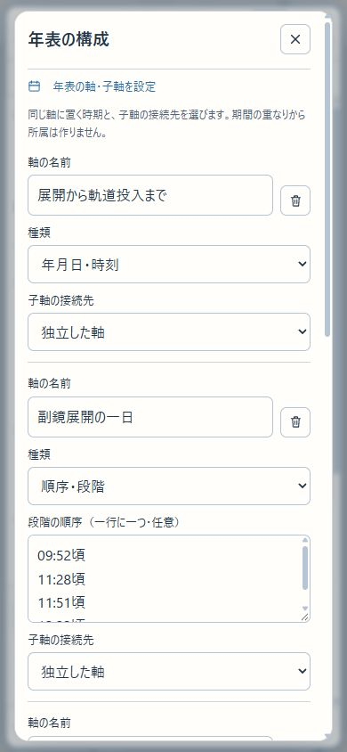

# R4b 時間入力・多言語・Capsuleの利用接続

2026-11-08。**R4b完了・R4完了｜次はR5の統合受入｜全体はR6まで。** 初版全体や正式公開の完了を意味しない。

## 確認先と短い手順

- [HTTPS β](https://graph-beta.isinxnisi.com/)／[localhost:3200](http://localhost:3200/)。本人ログインはHTTPS βを使う。
- [確認用Capsule](https://graph-beta.isinxnisi.com/member?capsule=54059647-872e-4b4a-a2e3-0c7369a6c72f)：本人の「β確認｜R4b 時間と訳文」。非公開の保存物であり、他の会員へ閲覧範囲を広げていない。
- [公開した英語のテーマ訳・版1](https://graph-beta.isinxnisi.com/translations?id=translation%3A984b743591a6642b9c622c011e5636e2724c35552f31c02f&revision=1)。原文はWebbテーマの内容版5。

1. 確認用Capsuleの「保存した訳文」を開き、原文内容版5／訳文版1と英語の題名を読む。
2. 「編集」から関係の時期を開く。打上げの時刻 `2021-12-25T12:20Z` に加え、仮想と明記した周期・定性軸・1991年前期の表記がある。実資料にない仮想注釈を本線KGへ登録していない。
3. ヘッダの設定アイコンから「年表の構成」を開く。子軸は打上げの特定の時期に接続する。編集を試して破棄できる。
4. 「取得元の更新」で「テーマの英語訳も探す」を選ぶ。公開された訳文だけを比較し、選んだ訳文を草稿へ取り込む。保存と共有への反映は別操作。

## 実装・判断

[時間入力と固定保存の契約](../design/KNOWLEDGE_TIME_INPUT_R4B.md)を現行仕様とする。

- 年月日・時刻・offsetを共通の暦パーサーで検証する。精度と原文字列を保存し、時区未指定をUTCに変えない。時区指定と未指定を同じ軸へ混在させない。表示は年／月／日／時間、分秒の原値は保持する。
- 「前期」「頃」は原資料の表記として保持し、根拠のない月日を補わない。時点、続いた期間、発生時期の幅、不確かな境界の区別を維持する。
- 会員投稿・Capsule関係編集・運営の記録登録／訂正で時期フォームを共用する。複数時期、周期の折返し、定性軸を入力できる。ThemeとCapsuleの年表構成から配置・順序・特定time IDへの子軸を指定する。直接作図は引き続き後続。
- Capsuleの独自時期・配置は取得断面とは別に保持する。親時期を外しても、子軸を別の時期へ勝手に付け替えない。
- Themeの原文・内容版を断面に保存し、訳文の対象原文とサーバー正本を照合する。新しいTheme訳の言語選択と明示取込を追加。元の版に対する旧訳を新原文へ流用しない。
- 旧KGの対象・関係からも翻訳へ入れる。初回準備は公開原文をサーバー側で再照合して固定参照する。ログイン・Origin・機能認可を守り、クライアント原文を採用しない。準備済み原本と訳文は従来の公開範囲で読み、本線KGは変更しない。
- Recordの該当箇所、Themeの名前／説明を含む対応fieldへUIから到達できる。翻訳の公開文脈・hash・cache・意味確認はR1g/iの既存契約を使う。全量の自動翻訳は始めない。

## 検証結果

変更境界のテストは累計104件成功。最初の102件に、Theme自動追加の時区分離と作成後の新訳文取込を各1件追加した。後者の最終差分では更新比較9件＋年表構成UI2件を再確認した。既存のtranslation-generationのDB条件付き17件はこの実行ではskipであり、成功件数に含めない。R1の既存実DB／実AI記録も活用し、無関係な全体再実行を追加していない。

対象：calendar-clock、calendar-graph、theme-time、theme-timeline、knowledge-timeline、capsule-knowledge、capsule-knowledge-updates、capsule-time-fields、knowledge-input-draft、knowledge-r4b-storage、capsule-updates-route、theme-timeline-ui、knowledge-timeline-fields、translation-generation。Vitestは `.local/**` を除外する。そこに残る過去の再現用ソースを現行テストとして拾わない。

独立PostgreSQL `plunode_knowledge75_test_r4b_f168eb56` で、Theme訳文版1の固定／版2との比較、正本改ざんの拒否、非公開Themeの404、サーバー原文からの旧KG準備、書込直前に元資料が変わった場合の拒否を確認。Neo4jへの書込は行わない。テストDBは稼働β DBと分離している。

関連lintと型検査込み最終build成功。最終build91.7秒、Node heap3072MiB、C空き最小6,160,719,872 bytes。追加migrationなし、適用済みchecksumは変更していない。

## 実Google・実操作

Chromeの既存本人セッションで次を確認した。

- 通常ThemeからCapsule作成、時刻・周期・定性・原表記を入力、特定時刻への子軸配置、明示保存、保存一覧から再訪。
- 保存先20件の上限を検出し、既存の検証用「β操作確認・PLUTOの関係図（再編集）」1件だけをごみ箱へ移動して再保存。通常の復元が可能で、完全削除はしていない。
- 公開Webbテーマの英語訳を既存生成経路で下書きし、人が題名を調整、通常の確認を経て自動公開。生成案は “Until Webb Unfolds in Space”、公開題名は “Webb’s Journey to Unfolding in Space”。原文は変更していない。
- 作成済みCapsuleで英語Theme訳を探し、原文内容版5／訳文版1を選択して取り込み、保存版2へ保存して再訪。独自に編集した関係の時刻・配置を保持。比較中に見つかった通常のRecord更新も明示操作で取り込んだ。
- 旧KGのPLUTO詳細から名前・説明・別名の翻訳入口、浦沢直樹→PLUTOの記録から本文・関係語・範囲・該当箇所・資料名・書誌の入口を確認。これらの原本準備だけではAI生成しない。
- PC幅1920、390×844で保存物と年表構成を確認。390px時の文書幅380、横はみ出しなし。viewportはresetし1920へ復帰。実iPhone／WebKit確認とは区別する。

実操作で、作成後のTheme訳を既存Capsuleへ取り込む入口の欠落、軸名入力のcontent-boxによる削除ボタンとの重なり、訳文展開時の分割枠の暗黙行が内容高まで伸びる問題を修正した。最後は関係図の高さ480px、分割枠524pxで枠内に収まることを実DOMと画像で確認した。





## 配置・保全・再開

実行ソース `037ee63e8722f32260a87b9b4fdec8d0cd6a6b23`、build `QqlZmk4g9xc1ZmjOk7vXl`。mainへFFし、3200／HTTPS βへ反映。文書commitでmainが進んでも実行資材のsourceはこのSHA。配置の実測値は[JSON](KNOWLEDGE_USAGE_R4B_20261108.json)。

既存の16のprivate設定・Google認証をhash照合して保持。時間schemaを使うWebと既存5 Workerを同じソースへ揃えた。会員migration 000〜035は不変、今回のDB更新は通常の検証操作と公開原本の準備だけ。β DB・会員DB全体のreset、VPS、3276、共有Kev、AI教育・日次予定、収集用ChatGPT会話／予定の変更はしていない。

再起動時はmainで既存launcherを使う。NodeはこのPCの `.local/issue75/node` にある。

```sh
cd /home/isinxnisi/1.projects/7.graph-knowledge
python3 scripts/start-local-previews.py beta --node /home/isinxnisi/1.projects/.worktrees/graph-issue75-theme-foundation/.local/issue75/node
```

既存のprivate profileからWeb・5 Workerを再開する。認証・資格・計画・利用台帳を作り直さず、再開のためのmigrationやbuildは不要。HTTPSが落ちている場合は、アプリの3200応答と既存tunnelを分けて確認する。

容量整理では、非稼働の古いbuild-source内で `git archive` とバイト一致した再生成可能なソースだけ26,455ファイル／1,494,473,421論理bytesを除去した。秘密設定・DB・volume・稼働資材・差分は保護。fstrim後もCの物理空きは即時には増えず、この値を物理回収量としない。WSL停止やVHD圧縮は今回行っていない。

## R5へ引き継ぐこと

R4a/bの機能接続を前提に、R5は二つの実テーマ＋Themeなし、三入力経路、一般会員、異言語訂正、共有・旧版コメント・コミュニティ固定、旧保存、新旧publisherの切替／復旧を横断して確認する。今回の代表確認を全組合せの確認済みへ拡大しない。新しい管理者承認や全件AI完了待ちは追加しない。

R5は概ね1〜2回、R6は別に1〜2回という推定。差分が増えた場合は現在地と分母を更新し、回数へ合わせて要件を削らない。R6でLinux脆弱性対応、本番向け移行、正式URLでの確認を行う。
