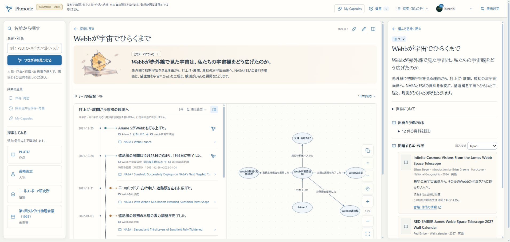
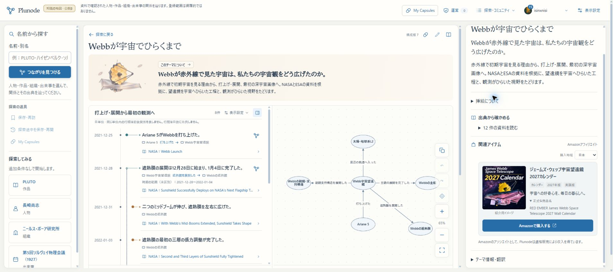
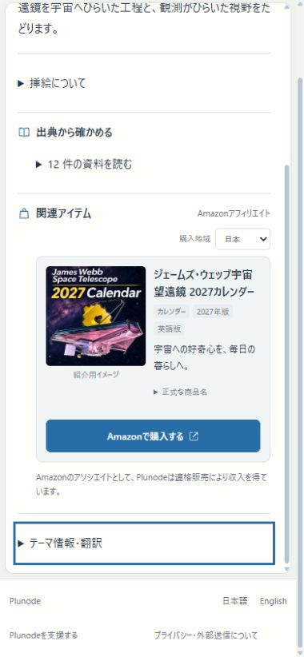
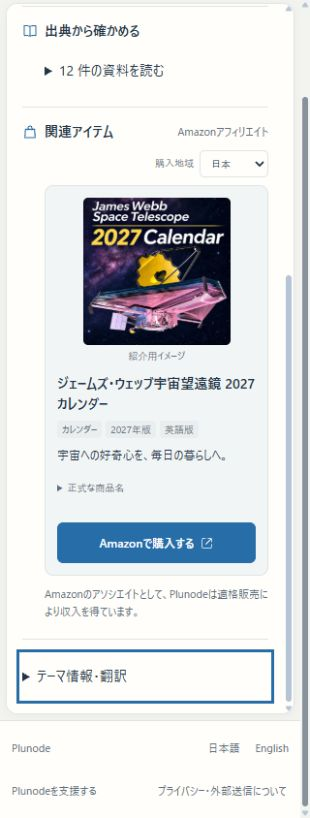
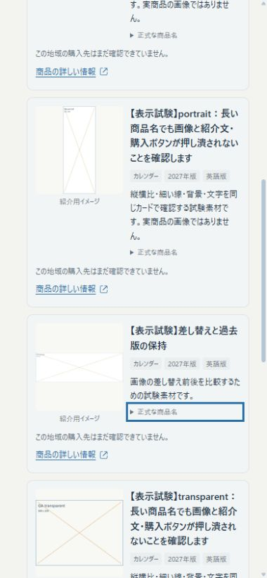
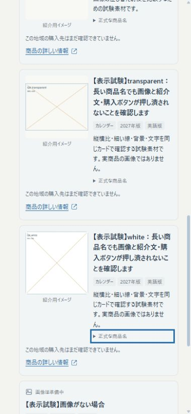
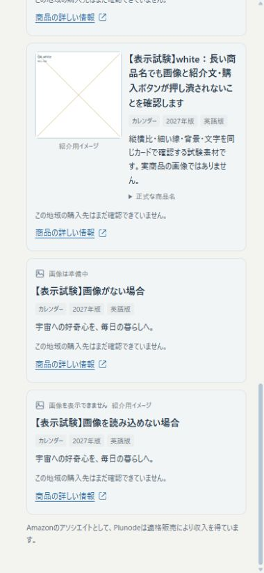
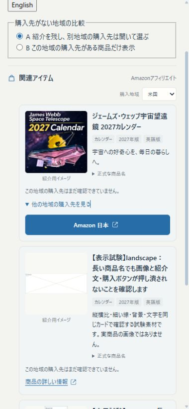
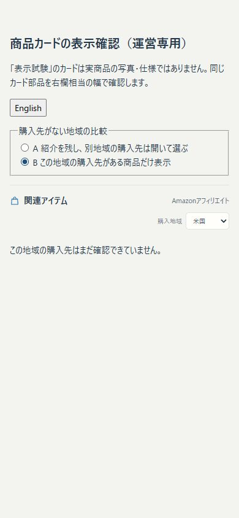

# 商品カード・運営画像登録の検証（2026-11-10）

## 現在地と確認先

①確認→②実装→③ローカル／HTTPS βの登録・表示確認まで実施。本番VPS・正式Appは変更していない。デザインの採用判断とは分け、今回の動作と見た目をここに残す。

- [通常のWebbテーマ](https://graph-beta.isinxnisi.com/t/reading-20261110%3Awebb%3Atheme)：右上の本アイコン／「このテーマについて」→詳細の「関連アイテム」。スマホも同じ操作。テーマ構成版7、商品 `calendar:B0GMV4CK32` 版4。
- [英語](https://graph-beta.isinxnisi.com/en/t/reading-20261110%3Awebb%3Atheme)：同じ内容の英語表示。
- [運営限定の比較](https://graph-beta.isinxnisi.com/operations/product-preview)：既存運営ログインが必要。縦長・横長・白背景・透過・長い名前・画像なし・読込失敗、地域A/Bを確認する。試験カードを通常の商品欄に混ぜない。
- ローカルは同じパスを `http://localhost:3200` で確認できる。API・DB境界は既存β設定を使う。

実装契約・API例・再開は [設計と運用](../design/PRODUCT_CARDS_OPERATOR_IMAGES_20261110.md)。自動試験の秘密値を含まない結果は [JSON](PRODUCT_CARDS_OPERATOR_IMAGES_20261110.json)。

## 変更前後

変更前は小さな書籍用プレースホルダーと長い情報の列、細いリンクに寄っていた。変更後は画像→短い商品名と魅力→幅のある購入ボタン。見出しのアフィリエイト表示、参加者表示、紹介イメージの識別を含めた状態で確認した。

変更前（同じテーマの右欄）：

変更後（通常の詳細欄）：

390pxと320px。狭い欄では画像と本文を縦に切り替え、本文を押し潰さない：

## 接続と確認の区別

|経路|結果|
|---|---|
|HTTPファイル投入|実際のPOSTへmultipartのファイルとmetadataを送り、既存会員セッション・運営権限・Origin照合を通して登録。画像IDを取得し同じ受付の再送が不変であることを確認|
|商品登録／テーマ更新|同じ運営サービスを呼ぶMCP transport handlerで `upload_product_image`／`save_product`／`read_product`／`update_theme` を試験。商品版をテーマへ固定して通常publisherの公開まで確認|
|通常の画面|Chromeの既存GoogleログインでHTTPS βの右欄、390／320px、英語と日本語、正式名の閲覧手段、購入リンクのDOMを確認。画像はCreators未設定のまま表示|
|実ChatGPT Appの新操作|未確認。このチャットの接続済み正式Appは従来ツールのまま。βサーバーの実装・handler試験を、ChatGPTのOAuth接続や新ツール取得の完了とは扱わない|
|Creators API実接続|未確認・未設定を維持。資格取得や外部登録をせず、登録済み画像＋購入先で成立させた|
|本番|今回の反映なし。別途公開承認後にmigration039・Web／確認Workerを配置する必要がある|

HTTPの試験は、activeな既存運営アカウントに短命の内部試験セッションを発行して通常の認証検査を通した。GoogleのパスワードやCookieを会話に出していない。確認用の短命セッションはfinallyで削除。Capsule保持試験には使い捨てfixture会員を用い、既存ユーザーのCapsuleは削除していない。fixture会員は既存の退会サービスで終了処理した。

## 画像の実測

容量はbytes。出力はWebP。縮小派生は長辺640px以下、元の縦横比を保持する。正方形ファイルへ変形していない。

|素材|入力寸法|入力容量|保存寸法|保存容量|表示派生容量|
|---|---:|---:|---:|---:|---:|
|添付カレンダー紹介画像|1254×1254|2,650,053|1254×1254|338,320|120,380|
|縦長の文字・細線試験|600×1600|44,679|600×1600|20,492|6,392|
|横長の文字・細線試験|2400×800|51,256|1600×533|17,516|4,802|
|白背景|900×900|15,337|900×900|15,680|8,682|
|透過|800×600|22,168|800×600|16,994|25,056|

添付素材の本体容量は約87.2%減。小さい白背景や透過の派生では、WebP出力が入力や別サイズより若干大きくなる例も確認している。一律に全ファイルが小さくなったとはしない。上限内で文字と細線、alphaを保つ方を優先した。

Chromeで実画像と試験画像を表示し、PCの画像枠136×136px、390px欄で128×128px、320px欄では縦積み152×152pxを確認。縦長画像がintrinsic sizeによって128×341pxへ拡張される不具合を途中で発見し、枠内の配置を修正後に全形式が1:1となることを再測定した。`object-fit:contain`、縦長240×640、横長640×213の派生を読み、切り抜きなしで表示している。

## 地域が未対応の場合

Aは紹介を残し、別地域の販売先は利用者が開いて選ぶ。ボタンに「Amazon 日本」等を明示し、米国の商品であるように見せない。Bはその地域で購入先があるものだけを表示する。正式採用は未決で、運営比較画面に残した。購入先のないカードに架空の価格・在庫や無効な購入ボタンを作っていない。

## 保全・境界・検証

- 039適用前にβ会員DBを `.local/product-assets-20261110/member-before.sql.gz` へbackup。既存の知識DBmigrationは変更せず、会員DBへ画像・商品・受付・自動整理の5表を追加。
- 同じ `requestId` の再送は同じ画像ID、別内容の再利用は拒否。匿名401、別Origin403、SVG400をHTTPで確認。
- 画像は不変、商品版とテーマ版も追記。旧テーマ構成版3の原本・既存知識を保持。画像差し替え用の別QA商品／別QAテーマも同じ経路で登録し、旧版1→新版3の旧画像と新画像が両方200で読める。
- Capsule作成・保存・固定版読み戻し、共有発行→200→停止→404を通常APIで確認。商品を更新しても保存済みの旧商品ピンは変わらない。
- 商品だけの更新後も、チェック済みの読書導入・SEO用プレゼンテーション・英語版を継続表示。テーマ本文や知識を変更した場合まで流用するものではない。
- 未参照fixtureだけを8日前にして自動整理を試験。猶予を越えた未参照は削除、参照済み画像は保持し、同じ失効済みアップロードの再送から再作成も確認。
- Creators未設定、設定ファイル不在・JSON不正、通信失敗・欠品を単体で分けて試験。有効な運営購入リンク・運営画像は外部取得失敗から切り離した。Amazon画像をアップロード処理へ送るURL取込経路は用意していない。
- 機能関連の48テスト成功、既存のDB条件付き16テストはskipとして区別。TypeScriptを含む公開用build成功。変更TS／TSXのlintはerror0（最終mockも警告0）、差分空白検査成功。
- 確認スクリプト `scripts/test-product-assets-beta.ts --confirm-beta` を終了コード0で再実行。内部fixture会員の直接DELETEが既存FKに阻まれた途中失敗は、既存退会サービスを使うfinallyへ直して確認した。元の会員やCapsuleは対象にしていない。
- 動作中の共通Kevを変更せず、今回の検証のために外部AIへ追加送信していない。

## 反映と再開時の注意

βの最終buildは後述の最終結果に固定する。3200とHTTPS βは同じWebを使う。確認Workerは今回の素材GC実装を読み込むソースで再起動済み。既存collection／reader／patrol／publisherとコンテナは継続利用する。

配置途中、旧NextプロセスがSIGTERM後もkeep-alive接続を保持し、WSLからは正常、Windows／Cloudflare経由では旧プロセスの失敗が混ざった。CWD・親子PID・コマンドを照合した旧β Web子プロセスだけを終了して復旧。WSL全体・共有Kev・Cloudflareは再起動していない。以後の配置では旧Webの終了と接続の排出を確認してから新Webを起動した。

Turbopackの`pg-*`／`sharp-*` aliasは、隔離buildを移動する際に実node_modulesを指すことを確認する。build成功だけでruntimeの依存解決を完了としない。

前回のテーマ閲覧デザイン全体の合格を今回の商品カード確認で代替しない。実ChatGPT新操作・Creators実接続、本番配置は未確認／未実施として残す。

## 最終配置結果

2026-11-10の最終β build `zOd5nbdXYX3d0CrC9Mg14`。ローカルの日本語／英語テーマHTMLと商品JSONは200、HTTPS βの同じ構成版7で画像136×136・containと有効な購入先を再確認。比較操作の幅変更は解除済み。紹介文・挿絵・日英SEO・8件の年表／関係図は同じテーマに残る。

本番は既存公開版を継続し、今回のmigration／Web／Workerは未反映。公開用資材の作成・転送はしていない。
