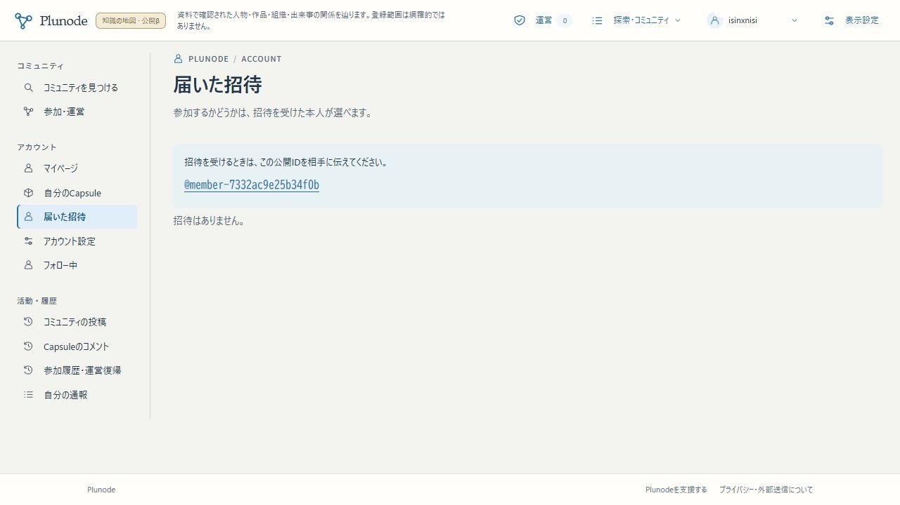

# Issue #39・010と招待公開ID対応のmain／beta受入

2026-10-26 JST。ユーザーの[同梱指示](https://github.com/isinxnisi/graph-knowledge/issues/39#issuecomment-6400053458)に基づく受入。既存betaのGoogle認証・専用PGを使用し、正式VPS／正式会員DBは操作していない。

## 固定した実装

- 独立worktree：`/home/isinxnisi/1.projects/.worktrees/graph-issue39-corrections`、branch `codex/issue39-initial-corrections`。
- 固定実装：`71b61fb0a54f57e15798f96e800dff86e4c73485`。初期修正 `9c357ef`、表示の修正 `ce0b424`、招待公開ID対応 `71b61fb` をまとめて受入。
- main受入commit：`d514b9cb0abc9840a254b9a190c0220acedaed16`。受入前main/origin/main `30ffa72`、並行未受入Autopilot commit 0件。固定SHAをmergeし、main／作業branchを通常push済み。
- 配信build：`omVu8EDJfIyAox7r8SYAw`。候補worktreeの型検査込みbuildと、main受入後のapp/components/lib/db/scriptsの差分なしを照合し、同じbuildをローカル3200へ配置。HTTPS betaでもbuild一致を確認。

新migrationは010だけ。000〜009のbytesとDB checksumを保持。招待のための新migration・検索・エンドポイント・feature flagは追加していない。

## 招待の変更と検証

本人の「届いた招待」は公開 `@handle` を押すとコピーでき、プロフィールと共通部品を使用する。管理者の既存招待POSTの `userId` はUUID互換を保ち、`@handle` を追加で受け付ける。権限・期待revision・既存60回/時のquota確認後にactiveな人間Userへ解決し、User→Profile→Communityの順でlockと再確認。解決失敗もquotaを消費する。内部のUUID宛先と承諾・失効条件は維持。発行後のhandle変更で宛先を変更しない。AI、不明、停止、退会、旧handleは同じエラーで拒否する。

| 確認 | 結果 |
|---|---|
| 全単体 | 71 files / 856件成功 |
| 010・公開境界・フォロー・招待の実PG/実OIDC | 26件成功 |
| 既存会員 / コミュニティ / 安全対策 / 運営 | 33 / 29 / 14 / 14件成功。実DB合計116件 |
| 招待の画面往復 | JA/1440/light、EN/390/dark-blue。本人IDコピー→管理者入力→発行→本人承諾が成功 |
| 再取得の画面回帰 | 30秒再取得時の見出しDOM保持・実Clipboard・503/404・再試行が成功 |
| 静的検査 | 変更箇所lint、型検査込みwebpack build成功 |

招待の追加試験では、UUID・大文字/空白handle、匿名/別人/管理権、AI・停止・退会・引退済みhandleの同一エラー、失敗時quota、二重招待、取消/承諾、旧cohortへの非付与、期限・issuer参加世代・対象停止、ロック待ち中のhandle変更を検証。作成者表示の補修後にも26件・29件・招待画面2条件を再確認した。

開発サーバーの初回コンパイル待ちで再取得画面試験が失敗したため、既存ログイン試験と同じく実APIを事前取得して再試験し成功。各成功を合わせた記録であり、全画面条件を一括実行したとの主張ではない。[隔離評価の詳細と画像](PUBLIC_ACCOUNTS_INITIAL_CORRECTION_20261025.md)も参照。

## betaのDB移行と保全

既存WebのPID・cwd・開始時刻・設定を確認し、Web停止後にprivate custom dumpを作成。別名・networkなしの使い捨てPGへrestoreし、旧29テーブル全行を照合。そのコピーへ010を適用して保全条件を確認後、beta専用55433のPGへ既存の明示migration CLIで適用した。

- dump SHA256：`d0c6b43aa8e0bd295e6f342be91631a2c96fe1e10d3dfb7bc87779323e8f373b`。
- 旧000〜009のledger/checksumを維持、010後は11件。再実行が無変更で成功。
- 既存列・認証識別子・Capsule・共有・コミュニティ本文/status/日時/audience・招待・監査・AI・follow/claimを保全。本人保存済みプロフィールの全列とfalse/revisionを保持する検査を実施。
- User.nameは既存プロフィールの本人設定名、または有効な旧名／固有仮名への意図した整合だけを許可。欠落プロフィールを一意に生成。旧活動の公開由来は推測で公開しない。
- Google等20設定と `.env.public` のbytesを維持。fixtureへの置換なし。公開KG revision `82b01515-594c-48ca-b4b6-515eefac83ca` を維持。

private控え：`~/.local/share/plunode-backups/issue39-010-20261026/`（0700）。dump、移行前後の比較、復元・Google・HTTPの結果、旧build `wB2V-kS7P7DtuvvrE0q8g` を保存。秘密設定・SQLの個人データはGitへ入れていない。復旧は[運用手順](../runbooks/PUBLIC_ACCOUNTS_RELEASE.md)に従い、010を保持して公開プロフィールをoffにし旧buildへ戻すか、修正版へroll-forwardする。旧009投影を010の上で再有効化しない。DB restoreは別DBで再照合し、backup後の停止・退会・失効を再適用する。

## betaの実認証・実UI

通常のGoogleボタンでログアウト→Googleログイン→beta復帰を実施。新しいsessionがGoogle accountに対応すること、fixture accountなし、選択済みの名前と全プロフィールが再ログイン後も変わらないこと、既存Capsuleが保持されたことをDBでも確認した。

本人メニュー先頭マイページ、自動プロフィール、編集の単一表示名と公開設定、本人ヘッダーの同じアイコン、保存済みCapsule 2件、既存公開会話の人物リンク・管理非表示、届いた招待の公開IDコピー、フォロー画面、運営受信箱を実UIで確認。招待発行・承諾の成功経路は隔離実OIDCで検証した。

AIラボは実推論0・追加学習0・非AI比較5・保留2を維持。記録 `41cd2d6f-e9b5-49ef-9cc9-ede5077d6a59` → Graph（3 Entity / 3 Claim / 2 Relation）→同じrun/filterへの復帰を確認。元のAI実験branch/worktree・Kev・不変artifactへの変更なし。

ローカル/HTTPSの代表14 HTTP経路でbuildとGoogle providerを照合。匿名の会員・招待APIは401、公開プロフィールはno-store・内部User UUID/メール/画像なし、限定コミュニティ/cohortは404を確認。公開境界の組合せは上記実DB試験で検証した。

## 確認先と残件

- [届いた招待・公開ID](https://graph-beta.isinxnisi.com/communities#%2Finvitations)
- [プロフィール編集](https://graph-beta.isinxnisi.com/member#profile) / [アカウント設定](https://graph-beta.isinxnisi.com/member#account-settings)
- [日本語の見習い](https://graph-beta.isinxnisi.com/people/explorer-apprentice) / [English profile](https://graph-beta.isinxnisi.com/en/people/explorer-apprentice)
- [コミュニティ](https://graph-beta.isinxnisi.com/communities) / [AIラボ](https://graph-beta.isinxnisi.com/ai-lab#apprentice)

既存AI worktree `graph-ai-lab`（`af31afd`）、`graph-ai-lab-publication`（`02bf1c5`）とmainの未追跡 `memo.txt` を保持。Autopilotの未受入commitや他作業のdirtyは取り込んでいない。正式VPS・正式会員DBは未変更。正式公開前の残件は実機iPhone/Safari、正式環境のbackup/010移行・復旧確認と配備判断。今回のbeta受入・Google確認は完了。
