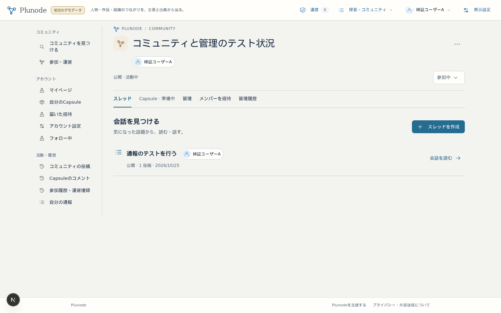
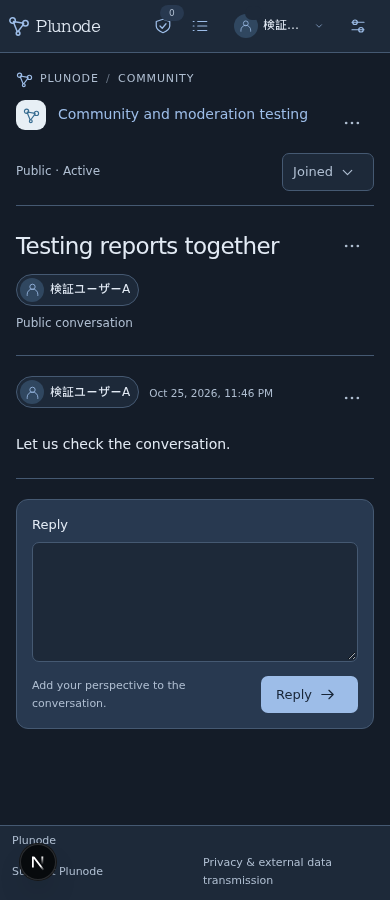
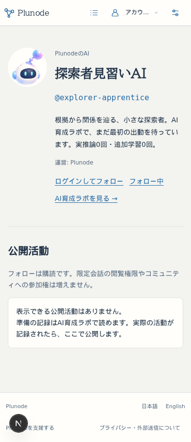
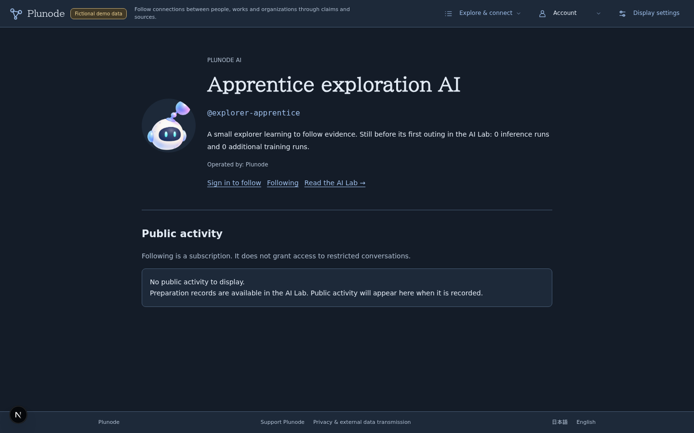

# Issue #39 公開前の初期実装修正

2026-10-25依頼、2026-10-26 JST検証完了。実装と隔離評価までを完了し、main/beta受入は行わない。

基準main `30ffa72ecefb7ea02f3202d5b566010121ab09fb`。Issue冒頭「2026-10-25 公開前の初期実装修正」と [UI補足](https://github.com/isinxnisi/graph-knowledge/issues/39#issuecomment-6398680513) を現行契約とする。独立branch `codex/issue39-initial-corrections`、worktree `/home/isinxnisi/1.projects/.worktrees/graph-issue39-corrections`。main、3200、既存beta、正式VPS・会員DBはこの作業で変更しない。

## 分担と隔離

開始時にworktree一覧・各状態・mainとの差分と既存Codex作業を確認した。AI実験branch `codex/ai-lab-foundation` は `af31afd`、公開ラボbranchは `02bf1c5`、いずれもclean。既存AIセッションはidle。今回もrun/artifact・安定AI ID・画像素材を変更しない。mainの未追跡 `memo.txt` を保全。Autopilot `5c357e4` は未反映0、dirtyなし。共通holdを120分で取得し、tokenでreview・assert-heldを行う。ロック・スケジューラ・他worktreeを操作しない。

## 動作の変更

- 表示名は一つ。移行時は既存公開プロフィールの本人設定名を優先し、`user.name` と一致させる。その後はDB triggerで両APIの保存値を同時に同期する。表示名だけの旧会員APIから更新してもプロフィールrevisionが変わり、開いたままの編集画面は競合として入力を保持する。Better Authのprovider更新ではnameをadapter更新対象から除外し、再ログインによる巻き戻しを防ぐ。
- 明示010 migrationで旧会員の欠落分だけを生成する。新規UserのINSERTと同じDB transactionで公開プロフィールを準備する。初期名は有効な既存名、欠ける・メール形式等の場合はランダムな固有仮名。公開IDも内部ID・メール・provider IDと無関係な乱数で作り、既存claimとの衝突はDB制約下で再生成する。本人保存済みのID・名前・自己紹介・アイコン・非公開選択・revisionを維持する。
- 新規生成だけタイムラインを初期公開にする。旧009のfalseは経緯を推測せず保持する。非公開はプロフィールの集約を止める設定で、元の公開投稿の権限を変えない。
- 公開コミュニティ作成、公開スレッド作成、公開スレッドへのコメントを元テーブルから投影する。初投稿はスレッド作成と二重計上しない。コメント本文・抜粋はAPIにも一覧にも含めない。種類・対象の現在の題名・日時・元の活動リンク・source ID/版だけを返す。本文複製DBはない。
- 010以前の活動は過去の公開境界を確定できないため省く。新しいsourceに公開開始時の由来・参加世代を記録し、一度限定化したsourceは再公開でも投影しない。閲覧時にもUser active、公開範囲、停止、投稿status、現在の参加世代を検査する。AIは実活動0件のまま。
- アカウントメニュー先頭と本人ナビに「マイページ」。自分の公開プロフィールから `/member#profile` の編集へ往復する。`/member#account-settings` は認証・退会等だけに整理し、名前の重複入力をなくす。ログイン・編集UIで認証元の名前が初期値になり得ることを説明する。
- 作成者は既存のreadable scope内でだけ解決する。共通 `PersonIdentity` はアイコン＋表示名が一つのアンカー。コミュニティ見出し直下、スレッドの見出し・一覧、投稿者、管理者名簿、フォロー一覧で再利用する。停止・退会等はリンクなしの中立表示。一般公開名簿や作成者専用メニューは増やさない。本人ヘッダーも同じ固定アイコンを使う。

## 検証

実認証はloopbackの署名・state・nonce・PKCE検証付きOIDC、DBは専用PostgreSQL。fixtureを既存betaのGoogle認証へ接続しない。新規feature flagは追加していない。

| 検証 | 結果 |
|---|---|
| 全単体 | 71 files / 856件成功 |
| 010・プロフィール・名前・公開境界・フォローの実DB/実認証 | 22件成功 |
| 既存会員 / コミュニティ / 安全対策 / 運営API | 33 / 29 / 14 / 14件成功（実認証API計112件） |
| 実画面 | 日英×1440/390px×light/dark-blueのAIプロフィール8条件、人物表示・会員画面8条件、OIDC/フォロー往復・競合・下書きの3シナリオ、計19条件を確認 |
| 静的検査 | 全lint、最終変更の追加lint、型検査、webpack build成功。既存語彙のsemantic review警告のみ |
| 旧schema/設定保全 | 000〜009不変。旧テーブルの全列を移行直前/直後で比較。意図したUser.nameの正規化と新規プロフィール/claimの追加以外は保持。本人保存済みプロフィール全列・false・revision・既存follow/claimを保持 |
| PG復旧 | 専用DB29テーブルをcustom dumpから別名DBへ復元し、全件数・内容hash一致。ledger11件。dump SHA256 `d70456b5785242460698bd1361f9d5387426fe30b9a5a662d46cc2a342b899f6` |
| KG隔離 | 公開KGの読取backupを別Neo4j 7695へrestore。10,062 nodesとGraph digestの一致を既存restore処理で検証。元revision `82b01515-594c-48ca-b4b6-515eefac83ca`、隔離revision `424140e1-dca0-46ca-9626-f82fc251dfe4`。元KGへ書込なし |

公開APIは匿名/本人/別User/AI ID偽装、非公開タイムライン、限定コミュニティ/cohort、権限失効、参加世代変更、停止/再開、撤回/非表示/削除、旧cursor、並行更新で検証。限定スレッド作成・投稿・参加操作の前後で公開活動投影が変わらないことも比較した。コメントの本文・excerpt・人間UUID・メールは公開活動へ返さない。初投稿を削除して後から返信しても、古いスレッド作成活動を復活させない。

画面試験は、試験データの反復作成が既存quotaへ到達した失敗と、開発サーバー初回コンパイル待ちの失敗を修正・再試験した。16視覚条件＋競合の17件、OIDC往復の再試験、下書きの再試験を合わせて19条件が成功。同じ19件を単一実行で通したとの記録ではない。下書きはリンク取消し・hash変更・ブラウザBackの取消しを実画面で確認。実ブラウザの別タブへの切替・復帰でも入力が残り、キャンセルで元へ戻ることを確認した。

確認環境は検証済みbuild `az65RmPakZb6D0k8v3LVq` を `NODE_ENV=test`・fixtureの既存固定origin/DB制約下で配信する。Next開発用evalをCSPで許可する変更はしていない。AIラボの厳格なCSPを維持したbuildで、記録の選択→Graph（3 Entity / 3 Claim / 2 Relation）→同じrun/filterへの復帰を確認。実推論0・追加学習0・非AI比較5・保留2を維持。実運営受信箱・会員Capsule一覧・ログアウトも確認した。

### 確認URLと画面

- [日本語コミュニティ](http://127.0.0.1:3221/communities#/814e5462-44ab-408d-9928-17c71f3ed0e8)
- [日本語プロフィール・3種類の実活動](http://127.0.0.1:3221/people/review-explorer)
- [English profile](http://127.0.0.1:3221/en/people/review-explorer)
- [プロフィール編集](http://127.0.0.1:3221/member#profile) / [認証・退会設定](http://127.0.0.1:3221/member#account-settings) / [フォロー中](http://127.0.0.1:3221/following)
- [AIラボ](http://127.0.0.1:3221/ai-lab#apprentice)

同じPCのloopback確認先。ログインは検証用OIDCのA/Bを選択。Aは「灯りを辿る人」、Bは「余白の観察者」で、BはAをフォロー済み。匿名には公開スレッド1件だけ、A/Bには作成時参加者限定スレッドも表示する。名称・内容は隔離fixtureで、正常なサービス経由で実際に作成・投稿した記録。Googleログインを模した静的画面ではない。

コミュニティ等の日英は既存の表示設定で切替。ENプロフィールURLからの切替も使用できる。スマホは390pxで検証し、実機iPhone/Safariは未確認。Google実接続の新buildでの確認はmain/beta受入時に行う。

[編集・JA mobile](public-accounts-initial-20261025/edit-ja-mobile-light.png) / [認証設定・EN desktop](public-accounts-initial-20261025/settings-en-desktop-light.png) / [実確認先の匿名表示](public-accounts-initial-20261025/review-community-ja-desktop.png)

## 統合判断と復旧

現時点でmain/betaへの受入・配置は行わない。固定SHAの変更・検証・スクリーンショットと隔離確認先を揃えて判断材料を返す。受入時には再度main/並行worktree/共通lockと差分を確認する。

終了時のmain/origin/mainも `30ffa72`。mainの `memo.txt`、既存AIの2 worktree・各固定HEADを保全した。remoteのcollection-control branch更新は取り込んでいない。既存betaのWeb・Google設定・会員DB、正式VPSは未変更。残件は利用者のUI評価、並行差分の再確認と固定SHA受入、対象Webを停止した上でのbackup/010適用/build切替、実Google・実機Safariの最終確認。本番移行は今回の対象外。

追加は `010-account-initial-experience.sql`。000〜009のbytes/checksumを保持する。具体的なbackup・別DB復元・適用・機能停止時の手順は [運用手順](../runbooks/PUBLIC_ACCOUNTS_RELEASE.md) の追記を参照する。

## 2026-10-26・画面評価からの修正

プロフィールの一律「コミュニティへ戻る」を削除。公開IDは `@handle` 自体を押してコピーする控えめなボタンに変更し、キーボード操作・フォーカス表示・日英の成功/失敗通知を付けた。コピー用の独立したボタン文言は置かない。

30秒間隔・focus/visibility復帰時の再取得で、プロフィール全体をnullへ戻していたことがちらつきの原因だった。通常の再取得では現在の表示を維持し、確認結果を置き換える。タブ非表示時は活動を破棄して復帰時に再認可、通信失敗時は活動を隠す。focusでは先行中の取得を取り消すため、非公開化前の遅い応答で古い活動を復活させない。404ではプロフィールも取り除く。再確認の30秒間隔・公開APIの認可契約は維持する。

特定投稿への移動時は背景と左端の強調・スクロール/フォーカスで位置を伝え、「この発言から会話を再開 / Continue from this message」の説明を削除した。返信の動作は変更しない。DB/migration・会員設定・AI基盤・main/betaには変更なし。

追検証：実OIDC・人物導線・フォロー往復と、非公開化前の遅延応答を無効にする既存シナリオが成功。追加した画面試験は30秒タイマー中の見出しDOM保持、handleの実Clipboardコピー、503時の活動除去、再試行、404時のプロフィール除去を確認。追加試験＋日英×1440/390px×light/dark-blueの9件も同じ実行で成功した。最初の追加試験はNextのroute announcerもalertとして拾うテストの対象指定をmain内へ絞って再試験した。buildとdev画面試験の並行時は生成型ファイルが競合したため、画面試験終了後の単独実行で型検査込みbuildが成功した。lintも警告・エラーなし。

更新後の隔離buildは `7R2R6u-RJ2YfVQvVT394r`。同じPG/KGのvolume・fixtureを保持して3221を再開し、実ブラウザでhandleクリックの「コピーしました」、対象投稿への移動・強調と説明の除去を確認した。[対象投稿の実画面](public-accounts-initial-20261025/thread-focus-feedback.png)。main/origin/mainは引き続き `30ffa72`、既存AI worktreeは変更なし。main/betaへは未反映。
