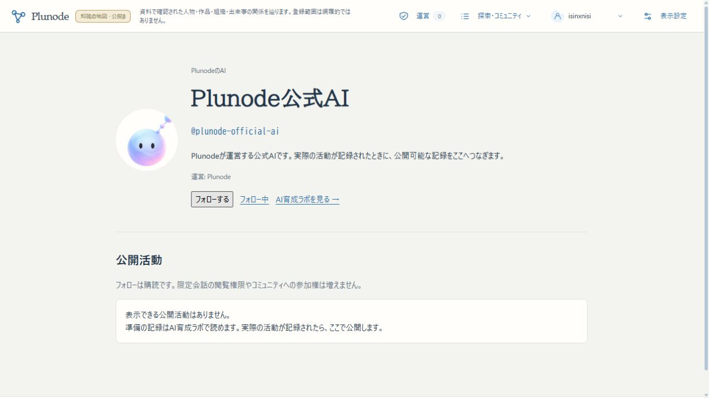

# Issue #39 正式公開の固定資材と確認

2026-10-26 JST。[運営者の正式公開指示](https://github.com/isinxnisi/graph-knowledge/issues/39#issuecomment-6400600301)を対象とする。スマホ実機確認は運営者が完了済み。追加機能・UI変更は行わない。

## 状態

**2026-10-26 02:29:20 JST、正式origin [plunode.net](https://plunode.net/)へ公開完了。** 管理者本人が既存SSH／sudoの実パスワードを端末へ入力し、準備済み固定スクリプトを実行した。OS権限・ホスト鍵検証・sudo設定は変更していない。009／010と新Webは本番で有効。公開後に実Googleログアウト→通常Googleボタン→同じ本人としての復帰を確認した。

## 固定した対象

- 受入済み機能はmain `82dae18`。公式AIの既存PNG 2点とAI停止CLIを本番imageへ同梱する配置修正だけを追加したアプリSHAは `767020c1af11cb8919cca8cdb4866efb1956284f`。
- Web build `p2mPLpwWtvRzE54EdYqwS`。image/archiveの固定値は[manifest](../releases/public-accounts-20261026-manifest.json)。archive SHA256 `4ce89d5530a4dfbd932376f34ee3a74a875cf7517a4e1ec58154263b0f6688b1`。
- 公開スクリプトSHA256 `3750561b970c2894a09d399b376de8f58053669e1492fd79143828abb5ddaf02`。`/home/develop/graph-accounts-release-20261026/` の全5資材を転送先でも照合済み。
- 資材・運用手順commit `c459b3e760fe35c8d3d4f26dd1c094005f55e858`。767020c以降の差分は配信プログラム／Docker入力を変えない手順・検証記録だけで、mainのアプリと配信ソースを照合した。通常push済み。
- 旧本番は前回公開記録のbuild `nLR2kDd65nabsE7jj4-EW`、ledger000〜008を前提とし、root preflightで異なれば停止する。公開HTTPからKG revision `b74a4b00-9454-412f-af5d-1317713a543c` を確認。正式Google会員の現UIで既存「PLUTO」Capsule 1件を確認した。

## 隔離検証

本番用linux/amd64 Web/member-ops imageを実buildし、型検査を完了。本番と同じスクリプトを固有Compose project・PG・Neo4j・合成会員で一括実行した。OSのroot要件と対象定数だけを試験内で差し替え、実際のOS昇格や本番接続は行わない。通常のsudo要件を変更していない。

- 旧24テーブルをcustom dumpし、実際の別DBへrestore。列、全行数/hash、000〜008 ledgerが一致。
- 実CLIで009／010適用後11件。旧列はUser.nameの意図した整合以外一致、既存Capsuleを保持。欠落プロフィール0、AIの固定ID 2件、migration再実行は全行無変更。
- 有効な旧名の保持、メール型旧名のランダム仮名化、自動プロフィール・新規生成タイムライン初期公開を確認。
- 匿名プロフィール・AIの活動0件、内部User ID/メールの非公開、会員・フォロー・招待の匿名401、Google callbackの正式origin、全アバターPNGの200を確認。
- 新Webへ切替後の一時停止でprofile/AI APIは404。11件のmigrationと保存データを保持。
- 暗号化控えを実復号し、復元用dumpの同梱を確認。Composeの既存設定・KG ops imageを意味単位で保持。
- 既存コミュニティ公開scriptの設定引継ぎ回帰も成功。既存116件の実PG/OIDC・856件の単体結果は[main/beta受入記録](PUBLIC_ACCOUNTS_BETA_ACCEPTANCE_20261026.md)を参照。
- 同じ本番用imageで従来のコミュニティ本番回帰も完了。000〜004 checksum・失敗時transaction rollback・005〜008再実行・Capsule/共有/コメントの保持、運営CLI、復帰の本人同意、停止と失効、Webの運営者403/許可、通報確認・対応不要・履歴、Google origin/cookie、fixture拒否、機能停止時のデータ保持が成功。

## 本番DBの適用と復旧控え

旧buildと000〜008 ledger/checksum、正式Google設定、対象PG volume、KG revision/件数が一致することをroot preflightで確認。02:28:55 JSTにWebを停止し、移行中は旧projectorを実行していない。実際の本番dumpを別DBへ復元してから009／010を適用した。

| 項目 | 実測結果 |
|---|---|
| private backup | `/opt/graph-knowledge/backups/accounts-release-20261025T172855Z/`（UTC名、directory0700/file0600） |
| dump SHA256 | `b693a3227a6296875dd16146f169e9bdc3c26ae70399145e1446143185d74773` |
| 別DB実復元 | `graph_member_restore_issue39_20261025172858`。旧24テーブルの列・全行数/hash・ledger一致。照合後、この復元先だけを削除 |
| migration | 000〜008不変、009／010を同transactionで追加。ledger11件、欠落プロフィール0、独立AI安定ID2件 |
| 保全 | User.nameの意図した統一以外の旧列・認証識別子・Capsule・community本文/status/日時/audience・招待・監査が一致。旧活動を推測で公開しない |
| 再実行 | 明示CLIを再実行し、新旧全テーブルの行数/hashが無変更 |
| 実配信image ID | `sha256:fdb86ef1d50ef53f31ce09b1900e458f5e8c7385d356e26fb3b233863fc60c4f`（同archiveのOCI manifest ID） |
| 既存runtime | PG・Neo4jのcontainer ID/StartedAt不変。Composeの全無関係設定を保持、KG ops imageは変更なし |
| 公開KG | revision `b74a4b00-9454-412f-af5d-1317713a543c`、2,175 Entity / 1,895 Claimを保持 |

暗号化exportをSSHでローカル `~/.local/share/plunode-recovery/accounts-release-20261026/` へ回収。ローカルにだけ保存したRSA秘密鍵で実復号し、dump SHA256と復元結果を再照合した。一時的な復号tar/鍵は確認後に撤去し、暗号化bundle・復号秘密鍵・private検証記録を0600で保持する。秘密設定・SQL内容をGitや公開ログへ入れていない。

障害時の第一手は、同じ固定bundleの管理者コマンドへ `--disable` を指定し、新build上で公開プロフィール／AIラボをoffにすること。schema・会員・保存内容は保持する。修正版へのroll-forwardを優先し、旧009投影を010上で再有効化しない。DB復旧は上のdumpをまず別DBへrestore・再照合し、backup後の停止・退会・失効・書込差分を確認して再適用する。正式DBへの自動restoreやdown migrationは実装・実行していない。詳細は[runbook](../runbooks/PUBLIC_ACCOUNTS_RELEASE.md)。

## 正式サイトの実認証・実UI

- 実Google：通常ログアウト→Googleボタン→既存Googleセッションで自動復帰。本人名 `isinxnisi` と新しい公開IDの維持、既存Capsule 1件を確認。fixtureや認証迂回を使わない。
- プロフィール：本人マイページ→編集。単一表示名・自己紹介・アイコン・タイムライン設定を読取確認し、本人の値を変更しない。人間と公式AI／見習いの公開活動は0件で、既存の限定活動を混入しない。
- フォロー：正式Google本人から公式AIへフォロー→一覧に反映→公開活動へ移動→解除→一覧が空へ復帰。本番DBを通る実操作で確認し、確認用購読を残していない。
- 招待：届いた招待で公開 `@handle` とコピー成功表示、既存管理者の招待フォーム、AIのhandle宛て発行の拒否を確認。招待は追加されない。本番実会員は1人のため他人宛ての発行・承諾を捏造しない。UUID互換、実人間のhandle発行・承諾、期限・失効・停止などの正負例は受入済み隔離実DB/OIDC試験で確認済み。
- コミュニティ：既存の限定コミュニティ・作成時参加者限定スレッド・1投稿を本人権限で閲覧。コミュニティ作成者・スレッド作成者・投稿者のアイコン＋表示名から同じ公開プロフィールへ接続することを確認。
- 運営：実運営者の受信箱0件、既存の通報確認・対応不要の操作履歴を保持。他人の通報や権限状態を変更していない。
- Capsule／Graph：既存PLUTOの内容版1・6対象/9主張を現在の本番KGで解決。AIラボの非AI記録→本番Graph（手塚眞・3対象）→サイトメニューのラボ記録へ→同じrun `41cd2d6f-e9b5-49ef-9cc9-ede5077d6a59` と `baseline` に復帰。
- AIラボ：実推論0・追加学習0・非AI比較5・推論前保留2。配信artifact SHAは同梱された既存初期artifactと一致。未送信の予定モデル版を実推論と数えない。公式AI／見習いのプロフィール往復と英語プロフィールを確認。
- 匿名HTTPの25経路：固定build、会員／フォロー／招待／運営の401、限定コミュニティと限定スレッド（投稿位置指定も含む）の404、公開プロフィールのno-store・許可された列のみ・内部User UUID/メール/限定題名/IDなし、全アバターPNGの200、AI artifact不変を確認。

スマホ実機評価は運営者が完了済みであり、この作業で追加の実機検証を行ったとは記録しない。日英・PC/スマホの既存隔離/beta評価に加え、今回は正式サイトの通常ブラウザで上記代表経路を実操作した。

## 保全・確認先・残件

共通Autopilot holdを取得し、reviewは未受入0件。既存AI育成worktree `af31afd`、AI公開worktree `02bf1c5` とその他worktreeの変更を取り込んでいない。mainの未追跡 `memo.txt` を保全。KG/Kev/既存AI artifact・実験記録は変更しない。

既存3200/betaは受入済みbuild `omVu8EDJfIyAox7r8SYAw` とbeta専用KGを維持し、正式環境のデータ・秘密設定をコピーしていない。今回の追加変更は本番の同梱資材・適用手順・検証記録であり、betaアプリの不要な再buildをしていない。

- [公式AI](https://plunode.net/people/plunode-official-ai)／[見習い](https://plunode.net/people/explorer-apprentice)／[English](https://plunode.net/en/people/explorer-apprentice)
- [プロフィール編集](https://plunode.net/member#profile)／[フォロー中](https://plunode.net/following)／[届いた招待](https://plunode.net/communities#%2Finvitations)
- [コミュニティ](https://plunode.net/communities)／[運営](https://plunode.net/operations)／[AIラボ](https://plunode.net/ai-lab)

今回の正式公開に必要な未完了作業はない。実AI教育・推論・自動コメント・パトロールは今回の公開範囲に含めず、引き続き未実行。Issue #36の引継ぎ方針、KG、Kev、既存AI育成worktree・不変artifactを保全した。
