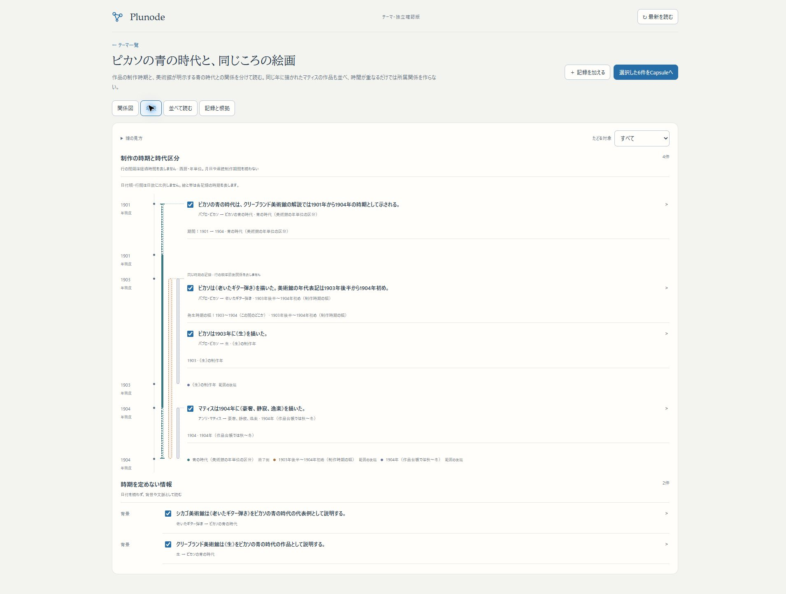

# Issue #75：期間を主年表に描く確認版

2026-11-01。期間の入力と保存に続き、期間そのものが出来事の複数行をまたぐグラフ描画を追加した。独立worktree／localhost:3276の確認版。

## 触れる場所

- [青の時代と同じころの絵画](http://localhost:3276/themes/picasso-blue-period)で「年表」を選ぶ。青の時代の期間線と、作品制作の時期の幅、同時期の別作者の出来事が同じ軸に並ぶ。
- 線を選ぶと元記録が開く。作品の行を開閉すると、途中をまたぐ期間線が伸縮する。チェックはCapsuleへ含める選択で、読む操作とは別。
- [曖昧な境界の操作例](http://localhost:3276/themes/temporal-boundaries-example)では、開始・終了の候補幅が離れたAと、重なったB、発生時期の幅だけのCを比べられる。すべて架空。
- [保存済みCapsule](http://localhost:3276/themes/capsules/9ad27bb1-af81-4b8f-bd43-cf47c506c75c)と[共有版](http://localhost:3276/themes/shared/Qtg8d2ezMBKz68Kfw8kK0ECSNESXLt_n)でも「年表」で同じ描画を使う。

## 変わった体験

前段の行内の小さい期間線・別枠の横比較を、暦日の主年表の期間レーンへ置き換えた。期間の開始・終了、途中の出来事、曖昧な境界を共通行に置く。重なる期間には別レーンを使い、同時期であることから所属関係や因果を生成しない。

期間は両端付きの線で、候補端は点線、確かな中央部分は実線。発生時期の幅は破線の帯、年・月精度の時点は精度の帯。開始候補と終了候補が重なった場合、確かな中央線を描かない。短い同日の期間も、時点や発生幅と同じ意味へ変えない。

CSS Gridの共有行を線と記録で使うため、根拠や子軸を開いた後も線の端が同じ時期に付く。DOMを測って後から線を移動する方式は使わず、時間値・精度・Capsule断面は保存済みのまま。今回はDB・API・会員認証・KGの変更なし。

## 確認済み

- geometry／年表／時期フォーム／ThemeWorkbench／Capsule／GraphCanvas、10ファイル133件成功。旧横比較のテストを主年表の描画・座標テストへ更新した。
- 範囲の重複時に別レーン、非重複時に再利用、間の出来事をまたぐ行配置、交差する境界、異なる日付精度、西暦0004の閏日、元データ非変更を検証。
- UIで線の種類・選択から行展開・Capsule選択の独立・明示した子軸・断面外の記録を取得しないことを確認。
- Chromeの実画面で、青の時代の期間線は閉じた行で約620px、途中の作品行を開くと約899pxへ伸長。時期を訂正せず、内容の展開に追従した。
- Chromeの390×844相当幅で年表と行の開閉を確認。ページ全体の横はみ出しなし（document幅380、viewport390）。一時幅指定は終了時に解除。
- 架空Bは同じ年表のA・Cと独立した線・帯として表示。候補幅が交差したBの中央を実線にせず、Aの確かな区間だけを実線にした。

最終build `hJLUrIcN9k6ptvwS31umn` を3276で起動。変更TS/TSXのESLint、型検査を含むwebpack buildも成功。保存済みCapsuleと共有版で4件の時期線を確認。共有版は編集・訂正操作を出さず、期間線から元記録と根拠を開けることを実操作で確認した。

[390px幅の実画面](assets/issue75-period-graph-mobile.png)。一時的なviewport指定は解除済み。

## 制約と再開

今回は暦日の描画。日付順の出来事配置で、縦の長さは日数比例ではない。同年・同日の複数記録の順序も厳密な前後を意味しない。年・月精度の位置決めに使う補完日は表示・保存しない。

多数の同時期の線は、隠す代わりに年表内を横スクロールする。周期・定性軸の期間レーン、多軸の比較、年表の連結、時間ズームなどは未実装。iPhone実機は未確認。main／3200／HTTPS β／本番へは未統合。

再開は独立worktreeで `python3 scripts/issue75-preview.py start`。起動・停止・buildの詳しい手順は[前段の確認記録](THEME_TEMPORAL_MEANING_20261101.md#起動再開)を参照。既存データを保持し、今回DBへの登録・訂正・削除は実行していない。作業ブランチは `codex/issue75-theme-foundation`。
