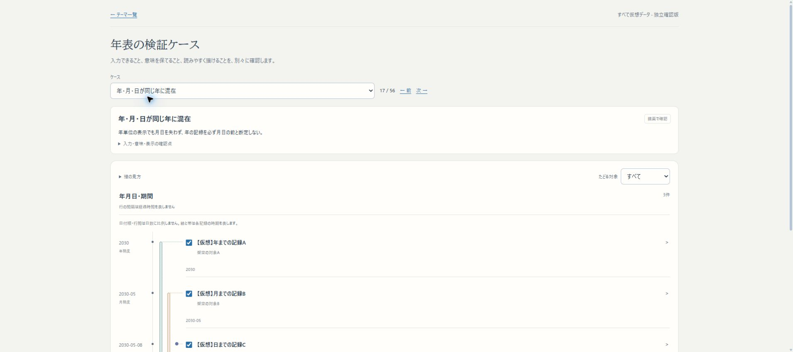

# Issue #75：仮想の時間表現56ケース

追補：表示単位と接続の更新後は60ケース・描画44／仕様不足9／拒否7。点化の条件や現在のbuildは[最新検証](THEME_TEMPORAL_PROJECTION_20261101.md)を参照。以下はケース集を最初に追加した時点の記録。

2026-11-01。実テーマの少数例では時間表現の組合せと仕様不足が分かりにくいため、同じ入力検証・描画を使うケース集を追加した。時間モデルの新機能をすべて実装した工程ではない。

## 確認先と使い方

[年表の検証ケース](http://localhost:3276/themes/patterns?case=precision-mixed)の「ケース」または前／次で切り替える。閲覧・線の選択・行展開はDBへ保存しない。

特に次のケースで、前段の質問を確認できる。

- [年・月・日の混在](http://localhost:3276/themes/patterns?case=precision-mixed)：年月日を同じ暦軸へ置く現在の表示。
- [比較相手のない曖昧な発生幅](http://localhost:3276/themes/patterns?case=window-empty)：自動で点へまとめる設定が未実装であることを明示。
- [ラベルだけの前期](http://localhost:3276/themes/patterns?case=first-half-label)：入力の受理と、時間上の意味を扱えることが違う例。
- [区切りを明示した前期](http://localhost:3276/themes/patterns?case=first-half-defined)：前期を一律1〜6月とせず、架空制度の4〜9月という明示した範囲を使う。
- [時刻](http://localhost:3276/themes/patterns?case=hour)：未対応の暦日時刻を別の日付へ置換して描かない。
- [12本の並行期間](http://localhost:3276/themes/patterns?case=dense-overlap)：多数の線と狭い画面のスクロール。

「原本の仮想データJSON」と期待する振る舞いも確認できる。「確認範囲と未対応を見る」から[全ケースJSON](../../public/theme-examples/temporal-patterns.json)を保存できる。通常の入力可能なケースは、選択した記録を新しいテーマへ保存し、既存の関係図・Capsuleへ進める。

## 確認範囲

- 56ケース：描画で確認38、仕様不足11、不正入力の拒否7。
- 期間の13関係を独立した端点条件で照合。精度、候補幅、期間境界、所属、周期・定性・子軸、密集、不正値を含む。[有限の網羅範囲](../design/THEME_TEMPORAL_CASES.md)を参照。
- 機械検証は[JSON記録](../research/issue75-themes/temporal-patterns-verification.json)。schema受理の一致、座標の整合、元データ保持、関係を増やさないことを確認。仕様不足の解消や見やすさの受入を成功件数へ含めない。
- ケース定義・画面・既存ThemeWorkbench・年表UIの4ファイル77テスト、対象ESLintを確認。部分選択の通常importと、親を選ばず子軸だけを保存した場合の参照整理も検証。
- Chrome実ブラウザで全56ケースを選択し、各ケースの見出し・表示区分・エラー表示の有無・描画数を一巡した。全ケースの人間による可読性評価が済んだという意味ではない。
- 時刻ケースが代用グラフを出さず保存不可であることを実操作で確認。密集ケースは12本を保持し、390px幅でページ幅380／年表内content幅402・表示幅330となり、年表内だけが横スクロールすることを確認。

最終build `5hYtBaiW9yf3pVmNjr5by` を3276で起動。対象ESLintと型検査を含むNext.js webpack build成功。最終buildでも全56ケースの巡回を実施し、38／11／7の区分と警告なしを確認した。[実ブラウザ巡回](../research/issue75-themes/temporal-patterns-browser.json)。

## 維持した境界

既存の7テーマ・7Capsuleを保全するため、通常保存の確認前に専用DBをprivate dumpへ保存。検証ケースはそれぞれ新IDで保存し、既存の固定テーマを上書きしない。会員DB・KG・mainのmemo.txtを変更しない。

localhost:3276の独立worktreeだけに反映する。main・3200・HTTPS β・本番へは未統合。起動・再開は同worktreeで `python3 scripts/issue75-preview.py start`。再buildは `stop` → `build` → `start`。

時刻、前期後期の意味定義、親時代内の相対的区分、離れた複数候補、表示粒度・自動点化・表示除外は今回の仕様不足として残る。ケース集を用意したことを、これらの実装完了とはしない。iPhone実機の確認も未実施。

## 通常保存の実操作と保全

- 精度混在ケースを新しい[仮想テーマ](http://localhost:3276/themes/pattern-precision-mixed-46f82d1c)へ通常importした。そこから[Capsule](http://localhost:3276/themes/capsules/a9769835-46d7-4a83-9416-902f296a5d63)を作り、[ローカル共有版](http://localhost:3276/themes/shared/TFm9ytE5c_crVWBrPW7OIzKHjZ1B2M-4)でも年表の3記録を確認した。DBのsnapshotで元の年・月・日の文字列を照合済み。
- 子軸のケースでは親のチェックを外し、子だけを[新テーマ](http://localhost:3276/themes/pattern-explicit-inset-239bc3f6)へ保存。不要な親参照を除き、2030-05-08という原点説明が残ることをブラウザとDBで確認。
- ケース集のチェックの読み上げ名は「テーマに保存する」とし、通常ThemeWorkbenchの「Capsuleに含める」は維持した。
- [保持検証](../research/issue75-themes/temporal-patterns-preservation.json)で既存7テーマ・7Capsuleの内容hash一致を確認。試験で新規作成した2テーマ・1Capsuleは仮想であることを明示して残した。既存内容の削除・上書きなし。
- 最終buildのスマホ相当幅390でもページのscrollWidth380を確認。一時的なviewport指定は解除済み。

[スマホ幅](assets/issue75-temporal-patterns-mobile.png)／[未対応の時刻の表示](assets/issue75-temporal-patterns-gap.png)。

作業ブランチは `codex/issue75-theme-foundation`。知識申請・審査・本線受入は準備中のまま。Autopilot候補の一括受入や確認済み処理は行わない。
