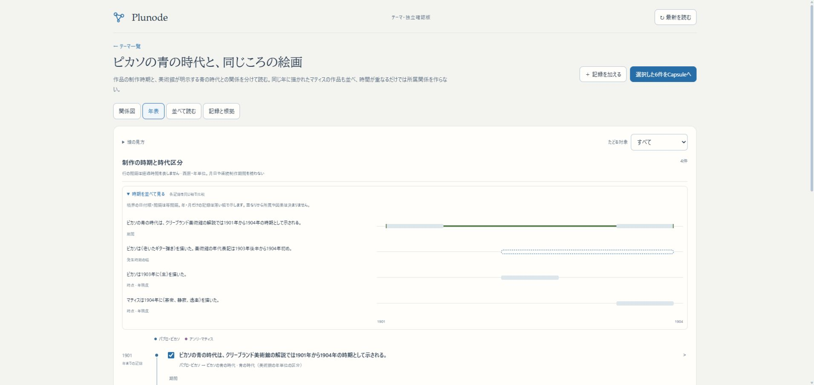

# Issue #75：期間・発生時期の幅・境界の不確かさ

2026-11-01。ユーザーの「その実装を進めて一度確認したい」という指示への独立確認版。main／localhost:3200／HTTPS β／本番へ統合しない。

## 確認先

- [青の時代と同じころの絵画](http://localhost:3276/themes/picasso-blue-period)：年表を選び「時期を並べて見る」を開く。青の時代、制作時期の幅、同じころの別作者の作品を独立した行として比較する。
- [境界が曖昧な期間の操作例](http://localhost:3276/themes/temporal-boundaries-example)：すべて架空。Aは開始・終了の幅が離れ、Bは幅が重なり、Cは発生時期の幅だけ。行を開いて「記録を訂正」で入力を試せる。
- [青の時代の保存Capsule](http://localhost:3276/themes/capsules/9ad27bb1-af81-4b8f-bd43-cf47c506c75c)／[保存版の共有](http://localhost:3276/themes/shared/Qtg8d2ezMBKz68Kfw8kK0ECSNESXLt_n)。このPC限定の確認用URL。
- [架空操作例の保存Capsule](http://localhost:3276/themes/capsules/60d63560-1501-4096-9fc9-5c3b2edf7af6)／[保存版の共有](http://localhost:3276/themes/shared/O3KWyu4kaT8aX12PveJFvIIyZkmQTiB7)。ブラウザで時期表記を訂正し、差分取込・同URL反映済みの保存版2。

## 起動・再開

開発PCのPowerShellから次を実行する。3276が稼働済みなら起動は不要。

```powershell
wsl -d Ubuntu --cd /home/isinxnisi/1.projects/.worktrees/graph-issue75-theme-foundation -- python3 scripts/issue75-preview.py status
wsl -d Ubuntu --cd /home/isinxnisi/1.projects/.worktrees/graph-issue75-theme-foundation -- python3 scripts/issue75-preview.py start
```

ソース変更後の再構築は同じ場所の `stop` → `build` → `start`。専用DBコンテナ／volumeを保持し、mainの認証・KG設定や既存確認環境を読み込まない。ローカル共有をインターネット向けの認可付き共有とみなさない。

## 完成範囲

暦日入力に時点・継続期間・発生時期の候補幅を追加。継続期間だけ、開始最遅／終了最早を入力できる。元資料の年・月の精度と原表現、主張自体の肯否は別々に保持する。旧from/toは未区別のまま保持する。

年表の点／線／候補幅と、初期閉じの比較帯で読み分ける。同じ軸へ並べることと意味上の所属は別。青の時代の作品分類は美術館が明記した関係を通常の記録として入力し、時間の重複から関係を作らない。

検索、Graphの補足、記録の訂正、Capsuleの断面保存・選択取込・明示共有で新しい時間値を保つ。今回の専用DBはJSON原本の追加属性を使うため、DB migrationや既存内容の一括書換えは行わない。

## 検証

- domain／年表UI／時期フォーム／ThemeWorkbench／CapsuleStudio／GraphCanvas／CapsuleDocument、9ファイル131件成功。
- [HTTP検証記録](../research/issue75-themes/temporal-http-verification.json)：21項目成功。意味・境界値の保存、検索、意味だけ／境界だけの内容訂正、選択取込、共有版の維持、同URLの明示更新、共有停止を確認。
- テスト専用テーマ `time-meaning-check-15c2aed882` とCapsule `f3ec3509-d023-41a4-93f3-422038599d7c` は独立したIDで保存。共有は停止済み。既存テーマをテスト用に変更しない。
- 実ブラウザで実テーマ6記録と架空3記録を通常の「入力例→内容確認→登録」から取り込んだ。専用の登録コード・分類ENUMは追加していない。
- 実ブラウザで各テーマをCapsuleへ保存・共有し、架空Bの時期表記を訂正。4境界の日付を保持したまま差分表示→選択取込→保存版2を同URLへ共有した。
- 開始・終了幅が交差するケースを受理し、確実な中央期間を描かない。年と年月の混在で負幅になる問題を独立レビューで検出し、表示専用の精度範囲を用いて修正。内部の補完日付を元記録・ラベルへ書き戻さない。西暦0004の閏日も回帰検証。
- 作業開始前の専用DBをprivate dumpへ保存。既存4テーマ・4Capsuleの内容hashが作業後も一致することを確認。mainの未追跡memo.txtを含め、並行作業を変更しない。

最終build `uBKzSXsNV13MotPMgTcHy`（この記録と同じ作業コミットの実装）を3276で起動。変更したTS/TSXのESLint、型検査を含むNext.js webpack buildも成功。

## 登録負担と判断の補完

実テーマは6対象・6記録、架空操作例は3対象・3記録。完成済み入力例は開く・内容確認・登録の3操作で取り込めた。調査・文章化・対象同定・制作と分類の分割はエージェントが人の編集に相当する作業として補い、自動抽出による無人登録とは扱わない。操作を他の検証と交互に行ったため、登録時間の独立した実測値は出していない。

出典と、1903年後半を7月1日などへ数値化しなかった判断は[出典・編集判断](../research/issue75-themes/PICASSO_TIMELINE_EVIDENCE.md)に記録した。青の時代自体の境界の不確かさを支持する四つの数値は資料にないため、数値を捏造せず架空テーマへ分離した。

## 残る範囲

今回の追加は暦日。周期・定性軸に同じ境界モデルを自動適用しない。1記録1時間値・1軸、入れ子は明示設定の最大3段。比較帯は日付順の配置で、日数比例の尺度ではない。時間の対応付け、多軸の重ね合わせ、複数の発生時期、確率分布、無限端・開区間などは未実装。既存のIssue #75の未統合範囲は維持し、知識申請・本線KGへのマージは準備中。

iPhone実機での表示・キーボード挙動は未確認。既存のGoogle認証、OGP、コミュニティへの正式統合は、このlocalhost専用初版には含めない。

## 最終実画面確認

- ChromeのPC幅と390×844のスマホ相当幅で、年表・比較帯・入力フォームを確認。横はみ出しなし（viewport 390、document scrollWidth 380）。一時的な画面幅指定は解除済み。
- スマホ幅の比較欄で長い記録名の先頭が切れる問題を修正。左揃え・2行表示にして再確認した。
- 期間→発生時期の幅→期間と入力を切り替え、4境界の日付が保持されることを実ブラウザで確認。変更を保存せず閉じる操作も確認。
- 年表からマティスの記録を選び「関係図で見る」で同じ作業面に図を表示。マティスと作品の関係が選択・表示され、青の時代への自動関係がないことを確認した。非表示Graphで保留したfocusが表示時に反映される経路も通した。
- 実Googleログイン・iPhone実機検証は行っていない。ローカル共有版は検証用で、インターネット公開ではない。



[スマホ幅の比較](assets/issue75-temporal-picasso-mobile.png)／[スマホ幅の入力](assets/issue75-temporal-input-mobile.png)／[同じ作業面の関係図](assets/issue75-temporal-related-graph.png)

既存内容の照合値は[保持検証記録](../research/issue75-themes/temporal-data-preservation.json)を参照。private dumpはリポジトリへ含めない。作業ブランチは `codex/issue75-theme-foundation`。この作業に無関係なAutopilot候補の取り込み・確認済み処理は行わない。
