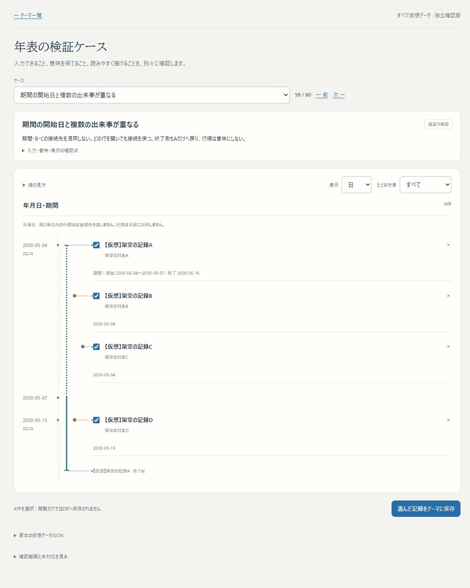

# Issue #75：表示単位と、点・期間から記録への接続

2026-11-01。ユーザーの「年表示なら1991年の出来事と1991年のどこかを、ともに点として読める方が自然」「上下の優先ではなく、どの点・期間につながる情報かが本題」という明確化に対応した。独立worktree・localhost:3276の改善であり、main・3200・HTTPS β・本番へは未統合。

## 確認先と短い手順

- [1991年の出来事と、1991年のどこか](http://localhost:3276/themes/patterns?case=year-point-and-window)：自動は年表示。二つの点を確認し、「表示」を日に変えると元の年内の候補範囲になる。原本の日付・意味は変更しない。
- [同日開始と複数の出来事](http://localhost:3276/themes/patterns?case=shared-start-anchors)：Aの期間線と、B・Cの点から各見出しへの線をたどる。Bを開いてもCやAの終了側への接続がずれない。終了側の名前を押すとAを開く。上下の順序は前後関係にしない。
- [同月の発生候補幅と実期間](http://localhost:3276/themes/patterns?case=month-window-and-duration)：月表示で、Aは丸い点、Bは短い両端付きの期間。日表示に戻すとそれぞれの幅を見られる。
- [年をまたぐ候補幅](http://localhost:3276/themes/patterns?case=year-crossing-window)：年表示でも幅を残す。他の出来事がないことを点化の条件にしない。
- [不確かな期間境界](http://localhost:3276/themes/patterns?case=boundaries-overlap)：囲う破線枠を重ねず、一本の中央点線にする。両端候補が重なる場合に確かな中央区間を作らない。

起動は独立worktree `/home/isinxnisi/1.projects/.worktrees/graph-issue75-theme-foundation` で `python3 scripts/issue75-preview.py start`。再buildは同スクリプトの `stop` → `build` → `start`。専用DBと既存データを保持し、初期化しない。

## 設計と完成範囲

- 表示単位は自動／年／月／日。保存精度とは独立する。自動は渡された断面で最も細かい元の日付精度を使う。選択した単位に収まる時点・候補幅は点にまとめ、期間は期間記号として残す。
- 日付ごとに複数カードをまとめて一本の接続先へ置いていた旧構造を、記録と終端ごとの共通Grid行へ変更。各線は自分の見出し・終端名へつながる。同じ日付の括りも残す。
- 不確かな境界は一本の中央点線、確かな区間は実線。全体の点線枠と端部の点線を二重に描いていたスタイルを除いた。発生候補幅は丸い端の破線とし、期間の両端記号と区別する。
- 表示を変えても原記録、内容版、選択、明示した所属、Capsuleの保存済み断面を変更しない。日付を細かい値へ補って保存しない。読んでいる断面外の記録を取りに行かない。
- 時刻・timezone、意味定義のない前期後期、離れた複数候補、比例時間軸、記録の表示除外は未実装。表示単位の追加を、時間モデル全体の完成とは扱わない。

## 検証

- 仮想60ケース：描画44／仕様不足9／拒否7。四つの表示設定すべてでschema受理・座標・元データ保持・接続先を検証。13種の期間関係は継続して独立端点条件で照合。
- 関連9ファイル118テスト成功。元の日付・選択・focusを変えない表示切替、同日ごとの接続、終端からの元記録展開、交差する不確かな端部の単一描画、既存の訂正・Capsule断面・子軸を含む。
- 対象ESLint成功。型検査を含むNext.js webpack build成功。最終build `1dGUbnTFnrVPcyICSFSU0` を3276で起動。

- Chrome実ブラウザで60ケースを一巡し、暦のケースは四つの表示設定、暦以外・未対応・拒否は該当表示で確認。計192画面、接続線が対応する見出し範囲から外れるもの0、390px幅でページ全体の横はみ出し0。[実ブラウザ記録](../research/issue75-themes/temporal-projection-browser.json)。全192画面の人間による可読性受入を意味するものではない。
- PC幅では同日開始のA期間・B/C点・D終了日点の個別接続を目視。B行を開き、終了側からA行を開いた後も全5接続が各見出し内に保たれた。
- 期間の両端候補が交差するケースで、外周の四辺はすべて0px、中央の不確かな線は一つ、確かな区間なしを確認。ブラウザのwarn/error記録なし。
- 既存の[保存済み精度混在Capsule](http://localhost:3276/themes/capsules/a9769835-46d7-4a83-9416-902f296a5d63)と[ローカル共有版](http://localhost:3276/themes/shared/TFm9ytE5c_crVWBrPW7OIzKHjZ1B2M-4)でも切替を実操作。年表示は3点、日表示は年・月の候補幅と日付の点。元の2030／2030-05／2030-05-08を保持し、共有版に編集ボタンなし。
- [DB保持結果](../research/issue75-themes/temporal-projection-preservation.json)：既存9テーマ・8Capsuleと共有状態を含むstate全体のhash一致。表示確認では新規保存・既存更新・DB移行を行わない。mainのmemo.txtも保持。
- iPhone実機は未確認。390pxのレスポンシブ幅とPC Chromeで確認した。一時的なviewport指定は解除済み。

[年表示のスマホ幅](assets/issue75-temporal-projection-mobile.png)／[不確かな期間境界の単一線](assets/issue75-temporal-projection-uncertain.png)。

作業ブランチは `codex/issue75-theme-foundation`。日本語commit・設定済みupstreamへの通常pushを行う。Autopilotの共通holdは検証・commit・push中に保持し、終了時に解放する。自動開発候補の一括受入や確認済み化は行わない。知識申請・審査・本線受入は準備中のまま。
