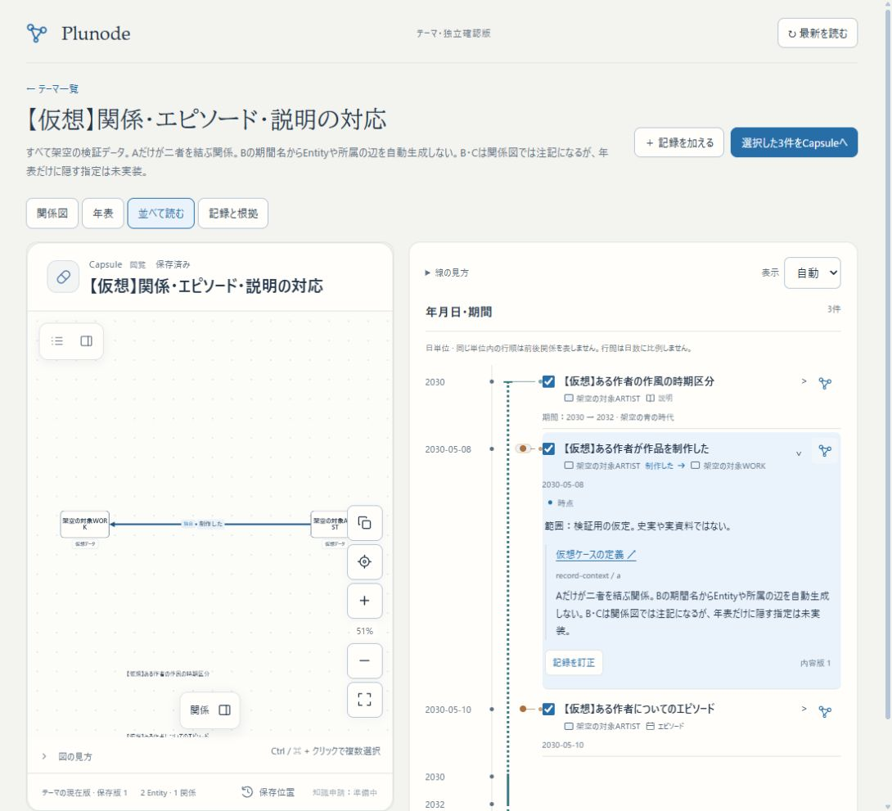

# Issue #75：年表の密度と関係図への対応

2026-11-01。ユーザーの「不要な空きを詰める」「年表の関係情報と関係図の対象・辺の対応が分かるようにする」「期間名をEntityにする必要があるかを整理する」という指摘への対応。作業ブランチと3276だけで進め、main・3200・HTTPS β・本番には未統合。

## 確認先

[関係・エピソード・説明の登録済み例](http://localhost:3276/themes/pattern-record-context-0dc833bc)を開き、「年表」を選ぶ。各行の対象・情報種別を読み、関係行の右端にある関係図アイコンを押すと、該当する辺が選ばれた並列表示になる。読む操作やCapsuleの選択チェックとは別の入口。

[同じ例の仮想ケース](http://localhost:3276/themes/patterns?case=record-context)は閲覧だけならDBへ保存しない。[密度を比較したケース](http://localhost:3276/themes/patterns?case=shared-start-anchors)も継続して使える。

起動・再開は `/home/isinxnisi/1.projects/.worktrees/graph-issue75-theme-foundation` で `python3 scripts/issue75-preview.py start`。再buildは `stop` → `build` → `start`。専用DBをresetせず継続する。最終build `GYW1MMgYuNfRHFSdBseGW`。

## 変更と評価

- 短い記録の上下padding、補足日付のmargin、空の境界行の最小高を詰めた。本文の文字サイズは維持。点・期間・接続線の基準位置も合わせた。
- 1100px幅の同じ仮想ケースで実測した行高は118.09px→83.09px、グラフ全体は576.38px→404.38px。約30%の高さ削減。長い記録まで一律に同率で縮むという推定ではない。[計測と実操作記録](../research/issue75-themes/timeline-context-browser.json)。
- 関係行は原記録の対象名・具体的な関係名・方向・相手名を、閉じた行でも表示。対象の初期分類に対応する小さな丸／角丸のマークを置く。否定・推測は省略しない。episode/noteには二者間の矢印を付けない。
- 関係図への操作を行の右端へ移し、展開して探す手数を減らした。Capsuleでその関係・注記が削除済みなら入口を出さない。
- 時間表現については、点、継続期間、発生候補幅、境界の不確かさ、表示単位、重なり、明示子軸までの最小の描画を評価できる。全ての時間モデルや表示先の整理まで完成したという判断にはしない。

## 期間とEntityの区別

年表は「記録」を時間に沿って読む。関係図は「対象」と「明示関係」を読む。元の記録IDで対応する。

- 現行 `relation` はsubject/objectを持つ関係の辺。
- 現行 `episode/note` はsubjectについての情報。関係の辺ではなく、今は関係図にも説明・テキスト注記として投影する。
- 「青の時代」が期間名として必要なだけなら、ピカソをsubjectにする説明記録のtime/labelとして保持でき、期間名そのもののEntityは不要。
- 作品の分類先として「青の時代に属する」を明示参照したいなら、その対象をEntityにする意味がある。現在の実資料サンプルが青の時代のEntityを持つのは、美術館が明示する作品分類の参照先にも使うため。時間の包含からその分類を推論したものではない。

**残る制約**：年表専用で関係図へ一切出さない指定は未実装。意味上の種類とは別に表示先を持つ整理が必要。対象を持たない全体注記も現行入力では未対応。今回の関係マークは原記録を表し、Capsule作者が独自変更した名前・形・関係端点と完全に外見一致する表示ではない。Entityクリックから曖昧な一記録を勝手に選ぶ双方向操作も追加していない。[設計の責務と残件](../design/THEME_TIMELINE_PREVIEW.md#記録関係図年表の責務密度と対応表示の追補)。

## 検証

- 関連4ファイル87テスト成功。具体的な関係名・対象ID・方向、否定の保持、行を開かない関係図操作、選択と読むfocusの分離、補足情報に辺を作らないこと、Capsuleで取り除かれた要素への入口非表示を含む。対象ESLintと型検査込みNext.js webpack build成功。
- 仮想ケースは61件（描画45／仕様不足9／拒否7）。新しい例はrelation・note・episodeの3件。61件の共通入力・四つの表示設定の座標検証を再生成した。
- Chromeの390px幅で全61ケースを一巡。接続先が見出し範囲から外れるもの0、ページ全体の横はみ出し0、関係行と矢印表示の件数不一致0。全ケースの人間による可読性受入を意味しない。
- 新しい例を通常フォームと同じimport経路へ実UIから通し、新IDで保存。関係図の2 Entity・1関係、年表の3記録、期間名が新たなEntityや辺を作らないこと、右端アイコンから対応辺を選択した並列表示へ進むことを確認。
- iPhone実機は未確認。スマホ相当幅とPC Chromeで確認。一時的なviewport設定は解除した。

## 保全と反映範囲

実操作前に専用DBをprivate dumpへ保存。既存9テーマ・8Capsuleの各hashと共有状態のhashが前後一致し、新しい仮想テーマ1件だけを追加した。現在10テーマ・8Capsule。[保全記録](../research/issue75-themes/timeline-context-preservation.json)。DB migrationなし。会員DB・KG・既存共有・mainのmemo.txtは変更しない。

`codex/issue75-theme-foundation` に日本語commit・設定upstreamへの通常pushを行う。Autopilot共通holdは検証・commit・push中に保持し、終了時に解放する。無関係な自動候補の受入・一括確認済み化は行わない。知識申請・審査・本線受入は準備中。

[スマホ幅](assets/issue75-timeline-context-mobile.png)／[密度改善](assets/issue75-timeline-density.png)。
